<p align="center">
  <picture>
    <source media="(prefers-color-scheme: dark)" srcset="docs/images/logo-dark.svg">
    
  </picture>
</p>

<p align="center"><b>Dein eigener Streamingdienst für Freunde und Familie – auf Basis der Jellyfin-Bibliothek, die du schon hast.</b></p>

<p align="center">
  <a href="README.md">English</a> · <a href="README.de.md">Deutsch</a>
  <br><br>
  <a href="https://github.com/LetsManu/friendflix/actions/workflows/ci.yml"></a>
  
  
</p>

<p align="center">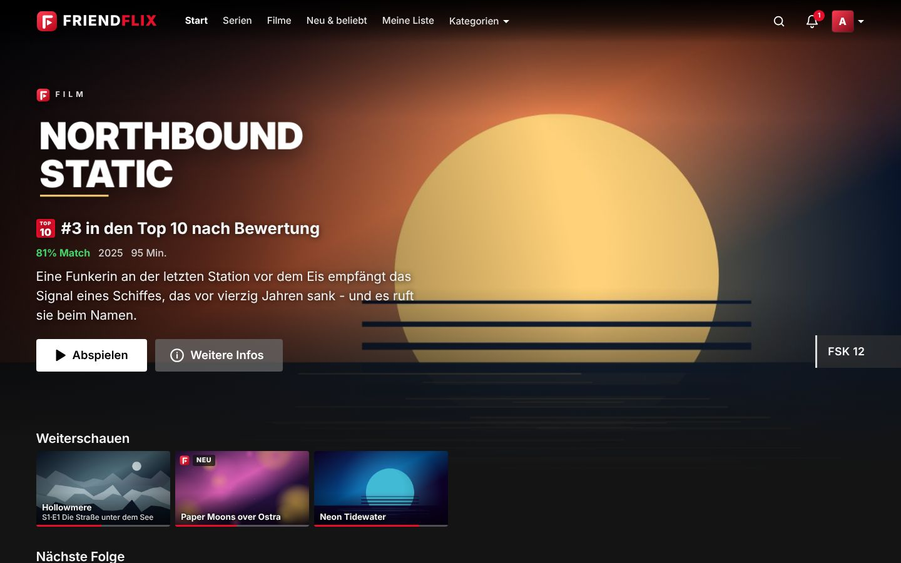</p>

FriendFlix ist ein privates Streaming-Portal vor **Jellyfin** (deine Medien) und **Seerr** (Wünsche). Deine Freunde bekommen ein schickes, vertrautes Streaming-Erlebnis auf Laptop, Handy und Fernseher – mit Profilen, Downloads, Watch-Partys und Empfehlungen untereinander. Jellyfin und Seerr sehen sie nie direkt, und du bestimmst, wer hineinkommt.

> Alle Titel und Bilder in diesen Screenshots sind erfunden und für die Demo generiert.

## Inhalt

- [Das bekommst du](#das-bekommst-du)
- [Gemacht für Freunde und Familie](#gemacht-für-freunde-und-familie)
- [Datenschutz und Sicherheit](#datenschutz-und-sicherheit)
- [Für Admins: Einrichtung und Betrieb](#für-admins-einrichtung-und-betrieb)

## Das bekommst du

### Eine Startseite wie bei einem echten Streamingdienst

Ein großes Billboard mit Titel-Logo, darunter Reihen wie *Weiterschauen*, *Nächste Folge*, *Von Freunden empfohlen*, *Freunde haben bewertet*, *Diese Woche bei uns*, *Weil du … gesehen hast*, *Top 10* und *Meine Liste*. Fährst du mit der Maus über eine Karte, klappt sie mit den wichtigsten Aktionen auf: abspielen, auf die Liste, bewerten, mehr Infos.

<p align="center">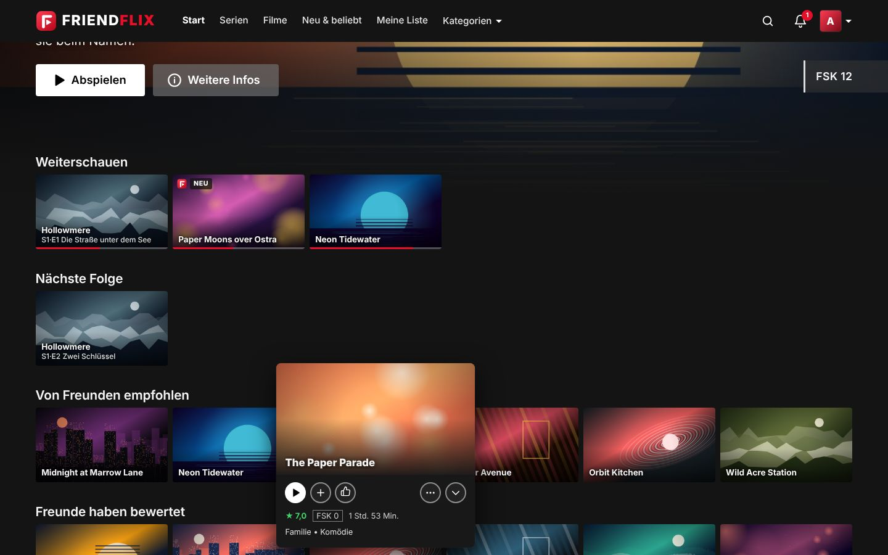</p>

### Alles zu einem Titel an einem Ort

Die Detailansicht zeigt Beschreibung, Ton- und Untertitelsprachen, Besetzung, welche Freunde den Titel empfohlen oder gesehen haben und – bei Serien – alle Staffeln und Folgen mit Fortschrittsbalken. Weiterschauen genau dort, wo du aufgehört hast.

<table>
  <tr>
    <td>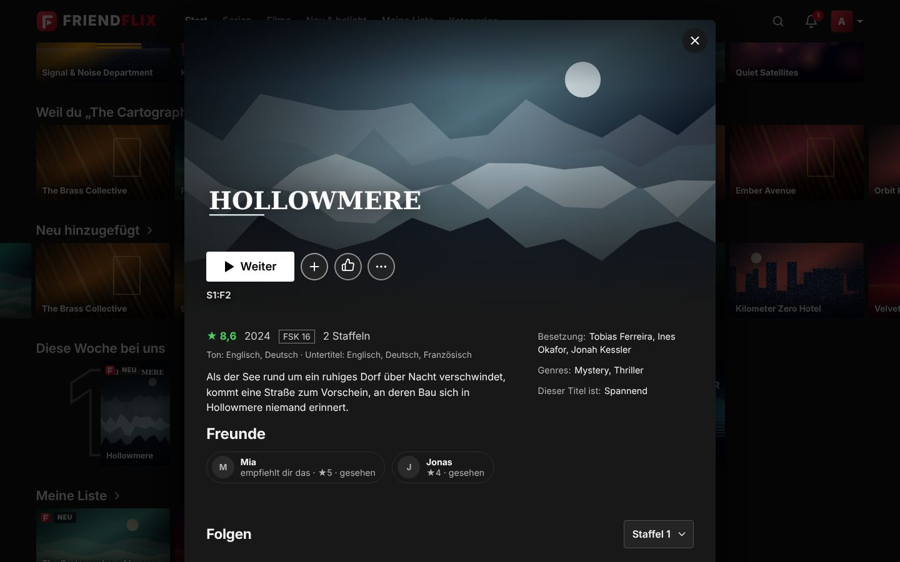</td>
    <td>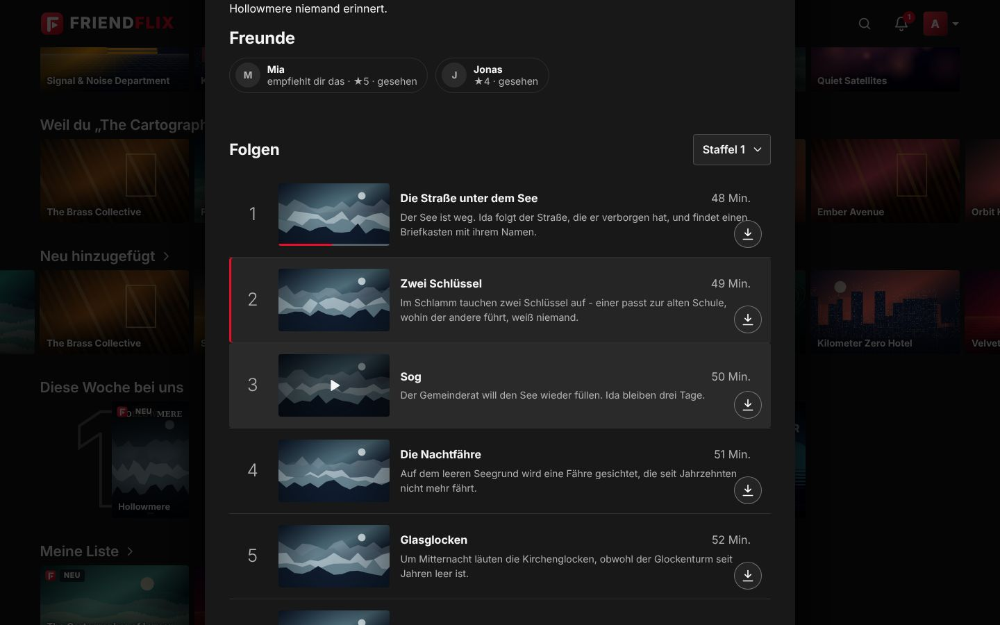</td>
  </tr>
</table>

### Ein Player für Serienabende

Intro überspringen, nächste Folge mit Countdown, Tonspur und Untertitel (mit eigenem Untertitel-Stil), Wiedergabegeschwindigkeit, Lesezeichen, Tastenkürzel und „Schaust du noch?“ nach mehreren automatisch gestarteten Folgen. Direct Play, wenn möglich, sonst adaptives Streaming (HLS).

<p align="center">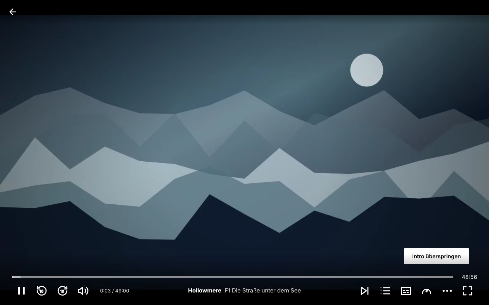</p>

### „Wer schaut gerade?“

Bis zu fünf Profile pro Konto, jedes mit eigenem Verlauf, eigener Liste, Favoriten, Sprache und Wiedergabe-Einstellungen. Profile lassen sich mit einer 4-stelligen PIN sperren.

<p align="center">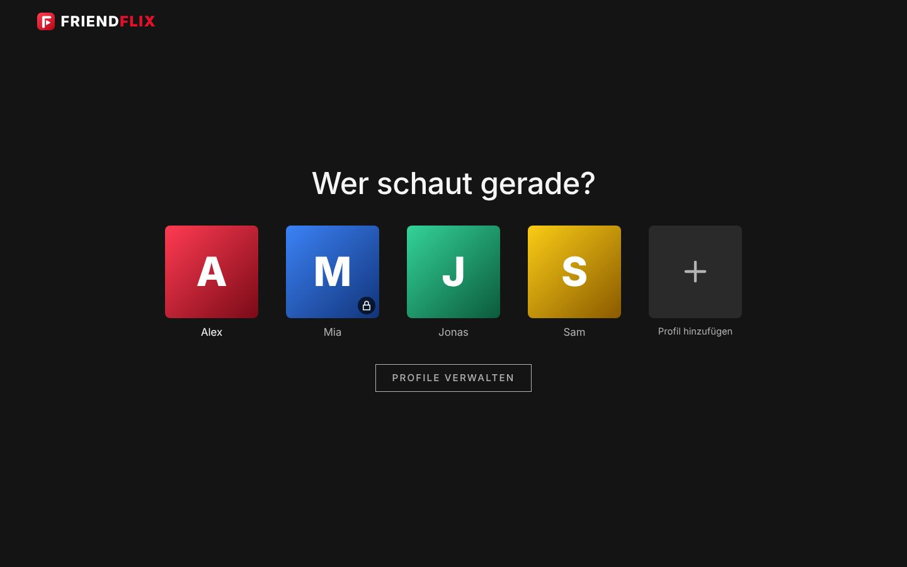</p>

### Stark auf dem Handy

App-artige Oberfläche mit Tab-Leiste unten, einer Vorschau beim Antippen eines Posters und allen Details nur einen Wisch entfernt. FriendFlix lässt sich auf dem Home-Bildschirm installieren (PWA).

<table>
  <tr>
    <td>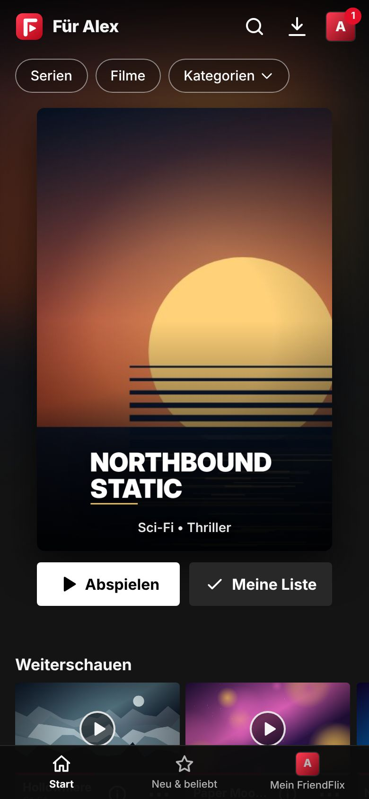</td>
    <td>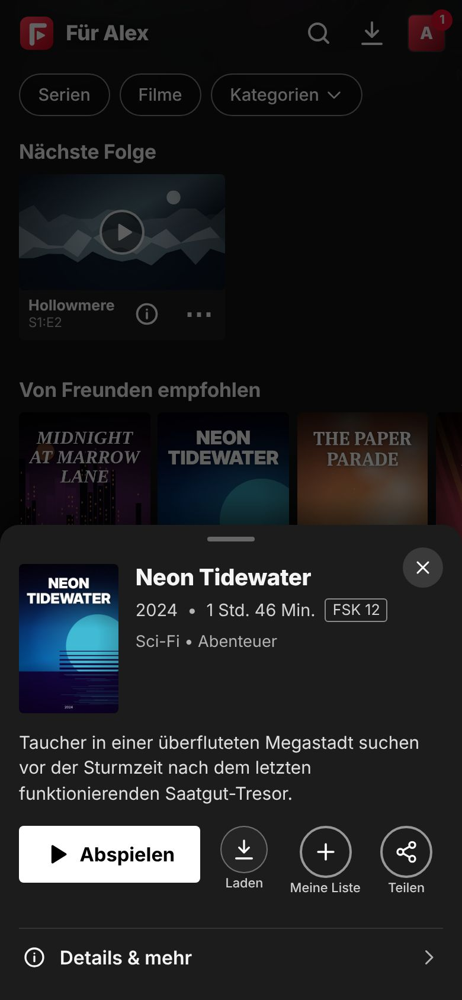</td>
    <td>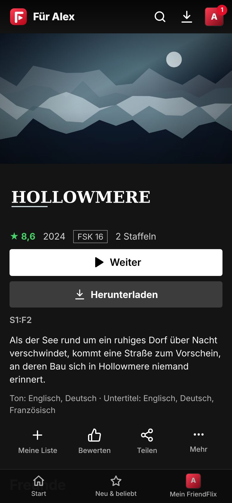</td>
  </tr>
</table>

### Downloads für Zug und Flugzeug

Filme und Folgen herunterladen (bei Serien auch gleich die nächsten Folgen) und offline im Browser ansehen. Der Fortschritt wird beim nächsten Online-Sein abgeglichen.

<p align="center">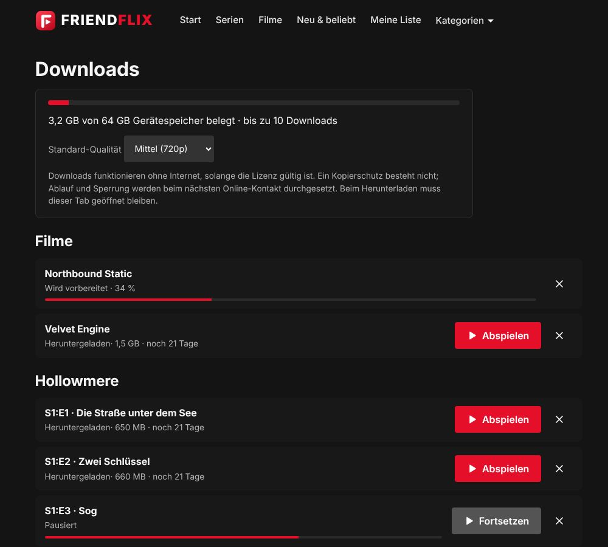</p>

### Sieben Sprachen

Die Oberfläche spricht **Deutsch, Englisch, Französisch, Spanisch, Italienisch, Türkisch und Polnisch**. Jedes Profil wählt seine eigene Sprache; beim ersten Login fragt FriendFlix einmal nach und schlägt die Browsersprache vor. Der Admin legt die Standardsprache der ganzen Instanz fest.

<p align="center">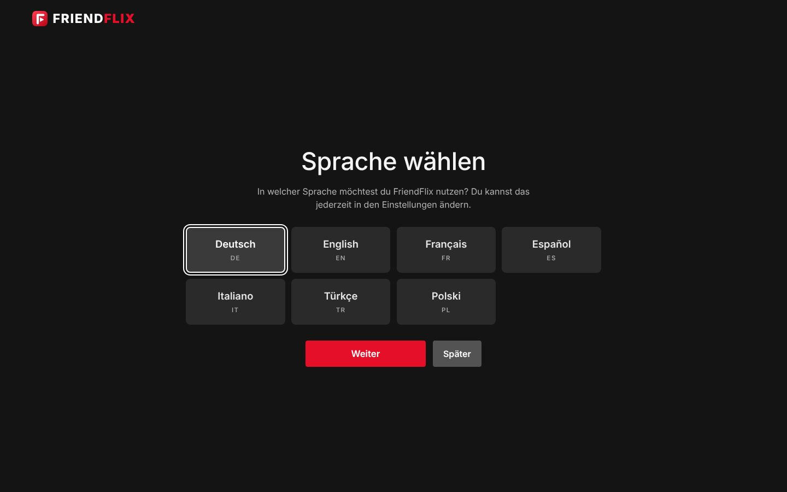</p>

## Gemacht für Freunde und Familie

| | |
|---|---|
| **Profile für alle** | Bis zu 5 Profile pro Konto, optionale PIN, getrennter Verlauf, eigene Listen und Einstellungen. |
| **Auf dem großen Bildschirm** | TV-Modus für Smart-TV-Browser, Sticks und Konsolen: große Schrift, Steuerung mit Pfeiltasten, Kopplung per Code oder QR-Code und das **Handy als Fernbedienung**. Chromecast aus Chrome, Edge und Android. |
| **Offline-Downloads** | Lizenzen pro Gerät mit Ablaufdatum; funktioniert in Chrome, Edge, Firefox, Safari 17+ und als Home-Bildschirm-App auf iOS 17+. |
| **Gemeinsam schauen** | Watch-Partys mit synchroner Wiedergabe, Chat und Emoji-Reaktionen. **Filmabend-Abstimmung** mit Countdown und automatischem Start. „Was hat noch keiner von uns gesehen?“ – der Gruppen-Matcher findet Titel für alle. „Heute Abend“ schlägt drei Titel nach Stimmung und Zeit vor. |
| **Empfehlungen** | Titel an Freunde empfehlen, sehen, was Freunde bewertet und diese Woche geschaut haben, „Weil du … gesehen hast“, geteilte Listen mit Editoren und Lesern, kuratierte Reihen vom Admin. |
| **Wünsche** | Fehlt etwas? Direkt aus der Suche wünschen (über Seerr) und benachrichtigt werden, sobald es da ist – mit einem monatlichen Limit pro Rolle. „Erinnere mich“ für kommende Titel. |
| **Immer auf dem Laufenden** | Benachrichtigungen in der App, als Web-Push auf jedem Gerät, über ntfy oder Discord und ein optionaler Wochenrückblick. |
| **Die Extras** | Reaktionen und Kurzkritiken (erst sichtbar, wenn du den Titel gesehen hast), Bewertungen, Statistik, Achievements und eine teilbare „Wrapped“-Karte mit deinen Zahlen. |
| **Sieben Sprachen** | Deutsch, Englisch, Französisch, Spanisch, Italienisch, Türkisch, Polnisch – pro Profil. |

## Datenschutz und Sicherheit

- **Selbst gehostet.** Alles läuft auf deinem eigenen Server. FriendFlix hat keine Werbung und keine Analyse-Dienste von Dritten.
- **Nur mit Einladung.** Neue Leute kommen über Einmal-Einladungslinks dazu. Die Anmeldung läuft über dein Authentik mit **verpflichtender Zwei-Faktor-Authentifizierung**, neue Geräte können eine Freigabe brauchen.
- **Jellyfin und Seerr bleiben unsichtbar.** Freunde sprechen nur mit dem Portal. Medien-Tokens bleiben auf dem Server; Videos laufen über ein Gateway, das jede Anfrage prüft.
- **Du bestimmst, was Freunde sehen.** „Verlauf teilen“ (standardmäßig aus) und „Bewertungen teilen“ stellt jede Person in den Einstellungen ein; „Diese Woche bei uns“ zeigt nur Zahlen, nie wer geschaut hat. Reaktionen zu einem Titel erscheinen erst, wenn du ihn gesehen hast, und der optionale Spoilerschutz blendet Bilder und Beschreibungen ungesehener Folgen aus.
- **Trailer ohne Tracking.** Trailer für Titel, die noch nicht in der Bibliothek sind, laufen im datenschutzfreundlichen `youtube-nocookie.com`-Player und laden erst nach einem Klick.
- **Fehlerberichte bleiben bei dir.** Stürzt die App im Browser von jemandem ab, landet eine bereinigte Fehlermeldung (ohne Query-Strings, Tokens oder E-Mail-Adressen) im Log *deines* Servers – und nirgendwo sonst.
- **Ehrlich zu Downloads.** Downloads sind für vertrauenswürdige Freunde und Familie gedacht: Es gibt keinen Kopierschutz (kein DRM); Ablauf und Widerruf setzt die App durch.

---

## Für Admins: Einrichtung und Betrieb

Ab hier wird es technisch. Die ausführliche Betriebsdoku steht unter [Dokumentation](#dokumentation).

### Voraussetzungen

- Ein Linux-Server mit **Docker** und **Docker Compose**.
- **Jellyfin** (deine Bibliothek) und **Seerr** (Wünsche) – schon vorhanden oder über das Profil `bundled` mitgestartet.
- **Authentik** als Login (OIDC mit PKCE; MFA dort erzwingen).
- Ein Reverse Proxy mit TLS, z. B. **Nginx Proxy Manager**, mit einem Proxy-Host für das Portal.
- Optional: ntfy, ein Discord-Webhook, Portainer (Updates per Knopfdruck).

### Schnellstart

Der Produktions-Stack zieht fertige Images von `ghcr.io/letsmanu/friendflix-{backend,gateway,web}`; auf dem Server wird nichts gebaut.

```bash
git clone https://github.com/LetsManu/friendflix.git && cd friendflix
cp .env.example .env
openssl rand -base64 32    # -> APP_ENC_KEY
openssl rand -hex 24       # -> INTERNAL_SECRET, WEBHOOK_SECRET, METRICS_TOKEN (je ein Wert)
$EDITOR .env               # PUBLIC_URL, Passwörter, OIDC_*, JELLYFIN_*, SEERR_*
docker login ghcr.io -u <user>                                 # nur bei privaten Paketen (PAT mit read:packages)
docker compose -f compose.prod.yaml up -d                      # mit --profile bundled auch Jellyfin + Seerr
docker compose -f compose.prod.yaml --profile backup up -d backup   # optional: nächtliche Datenbank-Backups
docker compose -f compose.prod.yaml ps                         # alles "healthy"
```

Danach:

1. **Authentik:** OIDC-Provider anlegen (Redirect-URI `${PUBLIC_URL}/auth/callback`) und MFA erzwingen – [docs/integrations.md](docs/integrations.md).
2. **Nginx Proxy Manager:** ein Proxy-Host `portal.<domain>` → `127.0.0.1:3080`, Websockets an, Force SSL/HTTP2/HSTS; [deploy/npm/portal.advanced.conf](deploy/npm/portal.advanced.conf) in den Reiter *Advanced* einfügen (leitet `/api`, `/auth`, `/ws` an `:3081` und `/media/` an `:3082`). Den Block `/media/c/` nicht entfernen: Er verhindert, dass Cast-Tokens in Logs landen.
3. **Jellyfin:** Admin-API-Key anlegen. Optional das Webhook-Plugin für sofortige „läuft gerade“- und „neu in der Bibliothek“-Ereignisse – [docs/integrations.md](docs/integrations.md).
4. **Seerr:** API-Key und Webhook – [docs/integrations.md](docs/integrations.md).
5. **Web-Push (optional):** `node scripts/gen-vapid.mjs`, beide Schlüssel in `.env`, neu starten.
6. **Erster Login** mit einem Mitglied der Authentik-Gruppe `friendflix-admins`: Du wirst Portal-Admin, wählst die Sprache der Instanz und lädst deine Freunde unter *Admin → Einladungen* ein.

Laufen Jellyfin/Seerr schon in einem eigenen Stack: `docker network connect friendflix_media <container>`, deren öffentliche Ports entfernen und `JELLYFIN_URL`/`SEERR_URL` setzen.

### Konfiguration

Vorlage: [.env.example](.env.example). Jede Variable kann mit der Endung `_FILE` auch aus einer Datei gelesen werden (Docker Secrets, siehe [compose.secrets.yaml](compose.secrets.yaml)). Die Standardwerte stammen aus [compose.prod.yaml](compose.prod.yaml).

| Variable | Standard | Bedeutung |
|---|---|---|
| `PUBLIC_URL` | – (Pflicht) | Öffentliche https-URL des Portals |
| `POSTGRES_PASSWORD`, `REDIS_PASSWORD` | – (Pflicht) | Passwörter für Datenbank und Redis |
| `APP_ENC_KEY` | – (Pflicht) | 32 Byte base64; verschlüsselt gespeicherte Jellyfin-Zugangsdaten. **Getrennt sichern.** |
| `INTERNAL_SECRET`, `WEBHOOK_SECRET` | – (Pflicht, ≥ 16 Zeichen) | Backend ↔ Gateway; Jellyfin-/Seerr-Webhooks |
| `OIDC_ISSUER`, `OIDC_CLIENT_ID`, `OIDC_CLIENT_SECRET` | – (Pflicht) | Authentik-OIDC-Provider |
| `JELLYFIN_URL`, `JELLYFIN_ADMIN_API_KEY` | – (Pflicht) | Interne Jellyfin-URL, z. B. `http://jellyfin:8096`, und Admin-API-Key |
| `SEERR_URL`, `SEERR_API_KEY` | – (Pflicht) | Interne Seerr-URL und API-Key |
| `ADMIN_GROUP` | `friendflix-admins` | Authentik-Gruppe, deren Mitglieder Portal-Admins werden |
| `BIND_ADDR` | `127.0.0.1` | Host-Adresse für die drei Ports – nie eine öffentliche Schnittstelle |
| `WEB_PORT`, `BACKEND_PORT`, `GATEWAY_PORT` | `3080`, `3081`, `3082` | Host-Ports für den Reverse Proxy |
| `FF_REGISTRY`, `FF_TAG` | `ghcr.io/letsmanu`, `latest` | Herkunft und Version der Images (festnageln mit Commit-SHA oder `x.y.z`) |
| `SESSION_TTL_SECONDS`, `SESSION_IDLE_SECONDS` | `28800`, `7200` | Maximale Sitzungsdauer (8 h) und Ablauf bei Inaktivität (2 h) |
| `TZ` | `Europe/Vienna` | Zeitzone für geplante Jobs (Rückblick, Wiedergabe-Check, Backups) |
| `AUTHENTIK_URL`, `AUTHENTIK_API_TOKEN`, `AUTHENTIK_ENROLL_FLOW` | leer | Einladungen, die auch das Authentik-Konto anlegen (alle drei nötig) |
| `NTFY_URL`, `NTFY_BASE_URL`, `DISCORD_WEBHOOK_URL` | leer | Gemeinsamer ntfy-/Discord-Kanal; ntfy-Server für persönliche Themen |
| `VAPID_PUBLIC_KEY`, `VAPID_PRIVATE_KEY`, `VAPID_SUBJECT` | leer, leer, `PUBLIC_URL` | Web-Push; nur aktiv, wenn beide Schlüssel gesetzt sind |
| `DIGEST_DAY`, `DIGEST_HOUR` | `0` (Sonntag), `18` | Zeitplan des Wochenrückblicks; `-1` = aus; im Admin-Bereich änderbar |
| `CAST_ENABLED` | `true` | Chromecast (braucht eine https-`PUBLIC_URL`); bei Plan B `false` |
| `DOWNLOADS_ENABLED` | `true` | Offline-Downloads; bei Plan B `false` |
| `DOWNLOADS_PATH`, `PREVIEWS_PATH` | Volumes `downloads`, `previews` | Host-Ordner (absoluter Pfad, beschreibbar für uid 1000) für vorbereitete Downloads und Vorschau-Clips |
| `DOWNLOAD_CACHE_MAX_GB`, `DOWNLOAD_MIN_FREE_GB` | `50`, `2` | Obergrenze für vorbereitete Downloads; Mindest-Freiplatz |
| `DOWNLOAD_PREP_CONCURRENCY`, `DOWNLOAD_PAUSE_STREAMS` | `1`, `2` | Parallele Vorbereitungen; Pause, solange so viele Streams laufen (`0` = nie) |
| `DOWNLOAD_FILE_TTL_HOURS`, `DOWNLOAD_OFFLINE_GRACE_DAYS`, `DOWNLOAD_CREATE_PER_HOUR` | `48`, `7`, `20` | Aufräumen ungenutzter Dateien, Offline-Kulanz, Rate-Limit für Lizenzen |
| `DIRECT_PLAY_REQUIRES_DOWNLOAD` | `false` | `true`: Rollen ohne Download-Recht verlieren auch Direct Play |
| `PREVIEW_WARM` | `true` | Hintergrundjob, der Vorschau-Clips für Karten und Billboard vorab erzeugt |
| `PLAYBACK_CHECK_HOUR` | `4` | Nächtlicher Wiedergabe-Check mit Admin-Hinweis; `-1` = aus |
| `BACKGROUND_JOBS` | `true` | Download-Vorbereitung/-Aufräumen, Sprachindex, Jellyfin-Session-Polling (auf dem einzigen Backend `true` lassen) |
| `API_COMPRESSION` | `true` | gzip/brotli für JSON-Antworten ab 1 KB; `false`, wenn der Proxy `/api` schon komprimiert |
| `METRICS_TOKEN` | leer | Bearer-Token für `/metrics` |
| `PORTAINER_WEBHOOK_URL` oder `PORTAINER_URL` + `PORTAINER_API_KEY` + `PORTAINER_STACK_ID` | leer | Updates per Knopfdruck unter *Admin → Update* (`PORTAINER_ENDPOINT_ID` Standard `1`) |
| `UPDATE_REPO`, `GITHUB_TOKEN` | `LetsManu/friendflix`, leer | Versionsprüfung; das Token hebt nur das GitHub-Limit an |
| `BACKUP_PATH`, `BACKUP_HOUR`, `BACKUP_KEEP_DAYS`, `BACKUP_RUN_ON_START` | `./backups`, `3`, `14`, `false` | Backup-Sidecar (Profil `backup`) |
| `MEDIA_PATH` | `./media` | Medienordner für das mitgelieferte Jellyfin (Profil `bundled`) |

Die vollständige Liste mit Erklärungen steht in [.env.example](.env.example).

### Architektur

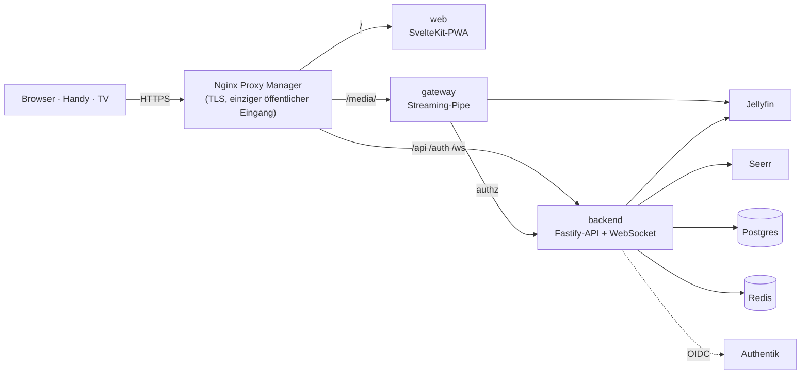

- Öffentlich ist nur der Proxy. `web`, `backend` und `gateway` sind nur auf `127.0.0.1` veröffentlicht; Jellyfin und Seerr haben gar keine Ports und hängen im internen Netz `media`, Postgres und Redis im internen Netz `db`.
- Alle Videodaten (Playlists, Segmente, Direct Play, Bilder, Untertitel, Downloads, Chromecast) laufen durch das Gateway: ohne Pufferung, mit HTTP-Range, Jellyfin-Tokens nur serverseitig, Pfad-Allowlist, fester Upstream, Bitrate-Grenze pro Rolle.
- Container laufen ohne Root, mit schreibgeschütztem Dateisystem, `cap_drop: ALL` und `no-new-privileges`. Strikte CSP, CSRF-Tokens, Rate-Limits, Audit-Log.
- Alternative „Plan B“: nginx liefert `/media/` selbst über `auth_request` aus – [docs/operations.md](docs/operations.md).

### Betrieb

- **Backups:** Der optionale Sidecar `backup` macht täglich um `BACKUP_HOUR` einen `pg_dump`, prüft jeden Dump mit `pg_restore --list`, behält `BACKUP_KEEP_DAYS` Tage und wird `unhealthy`, wenn ein Lauf fehlschlägt. Wiederherstellung und monatlicher Restore-Test (`scripts/restore-test.sh`): [docs/operations.md](docs/operations.md). `APP_ENC_KEY` getrennt von den Dumps im Passwort-Manager aufbewahren.
- **Updates:** *Admin → Update* zeigt installierte und neueste Version samt Änderungsliste und stößt über Portainer (Webhook oder API) ein Redeploy an. Von Hand: `docker compose -f compose.prod.yaml pull && docker compose -f compose.prod.yaml up -d`. Datenbank-Migrationen laufen beim Start.
- **Monitoring:** `/health` (Liveness) und `/health/ready` (Redis, Postgres, Jellyfin) auf `127.0.0.1:3081`; Prometheus-Metriken unter `:3081/metrics` und `:3082/metrics` (Bearer `METRICS_TOKEN`). Beispiele für Icinga und Prometheus: [docs/monitoring.md](docs/monitoring.md).
- **Ladezeiten:** Jede API-Antwort trägt einen `Server-Timing`-Header (`jf` = Jellyfin, `db` = Postgres, `kv` = Redis, `app` = gesamt), das Gateway ergänzt `authz` und `upstream`; sichtbar in den Browser-DevTools unter *Network → Timing*. Anfragen ab 500 ms erscheinen als `slow request` im Log. Browser-Fehler landen im Backend-Log und in `friendflix_client_errors_total`.

### Entwicklung

Node.js ≥ 22, npm-Workspaces `backend`, `gateway`, `web`.

```bash
npm ci
npm run lint && npm run typecheck && npm test   # Backend-Tests brauchen Postgres: TEST_DATABASE_URL=postgres://postgres@localhost:5433/ff_test
npm run dev -w backend                          # API auf :3000
npm run dev -w web                              # UI auf :5173 (Proxy auf backend/gateway)
npm run e2e                                     # Playwright: baut die Web-App und testet sie gegen eine vollständig gemockte API
```

- `E2E_SKIP_BUILD=1` nutzt einen vorhandenen Build; `PW_CHROMIUM=/pfad/zu/chrome` nimmt ein lokal installiertes Chromium.
- `./scripts/setup-hooks.sh` installiert den gitleaks-Pre-Commit-Hook.
- Entwicklung gegen ein http-Authentik: `OIDC_ALLOW_INSECURE=true` (nie in Produktion).
- CI ([.github/workflows/ci.yml](.github/workflows/ci.yml)): Lint, Typecheck, Tests, `npm audit`, E2E, gitleaks und Trivy; Images veröffentlicht [publish.yml](.github/workflows/publish.yml) erst, wenn alles grün ist.
- Übersetzungen: Deutsch ist die Quelle, alle anderen Sprachen liegen daneben – wie man eine Sprache korrigiert oder hinzufügt: [docs/i18n.md](docs/i18n.md).

### Dokumentation

| Thema | Datei |
|---|---|
| Jellyfin, Seerr, Authentik, ntfy/Discord, Web-Push | [docs/integrations.md](docs/integrations.md) |
| Backups, Wiederherstellung, Firewall, Updates, Plan B | [docs/operations.md](docs/operations.md) |
| Monitoring, Metriken, Server-Timing, Browser-Fehler | [docs/monitoring.md](docs/monitoring.md) |
| Offline-Downloads (Plattformen, Speicher, Grenzen) | [docs/downloads.md](docs/downloads.md) |
| TV-Modus und Handy als Fernbedienung | [docs/tv-mode.md](docs/tv-mode.md) |
| Chromecast | [docs/cast.md](docs/cast.md) |
| Such- und Entdecken-API | [docs/discovery.md](docs/discovery.md) |
| Sprachen und Übersetzungen | [docs/i18n.md](docs/i18n.md) |
| Änderungen | [CHANGELOG.md](CHANGELOG.md) |

### Bekannte Einschränkungen

- Ein Backend-Replikat: Watch-Party-Räume, Rate-Limits und Fernbedienungs-Räume liegen im Speicher.
- Bildbasierte Untertitel (PGS) werden nicht angeboten; Text-Untertitel kommen als WebVTT.
- Intro überspringen braucht Jellyfin ≥ 10.10 mit Media Segments (z. B. vom Intro-Skipper-Plugin).
- Die APIs von Jellyfin, Seerr und Authentik unterscheiden sich je Version – nach Upgrades siehe [docs/operations.md](docs/operations.md) und [docs/integrations.md](docs/integrations.md).
- Profile sind versteckte Jellyfin-Nutzer: den automatischen Jellyfin-Nutzerimport in Seerr ausschalten, damit sie dort nicht auftauchen.
- Mit Intel QSV/VAAPI in Jellyfin „VPP Tone mapping“ ausschalten, wenn der Treiber kein HDR kann; sonst scheitern 4K-HDR-Titel.

### Lizenz

Copyright © 2026 Manuel Weißböck. Alle Rechte vorbehalten – siehe [LICENSE](LICENSE).
