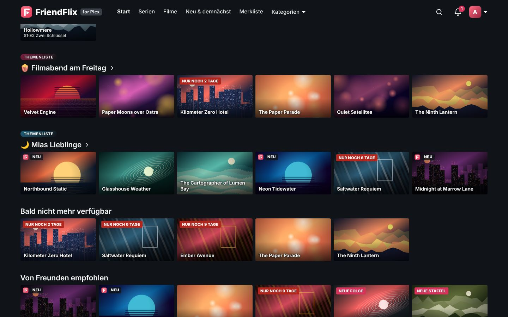
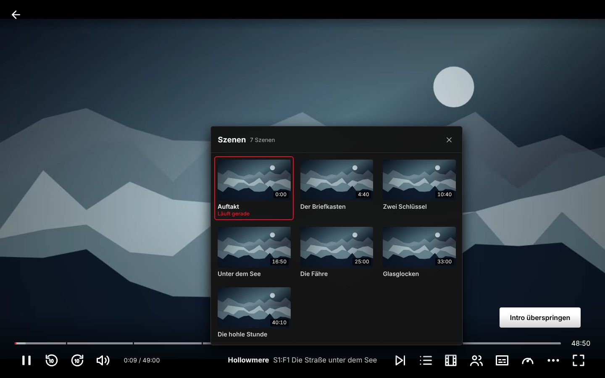
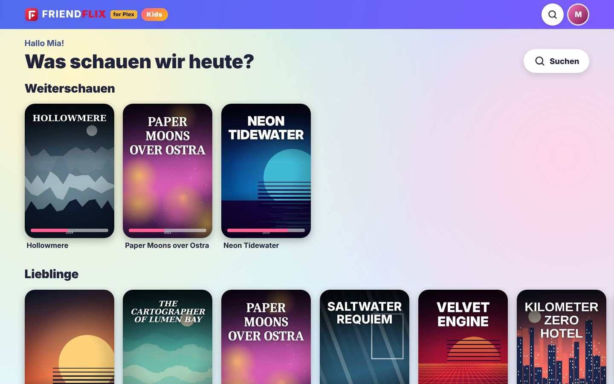
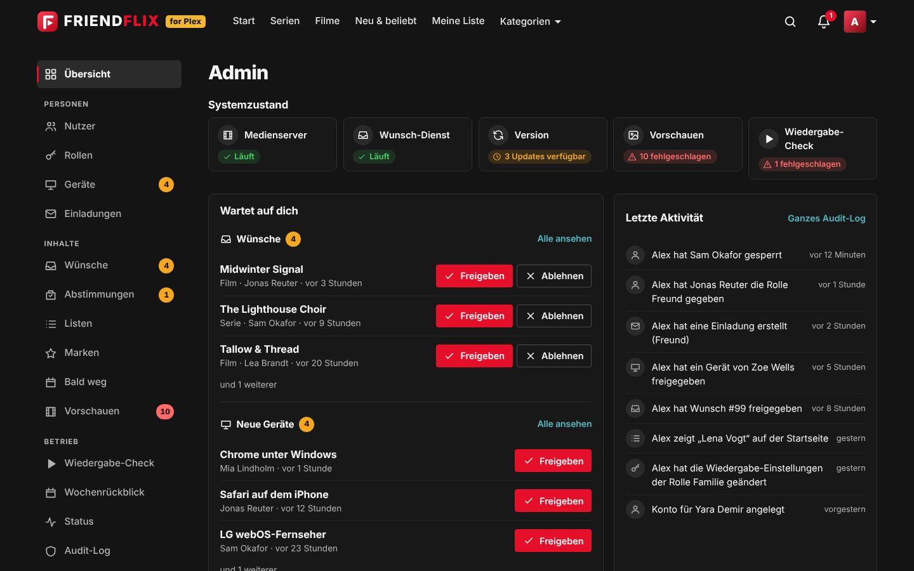
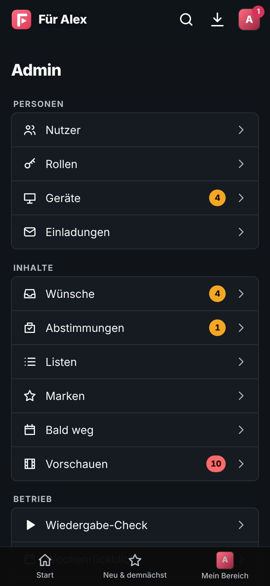
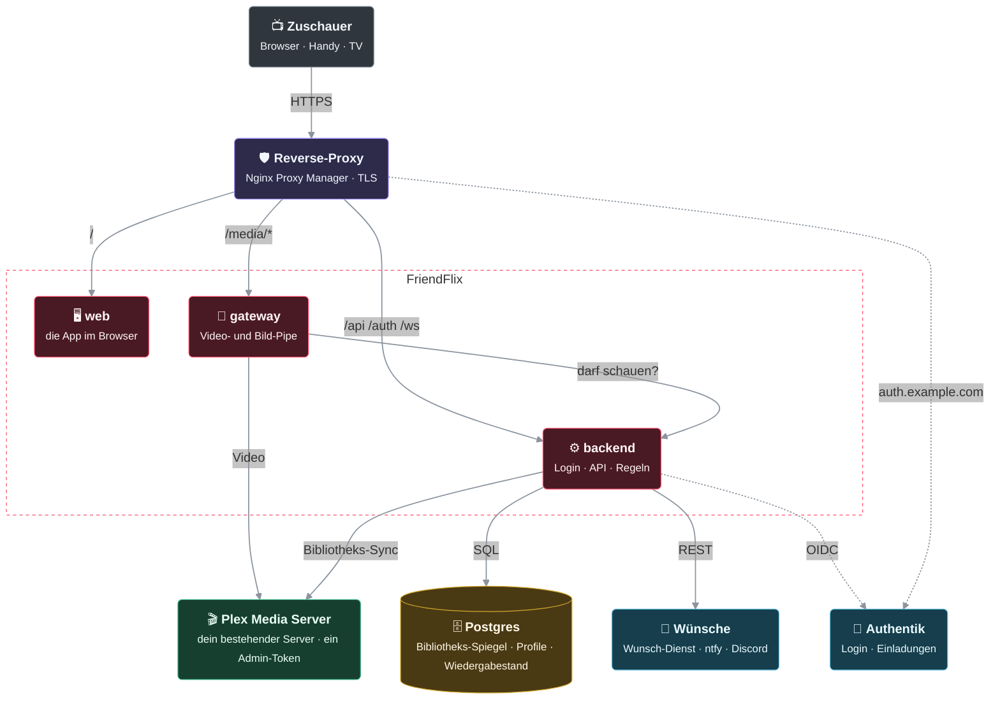

<p align="center">
  <picture>
    <source media="(prefers-color-scheme: dark)" srcset="docs/images/logo-dark.svg">
    
  </picture>
</p>

<p align="center"><b>Dein eigener Streamingdienst für Freunde und Familie – auf Basis der Plex-Bibliothek, die du schon hast.</b></p>

<p align="center">
  <a href="README.md">English</a> · <a href="README.de.md">Deutsch</a>
  <br><br>
  <a href="https://github.com/LetsManu/friendflix/actions/workflows/ci.yml"></a>
  
  
  
  <a href="LICENSE"></a>
</p>

<p align="center"></p>

**FriendFlix for Plex** ist ein privates Streaming-Portal vor deinem **Plex Media Server** (deine Medien) und einem optionalen Wunsch-Dienst. Deine Freunde bekommen ein schickes, vertrautes Streaming-Erlebnis auf Laptop, Handy und Fernseher – mit Profilen, Downloads, Watch-Partys und Empfehlungen untereinander. Plex und den Wunsch-Dienst sehen sie nie direkt, und du bestimmst, wer hineinkommt. Niemand braucht ein plex.tv-Konto.

> **Status: Preview, nicht veröffentlicht.** Die Plex-Unterstützung ist im Entwicklungszweig umgesetzt und gegen einen Fake-Plex-Server aus echten Antworten von Plex Media Server 1.43 getestet, aber **nicht released** und kaum an echten Servern erprobt – Images gibt es erst mit dem ersten Preview-Release (siehe [Releases](https://github.com/LetsManu/friendflix-plex/releases) und [CHANGELOG.md](CHANGELOG.md)). Freiwillige: [mit einem echten Plex-Server testen](docs/de/plex.md#mit-einem-echten-plex-server-testen).
>
> **Das ist ein Fork.** FriendFlix for Plex ist ein Fork von [FriendFlix](https://github.com/LetsManu/friendflix), der statt Jellyfin mit Plex spricht. **Du nutzt Jellyfin? Dann nimm das Originalprojekt: [LetsManu/friendflix](https://github.com/LetsManu/friendflix).** Die Funktionsübersicht unten ist die des Originals, auf Plex umformuliert; die [Vergleichstabelle](#plex-und-jellyfin-im-vergleich) zeigt, was Plex nicht liefern kann.

> Alle Titel und Bilder in diesen Screenshots sind erfunden und für die Demo generiert. Das „for Plex“-Badge neben dem Schriftzug gehört zur Oberfläche dieses Forks.


## Inhalt

- [Das bekommst du](#das-bekommst-du)
- [Datenschutz und Sicherheit](#datenschutz-und-sicherheit)
- [Plex und Jellyfin im Vergleich](#plex-und-jellyfin-im-vergleich)
- [Für Admins: Einrichtung und Betrieb](#für-admins-einrichtung-und-betrieb)

## Das bekommst du

Schauen · Entdecken · Gemeinsam · Familie und Kinder · Handy und TV · Admin

### Schauen

#### Eine Startseite wie bei einem echten Streamingdienst

Ein großes Billboard mit Titel-Logo, darunter Reihen wie *Weiterschauen*, *Nächste Folge*, *Von Freunden empfohlen*, *Freunde haben bewertet*, *Diese Woche bei uns*, *Weil du … gesehen hast*, *Top 10* und *Merkliste*. Fährst du mit der Maus über eine Karte, klappt sie mit den wichtigsten Aktionen auf: abspielen, auf die Liste, bewerten, mehr Infos.

Kleine **Labels** auf den Karten zeigen, was neu ist – *Neu*, *Neue Folge*, *Neue Staffel*, *Staffelfinale*, *Neue Serie*. Weiß der Admin, dass ein Titel bald die Bibliothek verlässt, steht auf seiner Karte „Nur noch 6 Tage“, und eine Reihe **Bald nicht mehr verfügbar** sammelt diese Titel; wer einen davon auf der Liste oder in *Weiterschauen* hat, bekommt eine Woche und einen Tag vorher eine Erinnerung. Gelöscht wird nichts – das Datum ist nur eine Ankündigung.

<p align="center"></p>

<p align="center"></p>

#### Alles zu einem Titel an einem Ort

Die Detailansicht zeigt Beschreibung, Ton- und Untertitelsprachen, Besetzung, welche Freunde den Titel empfohlen oder gesehen haben und – bei Serien – alle Staffeln und Folgen mit Fortschrittsbalken. Weiterschauen genau dort, wo du aufgehört hast. Kleine Chips verraten vor dem Start **Bild und Ton** (4K, HDR, Dolby Vision, Dolby Atmos, 5.1 Surround), gelesen aus den Stream-Details von Plex. Steht eine neue Staffel an oder warst du ein paar Wochen weg, fasst **Die Geschichte bisher** (aus den Staffel- und Folgenbeschreibungen von Plex) kurz zusammen, was passiert ist und wo du stehengeblieben bist – die Karte lässt sich ausblenden. Ein Tab **Extras** sammelt Trailer und Bonusmaterial aus Plex (lokale Extras wie `-trailer`-Dateien), und jede Folge hat ihre eigenen **Kommentare** von Freunden: Kommentare zu einer Folge, die du noch nicht gesehen hast, bleiben verschwommen, bis du „Spoiler – trotzdem zeigen“ wählst.

<table>
  <tr>
    <td></td>
    <td></td>
  </tr>
</table>

#### Ein Player für Serienabende

Intro und Abspann überspringen (wo Plex Marker hat, siehe [Grenzen](#plex-und-jellyfin-im-vergleich)), nächste Folge mit Countdown, Tonspur und Untertitel (mit eigenem Untertitel-Stil), Wiedergabegeschwindigkeit, Lesezeichen, Tastenkürzel und „Noch da?“ nach mehreren automatisch gestarteten Folgen. Direct Play, wenn möglich, sonst adaptives Streaming (HLS). **Vorschau überspringen** („Nächstes Mal bei …“) gibt es mit Plex nicht. Wechselst du einmal Tonspur oder Untertitel, merkt sich FriendFlix das **für die ganze Serie**; mit „Anime: Originalton mit Untertiteln“ starten Anime auf Japanisch mit Untertiteln in deiner Sprache, solange du für die Serie nichts anderes gewählt hast.

- **Besetzung & Infos** (<kbd>I</kbd> für einen kurzen Blick, dann „Alle Infos“): wer wen spielt, die Gaststars dieser Folge, Regie, Drehbuch, Studio und Labels – ein Tipp auf eine Person zeigt ihre weiteren Titel in deiner Bibliothek (Plex hat keine Personenbilder).
- **Szenen**: Kapitelmarken auf der Zeitleiste und ein Fenster mit einem Vorschaubild je Szene (nur, wenn Plex Kapitelbilder erzeugt) – direkt zur besten Stelle springen.
- **Klare Stimmen** und **Nachtmodus** im Klang-Menü: Dialoge hervorheben oder dafür sorgen, dass laute Szenen nicht das ganze Haus wecken.
- **Ruckelfreies Streaming**: Die Qualität „Automatisch“ passt sich deiner Verbindung an und sinkt, wenn das Bild hängt (ein Chip erklärt den Grund). Unterwegs, also außerhalb des Heimnetzes, gilt je Rolle ein Bitraten-Limit; der Player startet mit einem Poster des Titels statt mit einem schwarzen Bild.

<p align="center"></p>

<p align="center"></p>

### Entdecken

- **Marken-Hubs** – breite Kacheln, die der Admin aus deinen eigenen Plex-Sammlungen, -Genres oder -Tags baut – Studio-Hubs hängen davon ab, was Plex liefert (etwa „Anime“ oder „Dokus“) – führen auf eine eigene Seite mit *Neu*, *Beliebt*, *Filme*, *Serien* und A–Z.
- **Themenlisten** – jede Liste kann zur redaktionellen Seite mit Titel, Farbe und Emoji werden; der Admin heftet einige als Reihen auf die Startseite aller an („Filmabend am Freitag“, „Gemütlicher Herbst“).
- **Eine ausführlichere Detailseite** – Bewertungen in einer Zeile (Community, Kritik, Freunde; mit optionalem OMDb-Schlüssel auch IMDb, Rotten Tomatoes und Metacritic), eine Sammlungsreihe mit „Teil 2 von 3“ und Gesehen-Häkchen sowie ein Tab *Details* mit Fakten und Links zu TMDB, IMDb, TVDB und Trakt. Auf dem Handy bleiben die Tabs beim Scrollen in Reichweite.
- **Weil du … gesehen hast** – mehrere Reihen, jede zu einem anderen zuletzt gesehenen Titel, verteilt zwischen den übrigen Reihen.
- **Suche und Stöbern** finden Personen, Genres, Titel und Folgen; filtern geht nach Jahrzehnt, Bewertung, Sprache und **Bildqualität** (4K, HDR, Dolby Vision, Atmos). „Heute Abend“ schlägt drei Titel nach Stimmung und Zeit vor.
- **Simulcast** (verlinkt im Kalender) zeigt die gerade laufenden Serien nach Wochentag und Season, mit Filter „Nur Anime“ (mit Plex auf Basis der Plex-Sendedaten; eingeschränkt, noch nicht geprüft).

### Gemeinsam

- **Watch-Partys** mit synchroner Wiedergabe, Chat und Live-Emoji-Reaktionen, die für alle in der Party über das Bild schweben. **Filmabend-Abstimmung** mit Countdown und automatischem Start. „Was hat noch keiner von uns gesehen?“ – der Gruppen-Matcher findet Titel für alle.
- **Empfehlungen**: Titel an Freunde empfehlen, sehen, was Freunde bewertet und diese Woche geschaut haben, geteilte Listen mit Editoren und Lesern, kuratierte Reihen vom Admin.
- **Wünsche**: Fehlt etwas? Direkt aus der Suche wünschen und benachrichtigt werden, sobald es da ist (über den Wunsch-Dienst, mit je einem eigenen lokalen Wunsch-Nutzer pro FriendFlix-Konto) – mit einem monatlichen Limit pro Rolle. „Erinnere mich“ für kommende Titel.
- **Immer auf dem Laufenden**: Benachrichtigungen in der App, als Web-Push auf jedem Gerät, über ntfy oder Discord und ein optionaler Wochenrückblick.
- **Die Extras**: Reaktionen und Kurzkritiken (erst sichtbar, wenn du den Titel gesehen hast), Bewertungen, Statistik, Achievements und eine teilbare „Jahresrückblick“-Karte mit deinen Zahlen.

### Familie und Kinder

Bis zu fünf Profile pro Konto, jedes mit eigenem Verlauf, eigener Liste, Favoriten, Sprache und Wiedergabe-Einstellungen. Profile lassen sich mit einer 4-stelligen PIN sperren. Jedes neue Profil beginnt mit einem kurzen **Willkommen**: Name und Farbe bestätigen, dann drei Titel wählen, die dir gefallen – so wissen die Empfehlungen, wo sie anfangen sollen.

**Kinderprofile** bekommen eine eigene, bunte Startseite mit großen Kacheln, eine einfache Suche und eine Altersgrenze (0, 6 oder 12), die der Server bei jeder Liste, Suche und jedem Titel durchsetzt. Soziales gibt es dort nicht – keine Freunde, Reaktionen, Bewertungen, Kommentare, Watch-Partys, geteilten Listen, Wünsche oder Statistiken –, und die Einstellungen bieten nur Sprache und Wiedergabesprachen. Ein Kinderprofil verlässt man nur mit der PIN des Zielprofils oder, wenn dieses keine hat, mit der PIN des Hauptprofils; ein Fernseher, der aus einem Kinderprofil gekoppelt wurde, bleibt auf diesem Kinderprofil. Angeheftete Themenlisten („Gemütlicher Herbst“ für die Kleinen) erscheinen dort ebenfalls.

Der **Ruhige Modus** (pro Profil, auch für Kinder) hält alles still: kein Trailer im Billboard, keine Vorschau beim Darüberfahren, kein Ton und weniger Bewegung in der ganzen App.

<table>
  <tr>
    <td></td>
    <td></td>
  </tr>
</table>

### Handy und TV

App-artige Oberfläche mit Tab-Leiste unten, einer Vorschau beim Antippen eines Posters und allen Details nur einen Wisch entfernt. FriendFlix lässt sich auf dem Home-Bildschirm installieren (PWA) – mit **Verknüpfungen** per langem Druck (Weiterschauen, Merkliste, Suche, Downloads), einem **Badge** mit deinen ungelesenen Benachrichtigungen auf dem Symbol und Name und Beschreibung der App in deiner Sprache.

<table>
  <tr>
    <td></td>
    <td></td>
    <td></td>
  </tr>
</table>

**Auf dem großen Bildschirm:** TV-Modus für Smart-TV-Browser, Sticks und Konsolen – große Schrift, Steuerung mit Pfeiltasten, Kopplung per Code oder QR-Code und das **Handy als Fernbedienung**. Chromecast aus Chrome, Edge und Android; **AirPlay** aus Safari auf iPhone, iPad und Mac zu Apple TV und AirPlay-2-Fernsehern (z. B. LG webOS ab 2019). Die Übertragung läuft beim Stöbern weiter: eine **Leiste am unteren Rand** steuert den Fernseher, die Play-Tasten senden neue Titel direkt dorthin und die nächste Folge startet auf dem Fernseher, wenn Autoplay erlaubt ist (sonst bietet die Leiste sie an).

**Downloads für Zug und Flugzeug:** Filme und Folgen herunterladen (bei Serien auch gleich die nächsten Folgen) und offline im Browser ansehen. Der Fortschritt wird beim nächsten Online-Sein abgeglichen. Lizenzen pro Gerät mit Ablaufdatum; funktioniert in Chrome, Edge, Firefox, Safari 17+ und als Home-Bildschirm-App auf iOS 17+. Auf Android (Chrome, Edge) laden Downloads auch im Hintergrund und bei geschlossener App weiter; auf dem iPhone pausieren sie, solange die App im Hintergrund ist, und laufen beim Öffnen sofort weiter.

<p align="center"></p>

**Sieben Sprachen:** Die Oberfläche spricht **Deutsch, Englisch, Französisch, Spanisch, Italienisch, Türkisch und Polnisch**. Jedes Profil wählt seine eigene Sprache; beim ersten Login fragt FriendFlix einmal nach und schlägt die Browsersprache vor. Der Admin legt die Standardsprache der ganzen Instanz fest.

<p align="center"></p>

### Admin

Ein aufgeräumter Admin-Bereich mit Seitenleiste (Personen, Inhalte, Betrieb) und einer **Übersicht**, die Systemzustand, offene Entscheidungen – einen Wunsch oder ein neues Gerät gleich dort freigeben oder ablehnen –, die letzte Aktivität in ganzen Sätzen, Zahlen und Speicher zeigt. Alles meldet sich zurück: keine Pop-up-Fenster, riskante Aktionen fragen vorher, kleine bieten **Rückgängig**. Auf dem Handy ist derselbe Bereich eine einfache Liste mit großen Tippflächen.

Außerdem im Admin-Bereich: Einladungen und Rollen, **Marken-Hubs**, hervorgehobene und Themenlisten, **Bald-weg-Termine**, Vorschau-Clips, der nächtliche Wiedergabe-Check, der Wochenrückblick, ein Audit-Log und Updates per Knopfdruck.

**Admin-Pflege:** eine Status-Seite mit Ampeln für jeden Dienst, Speicherplatz, laufenden Streams (direkt oder umgewandelt, und warum) und den letzten Fehlern, dazu ein schmales Warnband, wenn etwas dich braucht; eine Seite **Bibliothekspflege**, die fehlende Bilder, Sprachlücken, Doppelte und Problemdateien findet; und eine Seite **Nutzung** mit Sehzeit, Streams und Geräten pro Konto (nur Summen, keine Titel).

<table>
  <tr>
    <td></td>
    <td></td>
  </tr>
</table>

## Datenschutz und Sicherheit

- **Selbst gehostet.** Alles läuft auf deinem eigenen Server. FriendFlix hat keine Werbung und keine Analyse-Dienste von Dritten.
- **Nur mit Einladung.** Neue Leute kommen über Einmal-Einladungslinks dazu. Die Anmeldung läuft über dein Authentik mit **verpflichtender Zwei-Faktor-Authentifizierung**, neue Geräte können eine Freigabe brauchen.
- **Plex und der Wunsch-Dienst bleiben unsichtbar.** Freunde sprechen nur mit dem Portal. Das Plex-Token liegt nur im Backend und im Gateway und geht nie an einen Browser; Videos und Bilder laufen über ein Gateway, das jede Anfrage prüft.
- **Keine plex.tv-Konten für deine Freunde.** FriendFlix verwaltet seine Nutzer selbst und setzt Rollen, Profile und Altersgrenzen selbst durch; Plex sieht nur ein serverseitiges Token. Es läuft ohne Plex Pass.
- **Du bestimmst, was Freunde sehen.** „Verlauf teilen“ (standardmäßig aus) und „Bewertungen teilen“ stellt jede Person in den Einstellungen ein; „Diese Woche bei uns“ zeigt nur Zahlen, nie wer geschaut hat. Reaktionen zu einem Titel erscheinen erst, wenn du ihn gesehen hast, und der optionale Spoilerschutz blendet Bilder und Beschreibungen ungesehener Folgen aus.
- **Trailer ohne Tracking.** Trailer für Titel, die noch nicht in der Bibliothek sind, laufen im datenschutzfreundlichen `youtube-nocookie.com`-Player und laden erst nach einem Klick.
- **Fehlerberichte bleiben bei dir.** Stürzt die App im Browser von jemandem ab, landet eine bereinigte Fehlermeldung (ohne Query-Strings, Tokens oder E-Mail-Adressen) im Log *deines* Servers – und nirgendwo sonst.
- **Ehrlich zu Downloads.** Downloads sind für vertrauenswürdige Freunde und Familie gedacht: Es gibt keinen Kopierschutz (kein DRM); Ablauf und Widerruf setzt die App durch.
- **Geprüft, bevor es ausgeliefert wird.** Jedes Image wird gescannt, signiert und mit einer Software-Stückliste veröffentlicht; die Pipeline macht außerdem einen Web-Sicherheitsscan, und die Lieferkette wird öffentlich bewertet (siehe unten).


## Plex und Jellyfin im Vergleich

Die FriendFlix-Oberfläche ist dieselbe; unterschiedlich ist, was Plex liefern kann. Stand der Preview (Plex-Verhalten geprüft gegen einen echten Plex Media Server 1.43, Umsetzung getestet gegen einen Fake aus dessen Antworten):

| Funktion | Plex | Hinweis |
|---|---|---|
| Profile, Kinderprofile, Altersgrenzen, PIN | Funktioniert | Liegt in FriendFlix und wird dort durchgesetzt (Kinder-Altersgrenzen 0/6/12 bei jeder Liste, Suche, jedem Titel und jeder Medienanfrage); Altersfreigaben kommen von Plex (`contentRating`), unbekannte Freigaben sind für Profile mit Altersgrenze und Kinderprofile gesperrt |
| Bibliothekszugriff pro Rolle | Funktioniert | Über den Plex-Bibliotheksnamen (nach Umbenennen in Plex Rolle anpassen) |
| Bibliothek, Suche, Detailseiten, Bilder | Funktioniert | Titel-Logos hängen davon ab, was Plex liefert; sonst erscheint der Titel als Text |
| „Besetzung & Infos“ | Eingeschränkt | Rollennamen, Regie, Drehbuch, Studio, Labels, Gaststars bei Folgen; keine Personenbilder |
| Kapitel („Szenen“-Panel) | Funktioniert | Kapitelmarken aus den Dateien; Kapitelbilder nur, wenn Plex Kapitel-Vorschaubilder erzeugt |
| Qualitäts-Chips, Filter 4K / HDR | Funktioniert | Aus Plex' Stream-Angaben (Auflösung, Dolby Vision / HDR10 / HDR10+ / HLG, Kanäle, Atmos) |
| Neu-Labels („Neue Folge“, „Staffelfinale“ …) | Eingeschränkt | Plex kennt keinen Serienstatus, deshalb erscheint „Staffelfinale“ nur bei Serien, deren letzte Folge vor mehr als 60 Tagen lief |
| Bald nicht mehr verfügbar, „Bisher geschah“, Themenlisten, ruhiger Modus, klare Stimmen, Handy-Kurzbefehle, Admin-Seiten | Funktioniert | FriendFlix-Funktionen; „Live-Streams“ zeigt auch Sitzungen anderer Plex-Apps (Plex nennt keine Transcode-Gründe), „Beenden“ stoppt den Plex-Transcode; die Bibliothekspflege liest Plex' Listen und die Stream-Details des Spiegels |
| „Mehr davon“ | Eingeschränkt | Von FriendFlix aus gemeinsamen Genres und Besetzung berechnet |
| Marken-Hubs, „Weil du … gesehen hast“-Reihen, Folgenkommentare, Willkommen | Funktioniert | FriendFlix-Funktionen; Hubs entstehen aus Plex-Sammlungen/Genres/Tags |
| Extras-Tab (Trailer, Bonusmaterial) | Eingeschränkt | Nur, was Plex als lokale Extras hat |
| Simulcast-Seite (läuft gerade, Anime-Filter) | Eingeschränkt | Stützt sich auf Plex-Ausstrahlungsdaten; noch nicht geprüft |
| Merken von Ton/Untertiteln pro Serie, Anime-Originalton | Funktioniert | Von FriendFlix gespeichert; der Wechsel der Tonspur selbst unterliegt der Plex-Konto-Grenze unten |
| Weiterschauen, Favoriten, Merkliste, Bewertungen, Verlauf | Funktioniert | Liegt in FriendFlix; FriendFlix schreibt nie Wiedergabestatus nach Plex |
| Direct Play und adaptives Streaming (HLS) | Funktioniert | Über den Plex-Transcoder; 4K/HDR/Hardware-Transcoding hängt von deinem Plex ab; Rollengrenzen (Bitrate, Höhe, Transcoding aus, max. Streams) setzt FriendFlix durch |
| Untertitel | Eingeschränkt | Nur Text-Untertitel; eingebettete Spuren extrahiert FriendFlix (ffmpeg) und wandelt sie in WebVTT um; kein PGS, keine Untertitelsuche |
| Tonspur wählen | Eingeschränkt | Plex speichert sie pro Plex-Konto. FriendFlix startet Streams nacheinander; es kollidiert mit anderen Plex-Apps am selben Konto – nimm ein eigenes Plex-Konto/Token |
| Intro / Abspann überspringen | Eingeschränkt | Braucht Marker von Plex, dafür **Plex Pass**. Ohne erscheint der Knopf nie |
| Rückblick / Vorschau überspringen („Zuvor bei …“) | Nicht verfügbar | Plex hat dafür keine Marker |
| Vorschaubilder beim Spulen | Eingeschränkt | Einzelbilder, nur wenn „Video-Vorschaubilder“ in Plex aktiviert sind |
| Downloads | Funktioniert | Originaldatei, wenn browsertauglich, sonst von Plex transkodiert und von FriendFlix umverpackt |
| Chromecast | Funktioniert | Inklusive Text-Untertiteln (signierte FriendFlix-Untertitel-URLs) |
| TV-Modus, Watch-Partys, Empfehlungen, Benachrichtigungen | Funktioniert | FriendFlix-Funktionen, unabhängig vom Medienserver |
| „Demnächst erscheinende Folgen“ | Nicht verfügbar | Plex bietet das nicht |
| Wünsche / Wunsch-Dienst | Funktioniert | Jedes FriendFlix-Konto bekommt beim ersten Wunsch einen eigenen lokalen Wunsch-Dienst-Nutzer (nur Wunsch-Recht) |
| nginx-„Plan B“ für Medien | Nicht verfügbar | Mit Plex nicht unterstützt |

Details, Einrichtung und Fehlersuche: [docs/de/plex.md](docs/de/plex.md).

---

## Für Admins: Einrichtung und Betrieb

Ab hier wird es technisch. Die Plex-Anleitung ist [docs/de/plex.md](docs/de/plex.md) ([English](docs/plex.md)); die ausführliche Betriebsdoku steht unter [Dokumentation](#dokumentation).

> **Preview:** Plex-Backend und `compose.plex.yaml` gibt es, aber kein Release, und die Images unten sind noch nicht veröffentlicht. Bis dahin die Images selbst bauen (`docker compose -f compose.yaml -f compose.plex.yaml build`) und eine Testinstanz nutzen.

**Installationsanleitung:** Schritt für Schritt vom leeren Server bis zum ersten eingeladenen Freund – [docs/de/setup.md](docs/de/setup.md); Authentik (Installation, Provider, Flows, Einladungen) – [docs/de/authentik.md](docs/de/authentik.md).

### Voraussetzungen

- Ein Linux-Server mit **Docker** und **Docker Compose**.
- Ein **Plex Media Server** (getestet gegen 1.43) mit deinen Bibliotheken, **beansprucht („claimed“)** (einmal mit einem Konto angemeldet) und vom FriendFlix-Gateway erreichbar. FriendFlix verbindet sich mit einem vorhandenen Server und startet keinen. Ein Plex-Server pro FriendFlix-Instanz.
- Ein **Plex-Admin-Token** (`X-Plex-Token`): siehe Plex-Supportartikel „Finding an authentication token / X-Plex-Token“ und [docs/de/plex.md](docs/de/plex.md). Nimm dafür ein eigenes Plex-Konto bzw. Token für FriendFlix. Plex Pass ist optional (Intro-/Abspann-Marker, Hardware-Transcoding).
- Optional ein Wunsch-Dienst (wie im Original; FriendFlix legt je Konto einen lokalen Wunsch-Nutzer an, ohne Plex- oder Jellyfin-Konto).
- **Authentik** als Login (OIDC mit PKCE; MFA dort erzwingen).
- Ein Reverse Proxy mit TLS, z. B. **Nginx Proxy Manager**, mit einem Proxy-Host für das Portal.
- Optional: ntfy, ein Discord-Webhook, Portainer (Updates per Knopfdruck).

### Schnellstart

Der Produktions-Stack zieht fertige Images von `ghcr.io/letsmanu/friendflix-plex-{backend,web,gateway}`; auf dem Server wird nichts gebaut. Die Images erscheinen mit dem ersten Preview-Release – vorher kann `docker compose ... up` sie nicht ziehen.

```bash
git clone https://github.com/LetsManu/friendflix-plex.git && cd friendflix-plex
cp .env.example .env
openssl rand -base64 32    # -> APP_ENC_KEY
openssl rand -hex 24       # -> INTERNAL_SECRET, WEBHOOK_SECRET, METRICS_TOKEN (je ein Wert)
$EDITOR .env               # PUBLIC_URL, Passwörter, OIDC_*, PLEX_URL, PLEX_TOKEN, REQUESTS_*
docker login ghcr.io -u <user>                                 # nur bei privaten Paketen (PAT mit read:packages)
docker compose -f compose.prod.yaml -f compose.plex.yaml config --quiet   # prüfen
docker compose -f compose.prod.yaml -f compose.plex.yaml up -d    # compose.plex.yaml verbindet nur mit deinem vorhandenen Plex-Server
docker compose -f compose.prod.yaml -f compose.plex.yaml --profile backup up -d backup   # optional: nächtliche Datenbank-Backups
docker compose -f compose.prod.yaml -f compose.plex.yaml ps                         # alles "healthy"
```

Danach:

1. **Authentik:** OIDC-Provider anlegen (Redirect-URI `${PUBLIC_URL}/auth/callback`) und MFA erzwingen – [docs/de/authentik.md](docs/de/authentik.md).
2. **Nginx Proxy Manager:** ein Proxy-Host `portal.<domain>` → `127.0.0.1:3080`, Websockets an, Force SSL/HTTP2/HSTS; [deploy/npm/portal.advanced.conf](deploy/npm/portal.advanced.conf) in den Reiter *Advanced* einfügen (leitet `/api`, `/auth`, `/ws` an `:3081` und `/media/` an `:3082`). Den Block `/media/c/` nicht entfernen: Er verhindert, dass Cast-Tokens in Logs landen.
3. **Plex:** Server claimen, Admin-Token holen, Bibliotheksnamen, Altersfreigaben und Vorschaubilder prüfen – [docs/de/plex.md](docs/de/plex.md). Die Jellyfin-Schritte in [docs/integrations.md](docs/integrations.md) gelten nicht.
4. **Wunsch-Dienst (optional):** API-Key und Webhook – [docs/integrations.md](docs/integrations.md).
5. **Web-Push (optional):** `node scripts/gen-vapid.mjs`, beide Schlüssel in `.env`, neu starten.
6. **Erster Login** mit einem Mitglied der Authentik-Gruppe `friendflix-admins`: Du wirst Portal-Admin, wählst die Sprache der Instanz und lädst deine Freunde unter *Admin → Einladungen* ein.

Das Gateway muss `PLEX_URL` erreichen; nimm die lokale Adresse deines Plex-Servers (Details in [docs/de/plex.md](docs/de/plex.md)). Läuft der Wunsch-Dienst schon in einem eigenen Stack: `docker network connect friendflix_media <container>`, dessen öffentliche Ports entfernen und `REQUESTS_URL` setzen.

### Konfiguration

Vorlage: [.env.example](.env.example). Jede Variable kann mit der Endung `_FILE` auch aus einer Datei gelesen werden (Docker Secrets, siehe [compose.secrets.yaml](compose.secrets.yaml)). Die Standardwerte stammen aus [compose.prod.yaml](compose.prod.yaml). Die Plex-Variablen unten reicht `compose.plex.yaml` durch (es setzt auch `MEDIA_SERVER=plex`).

| Variable | Standard | Bedeutung |
|---|---|---|
| `PUBLIC_URL` | – (Pflicht) | Öffentliche https-URL des Portals |
| `POSTGRES_PASSWORD`, `REDIS_PASSWORD` | – (Pflicht) | Passwörter für Datenbank und Redis |
| `APP_ENC_KEY` | – (Pflicht) | 32 Byte base64; verschlüsselt gespeicherte Zugangsdaten. **Getrennt sichern.** |
| `INTERNAL_SECRET`, `WEBHOOK_SECRET` | – (Pflicht, ≥ 16 Zeichen) | Backend ↔ Gateway; Webhooks von Medienserver/Wunsch-Dienst |
| `OIDC_ISSUER`, `OIDC_CLIENT_ID`, `OIDC_CLIENT_SECRET` | – (Pflicht) | Authentik-OIDC-Provider |
| `TMDB_API_KEY`, `OMDB_API_KEY` (oder `…_FILE`) | leer | Optionale Zusatzdaten für die Detailseite (Links, Bewertungen); oder unter *Admin → Datenquellen* setzen. Siehe [docs/integrations.md](docs/integrations.md#tmdb--omdb-optional) |
| `MEDIA_SERVER` | im Original `jellyfin`; hier `plex` | `plex` wählt das Plex-Backend (ein Medienserver pro Instanz) |
| `PLEX_URL` | – (Pflicht bei `plex`) | URL deines Plex-Servers aus Sicht von Backend und Gateway, z. B. `http://192.168.1.10:32400` oder `http://host.docker.internal:32400` |
| `PLEX_TOKEN` oder `PLEX_TOKEN_FILE` | – (Pflicht bei `plex`) | Plex-Token (am besten eines eigenen Plex-Kontos). Nur Backend und Gateway nutzen es; geht nie an Browser |
| `JELLYFIN_URL`, `JELLYFIN_ADMIN_API_KEY` | – (nur Original / `MEDIA_SERVER=jellyfin`) | Mit Plex nicht verwendet; leer lassen |
| `REQUESTS_URL`, `REQUESTS_API_KEY` | – (Pflicht) | Interne URL (mitgeliefert: `http://requests:5055`) und API-Key des Wunsch-Dienstes (ältere Variablennamen funktionieren weiter, mit Hinweis im Log) |
| `ADMIN_GROUP` | `friendflix-admins` | Authentik-Gruppe, deren Mitglieder Portal-Admins werden |
| `BIND_ADDR` | `127.0.0.1` | Host-Adresse für die drei Ports – nie eine öffentliche Schnittstelle |
| `WEB_PORT`, `BACKEND_PORT`, `GATEWAY_PORT` | `3080`, `3081`, `3082` | Host-Ports für den Reverse Proxy |
| `FF_REGISTRY`, `FF_TAG` | `ghcr.io/letsmanu`, `latest` | Herkunft und Version der Images (festnageln mit Commit-SHA oder `x.y.z`) |
| `SESSION_TTL_SECONDS`, `SESSION_IDLE_SECONDS` | `28800`, `7200` | Maximale Sitzungsdauer (8 h) und Ablauf bei Inaktivität (2 h) |
| `TZ` | `Europe/Vienna` | Zeitzone für geplante Jobs (Rückblick, Wiedergabe-Check, Backups) |
| `AUTHENTIK_URL`, `AUTHENTIK_API_TOKEN`, `AUTHENTIK_ENROLL_FLOW` | leer | Einladungen, die auch das Authentik-Konto anlegen (alle drei nötig) |
| `NTFY_URL`, `NTFY_BASE_URL`, `DISCORD_WEBHOOK_URL` | leer | Gemeinsamer ntfy-/Discord-Kanal; ntfy-Server für persönliche Themen |
| `VAPID_PUBLIC_KEY`, `VAPID_PRIVATE_KEY`, `VAPID_SUBJECT` | leer, leer, `PUBLIC_URL` | Web-Push; nur aktiv, wenn beide Schlüssel gesetzt sind |
| `DIGEST_DAY`, `DIGEST_HOUR` | `0` (Sonntag), `18` | Zeitplan des Wochenrückblicks; `-1` = aus; im Admin-Bereich änderbar |
| `CAST_ENABLED` | `true` | Chromecast und AirPlay (braucht eine https-`PUBLIC_URL`); bei Plan B `false` |
| `DOWNLOADS_ENABLED` | `true` | Offline-Downloads; bei Plan B `false` |
| `DOWNLOADS_PATH`, `PREVIEWS_PATH` | Volumes `downloads`, `previews` | Host-Ordner (absoluter Pfad, beschreibbar für uid 1000) für vorbereitete Downloads und Vorschau-Clips |
| `DOWNLOAD_CACHE_MAX_GB`, `DOWNLOAD_MIN_FREE_GB` | `50`, `2` | Obergrenze für vorbereitete Downloads; Mindest-Freiplatz |
| `DOWNLOAD_PREP_CONCURRENCY`, `DOWNLOAD_PAUSE_STREAMS` | `1`, `2` | Parallele Vorbereitungen; Pause, solange so viele Streams laufen (`0` = nie) |
| `DOWNLOAD_FILE_TTL_HOURS`, `DOWNLOAD_OFFLINE_GRACE_DAYS`, `DOWNLOAD_CREATE_PER_HOUR` | `48`, `7`, `20` | Aufräumen ungenutzter Dateien, Offline-Kulanz, Rate-Limit für Lizenzen |
| `DIRECT_PLAY_REQUIRES_DOWNLOAD` | `false` | `true`: Rollen ohne Download-Recht verlieren auch Direct Play |
| `PREVIEW_WARM` | `true` | Hintergrundjob, der Vorschau-Clips für Karten und Billboard vorab erzeugt |
| `PLAYBACK_CHECK_HOUR` | `4` | Nächtlicher Wiedergabe-Check mit Admin-Hinweis; `-1` = aus |
| `BACKGROUND_JOBS` | `true` | Download-Vorbereitung/-Aufräumen, Sprach- und Bildqualitäts-Index, Bald-weg-Erinnerungen, Plex-Bibliotheks-Sync (auf dem einzigen Backend `true` lassen) |
| `API_COMPRESSION` | `true` | gzip/brotli für JSON-Antworten ab 1 KB; `false`, wenn der Proxy `/api` schon komprimiert |
| `GATEWAY_URL` | `http://gateway:4000` | Interne Gateway-Adresse für die Status-Seite im Admin-Bereich (nur `/health` wird abgefragt) |
| `HEALTH_DISK_WARN_PCT`, `HEALTH_DISK_CRIT_PCT` | `85`, `95` | Belegung (Prozent), ab der Status-Seite und Warnband gelb / rot werden (Warnwert muss unter dem kritischen liegen, sonst gelten beide Standardwerte, mit Warnung beim Start) |
| `HEALTH_DB_WARN_GB` | `10` | Datenbankgröße (GB), ab der die Status-Seite warnt |
| `METRICS_TOKEN` | leer | Bearer-Token für `/metrics` |
| `PORTAINER_WEBHOOK_URL` oder `PORTAINER_URL` + `PORTAINER_API_KEY` + `PORTAINER_STACK_ID` | leer | Updates per Knopfdruck unter *Admin → Update* (`PORTAINER_ENDPOINT_ID` Standard `1`) |
| `UPDATE_REPO`, `GITHUB_TOKEN` | `LetsManu/friendflix`, leer | Versionsprüfung; das Token hebt nur das GitHub-Limit an |
| `GRAFANA_ADMIN_PASSWORD`, `GRAFANA_PORT`, `PROMETHEUS_RETENTION` | – (Pflicht für den Monitoring-Stack), `3083`, `30d` | Optionales Prometheus + Grafana (`compose.monitoring.yaml`); kein Standardpasswort |
| `BACKUP_PATH`, `BACKUP_HOUR`, `BACKUP_KEEP_DAYS`, `BACKUP_RUN_ON_START` | `./backups`, `3`, `14`, `false` | Backup-Sidecar (Profil `backup`) |
| `MEDIA_PATH` | `./media` | Medienordner für das mitgelieferte Jellyfin (Profil `bundled` im Original; mit Plex nicht verwendet) |

Die vollständige Liste mit Erklärungen steht in [.env.example](.env.example).

### Architektur

So greift es ineinander – das Plex-Token bleibt in Backend und Gateway, und das Backend spiegelt die Plex-Bibliothek nach Postgres und entscheidet den Zugriff selbst:



> 🟥 FriendFlix · 🟩 Medienserver · 🟦 weitere Dienste · 🟪 Reverse-Proxy · 🟨 Datenspeicher · ⬛ Zuschauer / extern · gestrichelter Rahmen = Netz bzw. Grenze · dicke Linie = Videostream · gepunktet = optional / über öffentliche URL

- Öffentlich ist nur der Proxy. `web`, `backend` und `gateway` sind nur auf `127.0.0.1` veröffentlicht; der Wunsch-Dienst hat gar keine Ports und hängt im internen Netz `media` (dein Plex-Server bleibt, wo er ist, und wird nur von Gateway und Backend angesprochen), Postgres und Redis im internen Netz `db`.
- Alle Videodaten (Playlists, Segmente, Direct Play, Bilder, Untertitel, Downloads, Chromecast) laufen durch das Gateway: ohne Pufferung, mit HTTP-Range, Plex-Token nur im Gateway (und Backend), Pfad-Allowlist, fester Upstream, Bitrate-Grenze pro Rolle. Pfade für Part, Transcode-Session und Kapitelbild tragen eine HMAC-Signatur: Ein sichtbarer Titel schaltet nie eine fremde Datei frei.
- Container laufen ohne Root, mit schreibgeschütztem Dateisystem, `cap_drop: ALL` und `no-new-privileges`. Strikte CSP, CSRF-Tokens, Rate-Limits, Audit-Log.
- Plex-spezifisch: FriendFlix spiegelt die Plex-Bibliothek nach Postgres (Abgleich alle 5 Minuten, Plex-Benachrichtigungs-Websocket und nächtlicher Komplettdurchlauf) und setzt Profile, Altersgrenzen und Zugriff selbst durch; das Gateway schreibt Playlists des Plex-Transcoders um, damit Clients nie Plex-URLs oder -Tokens sehen. Die „Plan B“-Alternative (nginx liefert `/media/` selbst aus) wird mit Plex **nicht unterstützt**.
- Der Medienserver sitzt hinter einer neutralen Schnittstelle (`MediaServer` im Backend, ein `Upstream`-Adapter im Gateway, gewählt über `MEDIA_SERVER`); Plex ist eine Implementierung neben Jellyfin. Container und Netze, „Play drücken“, Vertrauensgrenzen und die Schnittstelle, Plex und Jellyfin nebeneinander: [docs/architecture.md](docs/architecture.md) (englisch).

### Betrieb

- **Backups:** Der optionale Sidecar `backup` macht täglich um `BACKUP_HOUR` einen `pg_dump`, prüft jeden Dump mit `pg_restore --list`, behält `BACKUP_KEEP_DAYS` Tage und wird `unhealthy`, wenn ein Lauf fehlschlägt. Wiederherstellung und monatlicher Restore-Test (`scripts/restore-test.sh`): [docs/operations.md](docs/operations.md). `APP_ENC_KEY` getrennt von den Dumps im Passwort-Manager aufbewahren.
- **Updates:** *Admin → Update* zeigt die installierte Version und das neueste Release samt Notizen (dazu die Commits auf main) und stößt über Portainer (Webhook oder API) ein Redeploy an. Von Hand: `docker compose -f compose.prod.yaml pull && docker compose -f compose.prod.yaml up -d`. Datenbank-Migrationen laufen beim Start.
- **Monitoring:** `/health` (Liveness) und `/health/ready` (Redis, Postgres, Medienserver) auf `127.0.0.1:3081`; Prometheus-Metriken unter `:3081/metrics` und `:3082/metrics` (Bearer `METRICS_TOKEN`). Beispiele für Icinga und Prometheus sowie ein optionaler Prometheus-+-Grafana-Stack mit fertigem Dashboard (`compose.monitoring.yaml`, internes Netz, kein Standardpasswort): [docs/monitoring.md](docs/monitoring.md).
- **Lieferkette:** Images werden gescannt (Trivy), keyless mit cosign signiert und mit SBOM- und Provenienz-Attestations veröffentlicht; vor dem Deployen lassen sie sich prüfen – [docs/operations.md](docs/operations.md). Die Builds sind reproduzierbar: jedes Release lässt sich aus dem Quellcode nachbauen und ergibt denselben Image-Digest – [docs/reproducible-builds.md](docs/reproducible-builds.md) (englisch).
- **Ladezeiten:** Jede API-Antwort trägt einen `Server-Timing`-Header (`jf` = Medienserver, `db` = Postgres, `kv` = Redis, `app` = gesamt), das Gateway ergänzt `authz` und `upstream`; sichtbar in den Browser-DevTools unter *Network → Timing*. Anfragen ab 500 ms erscheinen als `slow request` im Log. Browser-Fehler landen im Backend-Log und in `friendflix_client_errors_total`.

### Versionen und Releases

FriendFlix nutzt [SemVer](https://semver.org) (`version.json`, angezeigt in der Fußzeile am Desktop und unter *Admin → Update*). Jede Hauptversion bekommt einen Codenamen: den nächsten Kino-Snack von A bis Z (1 = Arancini, 2 = Brezel, …; Liste in `codenames.json`). Releases entstehen über den manuellen Workflow **Release** (patch / minor / major): er erhöht die Version (`none` veröffentlicht beim allerersten Release 1.0.0 unverändert), verschiebt den *Unreleased*-Teil des [CHANGELOG.md](CHANGELOG.md) unter die neue Version, setzt den Tag `vX.Y.Z` und legt das GitHub-Release an. Gepusht wird mit dem optionalen Secret `RELEASE_TOKEN` (ein fine-grained Token, einziger Bypass-Akteur der Rulesets für main und Tags; ohne ihn muss main direkte Pushes von GitHub Actions zulassen). Die Images erscheinen danach als `X.Y.Z`, `X.Y`, `X` und, nur für die höchste Version, `latest`; mit `FF_TAG=1` bleibt die Installation auf Hauptversion 1 und bekommt trotzdem deren Minor- und Patch-Releases. Details: [docs/operations.md](docs/operations.md#release-erstellen).

### Entwicklung

Node.js ≥ 22, npm-Workspaces `backend`, `gateway`, `web`.

```bash
npm ci
npm run lint && npm run typecheck && npm test   # Backend-Tests brauchen Postgres: TEST_DATABASE_URL=postgres://postgres@localhost:5433/ff_test
npm run dev -w backend                          # API auf :3000
npm run dev -w web                              # UI auf :5173 (Proxy auf backend/gateway)
npm run e2e                                     # Playwright: baut die Web-App und testet sie gegen eine vollständig gemockte API
```

- `E2E_SKIP_BUILD=1` nutzt einen vorhandenen Build; `PW_CHROMIUM=/pfad/zu/chrome` nimmt ein lokal installiertes Chromium.
- `./scripts/setup-hooks.sh` installiert den gitleaks-Pre-Commit-Hook.
- Entwicklung gegen ein http-Authentik: `OIDC_ALLOW_INSECURE=true` (nie in Produktion).
- CI ([.github/workflows/ci.yml](.github/workflows/ci.yml)): Lint, Typecheck, Tests, `npm audit`, E2E, OWASP-ZAP-Baseline-Scan (DAST, Regeln in `.zap/rules.tsv`), gitleaks und Trivy (Ergebnisse auch im Code-Scanning); Images veröffentlicht [publish.yml](.github/workflows/publish.yml) erst, wenn alles grün ist, mit SBOM- und Provenienz-Attestations und keyless cosign-Signatur – Prüfung und empfohlener Branch-Schutz: [docs/operations.md](docs/operations.md).
- Lieferketten-Prüfung: OpenSSF Scorecard ([scorecard.yml](.github/workflows/scorecard.yml)), wöchentlich und bei jedem Push auf `main`. [](https://scorecard.dev/viewer/?uri=github.com/LetsManu/friendflix)
- Übersetzungen: Deutsch ist die Quelle, alle anderen Sprachen liegen daneben – wie man eine Sprache korrigiert oder hinzufügt: [docs/i18n.md](docs/i18n.md).

### Dokumentation

| Thema | Datei |
|---|---|
| Installation Schritt für Schritt (Jellyfin-Schritte: stattdessen [docs/de/plex.md](docs/de/plex.md)) | [docs/de/setup.md](docs/de/setup.md) |
| Architektur: Zusammenspiel, Container und Netze, Play drücken, Vertrauensgrenzen, Medienserver-Schnittstelle (Plex und Jellyfin; englisch) | [docs/architecture.md](docs/architecture.md) |
| Authentik: Installation, Provider, Flows, Einladungen | [docs/de/authentik.md](docs/de/authentik.md) |
| **Plex-Einrichtung, Funktionsvergleich, Fehlersuche, Abgleich mit dem Original** | [docs/de/plex.md](docs/de/plex.md) · [English](docs/plex.md) |
| Wunsch-Dienst, Authentik, ntfy/Discord, Web-Push (Jellyfin-Teile gelten nicht) | [docs/integrations.md](docs/integrations.md) |
| Backups, Wiederherstellung, Firewall, Updates, Image-Prüfung, Branch-Schutz (Plan B mit Plex nicht unterstützt) | [docs/operations.md](docs/operations.md) |
| Monitoring, Metriken, Grafana-Dashboard, Server-Timing, Browser-Fehler | [docs/monitoring.md](docs/monitoring.md) |
| Offline-Downloads (Plattformen, Speicher, Grenzen) | [docs/downloads.md](docs/downloads.md) |
| TV-Modus und Handy als Fernbedienung | [docs/tv-mode.md](docs/tv-mode.md) |
| Chromecast und AirPlay | [docs/cast.md](docs/cast.md) |
| Such- und Entdecken-API, Labels, Bald weg, Qualität, Regeln für Kinderprofile | [docs/discovery.md](docs/discovery.md) |
| Themenlisten, Ruhiger Modus, Klang im Player, Handy-Verknüpfungen und Badge | [docs/personal.md](docs/personal.md) |
| UI-Kit und Admin-Rahmen | [docs/ui-kit.md](docs/ui-kit.md) |
| Sprachen und Übersetzungen | [docs/i18n.md](docs/i18n.md) |
| Änderungen | [CHANGELOG.md](CHANGELOG.md) |

### Bekannte Einschränkungen

- Ein Backend-Replikat: Watch-Party-Räume, Rate-Limits und Fernbedienungs-Räume liegen im Speicher.
- Bildbasierte Untertitel (PGS) werden nicht angeboten; Text-Untertitel kommen als WebVTT.
- Besetzung & Infos, Szenen und die Bild-/Ton-Chips brauchen vom Medienserver Besetzungslisten, Kapitel und Stream-Details; mit Plex funktionieren sie (siehe Tabelle oben), wo ein Server sie nicht liefern kann, blendet die Oberfläche die Funktion aus (`capabilities` in `/api/me`).
- „Bald nicht mehr verfügbar“ ist eine Ankündigung eines Admins; FriendFlix löscht nie Medien. Das Label „Staffelfinale“ ist eine Heuristik (mit Plex: jede Folge hat ein Sendedatum und die neueste liegt über 60 Tage zurück). Der Bildqualitäts-Filter liest einen Hintergrund-Index (`BACKGROUND_JOBS=true`), der sich nach dem ersten Start erst etwas füllt; Plex-Bibliotheken, die eine ältere Version gespiegelt hat, werden einmal neu gelesen.
- Klare Stimmen und Nachtmodus nutzen die Audioverarbeitung des Browsers: nicht auf jedem Gerät verfügbar und nicht beim Streamen auf ein anderes Gerät. PWA-Widgets für den Home-Bildschirm gibt es nur unter Windows 11; Verknüpfungen und das Symbol-Badge (nicht auf jeder iOS-Version) bekommt das Handy stattdessen.
- Plex (siehe die [Tabelle oben](#plex-und-jellyfin-im-vergleich) und [docs/de/plex.md](docs/de/plex.md)): Intro/Abspann überspringen nur mit Plex-Pass-Markern (nie Recap/Vorschau); Vorschaubilder beim Spulen sind Einzelbilder und brauchen aktivierte Vorschaubilder in Plex; keine „demnächst erscheinenden Folgen“; die Tonspur-Auswahl gilt pro Plex-Konto (Stream-Starts laufen nacheinander, nimm ein eigenes Token); Untertitel extrahiert und wandelt FriendFlix um; der Server muss geclaimt und ein Token vorhanden sein; Plan B wird nicht unterstützt.
- Die Plex-Umsetzung stützt sich teils auf nicht dokumentierte Plex-APIs und ist gegen Plex Media Server 1.43 geprüft; andere Versionen können sich anders verhalten.
- Die APIs von Wunsch-Dienst und Authentik unterscheiden sich je Version – nach Upgrades siehe [docs/operations.md](docs/operations.md) und [docs/integrations.md](docs/integrations.md).
- Profile liegen in FriendFlix, nicht in Plex: Sie tauchen nicht in Plex' Nutzerliste auf und brauchen kein plex.tv-Konto.
- Hardware-Transcoding steuert Plex selbst (laut Plex braucht es Plex Pass); FriendFlix ändert daran nichts.
- Kinderprofile sind ein Jugendschutz, kein Schloss gegen jemanden, der den Konto-Login kennt. Die PIN des Hauptprofils setzt „PIN vergessen?“ (`/auth/login?resetPin=1`) zurück: Das verlangt eine frische Anmeldung bei Authentik (geprüft über `auth_time` im Token) und wird auf jedem Gerät abgelehnt, das an ein Kinderprofil gebunden ist – der Inhaber setzt sie auf seinem eigenen Gerät zurück. Den Authentik-Login (samt zweitem Faktor) also nicht den Kindern überlassen. Ist gar keine PIN gesetzt, lässt sich ein Kinderprofil frei verlassen; der Inhaber bekommt dann einen Hinweis, eine PIN zu setzen.

### Mitmachen


Wie Entscheidungen getroffen werden, steht in [GOVERNANCE.md](GOVERNANCE.md). Beiträge sind willkommen – die Anforderungen (Code-Standard, Tests, alle 7 Sprachen) stehen in [CONTRIBUTING.md](CONTRIBUTING.md), Sicherheitslücken bitte wie in [SECURITY.md](SECURITY.md) beschrieben melden.


### Lizenz

Copyright © 2026 Manuel Weißböck.

FriendFlix ist freie Software: Du darfst sie unter den Bedingungen der **GNU Affero General Public License v3.0 oder später** (AGPL-3.0-or-later) weitergeben und verändern – siehe [LICENSE](LICENSE). Wer eine veränderte Version als Dienst für andere betreibt, muss ihnen deren Quellcode anbieten. FriendFlix kommt ohne jede Gewährleistung.

### Markenhinweis

Netflix, Disney+, Prime Video, Crunchyroll, Plex, Jellyfin, TMDB, OMDb, IMDb, Rotten Tomatoes, Metacritic, TVDB, Trakt und weitere genannte Namen sind Marken ihrer jeweiligen Inhaber. FriendFlix for Plex ist ein unabhängiges Open-Source-Projekt und steht in keiner Verbindung zu diesen Unternehmen, wird von ihnen weder gesponsert noch unterstützt. „for Plex“ beschreibt nur die Kompatibilität; das Projekt verwendet kein Plex-Logo und ist kein offizielles Plex-Produkt. This product uses the TMDB API but is not endorsed or certified by TMDB.
