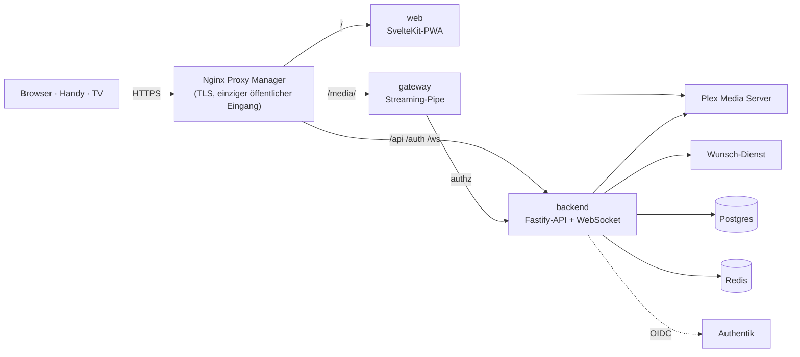

<p align="center">
  <picture>
    <source media="(prefers-color-scheme: dark)" srcset="docs/images/logo-dark.svg">
    
  </picture>
</p>

<p align="center"><b>Dein eigener Streamingdienst für Freunde und Familie – auf Basis der Plex-Bibliothek, die du schon hast.</b></p>

<p align="center">
  <a href="README.md">English</a> · <a href="README.de.md">Deutsch</a>
  <br><br>
  <a href="https://github.com/LetsManu/friendflix/actions/workflows/ci.yml"></a>
  
  
  
</p>

<p align="center"></p>

**FriendFlix for Plex** ist ein privates Streaming-Portal vor deinem **Plex Media Server** (deine Medien) und einem optionalen Wunsch-Dienst. Deine Freunde bekommen ein schickes, vertrautes Streaming-Erlebnis auf Laptop, Handy und Fernseher – mit Profilen, Downloads, Watch-Partys und Empfehlungen untereinander. Plex und den Wunsch-Dienst sehen sie nie direkt, und du bestimmst, wer hineinkommt. Niemand braucht ein plex.tv-Konto.

> **Status: in Entwicklung / Preview.** Die Plex-Unterstützung wird gerade gebaut und **funktioniert noch nicht** – nichts hier ist ein Versprechen für eine veröffentlichte Funktion, bis das erste Preview-Release erscheint (siehe [Releases](https://github.com/LetsManu/friendflix-plex/releases) und [CHANGELOG.md](CHANGELOG.md)). Die Screenshots zeigen die FriendFlix-Oberfläche, wie sie im Original existiert.
>
> **Das ist ein Fork.** FriendFlix for Plex ist ein Fork von [FriendFlix](https://github.com/LetsManu/friendflix), der statt Jellyfin mit Plex spricht. **Du nutzt Jellyfin? Dann nimm das Originalprojekt: [LetsManu/friendflix](https://github.com/LetsManu/friendflix).**

> Alle Titel und Bilder in diesen Screenshots sind erfunden und für die Demo generiert.

## Inhalt

- [Das bekommst du](#das-bekommst-du)
- [Gemacht für Freunde und Familie](#gemacht-für-freunde-und-familie)
- [Datenschutz und Sicherheit](#datenschutz-und-sicherheit)
- [Plex und Jellyfin im Vergleich](#plex-und-jellyfin-im-vergleich)
- [Für Admins: Einrichtung und Betrieb](#für-admins-einrichtung-und-betrieb)

## Das bekommst du

### Eine Startseite wie bei einem echten Streamingdienst

Ein großes Billboard mit Titel-Logo, darunter Reihen wie *Weiterschauen*, *Nächste Folge*, *Von Freunden empfohlen*, *Freunde haben bewertet*, *Diese Woche bei uns*, *Weil du … gesehen hast*, *Top 10* und *Meine Liste*. Fährst du mit der Maus über eine Karte, klappt sie mit den wichtigsten Aktionen auf: abspielen, auf die Liste, bewerten, mehr Infos.

Unter dem Billboard führen **Marken-Hubs** – breite Kacheln, die der Admin aus deinen eigenen Plex-Sammlungen, -Genres oder -Tags baut (Studio-Hubs hängen davon ab, was Plex liefert) (etwa „Anime“ oder „Dokus“) – auf eine eigene Seite mit *Neu*, *Beliebt*, *Filme*, *Serien* und A–Z. Mehrere Reihen *Weil du … gesehen hast*, jede zu einem anderen zuletzt gesehenen Titel, sind zwischen die übrigen Reihen verteilt. Die **Simulcast**-Seite (verlinkt im Kalender) zeigt die gerade laufenden Serien nach Wochentag und Season, mit Filter „Nur Anime“ (bei Plex stützt sie sich auf Plex-Ausstrahlungsdaten; eingeschränkt, noch nicht geprüft).

<p align="center"></p>

### Alles zu einem Titel an einem Ort

Die Detailansicht zeigt Beschreibung, Ton- und Untertitelsprachen, Besetzung, welche Freunde den Titel empfohlen oder gesehen haben und – bei Serien – alle Staffeln und Folgen mit Fortschrittsbalken. Weiterschauen genau dort, wo du aufgehört hast. Ein Tab **Extras** sammelt Trailer und Bonusmaterial aus Plex (lokale Extras wie `-trailer`-Dateien), und jede Folge hat ihre eigenen **Kommentare** von Freunden: Kommentare zu einer Folge, die du noch nicht gesehen hast, bleiben verschwommen, bis du „Spoiler – trotzdem zeigen“ wählst.

<table>
  <tr>
    <td></td>
    <td></td>
  </tr>
</table>

### Ein Player für Serienabende

Intro und Abspann überspringen (wo Plex Marker hat, siehe [Grenzen](#plex-und-jellyfin-im-vergleich)), nächste Folge mit Countdown, Tonspur und Untertitel (mit eigenem Untertitel-Stil), Wiedergabegeschwindigkeit, Lesezeichen, Tastenkürzel und „Schaust du noch?“ nach mehreren automatisch gestarteten Folgen. Direct Play, wenn möglich, sonst adaptives Streaming (HLS). **Vorschau überspringen** („Zuvor bei …“) gibt es mit Plex nicht. Tonspur und Untertitel merkt sich FriendFlix **für die ganze Serie** (von FriendFlix gespeichert); ist „Anime: Originalton mit Untertiteln“ an, starten Animes auf Japanisch mit Untertiteln in deiner Sprache, sofern du für die Serie nichts anderes gewählt hast.

<p align="center"></p>

### „Wer schaut gerade?“

Bis zu fünf Profile pro Konto, jedes mit eigenem Verlauf, eigener Liste, Favoriten, Sprache und Wiedergabe-Einstellungen. Profile lassen sich mit einer 4-stelligen PIN sperren. Profile, Kinderprofile, Altersgrenzen, Wiedergabefortschritt und Favoriten speichert FriendFlix selbst – nicht Plex, und die Altersgrenzen der Kinderprofile setzt FriendFlix bei jeder Liste, Suche und jedem Titel durch. Jedes neue Profil beginnt mit einem kurzen **Willkommen**: Name und Farbe bestätigen, dann drei Titel wählen, die dir gefallen – so wissen die Empfehlungen, wo sie anfangen sollen.

**Kinderprofile** bekommen eine eigene, bunte Startseite mit großen Kacheln, eine einfache Suche und eine Altersgrenze (0, 6 oder 12), die der Server bei jeder Liste, Suche und jedem Titel durchsetzt. Soziales gibt es dort nicht – keine Freunde, Reaktionen, Bewertungen, Kommentare, Watch-Partys, geteilten Listen, Wünsche oder Statistiken –, und die Einstellungen bieten nur Sprache und Wiedergabesprachen. Ein Kinderprofil verlässt man nur mit der PIN des Zielprofils oder, wenn dieses keine hat, mit der PIN des Hauptprofils; ein Fernseher, der aus einem Kinderprofil gekoppelt wurde, bleibt auf diesem Kinderprofil.

<p align="center"></p>

### Stark auf dem Handy

App-artige Oberfläche mit Tab-Leiste unten, einer Vorschau beim Antippen eines Posters und allen Details nur einen Wisch entfernt. FriendFlix lässt sich auf dem Home-Bildschirm installieren (PWA).

<table>
  <tr>
    <td></td>
    <td></td>
    <td></td>
  </tr>
</table>

### Downloads für Zug und Flugzeug

Filme und Folgen herunterladen (bei Serien auch gleich die nächsten Folgen) und offline im Browser ansehen. Der Fortschritt wird beim nächsten Online-Sein abgeglichen.

<p align="center"></p>

### Sieben Sprachen

Die Oberfläche spricht **Deutsch, Englisch, Französisch, Spanisch, Italienisch, Türkisch und Polnisch**. Jedes Profil wählt seine eigene Sprache; beim ersten Login fragt FriendFlix einmal nach und schlägt die Browsersprache vor. Der Admin legt die Standardsprache der ganzen Instanz fest.

<p align="center"></p>

## Gemacht für Freunde und Familie

| | |
|---|---|
| **Profile für alle** | Bis zu 5 Profile pro Konto, optionale PIN, getrennter Verlauf, eigene Listen und Einstellungen. |
| **Auf dem großen Bildschirm** | TV-Modus für Smart-TV-Browser, Sticks und Konsolen: große Schrift, Steuerung mit Pfeiltasten, Kopplung per Code oder QR-Code und das **Handy als Fernbedienung**. Chromecast aus Chrome, Edge und Android. |
| **Offline-Downloads** | Lizenzen pro Gerät mit Ablaufdatum; funktioniert in Chrome, Edge, Firefox, Safari 17+ und als Home-Bildschirm-App auf iOS 17+. |
| **Gemeinsam schauen** | Watch-Partys mit synchroner Wiedergabe, Chat und Live-Emoji-Reaktionen, die für alle in der Party über das Bild schweben. **Filmabend-Abstimmung** mit Countdown und automatischem Start. „Was hat noch keiner von uns gesehen?“ – der Gruppen-Matcher findet Titel für alle. „Heute Abend“ schlägt drei Titel nach Stimmung und Zeit vor. |
| **Empfehlungen** | Titel an Freunde empfehlen, sehen, was Freunde bewertet und diese Woche geschaut haben, „Weil du … gesehen hast“, geteilte Listen mit Editoren und Lesern, kuratierte Reihen vom Admin. |
| **Wünsche** | Fehlt etwas? Direkt aus der Suche wünschen (über den Wunsch-Dienst) und benachrichtigt werden, sobald es da ist – mit einem monatlichen Limit pro Rolle. „Erinnere mich“ für kommende Titel. |
| **Immer auf dem Laufenden** | Benachrichtigungen in der App, als Web-Push auf jedem Gerät, über ntfy oder Discord und ein optionaler Wochenrückblick. |
| **Die Extras** | Reaktionen und Kurzkritiken (erst sichtbar, wenn du den Titel gesehen hast), Bewertungen, Statistik, Achievements und eine teilbare „Wrapped“-Karte mit deinen Zahlen. |
| **Sieben Sprachen** | Deutsch, Englisch, Französisch, Spanisch, Italienisch, Türkisch, Polnisch – pro Profil. |

## Datenschutz und Sicherheit

- **Selbst gehostet.** Alles läuft auf deinem eigenen Server. FriendFlix hat keine Werbung und keine Analyse-Dienste von Dritten.
- **Nur mit Einladung.** Neue Leute kommen über Einmal-Einladungslinks dazu. Die Anmeldung läuft über dein Authentik mit **verpflichtender Zwei-Faktor-Authentifizierung**, neue Geräte können eine Freigabe brauchen.
- **Plex und der Wunsch-Dienst bleiben unsichtbar.** Freunde sprechen nur mit dem Portal. Das Plex-Admin-Token liegt nur im Gateway und geht nie an einen Browser; Videos laufen über ein Gateway, das jede Anfrage prüft.
- **Keine plex.tv-Konten für deine Freunde.** FriendFlix verwaltet seine Nutzer selbst; Plex sieht nur ein serverseitiges Token. Es funktioniert ohne Plex Pass.
- **Du bestimmst, was Freunde sehen.** „Verlauf teilen“ (standardmäßig aus) und „Bewertungen teilen“ stellt jede Person in den Einstellungen ein; „Diese Woche bei uns“ zeigt nur Zahlen, nie wer geschaut hat. Reaktionen zu einem Titel erscheinen erst, wenn du ihn gesehen hast, und der optionale Spoilerschutz blendet Bilder und Beschreibungen ungesehener Folgen aus.
- **Trailer ohne Tracking.** Trailer für Titel, die noch nicht in der Bibliothek sind, laufen im datenschutzfreundlichen `youtube-nocookie.com`-Player und laden erst nach einem Klick.
- **Fehlerberichte bleiben bei dir.** Stürzt die App im Browser von jemandem ab, landet eine bereinigte Fehlermeldung (ohne Query-Strings, Tokens oder E-Mail-Adressen) im Log *deines* Servers – und nirgendwo sonst.
- **Ehrlich zu Downloads.** Downloads sind für vertrauenswürdige Freunde und Familie gedacht: Es gibt keinen Kopierschutz (kein DRM); Ablauf und Widerruf setzt die App durch.

## Plex und Jellyfin im Vergleich

Die FriendFlix-Oberfläche ist dieselbe; unterschiedlich ist, was Plex liefern kann. Geplanter Stand der Plex-Version (geprüft gegen einen echten Plex Media Server 1.43):

| Funktion | Plex | Hinweis |
|---|---|---|
| Profile, Kinderprofile, Altersgrenzen, PIN | Funktioniert | Liegt in FriendFlix und wird dort durchgesetzt (Kinder-Altersgrenzen 0/6/12 bei jeder Liste, Suche und jedem Titel); Altersfreigaben kommen von Plex (`contentRating`), unbekannte Freigaben sind für Profile mit Altersgrenze und Kinderprofile gesperrt |
| Bibliothek, Suche, Detailseiten, Besetzung, Bilder | Funktioniert | Titel-Logos hängen davon ab, was Plex liefert; sonst erscheint der Titel als Text |
| Marken-Hubs, „Weil du … gesehen hast“-Reihen, Folgenkommentare, Willkommen | Funktioniert | FriendFlix-Funktionen; Hubs entstehen aus Plex-Sammlungen/Genres/Tags |
| Extras-Tab (Trailer, Bonusmaterial) | Eingeschränkt | Nur, was Plex als lokale Extras hat |
| Simulcast-Seite (läuft gerade, Anime-Filter) | Eingeschränkt | Stützt sich auf Plex-Ausstrahlungsdaten; noch nicht geprüft |
| Merken von Ton/Untertiteln pro Serie, Anime-Originalton | Funktioniert | Von FriendFlix gespeichert; der Wechsel der Tonspur selbst unterliegt der Plex-Konto-Grenze unten |
| Vorschau überspringen („Zuvor bei …“) | Nicht verfügbar | Plex hat dafür keine Marker |
| Weiterschauen, Favoriten, Meine Liste, Bewertungen, Verlauf | Funktioniert | Liegt in FriendFlix; FriendFlix schreibt nie Wiedergabestatus nach Plex |
| Direct Play und adaptives Streaming (HLS) | Funktioniert | Über den Plex-Transcoder; 4K/HDR/Hardware-Transcoding hängt von deinem Plex ab |
| Untertitel | Funktioniert | FriendFlix extrahiert sie und wandelt sie in WebVTT um; bildbasierte (PGS) gibt es nicht |
| Tonspur wählen | Eingeschränkt | Plex speichert sie pro Plex-Konto. FriendFlix startet Streams nacheinander; es kann mit anderen Plex-Apps am selben Konto kollidieren – nimm ein eigenes Token |
| Intro / Abspann überspringen | Eingeschränkt | Braucht Marker von Plex, dafür **Plex Pass**. Ohne erscheint der Knopf nie. Recap/Vorschau überspringen: nicht verfügbar |
| Vorschaubilder beim Spulen | Eingeschränkt | Einzelbilder, nur wenn „Video-Vorschaubilder“ in Plex aktiviert sind |
| Downloads, TV-Modus, Chromecast, Watch-Partys, Empfehlungen, Benachrichtigungen | Funktioniert | FriendFlix-Funktionen, unabhängig vom Medienserver |
| „Demnächst erscheinende Folgen“ | Nicht verfügbar | Plex bietet das nicht |
| Wünsche / Wunsch-Dienst | Eingeschränkt | Zuordnung der Wünsche pro Nutzer ist eingeschränkt |
| nginx-„Plan B“ für Medien | Nicht verfügbar | Mit Plex nicht unterstützt |

Details, Einrichtung und Fehlersuche: [docs/de/plex.md](docs/de/plex.md).

---

## Für Admins: Einrichtung und Betrieb

Ab hier wird es technisch. Die Plex-Anleitung ist [docs/de/plex.md](docs/de/plex.md) ([English](docs/plex.md)); die ausführliche Betriebsdoku steht unter [Dokumentation](#dokumentation).

> **Preview:** Das Plex-Backend, `compose.plex.yaml` und die Images unten sind **geplant / in Entwicklung** und noch nicht veröffentlicht. Die Schritte beschreiben das Zielsetup des ersten Preview-Releases.

**Installationsanleitung:** Schritt für Schritt vom leeren Server bis zum ersten eingeladenen Freund – [docs/de/setup.md](docs/de/setup.md); Authentik (Installation, Provider, Flows, Einladungen) – [docs/de/authentik.md](docs/de/authentik.md).

### Voraussetzungen

- Ein Linux-Server mit **Docker** und **Docker Compose**.
- Ein **Plex Media Server** (getestet gegen 1.43) mit deinen Bibliotheken, **beansprucht („claimed“)** (einmal mit einem Konto angemeldet) und vom FriendFlix-Gateway erreichbar. FriendFlix verbindet sich mit einem vorhandenen Server und startet keinen. Ein Plex-Server pro FriendFlix-Instanz.
- Ein **Plex-Admin-Token** (`X-Plex-Token`): siehe Plex-Supportartikel „Finding an authentication token / X-Plex-Token“ und [docs/de/plex.md](docs/de/plex.md). Nimm dafür ein eigenes Plex-Konto bzw. Token für FriendFlix. Plex Pass ist optional (Intro-/Abspann-Marker, Hardware-Transcoding).
- Optional ein Wunsch-Dienst (Seerr, wie im Original).
- **Authentik** als Login (OIDC mit PKCE; MFA dort erzwingen).
- Ein Reverse Proxy mit TLS, z. B. **Nginx Proxy Manager**, mit einem Proxy-Host für das Portal.
- Optional: ntfy, ein Discord-Webhook, Portainer (Updates per Knopfdruck).

### Schnellstart

Der Produktions-Stack zieht künftig fertige Images von `ghcr.io/letsmanu/friendflix-plex-{backend,web,gateway}` (geplant); auf dem Server wird nichts gebaut. **Kommt mit dem ersten Preview-Release** – die Befehle funktionieren noch nicht.

```bash
git clone https://github.com/LetsManu/friendflix-plex.git && cd friendflix-plex
cp .env.example .env
openssl rand -base64 32    # -> APP_ENC_KEY
openssl rand -hex 24       # -> INTERNAL_SECRET, WEBHOOK_SECRET, METRICS_TOKEN (je ein Wert)
$EDITOR .env               # PUBLIC_URL, Passwörter, OIDC_*, MEDIA_SERVER=plex, PLEX_URL, PLEX_TOKEN, SEERR_*
docker login ghcr.io -u <user>                                 # nur bei privaten Paketen (PAT mit read:packages)
docker compose -f compose.prod.yaml -f compose.plex.yaml up -d    # compose.plex.yaml verbindet nur mit deinem vorhandenen Plex-Server
docker compose -f compose.prod.yaml -f compose.plex.yaml --profile backup up -d backup   # optional: nächtliche Datenbank-Backups
docker compose -f compose.prod.yaml -f compose.plex.yaml ps                         # alles "healthy"
```

Danach:

1. **Authentik:** OIDC-Provider anlegen (Redirect-URI `${PUBLIC_URL}/auth/callback`) und MFA erzwingen – [docs/de/authentik.md](docs/de/authentik.md).
2. **Nginx Proxy Manager:** ein Proxy-Host `portal.<domain>` → `127.0.0.1:3080`, Websockets an, Force SSL/HTTP2/HSTS; [deploy/npm/portal.advanced.conf](deploy/npm/portal.advanced.conf) in den Reiter *Advanced* einfügen (leitet `/api`, `/auth`, `/ws` an `:3081` und `/media/` an `:3082`). Den Block `/media/c/` nicht entfernen: Er verhindert, dass Cast-Tokens in Logs landen.
3. **Plex:** Server claimen, Admin-Token holen, Bibliotheksnamen, Altersfreigaben und Vorschaubilder prüfen – [docs/de/plex.md](docs/de/plex.md). Die Jellyfin-Schritte in [docs/integrations.md](docs/integrations.md) gelten nicht.
4. **Wunsch-Dienst (optional):** API-Key und Webhook – [docs/integrations.md](docs/integrations.md).
5. **Web-Push (optional):** `node scripts/gen-vapid.mjs`, beide Schlüssel in `.env`, neu starten.
6. **Erster Login** mit einem Mitglied der Authentik-Gruppe `friendflix-admins`: Du wirst Portal-Admin, wählst die Sprache der Instanz und lädst deine Freunde unter *Admin → Einladungen* ein.

Das Gateway muss `PLEX_URL` erreichen; nimm die lokale Adresse deines Plex-Servers (Details in [docs/de/plex.md](docs/de/plex.md)). Läuft der Wunsch-Dienst schon in einem eigenen Stack: `docker network connect friendflix_media <container>`, dessen öffentliche Ports entfernen und `SEERR_URL` setzen.

### Konfiguration

Vorlage: [.env.example](.env.example). Jede Variable kann mit der Endung `_FILE` auch aus einer Datei gelesen werden (Docker Secrets, siehe [compose.secrets.yaml](compose.secrets.yaml)). Die Standardwerte stammen aus [compose.prod.yaml](compose.prod.yaml). Die Plex-Variablen unten gehören zur geplanten `compose.plex.yaml`.

| Variable | Standard | Bedeutung |
|---|---|---|
| `PUBLIC_URL` | – (Pflicht) | Öffentliche https-URL des Portals |
| `POSTGRES_PASSWORD`, `REDIS_PASSWORD` | – (Pflicht) | Passwörter für Datenbank und Redis |
| `APP_ENC_KEY` | – (Pflicht) | 32 Byte base64; verschlüsselt gespeicherte Zugangsdaten. **Getrennt sichern.** |
| `INTERNAL_SECRET`, `WEBHOOK_SECRET` | – (Pflicht, ≥ 16 Zeichen) | Backend ↔ Gateway; Webhooks von Medienserver/Wunsch-Dienst |
| `OIDC_ISSUER`, `OIDC_CLIENT_ID`, `OIDC_CLIENT_SECRET` | – (Pflicht) | Authentik-OIDC-Provider |
| `MEDIA_SERVER` | im Original `jellyfin`; hier `plex` | `plex` wählt das Plex-Backend (ein Medienserver pro Instanz) |
| `PLEX_URL` | – (Pflicht bei `plex`) | URL deines Plex-Servers aus Sicht des Gateways, z. B. `http://192.168.1.10:32400` |
| `PLEX_TOKEN` oder `PLEX_TOKEN_FILE` | – (Pflicht bei `plex`) | Plex-Admin-Token. Nur das Gateway nutzt es; geht nie an Browser |
| `JELLYFIN_URL`, `JELLYFIN_ADMIN_API_KEY` | – (nur Original / `MEDIA_SERVER=jellyfin`) | Mit Plex nicht verwendet |
| `SEERR_URL`, `SEERR_API_KEY` | – (Pflicht) | Interne URL und API-Key des Wunsch-Dienstes |
| `ADMIN_GROUP` | `friendflix-admins` | Authentik-Gruppe, deren Mitglieder Portal-Admins werden |
| `BIND_ADDR` | `127.0.0.1` | Host-Adresse für die drei Ports – nie eine öffentliche Schnittstelle |
| `WEB_PORT`, `BACKEND_PORT`, `GATEWAY_PORT` | `3080`, `3081`, `3082` | Host-Ports für den Reverse Proxy |
| `FF_REGISTRY`, `FF_TAG` | `ghcr.io/letsmanu`, `latest` | Herkunft und Version der Images (festnageln mit Commit-SHA oder `x.y.z`) |
| `SESSION_TTL_SECONDS`, `SESSION_IDLE_SECONDS` | `28800`, `7200` | Maximale Sitzungsdauer (8 h) und Ablauf bei Inaktivität (2 h) |
| `TZ` | `Europe/Vienna` | Zeitzone für geplante Jobs (Rückblick, Wiedergabe-Check, Backups) |
| `AUTHENTIK_URL`, `AUTHENTIK_API_TOKEN`, `AUTHENTIK_ENROLL_FLOW` | leer | Einladungen, die auch das Authentik-Konto anlegen (alle drei nötig) |
| `NTFY_URL`, `NTFY_BASE_URL`, `DISCORD_WEBHOOK_URL` | leer | Gemeinsamer ntfy-/Discord-Kanal; ntfy-Server für persönliche Themen |
| `VAPID_PUBLIC_KEY`, `VAPID_PRIVATE_KEY`, `VAPID_SUBJECT` | leer, leer, `PUBLIC_URL` | Web-Push; nur aktiv, wenn beide Schlüssel gesetzt sind |
| `DIGEST_DAY`, `DIGEST_HOUR` | `0` (Sonntag), `18` | Zeitplan des Wochenrückblicks; `-1` = aus; im Admin-Bereich änderbar |
| `CAST_ENABLED` | `true` | Chromecast (braucht eine https-`PUBLIC_URL`); bei Plan B `false` |
| `DOWNLOADS_ENABLED` | `true` | Offline-Downloads; bei Plan B `false` |
| `DOWNLOADS_PATH`, `PREVIEWS_PATH` | Volumes `downloads`, `previews` | Host-Ordner (absoluter Pfad, beschreibbar für uid 1000) für vorbereitete Downloads und Vorschau-Clips |
| `DOWNLOAD_CACHE_MAX_GB`, `DOWNLOAD_MIN_FREE_GB` | `50`, `2` | Obergrenze für vorbereitete Downloads; Mindest-Freiplatz |
| `DOWNLOAD_PREP_CONCURRENCY`, `DOWNLOAD_PAUSE_STREAMS` | `1`, `2` | Parallele Vorbereitungen; Pause, solange so viele Streams laufen (`0` = nie) |
| `DOWNLOAD_FILE_TTL_HOURS`, `DOWNLOAD_OFFLINE_GRACE_DAYS`, `DOWNLOAD_CREATE_PER_HOUR` | `48`, `7`, `20` | Aufräumen ungenutzter Dateien, Offline-Kulanz, Rate-Limit für Lizenzen |
| `DIRECT_PLAY_REQUIRES_DOWNLOAD` | `false` | `true`: Rollen ohne Download-Recht verlieren auch Direct Play |
| `PREVIEW_WARM` | `true` | Hintergrundjob, der Vorschau-Clips für Karten und Billboard vorab erzeugt |
| `PLAYBACK_CHECK_HOUR` | `4` | Nächtlicher Wiedergabe-Check mit Admin-Hinweis; `-1` = aus |
| `BACKGROUND_JOBS` | `true` | Download-Vorbereitung/-Aufräumen, Sprachindex, Bibliotheks-Sync / Session-Polling (auf dem einzigen Backend `true` lassen) |
| `API_COMPRESSION` | `true` | gzip/brotli für JSON-Antworten ab 1 KB; `false`, wenn der Proxy `/api` schon komprimiert |
| `METRICS_TOKEN` | leer | Bearer-Token für `/metrics` |
| `PORTAINER_WEBHOOK_URL` oder `PORTAINER_URL` + `PORTAINER_API_KEY` + `PORTAINER_STACK_ID` | leer | Updates per Knopfdruck unter *Admin → Update* (`PORTAINER_ENDPOINT_ID` Standard `1`) |
| `UPDATE_REPO`, `GITHUB_TOKEN` | `LetsManu/friendflix`, leer | Versionsprüfung; das Token hebt nur das GitHub-Limit an |
| `BACKUP_PATH`, `BACKUP_HOUR`, `BACKUP_KEEP_DAYS`, `BACKUP_RUN_ON_START` | `./backups`, `3`, `14`, `false` | Backup-Sidecar (Profil `backup`) |
| `MEDIA_PATH` | `./media` | Medienordner für das mitgelieferte Jellyfin (Profil `bundled` im Original; mit Plex nicht verwendet) |

Die vollständige Liste mit Erklärungen steht in [.env.example](.env.example).

### Architektur



- Öffentlich ist nur der Proxy. `web`, `backend` und `gateway` sind nur auf `127.0.0.1` veröffentlicht; der Wunsch-Dienst hat gar keine Ports und hängt im internen Netz `media` (dein Plex-Server bleibt, wo er ist, und wird nur von Gateway und Backend angesprochen), Postgres und Redis im internen Netz `db`.
- Alle Videodaten (Playlists, Segmente, Direct Play, Bilder, Untertitel, Downloads, Chromecast) laufen durch das Gateway: ohne Pufferung, mit HTTP-Range, Plex-Token nur im Gateway, Pfad-Allowlist, fester Upstream, Bitrate-Grenze pro Rolle.
- Container laufen ohne Root, mit schreibgeschütztem Dateisystem, `cap_drop: ALL` und `no-new-privileges`. Strikte CSP, CSRF-Tokens, Rate-Limits, Audit-Log.
- Plex-spezifisch: FriendFlix spiegelt die Plex-Bibliothek nach Postgres und setzt Profile, Altersgrenzen und Zugriff selbst durch; das Gateway schreibt Playlists des Plex-Transcoders um, damit Clients nie Plex-URLs oder -Tokens sehen. Die „Plan B“-Alternative des Originals (nginx liefert `/media/` selbst) wird mit Plex **nicht unterstützt**.

### Betrieb

- **Backups:** Der optionale Sidecar `backup` macht täglich um `BACKUP_HOUR` einen `pg_dump`, prüft jeden Dump mit `pg_restore --list`, behält `BACKUP_KEEP_DAYS` Tage und wird `unhealthy`, wenn ein Lauf fehlschlägt. Wiederherstellung und monatlicher Restore-Test (`scripts/restore-test.sh`): [docs/operations.md](docs/operations.md). `APP_ENC_KEY` getrennt von den Dumps im Passwort-Manager aufbewahren.
- **Updates:** *Admin → Update* zeigt installierte und neueste Version samt Änderungsliste und stößt über Portainer (Webhook oder API) ein Redeploy an. Von Hand: `docker compose -f compose.prod.yaml pull && docker compose -f compose.prod.yaml up -d`. Datenbank-Migrationen laufen beim Start.
- **Monitoring:** `/health` (Liveness) und `/health/ready` (Redis, Postgres, Medienserver) auf `127.0.0.1:3081`; Prometheus-Metriken unter `:3081/metrics` und `:3082/metrics` (Bearer `METRICS_TOKEN`). Beispiele für Icinga und Prometheus: [docs/monitoring.md](docs/monitoring.md).
- **Ladezeiten:** Jede API-Antwort trägt einen `Server-Timing`-Header (`jf` = Medienserver, `db` = Postgres, `kv` = Redis, `app` = gesamt), das Gateway ergänzt `authz` und `upstream`; sichtbar in den Browser-DevTools unter *Network → Timing*. Anfragen ab 500 ms erscheinen als `slow request` im Log. Browser-Fehler landen im Backend-Log und in `friendflix_client_errors_total`.

### Entwicklung

Node.js ≥ 22, npm-Workspaces `backend`, `gateway`, `web`.

```bash
npm ci
npm run lint && npm run typecheck && npm test   # Backend-Tests brauchen Postgres: TEST_DATABASE_URL=postgres://postgres@localhost:5433/ff_test
npm run dev -w backend                          # API auf :3000
npm run dev -w web                              # UI auf :5173 (Proxy auf backend/gateway)
npm run e2e                                     # Playwright: baut die Web-App und testet sie gegen eine vollständig gemockte API
```

- `E2E_SKIP_BUILD=1` nutzt einen vorhandenen Build; `PW_CHROMIUM=/pfad/zu/chrome` nimmt ein lokal installiertes Chromium.
- `./scripts/setup-hooks.sh` installiert den gitleaks-Pre-Commit-Hook.
- Entwicklung gegen ein http-Authentik: `OIDC_ALLOW_INSECURE=true` (nie in Produktion).
- CI ([.github/workflows/ci.yml](.github/workflows/ci.yml)): Lint, Typecheck, Tests, `npm audit`, E2E, gitleaks und Trivy; Images veröffentlicht [publish.yml](.github/workflows/publish.yml) erst, wenn alles grün ist.
- Übersetzungen: Deutsch ist die Quelle, alle anderen Sprachen liegen daneben – wie man eine Sprache korrigiert oder hinzufügt: [docs/i18n.md](docs/i18n.md).

### Dokumentation

| Thema | Datei |
|---|---|
| Installation Schritt für Schritt (Jellyfin-Schritte: stattdessen [docs/de/plex.md](docs/de/plex.md)) | [docs/de/setup.md](docs/de/setup.md) |
| Authentik: Installation, Provider, Flows, Einladungen | [docs/de/authentik.md](docs/de/authentik.md) |
| **Plex-Einrichtung, Funktionsvergleich, Fehlersuche, Abgleich mit dem Original** | [docs/de/plex.md](docs/de/plex.md) · [English](docs/plex.md) |
| Wunsch-Dienst, Authentik, ntfy/Discord, Web-Push (Jellyfin-Teile gelten nicht) | [docs/integrations.md](docs/integrations.md) |
| Backups, Wiederherstellung, Firewall, Updates (Plan B mit Plex nicht unterstützt) | [docs/operations.md](docs/operations.md) |
| Monitoring, Metriken, Server-Timing, Browser-Fehler | [docs/monitoring.md](docs/monitoring.md) |
| Offline-Downloads (Plattformen, Speicher, Grenzen) | [docs/downloads.md](docs/downloads.md) |
| TV-Modus und Handy als Fernbedienung | [docs/tv-mode.md](docs/tv-mode.md) |
| Chromecast | [docs/cast.md](docs/cast.md) |
| Such- und Entdecken-API | [docs/discovery.md](docs/discovery.md) |
| Sprachen und Übersetzungen | [docs/i18n.md](docs/i18n.md) |
| Änderungen | [CHANGELOG.md](CHANGELOG.md) |

### Bekannte Einschränkungen

- Ein Backend-Replikat: Watch-Party-Räume, Rate-Limits und Fernbedienungs-Räume liegen im Speicher.
- Bildbasierte Untertitel (PGS) werden nicht angeboten; Text-Untertitel kommen als WebVTT.
- Plex (siehe die [Tabelle oben](#plex-und-jellyfin-im-vergleich) und [docs/de/plex.md](docs/de/plex.md)): Intro/Abspann überspringen nur mit Plex-Pass-Markern (nie Recap/Vorschau); Vorschaubilder beim Spulen sind Einzelbilder und brauchen aktivierte Vorschaubilder in Plex; keine „demnächst erscheinenden Folgen“; die Tonspur-Auswahl gilt pro Plex-Konto (Stream-Starts laufen nacheinander, nimm ein eigenes Token); Untertitel extrahiert und wandelt FriendFlix um; der Server muss geclaimt und ein Token vorhanden sein; die Zuordnung der Wünsche pro Nutzer ist eingeschränkt; Plan B wird nicht unterstützt.
- Die Plex-Umsetzung stützt sich teils auf nicht dokumentierte Plex-APIs und ist gegen Plex Media Server 1.43 geprüft; andere Versionen können sich anders verhalten.
- Die APIs von Wunsch-Dienst und Authentik unterscheiden sich je Version – nach Upgrades siehe [docs/operations.md](docs/operations.md) und [docs/integrations.md](docs/integrations.md).
- Profile liegen in FriendFlix, nicht in Plex: Sie tauchen nicht in Plex' Nutzerliste auf und brauchen kein plex.tv-Konto.
- Hardware-Transcoding steuert Plex selbst (laut Plex braucht es Plex Pass); FriendFlix ändert daran nichts.
- Kinderprofile sind ein Jugendschutz, kein Schloss gegen jemanden, der den Konto-Login kennt. Die PIN des Hauptprofils setzt „PIN vergessen?“ (`/auth/login?resetPin=1`) zurück: Das verlangt eine frische Anmeldung bei Authentik (geprüft über `auth_time` im Token) und wird auf jedem Gerät abgelehnt, das an ein Kinderprofil gebunden ist – der Inhaber setzt sie auf seinem eigenen Gerät zurück. Den Authentik-Login (samt zweitem Faktor) also nicht den Kindern überlassen. Ist gar keine PIN gesetzt, lässt sich ein Kinderprofil frei verlassen; der Inhaber bekommt dann einen Hinweis, eine PIN zu setzen.

### Lizenz

Copyright © 2026 Manuel Weißböck. Alle Rechte vorbehalten – siehe [LICENSE](LICENSE).

### Markenhinweis

Plex is a trademark of Plex, Inc.; this project is not affiliated with or endorsed by Plex. (Plex ist eine Marke von Plex, Inc.; dieses Projekt steht in keiner Verbindung zu Plex und wird von Plex nicht unterstützt.) Jellyfin wird nur genannt, um Kompatibilität zu beschreiben.
