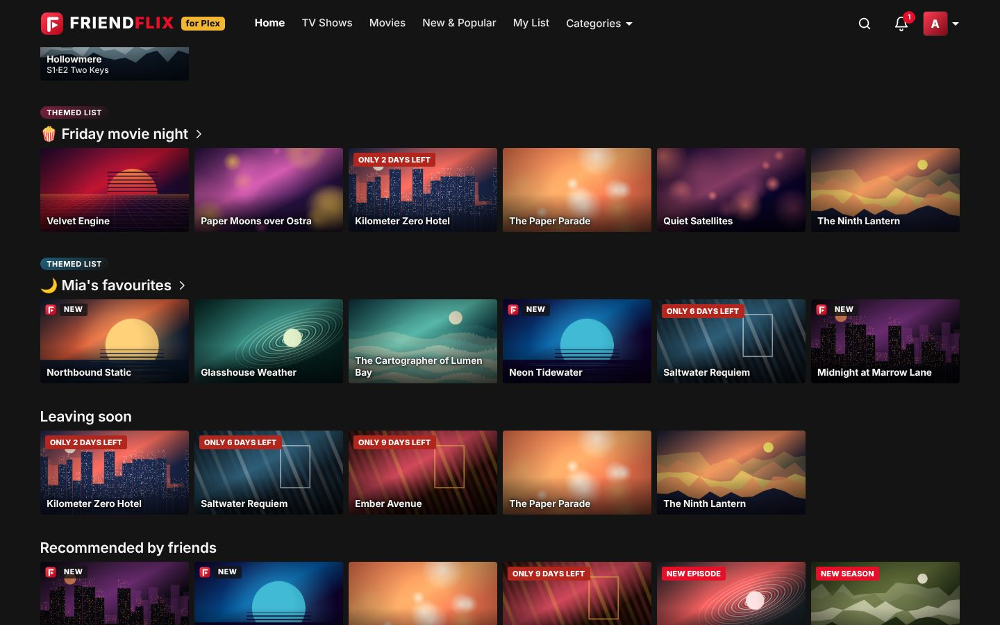
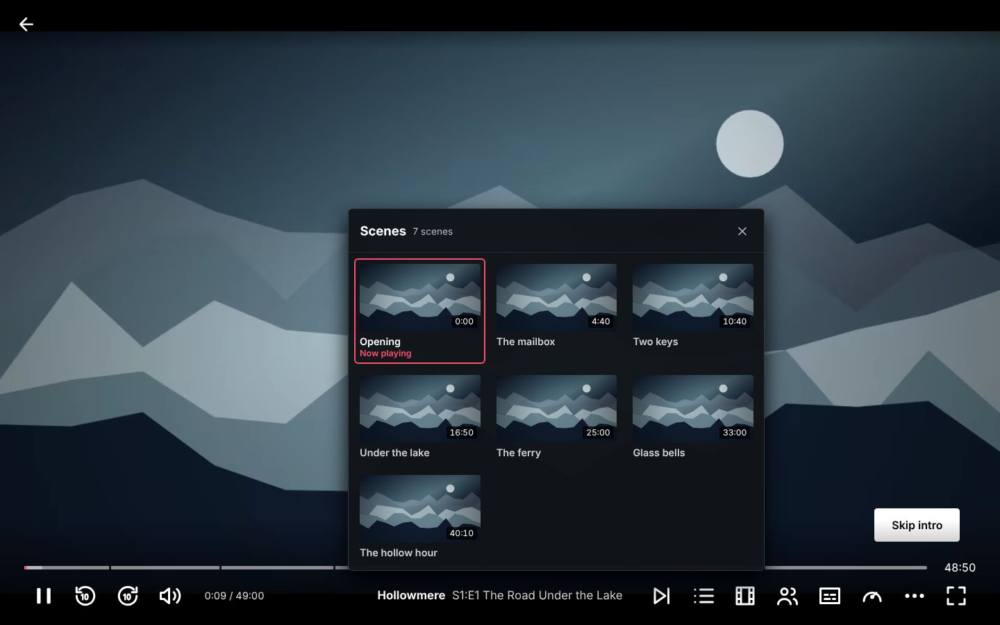
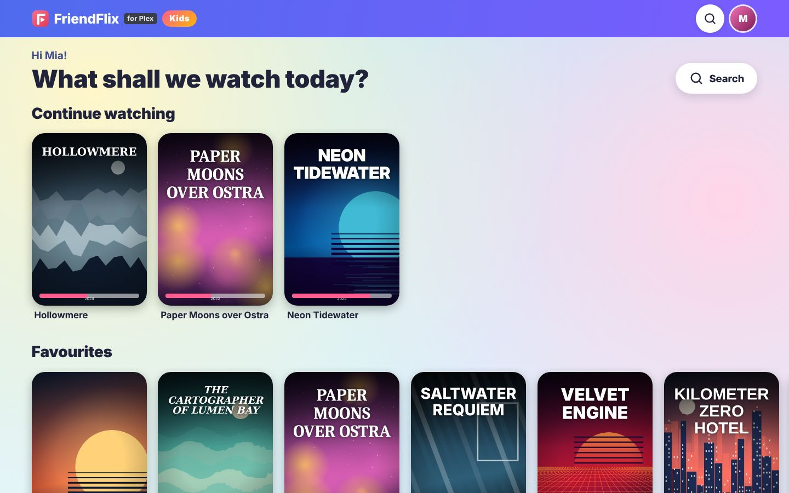
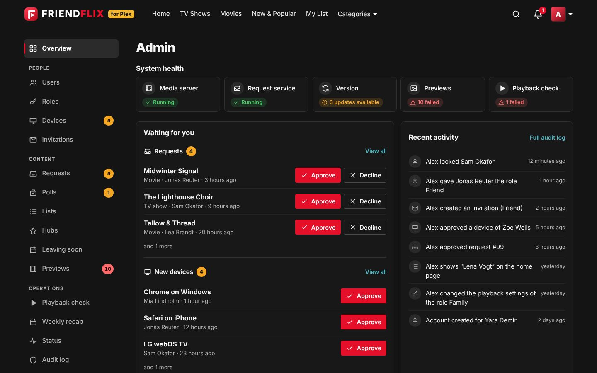
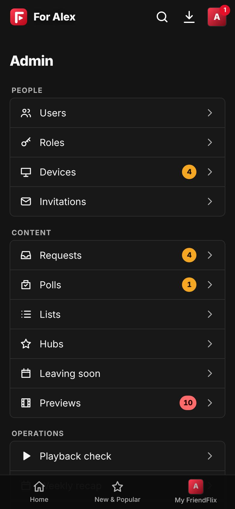
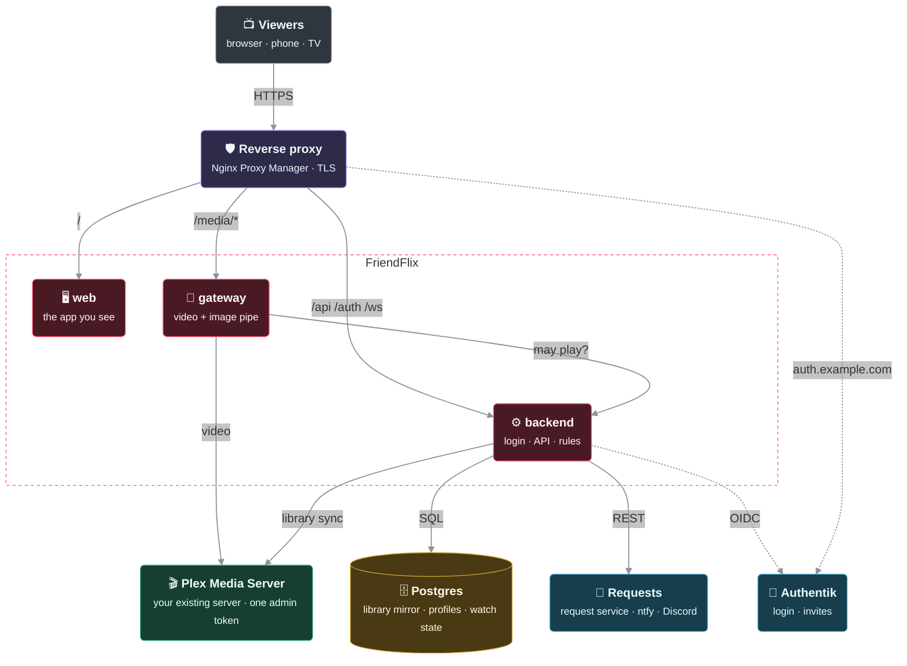

<p align="center">
  <picture>
    <source media="(prefers-color-scheme: dark)" srcset="docs/images/logo-dark.svg">
    
  </picture>
</p>

<p align="center"><b>Your own streaming service for friends and family – built on the Plex library you already have.</b></p>

<p align="center">
  <a href="README.md">English</a> · <a href="README.de.md">Deutsch</a>
  <br><br>
  <a href="https://github.com/LetsManu/friendflix/actions/workflows/ci.yml"></a>
  
  
  
</p>

<p align="center"></p>

**FriendFlix for Plex** is a private streaming portal that sits in front of your **Plex Media Server** (your media) and an optional request service (wishes). Your friends get a polished, familiar streaming experience on their laptop, phone and TV – with profiles, downloads, watch parties and recommendations from each other. They never see Plex or the request service directly, and you stay in control of who gets in. Nobody needs a plex.tv account.

> **Status: preview, not released.** The Plex support is implemented on the development branch and tested against a fake Plex server built from real Plex Media Server 1.43 answers, but it is **not released** and has hardly run against real servers yet – no images are published until the first preview release (see [Releases](https://github.com/LetsManu/friendflix-plex/releases) and [CHANGELOG.md](CHANGELOG.md)). Volunteers: [test against a real Plex server](docs/plex.md#test-against-a-real-plex-server).
>
> **This is a fork.** FriendFlix for Plex is a fork of [FriendFlix](https://github.com/LetsManu/friendflix) that talks to Plex instead of Jellyfin. **Using Jellyfin? Use the upstream project: [LetsManu/friendflix](https://github.com/LetsManu/friendflix).** The feature tour below is the upstream one, worded for Plex; the [parity table](#plex-vs-jellyfin-what-works) says what Plex cannot deliver.

> All titles and artwork in these screenshots are invented and generated for the demo. The "for Plex" badge next to the wordmark is part of this fork's interface.


## Contents

- [What you get](#what-you-get)
- [Privacy and safety](#privacy-and-safety)
- [Plex vs. Jellyfin: what works](#plex-vs-jellyfin-what-works)
- [For admins: setup and operation](#for-admins-setup-and-operation)

## What you get

Watching · Discovering · Together · Family and kids · Phone and TV · Admin

### Watching

#### A home page that feels like a real streaming service

A large billboard with the title logo, then rows such as *Continue Watching*, *Next Episode*, *Recommended by friends*, *Rated by friends*, *Popular this week*, *Because you watched …*, *Top 10* and *Watchlist*. Hover over a card and it pops out with the most important actions: play, add to your list, rate, more info.

Small **labels** on the cards tell you what is new – *New*, *New episode*, *New season*, *Season finale*, *New series*. When the admin knows that a title is about to leave the library, its card says "Only 6 days left" and a **Leaving soon** row collects those titles; everyone who has one on their list or in *Continue Watching* gets a reminder a week and a day before. Nothing is deleted – the date is only an announcement.

<p align="center"></p>

<p align="center"></p>

#### Everything about a title in one place

The detail view shows the description, audio and subtitle languages, cast, which friends recommended or watched it, and – for shows – every season and episode with progress bars. Pick up exactly where you left off. Small chips tell you the **picture and sound** before you press play (4K, HDR, Dolby Vision, Dolby Atmos, 5.1 surround), read from Plex's stream details. When a new season is about to start, or you have been away for a few weeks, **The story so far** gives a short recap (from Plex's season and episode summaries) and where you stopped – and you can hide the card. An **Extras** tab collects trailers and special features from Plex (local extras such as `-trailer` files), and every episode has its own **comments** from your friends: comments on an episode you have not seen yet stay blurred until you choose "Spoiler – show anyway".

<table>
  <tr>
    <td></td>
    <td></td>
  </tr>
</table>

#### A player made for binge nights

Skip intro and credits (where Plex has markers, see [limits](#plex-vs-jellyfin-what-works)), next episode with countdown, audio track and subtitles (with your own subtitle style), playback speed, bookmarks, keyboard shortcuts and "Are you still watching?" after several autoplayed episodes. Direct play when possible, adaptive streaming (HLS) otherwise. **Skip preview** (jumping over "next time on …") is not available with Plex. Change the audio track or subtitles once and FriendFlix remembers it **for the whole series**; with "Anime: original audio with subtitles" turned on, anime starts in Japanese with subtitles in your language unless you picked something else for that series.

- **Cast & info** (press <kbd>I</kbd> for a quick look, then "All info"): who plays whom, the guest stars of this episode, director, writers, studio and labels – tap a person to see their other titles in your library (Plex has no person images).
- **Scenes**: chapter marks on the timeline and a panel with a thumbnail for every scene (thumbnails need Plex's chapter thumbnails) – jump straight to the good part.
- **Clear voices** and **Night mode** in the sound menu: bring dialogue forward, or keep loud scenes from waking the house.
- **Smooth streaming**: *Auto* quality adapts to your connection and steps down when the picture stalls (a chip says why); outside your home network each role has its own bitrate limit, and the player starts from a poster of the title instead of a black screen.

<p align="center"></p>

<p align="center"></p>

### Discovering

- **Brand hubs** – wide tiles the admin builds from your own Plex collections, genres or tags – studio-based hubs depend on what Plex provides (say "Anime" or "Documentaries") – open a page of their own with *New*, *Popular*, *Movies*, *Series* and A–Z.
- **Themed lists** – any list can become an editorial page with a title, a colour and an emoji; the admin pins a few of them as rows on everyone's home page ("Friday movie night", "Cosy autumn").
- **A fuller detail page** – ratings in one line (community, critics, friends; IMDb, Rotten Tomatoes and Metacritic with an optional OMDb key), a collection row with "Part 2 of 3" and watched ticks, and a *Details* tab with facts and links to TMDB, IMDb, TVDB and Trakt. On phones the tabs stay in reach while you scroll.
- **Because you watched …** – several rows, each based on a different recent title, spread between the other rows.
- **Search and browse** find people, genres, titles and episodes; filter by decade, rating, language and **picture quality** (4K, HDR, Dolby Vision, Atmos). "Tonight" suggests three titles by mood and time.
- **Simulcast** (linked from the calendar) lists the series that are airing right now, grouped by weekday and season, with an "Anime only" filter (on Plex it relies on Plex air dates; limited, not verified yet).

### Together

- **Watch parties** with synchronised playback, chat and live emoji reactions that float over the picture for everyone in the party. **Movie-night voting** with countdown and automatic start. "What has none of us seen yet?" – the group matcher finds titles for everyone.
- **Recommendations**: recommend titles to friends, see what friends rated and watched this week, shared lists with editors and readers, curated rows from the admin.
- **Wishes**: missing something? Wish for it right from the search (through the request service, with its own local request user per FriendFlix account) and get notified when it arrives – with a monthly limit per role. "Remind me" for upcoming titles.
- **Stay in the loop**: notifications in the app, as web push on every device, via ntfy or Discord, and an optional weekly digest.
- **The fun extras**: reactions and short reviews (visible only after you watched it), ratings, stats, achievements and a shareable "year in review" card of your viewing stats.

### Family and kids

Up to five profiles per account, each with its own history, list, favourites, language and playback settings. Profiles can be locked with a 4-digit PIN. Every new profile starts with a short **welcome**: confirm name and colour, then pick three titles you like so the recommendations know where to start.

**Kids profiles** get a bright home of their own with big tiles, a simple search and an age limit (0, 6 or 12) that the server enforces on every list, search and title. Nothing social is shown – no friends, reactions, ratings, comments, watch parties, shared lists, requests or stats – and the settings only offer language and playback languages. Leaving a kids profile needs the PIN of the target profile, or the owner's PIN if the target has none; a TV paired from a kids profile stays on that kids profile. Pinned themed lists (a "Cosy autumn" for the little ones) show up there too.

**Calm mode** (per profile, also for kids) keeps everything quiet: no trailer in the billboard, no preview on hover, no sound, and less motion across the whole app.

<table>
  <tr>
    <td></td>
    <td></td>
  </tr>
</table>

### Phone and TV

An app-like layout with a bottom tab bar, a preview sheet when you tap a poster, and full details one swipe away. FriendFlix can be installed to the home screen (PWA) – with long-press **shortcuts** (Continue Watching, Watchlist, Search, Downloads), an icon **badge** with your unread notifications and the app name and description in your language.

<table>
  <tr>
    <td></td>
    <td></td>
    <td></td>
  </tr>
</table>

**On the big screen:** TV mode for smart-TV browsers, sticks and consoles – big type, arrow-key navigation, pairing with a code or QR code, and your **phone as the remote**. Chromecast from Chrome, Edge and Android.

**Downloads for the train and the plane:** download movies and episodes (or the next few episodes of a show in one go) and watch them offline in the browser. Progress syncs back the next time you are online. Per-device licences with expiry; works in Chrome, Edge, Firefox, Safari 17+ and as a home-screen app on iOS 17+.

<p align="center"></p>

**Seven languages:** the interface speaks **English, German, French, Spanish, Italian, Turkish and Polish**. Every profile picks its own language; on first login FriendFlix asks once and suggests the browser language. The admin sets the default language for the whole instance.

<p align="center"></p>

### Admin

A tidy admin area with a sidebar (People, Content, Operations) and an **overview** that shows system health, what is waiting for you – approve or decline a wish or a new device right there –, recent activity in plain sentences, counts and storage. Everything gives feedback: no pop-up boxes, risky actions ask first, small ones offer **Undo**. On the phone the same area is a simple list with big touch targets.

Also in the admin area: invitations and roles, **brand hubs**, featured and themed lists, **leaving-soon** dates, hover-preview clips, the nightly playback check, the weekly digest, an audit log and one-click updates.

<table>
  <tr>
    <td></td>
    <td></td>
  </tr>
</table>

## Privacy and safety

- **Self-hosted.** Everything runs on your own server. FriendFlix has no ads and no third-party analytics.
- **Invite only.** New people join with one-time invitation links. Sign-in goes through your Authentik with **mandatory multi-factor authentication**, and new devices can require approval.
- **Plex and the request service stay hidden.** Friends only ever talk to the portal. The Plex token lives only in the backend and the gateway and is never sent to a browser; video and images are streamed through a gateway that checks every request.
- **No plex.tv accounts for your friends.** FriendFlix manages its users itself and enforces roles, profiles and age limits itself; Plex only sees one server-side token. It works without Plex Pass.
- **You decide what friends see.** "Share history" (off by default) and "Share ratings" are switched in each person's settings; "Popular this week" only shows counts, never who watched. Reactions to a title only appear once you have watched it, and optional spoiler protection hides thumbnails and descriptions of unwatched episodes.
- **Trailers without tracking.** Trailers for titles that are not in the library play in the privacy-friendly `youtube-nocookie.com` player and only load after a click.
- **Error reports stay with you.** If the app crashes in someone's browser, a scrubbed error message (no query strings, tokens or e-mail addresses) is written to *your* server's log – and goes nowhere else.
- **Honest about downloads.** Downloads are for trusted friends and family: there is no copy protection (no DRM); expiry and revocation are enforced by the app.
- **Checked before it ships.** Every image is scanned, signed and published with a software bill of materials; the pipeline also runs a web security scan and the supply chain is scored publicly (see below).

## Plex vs. Jellyfin: what works

The FriendFlix interface is the same; what differs is what Plex can deliver. Status of the preview (Plex behaviour verified against a real Plex Media Server 1.43, implementation tested against a fake built from its answers):

| Feature | Plex | Note |
|---|---|---|
| Profiles, kids profiles, age limits, PIN | Works | Stored and enforced by FriendFlix (kids age caps 0/6/12 on every list, search, title and media request); age ratings come from Plex (`contentRating`), unknown ratings are blocked for capped and kids profiles |
| Library access per role | Works | By Plex library name (renaming a library in Plex needs a role update) |
| Library, search, detail pages, images | Works | Title logos depend on what Plex provides; falls back to the title text |
| Cast & info panel | Limited | Character names, directors, writers, studio, labels, guest stars on episodes; no person images |
| Chapters ("Scenes" panel) | Works | Chapter marks from the files; chapter stills only if Plex generates chapter thumbnails |
| Quality chips, 4K / HDR filter | Works | From Plex's stream details (resolution, Dolby Vision / HDR10 / HDR10+ / HLG, channels, Atmos) |
| Fresh labels ("New episode", "Season finale" …) | Limited | Plex has no series status, so "Season finale" only appears for series whose last episode aired more than 60 days ago |
| Leaving soon, story so far, themed lists, calm mode, clear voices, phone shortcuts, admin pages | Works | FriendFlix features; "Live streams" lists FriendFlix playback only, "Stop" ends the Plex transcode |
| "More like this" | Limited | Computed by FriendFlix from shared genres and cast |
| Brand hubs, "Because you watched …" rows, episode comments, onboarding | Works | FriendFlix features; hubs are built from Plex collections/genres/tags |
| Extras tab (trailers, special features) | Limited | Only what Plex has as local extras |
| Simulcast page (airing now, anime filter) | Limited | Relies on Plex air dates; not verified yet |
| Per-series audio/subtitle memory, anime original-audio default | Works | Stored by FriendFlix; the audio switch itself is subject to the per-account audio limit below |
| Continue watching, favourites, watchlist, ratings, history | Works | Stored in FriendFlix; FriendFlix never writes watch state to Plex |
| Direct play and adaptive streaming (HLS) | Works | Via the Plex transcoder; 4K/HDR/hardware transcoding depends on your Plex setup; role limits (bitrate, height, transcoding off, max. streams) enforced by FriendFlix |
| Subtitles | Limited | Text subtitles only; embedded tracks are extracted and converted to WebVTT by FriendFlix (ffmpeg); no PGS, no subtitle search |
| Audio track selection | Limited | Plex keeps it per Plex account. FriendFlix serializes stream starts; it collides with other Plex apps using the same account – use a dedicated Plex account/token |
| Skip intro / credits | Limited | Needs markers from Plex, which needs **Plex Pass**. Without it the button never appears |
| Skip recap / preview ("next time on …") | Not available | Plex has no such markers |
| Scrub preview thumbnails | Limited | Single frames, only if "video preview thumbnails" are enabled in Plex |
| Downloads | Works | Original file if browser-ready, otherwise transcoded by Plex and remuxed by FriendFlix |
| Chromecast | Works | Including text subtitles (signed FriendFlix subtitle URLs) |
| TV mode, watch parties, recommendations, notifications | Works | FriendFlix features, independent of the media server |
| "Upcoming episodes" | Not available | Plex does not offer it |
| Wishes / request service | Works | Each FriendFlix account gets its own local request-service user (request permission only), created on the first wish |
| nginx "Plan B" media path | Not available | Not supported with Plex |

Details, setup and troubleshooting: [docs/plex.md](docs/plex.md).

---

## For admins: setup and operation

Everything below is technical. The Plex setup guide is [docs/plex.md](docs/plex.md) ([Deutsch](docs/de/plex.md)); the detailed operating docs are in German (see [Documentation](#documentation)).

> **Preview:** the Plex backend and `compose.plex.yaml` exist, but there is no release and the images below are not published yet. Until then, build the images yourself (`docker compose -f compose.yaml -f compose.plex.yaml build`) and use a test instance.

**Setup guide:** step-by-step installation from an empty server to the first invited friend – [docs/setup.md](docs/setup.md); Authentik (installation, provider, flows, invitations) – [docs/authentik.md](docs/authentik.md).

### Requirements

- A Linux server with **Docker** and **Docker Compose**.
- A **Plex Media Server** (tested against 1.43) with your libraries, **claimed** (signed in to an account once) and reachable from the FriendFlix gateway. FriendFlix connects to an existing server; it does not start one. One Plex server per FriendFlix instance.
- A **Plex admin token** (`X-Plex-Token`): see Plex's support article "Finding an authentication token / X-Plex-Token" and [docs/plex.md](docs/plex.md). Use a dedicated Plex account or token for FriendFlix. Plex Pass is optional (intro/credits markers, hardware transcoding).
- Optionally a request service for wishes (as upstream; FriendFlix creates a local request user per account, no Plex or Jellyfin account involved).
- **Authentik** as the login provider (OIDC with PKCE; enforce MFA there).
- A reverse proxy with TLS, e.g. **Nginx Proxy Manager**, with one proxy host for the portal.
- Optional: ntfy, a Discord webhook, Portainer (one-click updates).

### Quick start

The production stack pulls prebuilt images from `ghcr.io/letsmanu/friendflix-plex-{backend,web,gateway}`; there is no build on the server. The images are published with the first preview release – before that, `docker compose ... up` cannot pull them.

```bash
git clone https://github.com/LetsManu/friendflix-plex.git && cd friendflix-plex
cp .env.example .env
openssl rand -base64 32    # -> APP_ENC_KEY
openssl rand -hex 24       # -> INTERNAL_SECRET, WEBHOOK_SECRET, METRICS_TOKEN (one value each)
$EDITOR .env               # PUBLIC_URL, passwords, OIDC_*, PLEX_URL, PLEX_TOKEN, SEERR_*
docker login ghcr.io -u <user>                                 # only if the packages are private (PAT with read:packages)
docker compose -f compose.prod.yaml -f compose.plex.yaml config --quiet   # validate
docker compose -f compose.prod.yaml -f compose.plex.yaml up -d    # compose.plex.yaml only connects to your existing Plex server
docker compose -f compose.prod.yaml -f compose.plex.yaml --profile backup up -d backup   # optional: nightly database backups
docker compose -f compose.prod.yaml -f compose.plex.yaml ps                         # everything "healthy"
```

Then:

1. **Authentik:** create the OIDC provider (redirect URI `${PUBLIC_URL}/auth/callback`) and enforce MFA – [docs/authentik.md](docs/authentik.md).
2. **Nginx Proxy Manager:** one proxy host `portal.<domain>` → `127.0.0.1:3080`, WebSockets on, Force SSL/HTTP2/HSTS; paste [deploy/npm/portal.advanced.conf](deploy/npm/portal.advanced.conf) into the *Advanced* tab (routes `/api`, `/auth`, `/ws` to `:3081` and `/media/` to `:3082`). Keep its `/media/c/` block: it stops cast tokens from being logged.
3. **Plex:** claim the server, get the admin token, check library names, age ratings and preview thumbnails – [docs/plex.md](docs/plex.md). The Jellyfin steps in [docs/integrations.md](docs/integrations.md) do not apply.
4. **Request service (optional):** API key and webhook – [docs/integrations.md](docs/integrations.md).
5. **Web push (optional):** `node scripts/gen-vapid.mjs`, put both keys into `.env`, restart.
6. **First login** with a member of the Authentik group `friendflix-admins`: you become the portal admin, choose the instance language, and invite your friends under *Admin → Invitations*.

The gateway must reach `PLEX_URL`; use the local address of your Plex server (details in [docs/plex.md](docs/plex.md)). If the request service already runs in its own stack: `docker network connect friendflix_media <container>`, remove its public ports and set `SEERR_URL`.

### Configuration

Template: [.env.example](.env.example). Every variable can also be read from a file with the `_FILE` suffix (Docker secrets, see [compose.secrets.yaml](compose.secrets.yaml)). Defaults are the ones in [compose.prod.yaml](compose.prod.yaml). Plex variables below are passed by `compose.plex.yaml` (which also sets `MEDIA_SERVER=plex`).

| Variable | Default | Purpose |
|---|---|---|
| `PUBLIC_URL` | – (required) | Public https URL of the portal |
| `POSTGRES_PASSWORD`, `REDIS_PASSWORD` | – (required) | Database and Redis passwords |
| `APP_ENC_KEY` | – (required) | 32 bytes base64; encrypts stored credentials. **Back it up separately.** |
| `INTERNAL_SECRET`, `WEBHOOK_SECRET` | – (required, ≥ 16 chars) | Backend ↔ gateway secret; media server/request service webhooks |
| `OIDC_ISSUER`, `OIDC_CLIENT_ID`, `OIDC_CLIENT_SECRET` | – (required) | Authentik OIDC provider |
| `TMDB_API_KEY`, `OMDB_API_KEY` (or `…_FILE`) | empty | Optional extra data for the detail page (links, ratings); or set in *Admin → Data sources*. See [docs/integrations.md](docs/integrations.md#tmdb--omdb-optional) |
| `MEDIA_SERVER` | `jellyfin` upstream; `plex` here | `plex` selects the Plex backend (one media server per instance) |
| `PLEX_URL` | – (required with `plex`) | URL of your Plex server as seen by backend and gateway, e.g. `http://192.168.1.10:32400` or `http://host.docker.internal:32400` |
| `PLEX_TOKEN` or `PLEX_TOKEN_FILE` | – (required with `plex`) | Plex token (a dedicated Plex account is recommended). Only backend and gateway use it; never sent to browsers |
| `JELLYFIN_URL`, `JELLYFIN_ADMIN_API_KEY` | – (upstream / `MEDIA_SERVER=jellyfin` only) | Not used with Plex; leave empty |
| `SEERR_URL`, `SEERR_API_KEY` | – (required as upstream) | Internal request service URL and API key |
| `ADMIN_GROUP` | `friendflix-admins` | Authentik group whose members become portal admins |
| `BIND_ADDR` | `127.0.0.1` | Host address the three ports are published on – never a public interface |
| `WEB_PORT`, `BACKEND_PORT`, `GATEWAY_PORT` | `3080`, `3081`, `3082` | Host ports for the reverse proxy |
| `FF_REGISTRY`, `FF_TAG` | `ghcr.io/letsmanu`, `latest` | Image source and version (pin with a commit SHA or `x.y.z`) |
| `SESSION_TTL_SECONDS`, `SESSION_IDLE_SECONDS` | `28800`, `7200` | Absolute session length (8 h) and idle timeout (2 h) |
| `TZ` | `Europe/Vienna` | Time zone for scheduled jobs (digest, playback check, backups) |
| `AUTHENTIK_URL`, `AUTHENTIK_API_TOKEN`, `AUTHENTIK_ENROLL_FLOW` | empty | Invitations that also create the Authentik account (all three needed) |
| `NTFY_URL`, `NTFY_BASE_URL`, `DISCORD_WEBHOOK_URL` | empty | Shared ntfy/Discord channel; ntfy server for personal topics |
| `VAPID_PUBLIC_KEY`, `VAPID_PRIVATE_KEY`, `VAPID_SUBJECT` | empty, empty, `PUBLIC_URL` | Web push; active only when both keys are set |
| `DIGEST_DAY`, `DIGEST_HOUR` | `0` (Sunday), `18` | Weekly digest schedule; `-1` = off; can be changed in the admin area |
| `CAST_ENABLED` | `true` | Chromecast (needs an https `PUBLIC_URL`); `false` with Plan B |
| `DOWNLOADS_ENABLED` | `true` | Offline downloads; `false` with Plan B |
| `DOWNLOADS_PATH`, `PREVIEWS_PATH` | named volumes `downloads`, `previews` | Host folder (absolute path, writable by uid 1000) for prepared downloads and preview clips |
| `DOWNLOAD_CACHE_MAX_GB`, `DOWNLOAD_MIN_FREE_GB` | `50`, `2` | Size cap for prepared downloads; minimum free space to keep |
| `DOWNLOAD_PREP_CONCURRENCY`, `DOWNLOAD_PAUSE_STREAMS` | `1`, `2` | Parallel preparations; pause preparation while this many streams run (`0` = never) |
| `DOWNLOAD_FILE_TTL_HOURS`, `DOWNLOAD_OFFLINE_GRACE_DAYS`, `DOWNLOAD_CREATE_PER_HOUR` | `48`, `7`, `20` | Cleanup of unused files, offline grace period, licence rate limit |
| `DIRECT_PLAY_REQUIRES_DOWNLOAD` | `false` | `true`: roles without download permission also lose direct play |
| `PREVIEW_WARM` | `true` | Background job that pre-generates hover/billboard preview clips |
| `PLAYBACK_CHECK_HOUR` | `4` | Nightly playback check with admin alert; `-1` = off |
| `BACKGROUND_JOBS` | `true` | Download preparation/cleanup, language and picture-quality index, leaving-soon reminders, Plex library sync (keep `true` on the single backend) |
| `API_COMPRESSION` | `true` | gzip/brotli for JSON responses ≥ 1 KB; `false` if the proxy already compresses `/api` |
| `METRICS_TOKEN` | empty | Bearer token for `/metrics` |
| `PORTAINER_WEBHOOK_URL` or `PORTAINER_URL` + `PORTAINER_API_KEY` + `PORTAINER_STACK_ID` | empty | One-click updates from *Admin → Update* (`PORTAINER_ENDPOINT_ID` default `1`) |
| `UPDATE_REPO`, `GITHUB_TOKEN` | `LetsManu/friendflix`, empty | Version check; the token only raises the GitHub rate limit |
| `GRAFANA_ADMIN_PASSWORD`, `GRAFANA_PORT`, `PROMETHEUS_RETENTION` | – (required for the monitoring stack), `3083`, `30d` | Optional Prometheus + Grafana (`compose.monitoring.yaml`); no default password |
| `BACKUP_PATH`, `BACKUP_HOUR`, `BACKUP_KEEP_DAYS`, `BACKUP_RUN_ON_START` | `./backups`, `3`, `14`, `false` | Backup sidecar (profile `backup`) |
| `MEDIA_PATH` | `./media` | Media folder for the bundled Jellyfin (upstream profile `bundled`; not used with Plex) |

The full list with explanations is in [.env.example](.env.example).

### Architecture

How it fits together – the Plex token stays in the backend and the gateway, and the backend mirrors the Plex library into Postgres and decides access itself:



> 🟥 FriendFlix · 🟩 media server · 🟦 other service · 🟪 reverse proxy · 🟨 data store · ⬛ viewers / outside · dashed frame = network or boundary · thick line = video stream · dotted = optional / via public URL

- Only the proxy is public. `web`, `backend` and `gateway` are published on `127.0.0.1` only; the request service has no ports at all and lives on the internal `media` network (your Plex server stays where it is and is only reached by the gateway and backend), Postgres and Redis on the internal `db` network.
- All video data (playlists, segments, direct play, images, subtitles, downloads, Chromecast) flows through the gateway: no buffering, HTTP range, the Plex token only in the gateway (and the backend), path allowlist, fixed upstream, bitrate cap per role. Part, transcode-session and chapter-image paths carry an HMAC signature, so a visible title never unlocks a foreign file.
- Containers run non-root with a read-only root filesystem, `cap_drop: ALL` and `no-new-privileges`. Strict CSP, CSRF tokens, rate limits, audit log.
- Plex-specific: FriendFlix mirrors the Plex library into Postgres (a sync every 5 minutes, Plex's notification websocket and a nightly sweep) and enforces profiles, age limits and access itself; the gateway rewrites Plex transcoder playlists so clients never see Plex URLs or tokens. The upstream alternative "Plan B" (nginx serves `/media/` itself) is **not supported** with Plex.
- The media server sits behind a neutral interface (`MediaServer` in the backend, an `Upstream` adapter in the gateway, chosen with `MEDIA_SERVER`); Plex is one implementation next to Jellyfin. Containers and networks, the "press play" walk-through, trust boundaries and the seam, with Plex and Jellyfin side by side: [docs/architecture.md](docs/architecture.md).

### Operations

- **Backups:** the opt-in `backup` sidecar runs `pg_dump` daily at `BACKUP_HOUR`, verifies each dump with `pg_restore --list`, keeps `BACKUP_KEEP_DAYS` days and turns `unhealthy` if a run fails. Restore steps and a monthly restore test (`scripts/restore-test.sh`) are in [docs/operations.md](docs/operations.md). Keep `APP_ENC_KEY` in a password manager, separate from the dumps.
- **Updates:** *Admin → Update* shows the installed and latest version with the change list and redeploys the stack through Portainer (webhook or API). Manually: `docker compose -f compose.prod.yaml pull && docker compose -f compose.prod.yaml up -d`. Database migrations run on start.
- **Monitoring:** `/health` (liveness) and `/health/ready` (Redis, Postgres, media server) on `127.0.0.1:3081`; Prometheus metrics on `:3081/metrics` and `:3082/metrics` (Bearer `METRICS_TOKEN`). Icinga and Prometheus examples and an optional Prometheus + Grafana stack with a provisioned dashboard (`compose.monitoring.yaml`, internal network, no default password): [docs/monitoring.md](docs/monitoring.md).
- **Supply chain:** images are scanned (Trivy), signed with cosign (keyless) and published with SBOM and provenance attestations; verify them before you deploy – [docs/operations.md](docs/operations.md).
- **Performance:** every API response carries a `Server-Timing` header (`jf` = media server, `db` = Postgres, `kv` = Redis, `app` = total), the gateway adds `authz` and `upstream`; see them in the browser DevTools under *Network → Timing*. Requests ≥ 500 ms are logged as `slow request`. Browser errors are reported to the backend log and counted in `friendflix_client_errors_total`.

### Development

Node.js ≥ 22, npm workspaces `backend`, `gateway`, `web`.

```bash
npm ci
npm run lint && npm run typecheck && npm test   # backend tests need Postgres: TEST_DATABASE_URL=postgres://postgres@localhost:5433/ff_test
npm run dev -w backend                          # API on :3000
npm run dev -w web                              # UI on :5173 (proxies to backend/gateway)
npm run e2e                                     # Playwright: builds the web app and runs it against a fully mocked API
```

- `E2E_SKIP_BUILD=1` reuses an existing build; `PW_CHROMIUM=/path/to/chrome` uses a locally installed Chromium.
- `./scripts/setup-hooks.sh` installs the gitleaks pre-commit hook.
- Development against an http Authentik: `OIDC_ALLOW_INSECURE=true` (never in production).
- CI ([.github/workflows/ci.yml](.github/workflows/ci.yml)): lint, typecheck, tests, `npm audit`, e2e, OWASP ZAP baseline scan (DAST, rules in `.zap/rules.tsv`), gitleaks and Trivy (results also in code scanning); images are published by [publish.yml](.github/workflows/publish.yml) only after everything is green, with SBOM + provenance attestations and a keyless cosign signature – verification and recommended branch protection: [docs/operations.md](docs/operations.md).
- Supply-chain checks: OpenSSF Scorecard ([scorecard.yml](.github/workflows/scorecard.yml)), weekly and on every push to `main`. [](https://scorecard.dev/viewer/?uri=github.com/LetsManu/friendflix)
- Translations: German is the source, all other languages live next to it – how to fix or add a language: [docs/i18n.md](docs/i18n.md).

### Documentation

| Topic | File |
|---|---|
| Installation step by step (Jellyfin steps: use [docs/plex.md](docs/plex.md) instead) | [docs/setup.md](docs/setup.md) |
| Architecture: how it fits together, containers and networks, press play, trust boundaries, media server seam (Plex and Jellyfin) | [docs/architecture.md](docs/architecture.md) |
| Authentik: installation, provider, flows, invitations | [docs/authentik.md](docs/authentik.md) |
| **Plex setup, feature parity, troubleshooting, keeping in sync with upstream** | [docs/plex.md](docs/plex.md) · [Deutsch](docs/de/plex.md) |
| Request service, Authentik, ntfy/Discord, web push (Jellyfin parts do not apply) | [docs/integrations.md](docs/integrations.md) |
| Backups, restore, firewall, updates, image verification, branch protection (Plan B not supported with Plex) | [docs/operations.md](docs/operations.md) |
| Monitoring, metrics, Grafana dashboard, Server-Timing, browser errors | [docs/monitoring.md](docs/monitoring.md) |
| Offline downloads (platforms, storage, limits) | [docs/downloads.md](docs/downloads.md) |
| TV mode and phone remote | [docs/tv-mode.md](docs/tv-mode.md) |
| Chromecast | [docs/cast.md](docs/cast.md) |
| Search and discovery API, labels, leaving soon, quality, kids rules | [docs/discovery.md](docs/discovery.md) |
| Themed lists, calm mode, sound in the player, phone shortcuts and badge | [docs/personal.md](docs/personal.md) |
| UI kit and admin shell | [docs/ui-kit.md](docs/ui-kit.md) |
| Languages and translations | [docs/i18n.md](docs/i18n.md) |
| Changes | [CHANGELOG.md](CHANGELOG.md) |

### Known limitations

- One backend replica: watch-party rooms, rate limits and remote-control rooms live in memory.
- Image-based subtitles (PGS) are not offered; text subtitles are delivered as WebVTT.
- Cast & info, scenes and the picture-quality chips need the media server to report credits, chapters and stream details; with Plex they work (see the parity table), where a server cannot, the UI hides the feature (`capabilities` in `/api/me`).
- "Leaving soon" is an announcement set by an admin; FriendFlix never deletes media. The "Season finale" label is a heuristic (with Plex: every episode has an air date and the newest is older than 60 days). The picture-quality filter reads a background index (`BACKGROUND_JOBS=true`) that fills a little after the first start, and Plex libraries mirrored by an older version are re-read once.
- Clear voices and Night mode use the browser's audio processing: not available on every device and not while casting. PWA home-screen widgets exist only on Windows 11; shortcuts and the icon badge (not on every iOS version) are what the phone gets instead.
- Plex (see the [table above](#plex-vs-jellyfin-what-works) and [docs/plex.md](docs/plex.md)): skip intro/credits only with Plex Pass markers (never recap/preview); scrub previews are single frames and need preview thumbnails enabled in Plex; no "upcoming episodes"; audio track selection is per Plex account (stream starts are serialized, use a dedicated token); subtitles are extracted and converted by FriendFlix; the server must be claimed and a token is required; Plan B is not supported.
- The Plex implementation relies on partly undocumented Plex APIs, verified against Plex Media Server 1.43; other versions may behave differently.
- Request service and Authentik APIs differ between versions – after upgrades see [docs/operations.md](docs/operations.md) and [docs/integrations.md](docs/integrations.md).
- Profiles live in FriendFlix, not in Plex: they do not appear in Plex's user list and need no plex.tv account.
- Hardware transcoding in Plex is controlled by Plex (according to Plex it needs Plex Pass); FriendFlix does not change that.
- Kids profiles are a parental guard, not a lock against someone who knows the account login. The owner PIN is reset with "Forgot PIN?" (`/auth/login?resetPin=1`): it needs a fresh sign-in at Authentik (checked via the token's `auth_time`) and is refused on any device that is tied to a kids profile – the owner resets it from their own device. Keep the Authentik login (and its second factor) away from the kids. If no PIN is set at all, leaving a kids profile is allowed and the owner sees a hint to set one.

### License

Copyright © 2026 Manuel Weißböck.

This project is free software: you can redistribute it and/or modify it under the terms of the **GNU Affero General Public License v3.0 or later** (AGPL-3.0-or-later) – see [LICENSE](LICENSE). If you run a modified version as a service for other people, you must offer them its source code. It comes with no warranty.

### Trademarks

Netflix, Disney+, Prime Video, Crunchyroll, Plex, Jellyfin, TMDB, OMDb, IMDb, Rotten Tomatoes, Metacritic, TVDB, Trakt and other names are trademarks of their respective owners. FriendFlix for Plex is an independent open-source project and is not affiliated with, sponsored or endorsed by any of them. "for Plex" only describes compatibility; the project uses no Plex logo and is not an official Plex product. This product uses the TMDB API but is not endorsed or certified by TMDB.
