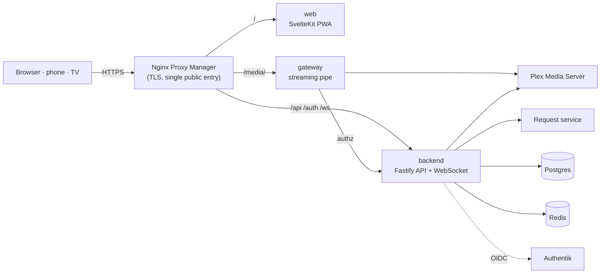

<p align="center">
  <picture>
    <source media="(prefers-color-scheme: dark)" srcset="docs/images/logo-dark.svg">
    
  </picture>
</p>

<p align="center"><b>Your own streaming service for friends and family – built on the Plex library you already have.</b></p>

<p align="center">
  <a href="README.md">English</a> · <a href="README.de.md">Deutsch</a>
  <br><br>
  <a href="https://github.com/LetsManu/friendflix/actions/workflows/ci.yml"></a>
  
  
  
</p>

<p align="center"></p>

**FriendFlix for Plex** is a private streaming portal that sits in front of your **Plex Media Server** (your media) and an optional request service (wishes). Your friends get a polished, familiar streaming experience on their laptop, phone and TV – with profiles, downloads, watch parties and recommendations from each other. They never see Plex or the request service directly, and you stay in control of who gets in. Nobody needs a plex.tv account.

> **Status: in development / preview.** The Plex support is being built right now and **does not work yet** – nothing below is a promise of a released feature until the first preview release is published (see [Releases](https://github.com/LetsManu/friendflix-plex/releases) and [CHANGELOG.md](CHANGELOG.md)). The screenshots show the FriendFlix interface as it exists upstream.
>
> **This is a fork.** FriendFlix for Plex is a fork of [FriendFlix](https://github.com/LetsManu/friendflix) that talks to Plex instead of Jellyfin. **Using Jellyfin? Use the upstream project: [LetsManu/friendflix](https://github.com/LetsManu/friendflix).**

> All titles and artwork in these screenshots are invented and generated for the demo.

## Contents

- [What you get](#what-you-get)
- [Made for friends and family](#made-for-friends-and-family)
- [Privacy and safety](#privacy-and-safety)
- [Plex vs. Jellyfin: what works](#plex-vs-jellyfin-what-works)
- [For admins: setup and operation](#for-admins-setup-and-operation)

## What you get

### A home page that feels like a real streaming service

A large billboard with the title logo, then rows such as *Continue Watching*, *Next Episode*, *Recommended by friends*, *Rated by friends*, *Popular this week*, *Because you watched …*, *Top 10* and *My List*. Hover over a card and it pops out with the most important actions: play, add to your list, rate, more info.

<p align="center"></p>

### Everything about a title in one place

The detail view shows the description, audio and subtitle languages, cast, which friends recommended or watched it, and – for shows – every season and episode with progress bars. Pick up exactly where you left off.

<table>
  <tr>
    <td></td>
    <td></td>
  </tr>
</table>

### A player made for binge nights

Skip intro and credits (where Plex has markers, see [limits](#plex-vs-jellyfin-what-works)), next episode with countdown, audio track and subtitles (with your own subtitle style), playback speed, bookmarks, keyboard shortcuts and "Are you still watching?" after several autoplayed episodes. Direct play when possible, adaptive streaming (HLS) otherwise.

<p align="center"></p>

### "Who's watching?"

Up to five profiles per account, each with its own history, list, favourites, language and playback settings. Profiles can be locked with a 4-digit PIN. Profiles, kids profiles, age limits, watch progress and favourites are stored by FriendFlix itself – not in Plex.

<p align="center"></p>

### Great on the phone

An app-like layout with a bottom tab bar, a preview sheet when you tap a poster, and full details one swipe away. FriendFlix can be installed to the home screen (PWA).

<table>
  <tr>
    <td></td>
    <td></td>
    <td></td>
  </tr>
</table>

### Downloads for the train and the plane

Download movies and episodes (or the next few episodes of a show in one go) and watch them offline in the browser. Progress syncs back the next time you are online.

<p align="center"></p>

### Seven languages

The interface speaks **English, German, French, Spanish, Italian, Turkish and Polish**. Every profile picks its own language; on first login FriendFlix asks once and suggests the browser language. The admin sets the default language for the whole instance.

<p align="center"></p>

## Made for friends and family

| | |
|---|---|
| **Profiles for everyone** | Up to 5 profiles per account, optional PIN, separate history, lists and settings. |
| **On the big screen** | TV mode for smart-TV browsers, sticks and consoles: big type, arrow-key navigation, pairing with a code or QR code, and your **phone as the remote**. Chromecast from Chrome, Edge and Android. |
| **Offline downloads** | Per-device licences with expiry; works in Chrome, Edge, Firefox, Safari 17+ and as a home-screen app on iOS 17+. |
| **Watch together** | Watch parties with synchronised playback, chat and emoji reactions. **Movie-night voting** with countdown and automatic start. "What has none of us seen yet?" – the group matcher finds titles for everyone. "Tonight" suggests three titles by mood and time. |
| **Recommendations** | Recommend titles to friends, see what friends rated and watched this week, "Because you watched …", shared lists with editors and readers, curated rows from the admin. |
| **Wishes** | Missing something? Request it right from the search (through the request service) and get notified when it arrives – with a monthly limit per role. "Remind me" for upcoming titles. |
| **Stay in the loop** | Notifications in the app, as web push on every device, via ntfy or Discord, and an optional weekly digest. |
| **The fun extras** | Reactions and short reviews (visible only after you watched it), ratings, stats, achievements and a shareable "Wrapped" card of your viewing stats. |
| **Seven languages** | English, German, French, Spanish, Italian, Turkish, Polish – per profile. |

## Privacy and safety

- **Self-hosted.** Everything runs on your own server. FriendFlix has no ads and no third-party analytics.
- **Invite only.** New people join with one-time invitation links. Sign-in goes through your Authentik with **mandatory multi-factor authentication**, and new devices can require approval.
- **Plex and the request service stay hidden.** Friends only ever talk to the portal. The Plex admin token lives only in the gateway and is never sent to a browser; video is streamed through a gateway that checks every request.
- **No plex.tv accounts for your friends.** FriendFlix manages its users itself; Plex only sees one server-side token. It works without Plex Pass.
- **You decide what friends see.** "Share history" (off by default) and "Share ratings" are switched in each person's settings; "Popular this week" only shows counts, never who watched. Reactions to a title only appear once you have watched it, and optional spoiler protection hides thumbnails and descriptions of unwatched episodes.
- **Trailers without tracking.** Trailers for titles that are not in the library play in the privacy-friendly `youtube-nocookie.com` player and only load after a click.
- **Error reports stay with you.** If the app crashes in someone's browser, a scrubbed error message (no query strings, tokens or e-mail addresses) is written to *your* server's log – and goes nowhere else.
- **Honest about downloads.** Downloads are for trusted friends and family: there is no copy protection (no DRM); expiry and revocation are enforced by the app.

## Plex vs. Jellyfin: what works

The FriendFlix interface is the same; what differs is what Plex can deliver. Planned status for the Plex version (verified against a real Plex Media Server 1.43):

| Feature | Plex | Note |
|---|---|---|
| Profiles, kids profiles, age limits, PIN | Works | Stored in FriendFlix; age ratings come from Plex (`contentRating`), unknown ratings are blocked for capped and kids profiles |
| Library, search, detail pages, cast, images | Works | Title logos depend on what Plex provides; falls back to the title text |
| Continue watching, favourites, my list, ratings, history | Works | Stored in FriendFlix; FriendFlix never writes watch state to Plex |
| Direct play and adaptive streaming (HLS) | Works | Via the Plex transcoder; 4K/HDR/hardware transcoding depends on your Plex setup |
| Subtitles | Works | Extracted and converted to WebVTT by FriendFlix; image-based (PGS) not offered |
| Audio track selection | Limited | Plex keeps it per Plex account. FriendFlix serializes stream starts; it can collide with other Plex apps using the same account – use a dedicated token |
| Skip intro / credits | Limited | Needs markers from Plex, which needs **Plex Pass**. Without it the button never appears. Recap/preview skipping: not available |
| Scrub preview thumbnails | Limited | Single frames, only if "video preview thumbnails" are enabled in Plex |
| Downloads, TV mode, Chromecast, watch parties, recommendations, notifications | Works | FriendFlix features, independent of the media server |
| "Upcoming episodes" | Not available | Plex does not offer it |
| Wishes / request service | Limited | Per-user mapping of requests is degraded |
| nginx "Plan B" media path | Not available | Not supported with Plex |

Details, setup and troubleshooting: [docs/plex.md](docs/plex.md).

---

## For admins: setup and operation

Everything below is technical. The Plex setup guide is [docs/plex.md](docs/plex.md) ([Deutsch](docs/de/plex.md)); the detailed operating docs are in German (see [Documentation](#documentation)).

> **Preview:** the Plex backend, `compose.plex.yaml` and the images below are **planned / in development** and not released yet. The steps describe the target setup of the first preview release.

### Requirements

- A Linux server with **Docker** and **Docker Compose**.
- A **Plex Media Server** (tested against 1.43) with your libraries, **claimed** (signed in to an account once) and reachable from the FriendFlix gateway. FriendFlix connects to an existing server; it does not start one. One Plex server per FriendFlix instance.
- A **Plex admin token** (`X-Plex-Token`): see Plex's support article "Finding an authentication token / X-Plex-Token" and [docs/plex.md](docs/plex.md). Use a dedicated Plex account or token for FriendFlix. Plex Pass is optional (intro/credits markers, hardware transcoding).
- Optionally a request service for wishes (Seerr, as upstream).
- **Authentik** as the login provider (OIDC with PKCE; enforce MFA there).
- A reverse proxy with TLS, e.g. **Nginx Proxy Manager**, with one proxy host for the portal.
- Optional: ntfy, a Discord webhook, Portainer (one-click updates).

### Quick start

The production stack will pull prebuilt images from `ghcr.io/letsmanu/friendflix-plex-{backend,web,gateway}` (planned); there is no build on the server. **Coming with the first preview release** – the commands do not work yet.

```bash
git clone https://github.com/LetsManu/friendflix-plex.git && cd friendflix-plex
cp .env.example .env
openssl rand -base64 32    # -> APP_ENC_KEY
openssl rand -hex 24       # -> INTERNAL_SECRET, WEBHOOK_SECRET, METRICS_TOKEN (one value each)
$EDITOR .env               # PUBLIC_URL, passwords, OIDC_*, MEDIA_SERVER=plex, PLEX_URL, PLEX_TOKEN, SEERR_*
docker login ghcr.io -u <user>                                 # only if the packages are private (PAT with read:packages)
docker compose -f compose.prod.yaml -f compose.plex.yaml up -d    # compose.plex.yaml only connects to your existing Plex server
docker compose -f compose.prod.yaml -f compose.plex.yaml --profile backup up -d backup   # optional: nightly database backups
docker compose -f compose.prod.yaml -f compose.plex.yaml ps                         # everything "healthy"
```

Then:

1. **Authentik:** create the OIDC provider (redirect URI `${PUBLIC_URL}/auth/callback`) and enforce MFA – [docs/integrations.md](docs/integrations.md).
2. **Nginx Proxy Manager:** one proxy host `portal.<domain>` → `127.0.0.1:3080`, WebSockets on, Force SSL/HTTP2/HSTS; paste [deploy/npm/portal.advanced.conf](deploy/npm/portal.advanced.conf) into the *Advanced* tab (routes `/api`, `/auth`, `/ws` to `:3081` and `/media/` to `:3082`). Keep its `/media/c/` block: it stops cast tokens from being logged.
3. **Plex:** claim the server, get the admin token, check library names, age ratings and preview thumbnails – [docs/plex.md](docs/plex.md). The Jellyfin steps in [docs/integrations.md](docs/integrations.md) do not apply.
4. **Request service (optional):** API key and webhook – [docs/integrations.md](docs/integrations.md).
5. **Web push (optional):** `node scripts/gen-vapid.mjs`, put both keys into `.env`, restart.
6. **First login** with a member of the Authentik group `friendflix-admins`: you become the portal admin, choose the instance language, and invite your friends under *Admin → Invitations*.

The gateway must reach `PLEX_URL`; use the local address of your Plex server (details in [docs/plex.md](docs/plex.md)). If the request service already runs in its own stack: `docker network connect friendflix_media <container>`, remove its public ports and set `SEERR_URL`.

### Configuration

Template: [.env.example](.env.example). Every variable can also be read from a file with the `_FILE` suffix (Docker secrets, see [compose.secrets.yaml](compose.secrets.yaml)). Defaults are the ones in [compose.prod.yaml](compose.prod.yaml). Plex variables below belong to the planned `compose.plex.yaml`.

| Variable | Default | Purpose |
|---|---|---|
| `PUBLIC_URL` | – (required) | Public https URL of the portal |
| `POSTGRES_PASSWORD`, `REDIS_PASSWORD` | – (required) | Database and Redis passwords |
| `APP_ENC_KEY` | – (required) | 32 bytes base64; encrypts stored credentials. **Back it up separately.** |
| `INTERNAL_SECRET`, `WEBHOOK_SECRET` | – (required, ≥ 16 chars) | Backend ↔ gateway secret; media server/request service webhooks |
| `OIDC_ISSUER`, `OIDC_CLIENT_ID`, `OIDC_CLIENT_SECRET` | – (required) | Authentik OIDC provider |
| `MEDIA_SERVER` | `jellyfin` upstream; `plex` here | `plex` selects the Plex backend (one media server per instance) |
| `PLEX_URL` | – (required with `plex`) | URL of your Plex server as seen by the gateway, e.g. `http://192.168.1.10:32400` |
| `PLEX_TOKEN` or `PLEX_TOKEN_FILE` | – (required with `plex`) | Plex admin token. Only the gateway uses it; never sent to browsers |
| `JELLYFIN_URL`, `JELLYFIN_ADMIN_API_KEY` | – (upstream / `MEDIA_SERVER=jellyfin` only) | Not used with Plex |
| `SEERR_URL`, `SEERR_API_KEY` | – (required as upstream) | Internal request service URL and API key |
| `ADMIN_GROUP` | `friendflix-admins` | Authentik group whose members become portal admins |
| `BIND_ADDR` | `127.0.0.1` | Host address the three ports are published on – never a public interface |
| `WEB_PORT`, `BACKEND_PORT`, `GATEWAY_PORT` | `3080`, `3081`, `3082` | Host ports for the reverse proxy |
| `FF_REGISTRY`, `FF_TAG` | `ghcr.io/letsmanu`, `latest` | Image source and version (pin with a commit SHA or `x.y.z`) |
| `SESSION_TTL_SECONDS`, `SESSION_IDLE_SECONDS` | `28800`, `7200` | Absolute session length (8 h) and idle timeout (2 h) |
| `TZ` | `Europe/Vienna` | Time zone for scheduled jobs (digest, playback check, backups) |
| `AUTHENTIK_URL`, `AUTHENTIK_API_TOKEN`, `AUTHENTIK_ENROLL_FLOW` | empty | Invitations that also create the Authentik account (all three needed) |
| `NTFY_URL`, `NTFY_BASE_URL`, `DISCORD_WEBHOOK_URL` | empty | Shared ntfy/Discord channel; ntfy server for personal topics |
| `VAPID_PUBLIC_KEY`, `VAPID_PRIVATE_KEY`, `VAPID_SUBJECT` | empty, empty, `PUBLIC_URL` | Web push; active only when both keys are set |
| `DIGEST_DAY`, `DIGEST_HOUR` | `0` (Sunday), `18` | Weekly digest schedule; `-1` = off; can be changed in the admin area |
| `CAST_ENABLED` | `true` | Chromecast (needs an https `PUBLIC_URL`); `false` with Plan B |
| `DOWNLOADS_ENABLED` | `true` | Offline downloads; `false` with Plan B |
| `DOWNLOADS_PATH`, `PREVIEWS_PATH` | named volumes `downloads`, `previews` | Host folder (absolute path, writable by uid 1000) for prepared downloads and preview clips |
| `DOWNLOAD_CACHE_MAX_GB`, `DOWNLOAD_MIN_FREE_GB` | `50`, `2` | Size cap for prepared downloads; minimum free space to keep |
| `DOWNLOAD_PREP_CONCURRENCY`, `DOWNLOAD_PAUSE_STREAMS` | `1`, `2` | Parallel preparations; pause preparation while this many streams run (`0` = never) |
| `DOWNLOAD_FILE_TTL_HOURS`, `DOWNLOAD_OFFLINE_GRACE_DAYS`, `DOWNLOAD_CREATE_PER_HOUR` | `48`, `7`, `20` | Cleanup of unused files, offline grace period, licence rate limit |
| `DIRECT_PLAY_REQUIRES_DOWNLOAD` | `false` | `true`: roles without download permission also lose direct play |
| `PREVIEW_WARM` | `true` | Background job that pre-generates hover/billboard preview clips |
| `PLAYBACK_CHECK_HOUR` | `4` | Nightly playback check with admin alert; `-1` = off |
| `BACKGROUND_JOBS` | `true` | Download preparation/cleanup, language index, library sync / session polling (keep `true` on the single backend) |
| `API_COMPRESSION` | `true` | gzip/brotli for JSON responses ≥ 1 KB; `false` if the proxy already compresses `/api` |
| `METRICS_TOKEN` | empty | Bearer token for `/metrics` |
| `PORTAINER_WEBHOOK_URL` or `PORTAINER_URL` + `PORTAINER_API_KEY` + `PORTAINER_STACK_ID` | empty | One-click updates from *Admin → Update* (`PORTAINER_ENDPOINT_ID` default `1`) |
| `UPDATE_REPO`, `GITHUB_TOKEN` | `LetsManu/friendflix`, empty | Version check; the token only raises the GitHub rate limit |
| `BACKUP_PATH`, `BACKUP_HOUR`, `BACKUP_KEEP_DAYS`, `BACKUP_RUN_ON_START` | `./backups`, `3`, `14`, `false` | Backup sidecar (profile `backup`) |
| `MEDIA_PATH` | `./media` | Media folder for the bundled Jellyfin (upstream profile `bundled`; not used with Plex) |

The full list with explanations is in [.env.example](.env.example).

### Architecture



- Only the proxy is public. `web`, `backend` and `gateway` are published on `127.0.0.1` only; the request service has no ports at all and lives on the internal `media` network (your Plex server stays where it is and is only reached by the gateway and backend), Postgres and Redis on the internal `db` network.
- All video data (playlists, segments, direct play, images, subtitles, downloads, Chromecast) flows through the gateway: no buffering, HTTP range, the Plex token only in the gateway, path allowlist, fixed upstream, bitrate cap per role.
- Containers run non-root with a read-only root filesystem, `cap_drop: ALL` and `no-new-privileges`. Strict CSP, CSRF tokens, rate limits, audit log.
- Plex-specific: FriendFlix mirrors the Plex library into Postgres and enforces profiles, age limits and access itself; the gateway rewrites Plex transcoder playlists so clients never see Plex URLs or tokens. The upstream alternative "Plan B" (nginx serves `/media/` itself) is **not supported** with Plex.

### Operations

- **Backups:** the opt-in `backup` sidecar runs `pg_dump` daily at `BACKUP_HOUR`, verifies each dump with `pg_restore --list`, keeps `BACKUP_KEEP_DAYS` days and turns `unhealthy` if a run fails. Restore steps and a monthly restore test (`scripts/restore-test.sh`) are in [docs/operations.md](docs/operations.md). Keep `APP_ENC_KEY` in a password manager, separate from the dumps.
- **Updates:** *Admin → Update* shows the installed and latest version with the change list and redeploys the stack through Portainer (webhook or API). Manually: `docker compose -f compose.prod.yaml pull && docker compose -f compose.prod.yaml up -d`. Database migrations run on start.
- **Monitoring:** `/health` (liveness) and `/health/ready` (Redis, Postgres, media server) on `127.0.0.1:3081`; Prometheus metrics on `:3081/metrics` and `:3082/metrics` (Bearer `METRICS_TOKEN`). Icinga and Prometheus examples: [docs/monitoring.md](docs/monitoring.md).
- **Performance:** every API response carries a `Server-Timing` header (`jf` = media server, `db` = Postgres, `kv` = Redis, `app` = total), the gateway adds `authz` and `upstream`; see them in the browser DevTools under *Network → Timing*. Requests ≥ 500 ms are logged as `slow request`. Browser errors are reported to the backend log and counted in `friendflix_client_errors_total`.

### Development

Node.js ≥ 22, npm workspaces `backend`, `gateway`, `web`.

```bash
npm ci
npm run lint && npm run typecheck && npm test   # backend tests need Postgres: TEST_DATABASE_URL=postgres://postgres@localhost:5433/ff_test
npm run dev -w backend                          # API on :3000
npm run dev -w web                              # UI on :5173 (proxies to backend/gateway)
npm run e2e                                     # Playwright: builds the web app and runs it against a fully mocked API
```

- `E2E_SKIP_BUILD=1` reuses an existing build; `PW_CHROMIUM=/path/to/chrome` uses a locally installed Chromium.
- `./scripts/setup-hooks.sh` installs the gitleaks pre-commit hook.
- Development against an http Authentik: `OIDC_ALLOW_INSECURE=true` (never in production).
- CI ([.github/workflows/ci.yml](.github/workflows/ci.yml)): lint, typecheck, tests, `npm audit`, e2e, gitleaks and Trivy; images are published by [publish.yml](.github/workflows/publish.yml) only after everything is green.
- Translations: German is the source, all other languages live next to it – how to fix or add a language: [docs/i18n.md](docs/i18n.md).

### Documentation

| Topic | File |
|---|---|
| **Plex setup, feature parity, troubleshooting, keeping in sync with upstream** | [docs/plex.md](docs/plex.md) · [Deutsch](docs/de/plex.md) |
| Request service, Authentik, ntfy/Discord, web push (Jellyfin parts do not apply) | [docs/integrations.md](docs/integrations.md) |
| Backups, restore, firewall, updates (Plan B not supported with Plex) | [docs/operations.md](docs/operations.md) |
| Monitoring, metrics, Server-Timing, browser errors | [docs/monitoring.md](docs/monitoring.md) |
| Offline downloads (platforms, storage, limits) | [docs/downloads.md](docs/downloads.md) |
| TV mode and phone remote | [docs/tv-mode.md](docs/tv-mode.md) |
| Chromecast | [docs/cast.md](docs/cast.md) |
| Search and discovery API | [docs/discovery.md](docs/discovery.md) |
| Languages and translations | [docs/i18n.md](docs/i18n.md) |
| Changes | [CHANGELOG.md](CHANGELOG.md) |

### Known limitations

- One backend replica: watch-party rooms, rate limits and remote-control rooms live in memory.
- Image-based subtitles (PGS) are not offered; text subtitles are delivered as WebVTT.
- Plex (see the [table above](#plex-vs-jellyfin-what-works) and [docs/plex.md](docs/plex.md)): skip intro/credits only with Plex Pass markers (never recap/preview); scrub previews are single frames and need preview thumbnails enabled in Plex; no "upcoming episodes"; audio track selection is per Plex account (stream starts are serialized, use a dedicated token); subtitles are extracted and converted by FriendFlix; the server must be claimed and a token is required; the request service's per-user mapping is degraded; Plan B is not supported.
- The Plex implementation relies on partly undocumented Plex APIs, verified against Plex Media Server 1.43; other versions may behave differently.
- Request service and Authentik APIs differ between versions – after upgrades see [docs/operations.md](docs/operations.md) and [docs/integrations.md](docs/integrations.md).
- Profiles live in FriendFlix, not in Plex: they do not appear in Plex's user list and need no plex.tv account.
- Hardware transcoding in Plex is controlled by Plex (according to Plex it needs Plex Pass); FriendFlix does not change that.

### License

Copyright © 2026 Manuel Weißböck. All rights reserved – see [LICENSE](LICENSE).

### Trademark note

Plex is a trademark of Plex, Inc.; this project is not affiliated with or endorsed by Plex. Jellyfin is named only to describe compatibility.
