<p align="center">
  <picture>
    <source media="(prefers-color-scheme: dark)" srcset="docs/images/logo-dark.svg">
    
  </picture>
</p>

<p align="center"><b>Your own streaming service for friends and family – built on the Jellyfin library you already have.</b></p>

<p align="center">
  <a href="README.md">English</a> · <a href="README.de.md">Deutsch</a>
  <br><br>
  <a href="https://github.com/LetsManu/friendflix/actions/workflows/ci.yml"></a>
  
  
</p>

<p align="center">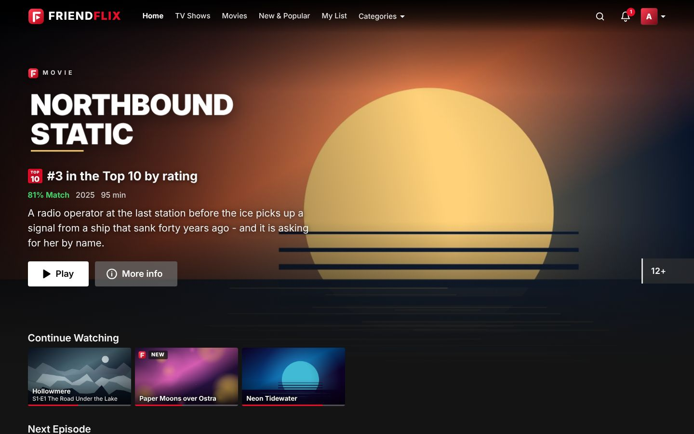</p>

FriendFlix is a private streaming portal that sits in front of **Jellyfin** (your media) and **Seerr** (wishes and requests). Your friends get a polished, familiar streaming experience on their laptop, phone and TV – with profiles, downloads, watch parties and recommendations from each other. They never see Jellyfin or Seerr directly, and you stay in control of who gets in.

> All titles and artwork in these screenshots are invented and generated for the demo.

## Contents

- [What you get](#what-you-get)
- [Made for friends and family](#made-for-friends-and-family)
- [Privacy and safety](#privacy-and-safety)
- [For admins: setup and operation](#for-admins-setup-and-operation)

## What you get

### A home page that feels like a real streaming service

A large billboard with the title logo, then rows such as *Continue Watching*, *Next Episode*, *Recommended by friends*, *Rated by friends*, *Popular this week*, *Because you watched …*, *Top 10* and *My List*. Hover over a card and it pops out with the most important actions: play, add to your list, rate, more info.

<p align="center">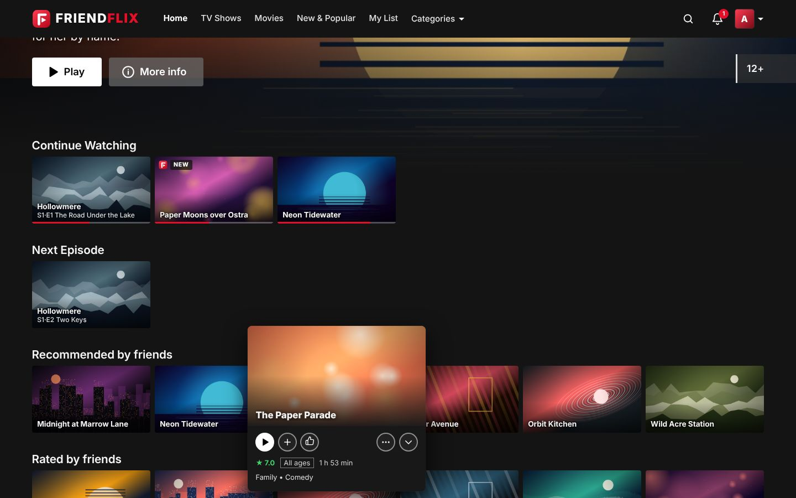</p>

### Everything about a title in one place

The detail view shows the description, audio and subtitle languages, cast, which friends recommended or watched it, and – for shows – every season and episode with progress bars. Pick up exactly where you left off.

<table>
  <tr>
    <td>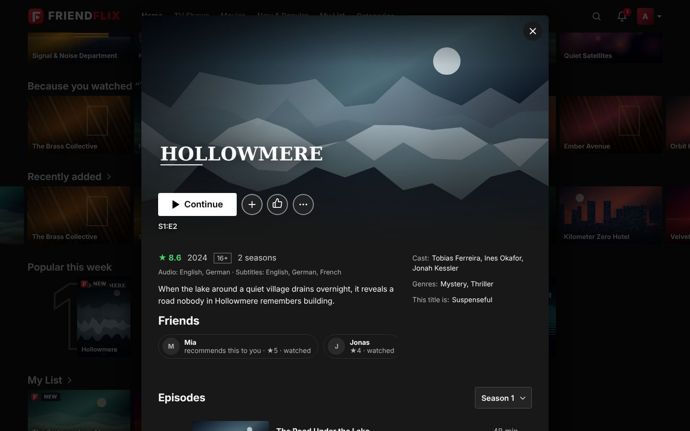</td>
    <td>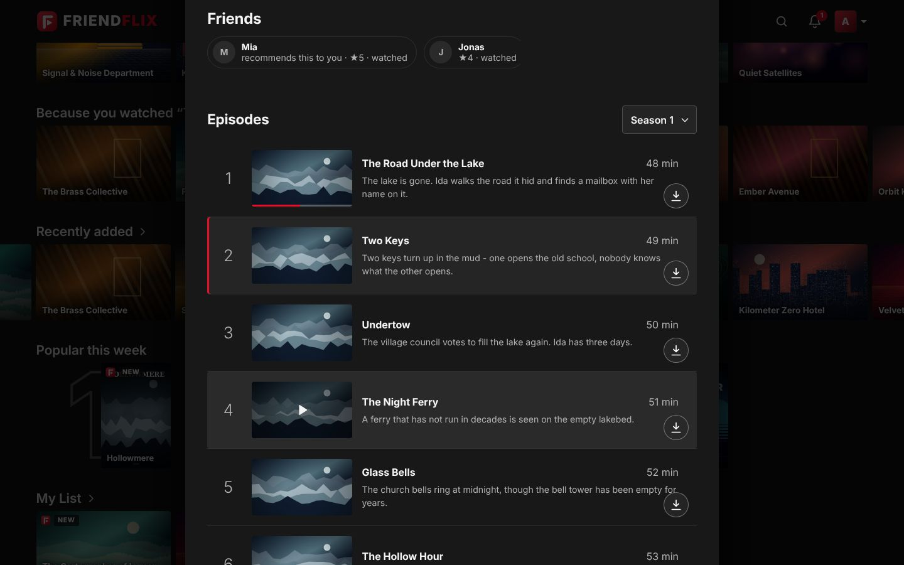</td>
  </tr>
</table>

### A player made for binge nights

Skip intro, next episode with countdown, audio track and subtitles (with your own subtitle style), playback speed, bookmarks, keyboard shortcuts and "Are you still watching?" after several autoplayed episodes. Direct play when possible, adaptive streaming (HLS) otherwise.

<p align="center">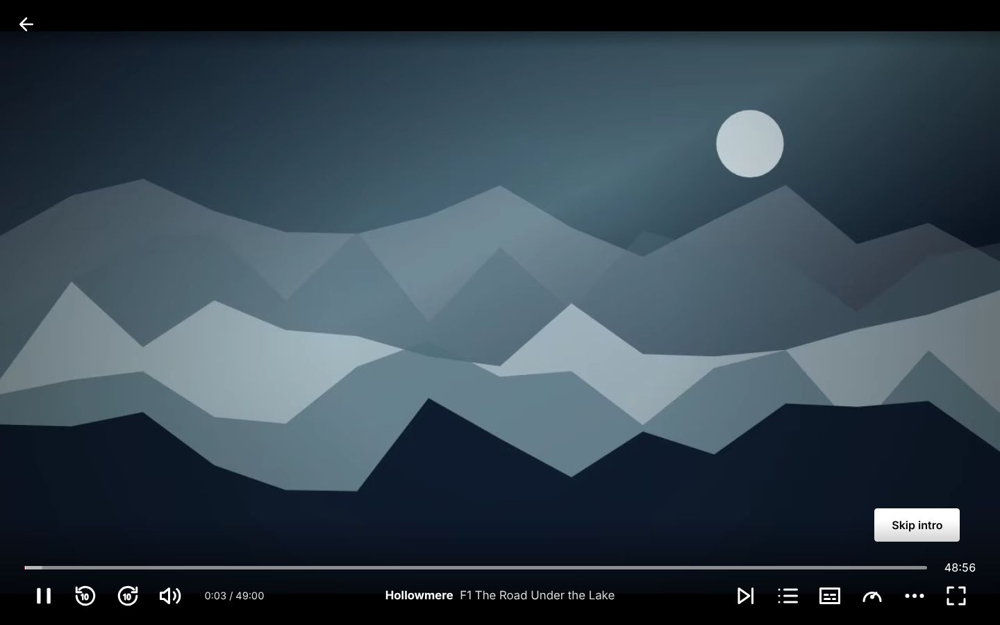</p>

### "Who's watching?"

Up to five profiles per account, each with its own history, list, favourites, language and playback settings. Profiles can be locked with a 4-digit PIN.

<p align="center">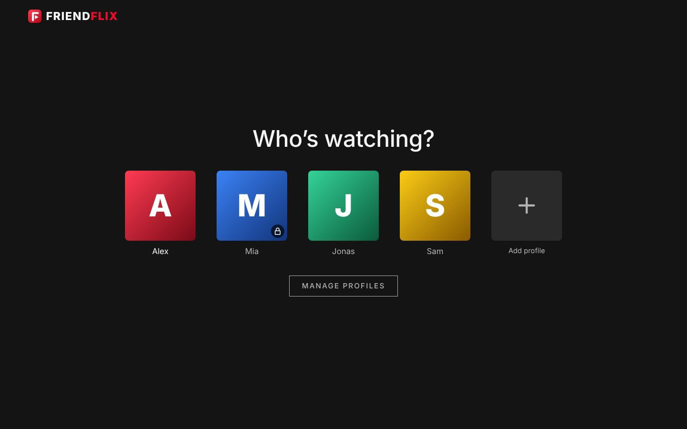</p>

### Great on the phone

An app-like layout with a bottom tab bar, a preview sheet when you tap a poster, and full details one swipe away. FriendFlix can be installed to the home screen (PWA).

<table>
  <tr>
    <td>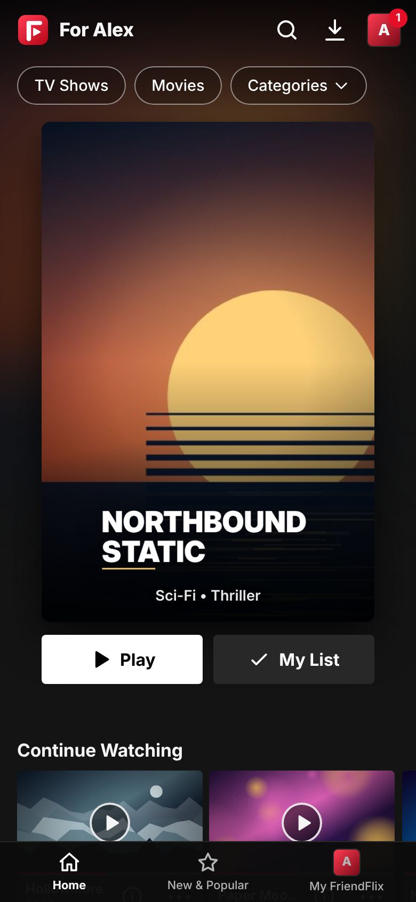</td>
    <td>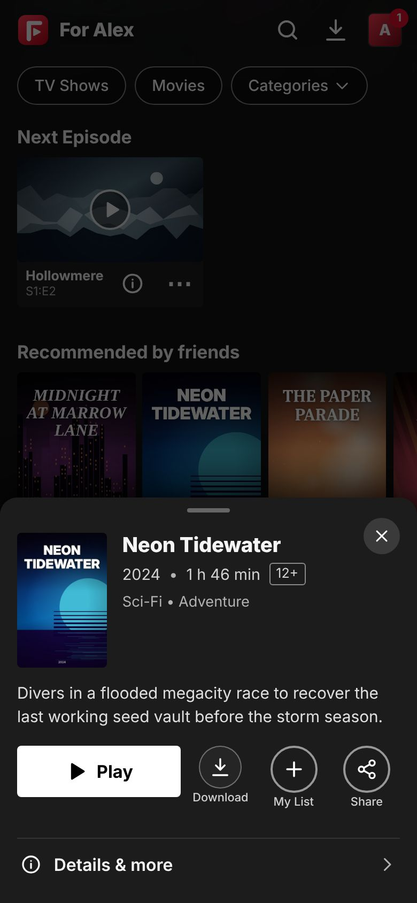</td>
    <td>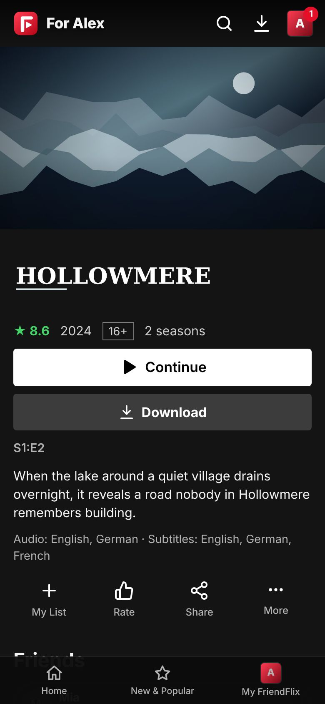</td>
  </tr>
</table>

### Downloads for the train and the plane

Download movies and episodes (or the next few episodes of a show in one go) and watch them offline in the browser. Progress syncs back the next time you are online.

<p align="center">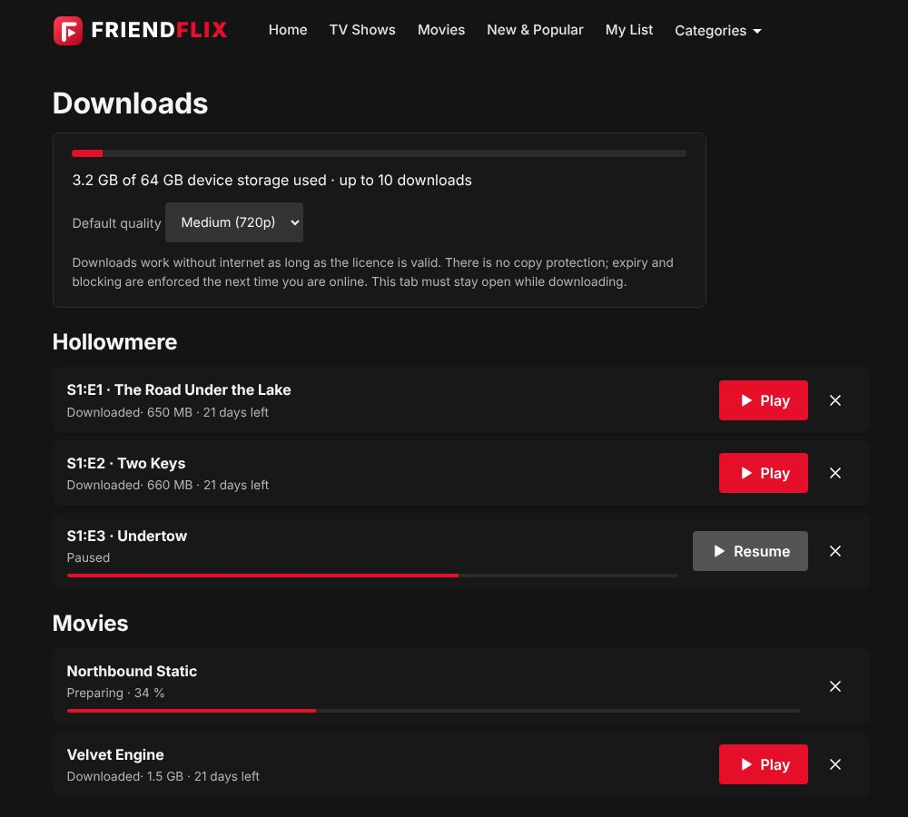</p>

### Seven languages

The interface speaks **English, German, French, Spanish, Italian, Turkish and Polish**. Every profile picks its own language; on first login FriendFlix asks once and suggests the browser language. The admin sets the default language for the whole instance.

<p align="center">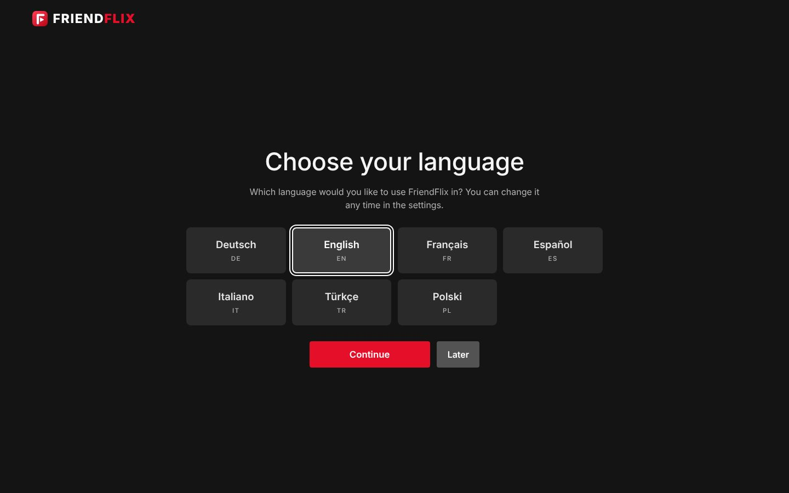</p>

## Made for friends and family

| | |
|---|---|
| **Profiles for everyone** | Up to 5 profiles per account, optional PIN, separate history, lists and settings. |
| **On the big screen** | TV mode for smart-TV browsers, sticks and consoles: big type, arrow-key navigation, pairing with a code or QR code, and your **phone as the remote**. Chromecast from Chrome, Edge and Android. |
| **Offline downloads** | Per-device licences with expiry; works in Chrome, Edge, Firefox, Safari 17+ and as a home-screen app on iOS 17+. |
| **Watch together** | Watch parties with synchronised playback, chat and emoji reactions. **Movie-night voting** with countdown and automatic start. "What has none of us seen yet?" – the group matcher finds titles for everyone. "Tonight" suggests three titles by mood and time. |
| **Recommendations** | Recommend titles to friends, see what friends rated and watched this week, "Because you watched …", shared lists with editors and readers, curated rows from the admin. |
| **Wishes** | Missing something? Request it right from the search (via Seerr) and get notified when it arrives – with a monthly limit per role. "Remind me" for upcoming titles. |
| **Stay in the loop** | Notifications in the app, as web push on every device, via ntfy or Discord, and an optional weekly digest. |
| **The fun extras** | Reactions and short reviews (visible only after you watched it), ratings, stats, achievements and a shareable "Wrapped" card of your viewing stats. |
| **Seven languages** | English, German, French, Spanish, Italian, Turkish, Polish – per profile. |

## Privacy and safety

- **Self-hosted.** Everything runs on your own server. FriendFlix has no ads and no third-party analytics.
- **Invite only.** New people join with one-time invitation links. Sign-in goes through your Authentik with **mandatory multi-factor authentication**, and new devices can require approval.
- **Jellyfin and Seerr stay hidden.** Friends only ever talk to the portal. Media tokens stay on the server; video is streamed through a gateway that checks every request.
- **You decide what friends see.** "Share history" (off by default) and "Share ratings" are switched in each person's settings; "Popular this week" only shows counts, never who watched. Reactions to a title only appear once you have watched it, and optional spoiler protection hides thumbnails and descriptions of unwatched episodes.
- **Trailers without tracking.** Trailers for titles that are not in the library play in the privacy-friendly `youtube-nocookie.com` player and only load after a click.
- **Error reports stay with you.** If the app crashes in someone's browser, a scrubbed error message (no query strings, tokens or e-mail addresses) is written to *your* server's log – and goes nowhere else.
- **Honest about downloads.** Downloads are for trusted friends and family: there is no copy protection (no DRM); expiry and revocation are enforced by the app.

---

## For admins: setup and operation

Everything below is technical. The detailed operating docs are in German (see [Documentation](#documentation)).

### Requirements

- A Linux server with **Docker** and **Docker Compose**.
- **Jellyfin** (your library) and **Seerr** (requests) – either already running or started with the bundled profile.
- **Authentik** as the login provider (OIDC with PKCE; enforce MFA there).
- A reverse proxy with TLS, e.g. **Nginx Proxy Manager**, with one proxy host for the portal.
- Optional: ntfy, a Discord webhook, Portainer (one-click updates).

### Quick start

The production stack pulls prebuilt images from `ghcr.io/letsmanu/friendflix-{backend,gateway,web}`; there is no build on the server.

```bash
git clone https://github.com/LetsManu/friendflix.git && cd friendflix
cp .env.example .env
openssl rand -base64 32    # -> APP_ENC_KEY
openssl rand -hex 24       # -> INTERNAL_SECRET, WEBHOOK_SECRET, METRICS_TOKEN (one value each)
$EDITOR .env               # PUBLIC_URL, passwords, OIDC_*, JELLYFIN_*, SEERR_*
docker login ghcr.io -u <user>                                 # only if the packages are private (PAT with read:packages)
docker compose -f compose.prod.yaml up -d                      # add --profile bundled to also start Jellyfin + Seerr
docker compose -f compose.prod.yaml --profile backup up -d backup   # optional: nightly database backups
docker compose -f compose.prod.yaml ps                         # everything "healthy"
```

Then:

1. **Authentik:** create the OIDC provider (redirect URI `${PUBLIC_URL}/auth/callback`) and enforce MFA – [docs/integrations.md](docs/integrations.md).
2. **Nginx Proxy Manager:** one proxy host `portal.<domain>` → `127.0.0.1:3080`, WebSockets on, Force SSL/HTTP2/HSTS; paste [deploy/npm/portal.advanced.conf](deploy/npm/portal.advanced.conf) into the *Advanced* tab (routes `/api`, `/auth`, `/ws` to `:3081` and `/media/` to `:3082`). Keep its `/media/c/` block: it stops cast tokens from being logged.
3. **Jellyfin:** create an admin API key. Optional webhook plugin for instant "now playing" and "new in library" events – [docs/integrations.md](docs/integrations.md).
4. **Seerr:** API key and webhook – [docs/integrations.md](docs/integrations.md).
5. **Web push (optional):** `node scripts/gen-vapid.mjs`, put both keys into `.env`, restart.
6. **First login** with a member of the Authentik group `friendflix-admins`: you become the portal admin, choose the instance language, and invite your friends under *Admin → Invitations*.

If Jellyfin/Seerr already run in their own stack: `docker network connect friendflix_media <container>`, remove their public ports and set `JELLYFIN_URL`/`SEERR_URL`.

### Configuration

Template: [.env.example](.env.example). Every variable can also be read from a file with the `_FILE` suffix (Docker secrets, see [compose.secrets.yaml](compose.secrets.yaml)). Defaults are the ones in [compose.prod.yaml](compose.prod.yaml).

| Variable | Default | Purpose |
|---|---|---|
| `PUBLIC_URL` | – (required) | Public https URL of the portal |
| `POSTGRES_PASSWORD`, `REDIS_PASSWORD` | – (required) | Database and Redis passwords |
| `APP_ENC_KEY` | – (required) | 32 bytes base64; encrypts stored Jellyfin credentials. **Back it up separately.** |
| `INTERNAL_SECRET`, `WEBHOOK_SECRET` | – (required, ≥ 16 chars) | Backend ↔ gateway secret; Jellyfin/Seerr webhooks |
| `OIDC_ISSUER`, `OIDC_CLIENT_ID`, `OIDC_CLIENT_SECRET` | – (required) | Authentik OIDC provider |
| `JELLYFIN_URL`, `JELLYFIN_ADMIN_API_KEY` | – (required) | Internal Jellyfin URL, e.g. `http://jellyfin:8096`, and admin API key |
| `SEERR_URL`, `SEERR_API_KEY` | – (required) | Internal Seerr URL and API key |
| `ADMIN_GROUP` | `friendflix-admins` | Authentik group whose members become portal admins |
| `BIND_ADDR` | `127.0.0.1` | Host address the three ports are published on – never a public interface |
| `WEB_PORT`, `BACKEND_PORT`, `GATEWAY_PORT` | `3080`, `3081`, `3082` | Host ports for the reverse proxy |
| `FF_REGISTRY`, `FF_TAG` | `ghcr.io/letsmanu`, `latest` | Image source and version (pin with a commit SHA or `x.y.z`) |
| `SESSION_TTL_SECONDS`, `SESSION_IDLE_SECONDS` | `28800`, `7200` | Absolute session length (8 h) and idle timeout (2 h) |
| `TZ` | `Europe/Vienna` | Time zone for scheduled jobs (digest, playback check, backups) |
| `AUTHENTIK_URL`, `AUTHENTIK_API_TOKEN`, `AUTHENTIK_ENROLL_FLOW` | empty | Invitations that also create the Authentik account (all three needed) |
| `NTFY_URL`, `NTFY_BASE_URL`, `DISCORD_WEBHOOK_URL` | empty | Shared ntfy/Discord channel; ntfy server for personal topics |
| `VAPID_PUBLIC_KEY`, `VAPID_PRIVATE_KEY`, `VAPID_SUBJECT` | empty, empty, `PUBLIC_URL` | Web push; active only when both keys are set |
| `DIGEST_DAY`, `DIGEST_HOUR` | `0` (Sunday), `18` | Weekly digest schedule; `-1` = off; can be changed in the admin area |
| `CAST_ENABLED` | `true` | Chromecast (needs an https `PUBLIC_URL`); `false` with Plan B |
| `DOWNLOADS_ENABLED` | `true` | Offline downloads; `false` with Plan B |
| `DOWNLOADS_PATH`, `PREVIEWS_PATH` | named volumes `downloads`, `previews` | Host folder (absolute path, writable by uid 1000) for prepared downloads and preview clips |
| `DOWNLOAD_CACHE_MAX_GB`, `DOWNLOAD_MIN_FREE_GB` | `50`, `2` | Size cap for prepared downloads; minimum free space to keep |
| `DOWNLOAD_PREP_CONCURRENCY`, `DOWNLOAD_PAUSE_STREAMS` | `1`, `2` | Parallel preparations; pause preparation while this many streams run (`0` = never) |
| `DOWNLOAD_FILE_TTL_HOURS`, `DOWNLOAD_OFFLINE_GRACE_DAYS`, `DOWNLOAD_CREATE_PER_HOUR` | `48`, `7`, `20` | Cleanup of unused files, offline grace period, licence rate limit |
| `DIRECT_PLAY_REQUIRES_DOWNLOAD` | `false` | `true`: roles without download permission also lose direct play |
| `PREVIEW_WARM` | `true` | Background job that pre-generates hover/billboard preview clips |
| `PLAYBACK_CHECK_HOUR` | `4` | Nightly playback check with admin alert; `-1` = off |
| `BACKGROUND_JOBS` | `true` | Download preparation/cleanup, language index, Jellyfin session polling (keep `true` on the single backend) |
| `API_COMPRESSION` | `true` | gzip/brotli for JSON responses ≥ 1 KB; `false` if the proxy already compresses `/api` |
| `METRICS_TOKEN` | empty | Bearer token for `/metrics` |
| `PORTAINER_WEBHOOK_URL` or `PORTAINER_URL` + `PORTAINER_API_KEY` + `PORTAINER_STACK_ID` | empty | One-click updates from *Admin → Update* (`PORTAINER_ENDPOINT_ID` default `1`) |
| `UPDATE_REPO`, `GITHUB_TOKEN` | `LetsManu/friendflix`, empty | Version check; the token only raises the GitHub rate limit |
| `BACKUP_PATH`, `BACKUP_HOUR`, `BACKUP_KEEP_DAYS`, `BACKUP_RUN_ON_START` | `./backups`, `3`, `14`, `false` | Backup sidecar (profile `backup`) |
| `MEDIA_PATH` | `./media` | Media folder for the bundled Jellyfin (profile `bundled`) |

The full list with explanations is in [.env.example](.env.example).

### Architecture

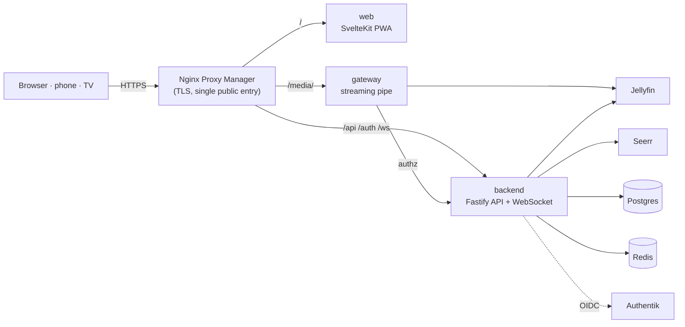

- Only the proxy is public. `web`, `backend` and `gateway` are published on `127.0.0.1` only; Jellyfin and Seerr have no ports at all and live on the internal `media` network, Postgres and Redis on the internal `db` network.
- All video data (playlists, segments, direct play, images, subtitles, downloads, Chromecast) flows through the gateway: no buffering, HTTP range, Jellyfin tokens only server-side, path allowlist, fixed upstream, bitrate cap per role.
- Containers run non-root with a read-only root filesystem, `cap_drop: ALL` and `no-new-privileges`. Strict CSP, CSRF tokens, rate limits, audit log.
- Alternative "Plan B": nginx serves `/media/` itself via `auth_request` – [docs/operations.md](docs/operations.md).

### Operations

- **Backups:** the opt-in `backup` sidecar runs `pg_dump` daily at `BACKUP_HOUR`, verifies each dump with `pg_restore --list`, keeps `BACKUP_KEEP_DAYS` days and turns `unhealthy` if a run fails. Restore steps and a monthly restore test (`scripts/restore-test.sh`) are in [docs/operations.md](docs/operations.md). Keep `APP_ENC_KEY` in a password manager, separate from the dumps.
- **Updates:** *Admin → Update* shows the installed and latest version with the change list and redeploys the stack through Portainer (webhook or API). Manually: `docker compose -f compose.prod.yaml pull && docker compose -f compose.prod.yaml up -d`. Database migrations run on start.
- **Monitoring:** `/health` (liveness) and `/health/ready` (Redis, Postgres, Jellyfin) on `127.0.0.1:3081`; Prometheus metrics on `:3081/metrics` and `:3082/metrics` (Bearer `METRICS_TOKEN`). Icinga and Prometheus examples: [docs/monitoring.md](docs/monitoring.md).
- **Performance:** every API response carries a `Server-Timing` header (`jf` = Jellyfin, `db` = Postgres, `kv` = Redis, `app` = total), the gateway adds `authz` and `upstream`; see them in the browser DevTools under *Network → Timing*. Requests ≥ 500 ms are logged as `slow request`. Browser errors are reported to the backend log and counted in `friendflix_client_errors_total`.

### Development

Node.js ≥ 22, npm workspaces `backend`, `gateway`, `web`.

```bash
npm ci
npm run lint && npm run typecheck && npm test   # backend tests need Postgres: TEST_DATABASE_URL=postgres://postgres@localhost:5433/ff_test
npm run dev -w backend                          # API on :3000
npm run dev -w web                              # UI on :5173 (proxies to backend/gateway)
npm run e2e                                     # Playwright: builds the web app and runs it against a fully mocked API
```

- `E2E_SKIP_BUILD=1` reuses an existing build; `PW_CHROMIUM=/path/to/chrome` uses a locally installed Chromium.
- `./scripts/setup-hooks.sh` installs the gitleaks pre-commit hook.
- Development against an http Authentik: `OIDC_ALLOW_INSECURE=true` (never in production).
- CI ([.github/workflows/ci.yml](.github/workflows/ci.yml)): lint, typecheck, tests, `npm audit`, e2e, gitleaks and Trivy; images are published by [publish.yml](.github/workflows/publish.yml) only after everything is green.
- Translations: German is the source, all other languages live next to it – how to fix or add a language: [docs/i18n.md](docs/i18n.md).

### Documentation

| Topic | File |
|---|---|
| Jellyfin, Seerr, Authentik, ntfy/Discord, web push | [docs/integrations.md](docs/integrations.md) |
| Backups, restore, firewall, updates, Plan B | [docs/operations.md](docs/operations.md) |
| Monitoring, metrics, Server-Timing, browser errors | [docs/monitoring.md](docs/monitoring.md) |
| Offline downloads (platforms, storage, limits) | [docs/downloads.md](docs/downloads.md) |
| TV mode and phone remote | [docs/tv-mode.md](docs/tv-mode.md) |
| Chromecast | [docs/cast.md](docs/cast.md) |
| Search and discovery API | [docs/discovery.md](docs/discovery.md) |
| Languages and translations | [docs/i18n.md](docs/i18n.md) |
| Changes | [CHANGELOG.md](CHANGELOG.md) |

### Known limitations

- One backend replica: watch-party rooms, rate limits and remote-control rooms live in memory.
- Image-based subtitles (PGS) are not offered; text subtitles are delivered as WebVTT.
- Skip intro needs Jellyfin ≥ 10.10 with media segments (e.g. from the Intro Skipper plugin).
- Jellyfin, Seerr and Authentik APIs differ between versions – after upgrades see [docs/operations.md](docs/operations.md) and [docs/integrations.md](docs/integrations.md).
- Profiles are hidden Jellyfin users: turn off Seerr's automatic Jellyfin user import so they do not show up there.
- With Intel QSV/VAAPI, switch off "VPP Tone mapping" in Jellyfin if the driver has no HDR support; otherwise 4K HDR titles fail.

### License

Copyright © 2026 Manuel Weißböck. All rights reserved – see [LICENSE](LICENSE).
