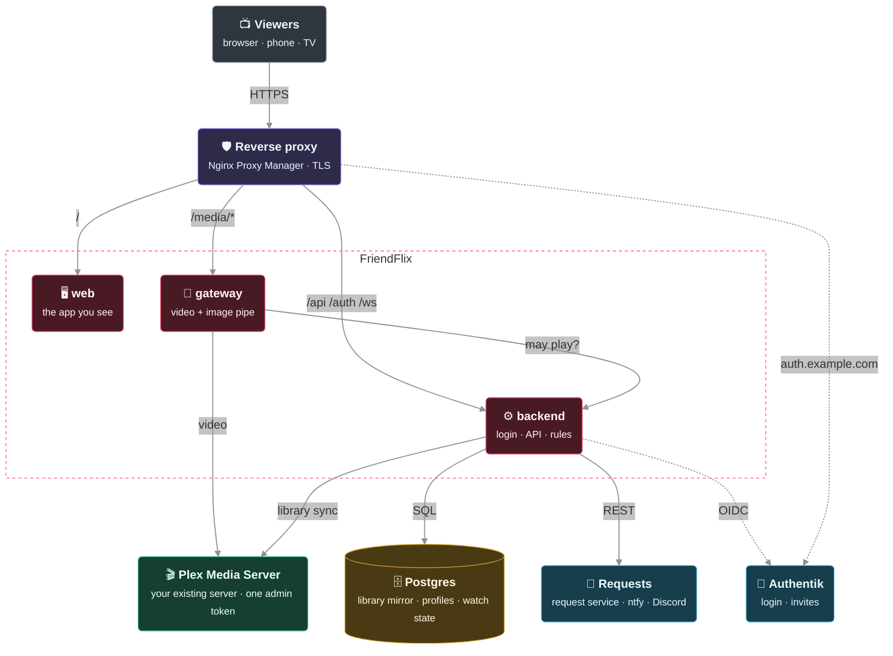
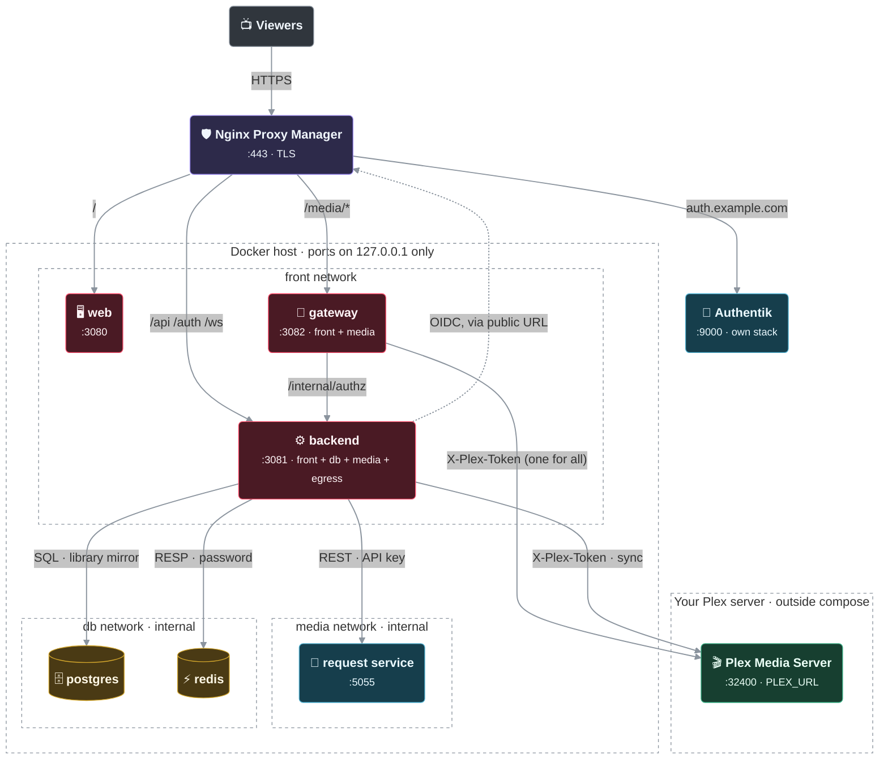
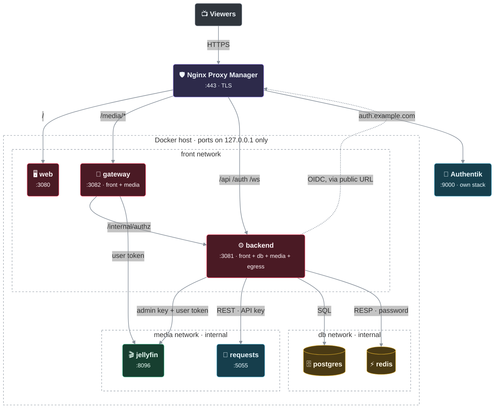
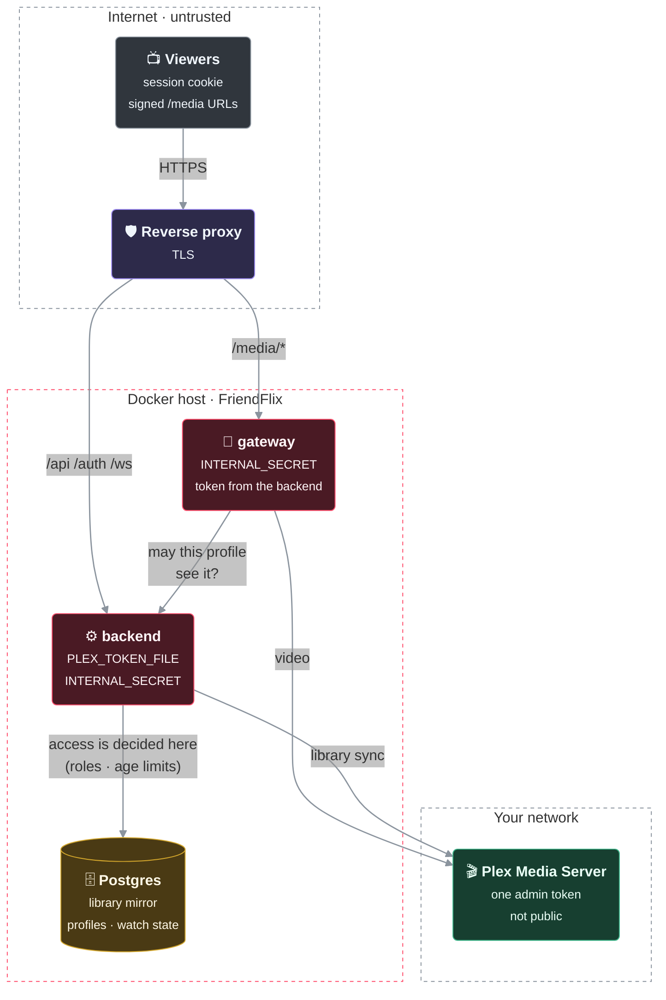
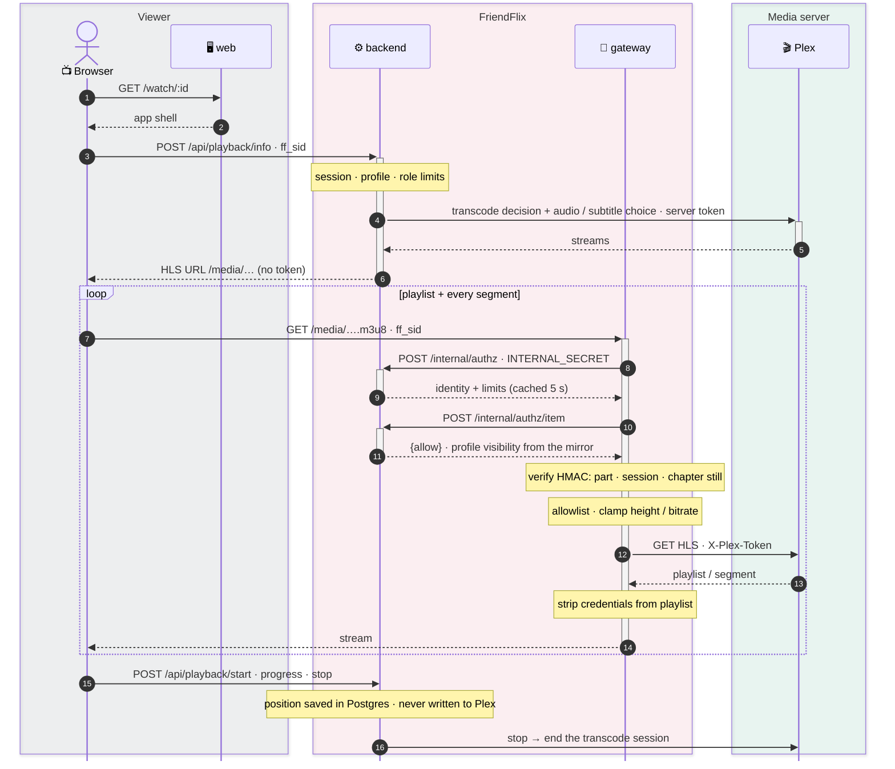
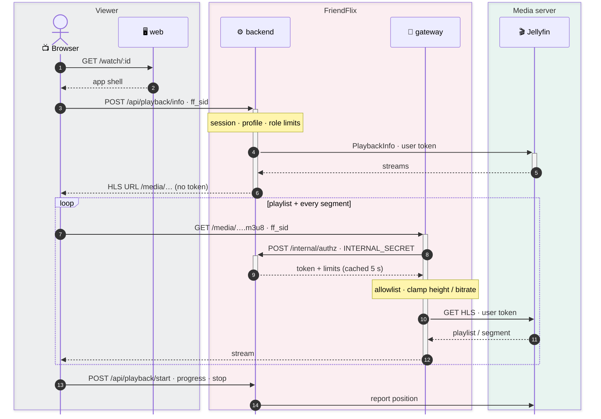
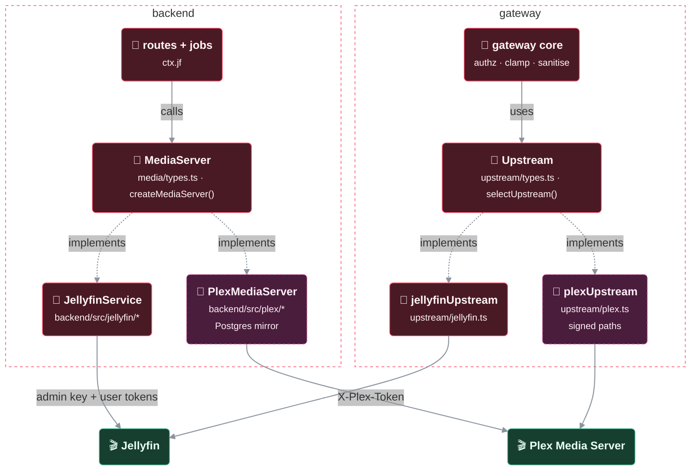
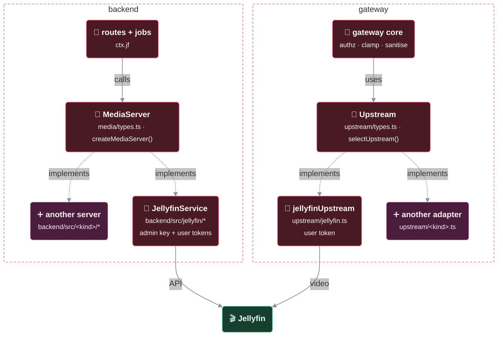

# Architecture notes

FriendFlix for Plex runs the same code as upstream with a Plex media server behind the neutral media-server interface. The diagrams show the Plex setup first; where the Jellyfin setup differs it is shown next to it. Colours and shapes are explained in the legend under each diagram. Jellyfin-only parts (bundled Jellyfin, "Plan B") are covered by the upstream project, [LetsManu/friendflix](https://github.com/LetsManu/friendflix).

## How it fits together

Viewers only talk to the reverse proxy. The backend and the gateway are the only components that talk to Plex, and they are the only ones that hold the Plex token. The backend mirrors the Plex library into Postgres and decides itself what a profile may see.



> 🟥 FriendFlix · 🟩 media server · 🟦 other service · 🟪 reverse proxy · 🟨 data store · ⬛ viewers / outside · dashed frame = network or boundary · thick line = video stream · dotted = optional / via public URL

## Containers and networks

Who talks to whom, and on which Docker network. Only the reverse proxy is public; every published port is bound to `127.0.0.1`. Plex is **not** part of the compose stack: `compose.plex.yaml` only connects the backend and gateway to your existing server (`PLEX_URL`).

### Plex



> 🟥 FriendFlix · 🟩 media server · 🟦 other service · 🟪 reverse proxy · 🟨 data store · ⬛ viewers / outside · dashed frame = network or boundary · thick line = video stream · dotted = optional / via public URL


| Service | Networks | Host port (127.0.0.1) | Holds |
|---|---|---|---|
| web | front | 3080 | nothing secret |
| backend | front, db, media, egress | 3081 | Plex token (database, encrypted; or the pin `PLEX_TOKEN` / `PLEX_TOKEN_FILE`), `APP_ENC_KEY`, `INTERNAL_SECRET`, OIDC client secret; sessions (cookie `ff_sid`) in Redis; profiles, watch state and the Plex library mirror in Postgres |
| gateway | front, media | 3082 | `INTERNAL_SECRET` (environment, `_FILE` or bootstrap volume); gets the Plex address and token from the backend over `/internal/gateway-config` and keeps them in memory only; asks the backend per request which items and sessions are allowed (cached 5 s) |
| postgres, redis | db (internal) | none | accounts, profiles, watch state, library mirror and id maps (`plex_*` tables); sessions |
| request service (profile `bundled`) | media (+egress) | none | request data |
| Plex Media Server | outside compose, reached at `PLEX_URL` (:32400) | none of ours | media; one server-wide admin token for all friends |
| Authentik (`compose.authentik.yaml`) | front, ak-db, egress | 9000 | identities |

The browser only ever sees a session cookie and signed `/media/...` URLs, never the Plex token or the Plex address. No Plan B with Plex: nginx never serves `/media/` itself, the gateway always does.

### Jellyfin (upstream setup, for comparison)



> 🟥 FriendFlix · 🟩 media server · 🟦 other service · 🟪 reverse proxy · 🟨 data store · ⬛ viewers / outside · dashed frame = network or boundary · thick line = video stream · dotted = optional / via public URL

| Service | Networks | Host port (127.0.0.1) | Holds |
|---|---|---|---|
| web | front | 3080 | nothing secret |
| bootstrap (one-shot) | none | none | writes the generated secrets into the `bootstrap` volume and `INTERNAL_SECRET` into `bootstrap-gateway`, then exits; every other service waits for it |
| backend | front, db, media, egress | 3081 | `APP_ENC_KEY`, `INTERNAL_SECRET` and the database and Redis passwords (`bootstrap` volume, read-only); the settings with Jellyfin admin API key and OIDC client secret (encrypted in Postgres); sessions (cookie `ff_sid`) in Redis; per-user Jellyfin credentials encrypted in Postgres |
| gateway | front, media | 3082 | `INTERNAL_SECRET` (`bootstrap-gateway` volume, read-only); pulls the media server URL from the backend; gets the user's media token per request from the backend (cached 5 s), never stores it |
| postgres, redis | db (internal) | none | accounts, profiles, settings, sessions; their passwords come from the `bootstrap` volume |
| jellyfin, requests (request service, profile `bundled`) | media (+egress) | none | media, request data |
| Authentik (`compose.authentik.yaml`) | front, ak-db, egress | 9000 | identities |


The browser only ever sees a session cookie and `/media/...` URLs, never a Jellyfin token.

Alternative setups (Plan B, bundled Jellyfin, Authentik in its own stack): [operations.md](operations.md), [setup.md](setup.md).

## Trust boundaries

What is trusted with what. Plex only knows one admin token, so it cannot tell your friends apart: everything that depends on *who* is watching is decided by FriendFlix, before anything is fetched from Plex.



> 🟥 FriendFlix · 🟩 media server · 🟦 other service · 🟪 reverse proxy · 🟨 data store · ⬛ viewers / outside · dashed frame = network or boundary · thick line = video stream · dotted = optional / via public URL

- **The token** is stored by the backend (database, encrypted; or pinned with `PLEX_TOKEN` / `PLEX_TOKEN_FILE` in the backend's environment). The gateway gets it from the backend over `/internal/gateway-config` (internal secret) and holds it in memory only. It is sent to Plex as the `X-Plex-Token` header only: never in a URL, never in a playlist, never to a browser, never in a log.
- **Access** is enforced by FriendFlix on every list, search, title and media request (role libraries, profile age limits, kids profiles). Unknown age ratings are blocked for capped profiles. The mirror in Postgres is what the backend reads; Plex is only asked for streams, images and sync.
- **Signed paths:** the gateway asks the backend (`/internal/authz/item`) whether the session's profile may see the item. Plex part ids, transcode sessions and chapter stills are not tied to an item by Plex, so FriendFlix binds them with an HMAC (key derived from `INTERNAL_SECRET`); a visible item combined with a foreign part, session or chapter never passes. Playlists are rewritten so segments stay relative and carry no credentials.
- **Wishes** work with local users: every FriendFlix account gets its own local user in the request service (request permission only), created on the first wish.

## Settings

Configuration has four classes (`backend/src/settings/registry.ts`; every key of `config.ts` is in exactly one):

- **bootstrap** – needed before the database can be read: `DATABASE_URL`, `REDIS_URL`, `APP_ENC_KEY`, `INTERNAL_SECRET`. Environment (incl. `_FILE`) first, else the files the `bootstrap` service writes into `/run/friendflix` (`settings/bootstrapFiles.ts`; the URLs are built from `postgres_password` / `redis_password`). A missing file stops the backend with the file name and the fix.
- **setting** – stored in the `settings` table (secrets AES-256-GCM encrypted with `APP_ENC_KEY`, API keys of data sources with their last four characters), edited in *Admin → Settings*. Environment > database > default. Most apply live (`API_COMPRESSION` too: it is read per response); `DOWNLOAD_CREATE_PER_HOUR` needs a restart (`pendingRestart()`).
- **env-only** – per container or shared with a container that reads env only (`MEDIA_SERVER`, `BACKGROUND_JOBS`, `METRICS_TOKEN`, `GATEWAY_URL`, paths, …); shown read-only.
- **build** – baked into the image (`GIT_SHA`, `APP_VERSION`, …).

`resolveConfig()` (`settings/resolve.ts`) is pure: environment (an empty value counts as unset, `_FILE` and the older names included), then the decrypted rows, then defaults. A row that cannot be decrypted or fails its schema is ignored, listed as invalid and logged by key name. An environment `PUBLIC_URL` with a path or query is reduced to its origin with one warning; a saved one must be an origin.

The store (`settings/store.ts`) keeps one immutable `Config` snapshot; `ctx.cfg` is a getter for it, so code reads the live value on every use. A save validates all values, writes them and bumps `settings_meta.rev` in one transaction, swaps the snapshot and publishes the revision on the Redis channel `ff:settings:rev` (`settings/bus.ts`). Other instances reload from the database when they hear it, or on their 30 s poll of the revision. `onChange(keys, fn)` rebuilds what was built from the config at start: the OIDC client (lazily, on the next sign-in), the media server client, the request service client (`null` while `REQUESTS_URL` or `REQUESTS_API_KEY` is unset), the Web Push keys.

The admin API is `backend/src/routes/adminSettings.ts` (`GET`/`PUT /api/admin/settings`, `POST …/test`, `…/import-env`, `…/generate`). A save runs the probes of the touched groups (`settings/probes.ts`) against the candidate config; refused credentials block, an unreachable service blocks unless `force`. Security rules: [security.md](security.md#settings-and-generated-secrets).

**Gateway pull.** The gateway has no database and no Redis. `gateway/src/remoteConfig.ts` fetches `GET /internal/gateway-config` (`INTERNAL_SECRET`) → `{ rev, upstreamUrl }` at start (every 5 s until it answers), then every 30 s, and at once when an `/internal/authz*` answer carries a newer `x-ff-config-rev`. A failed refresh keeps the last URL. Without a URL (`503 setup_required` from the backend) `/media/*` answers 503 and `/health` stays 200, so the container is not restarted. An environment `JELLYFIN_URL` (the adapter's URL variable) wins and nothing is fetched. `INTERNAL_SECRET` comes from the environment or `_FILE`, else from `/run/friendflix-gateway/internal_secret` (`gateway/src/env.ts`).

## Press play

What happens between the play button and the first picture. Every playlist and every segment passes the gateway, which asks the backend what this session may do (`/internal/authz`, cached for 5 seconds) before it clamps height and bitrate and fetches from the media server. With Plex the gateway additionally asks whether this profile may see the item, checks the HMAC of the path and strips credentials from playlists; the Plex token never leaves the gateway.

### Plex



### Jellyfin (upstream)



## Media server seam

FriendFlix talks to its media server through one neutral interface. Jellyfin and Plex (this fork) are the implementations; the seam exists so that a further server can be added mostly by **adding** files instead of editing shared ones, which is how Plex was added.

How the pieces line up: backend routes and jobs only know the `MediaServer` interface, the gateway core only the `Upstream` adapter; each media server kind provides one of each, and `MEDIA_SERVER` picks them. In this fork the kinds are `jellyfin` and `plex`.



> 🟥 FriendFlix · 🟩 media server · 🟦 other service · 🟪 reverse proxy · 🟨 data store · ⬛ viewers / outside · 🟫 dashed pink = Plex only · dashed frame = network or boundary · thick line = video stream · dotted = optional / via public URL

How the pieces line up: backend routes and jobs only know the `MediaServer` interface, the gateway core only the `Upstream` adapter; each media server kind provides one of each, and `MEDIA_SERVER` picks them.



> 🟥 FriendFlix · 🟩 media server · 🟦 other service · 🟪 reverse proxy · 🟨 data store · ⬛ viewers / outside · 🟫 dashed pink = room for another media server · dashed frame = network or boundary · thick line = video stream · dotted = optional / via public URL

### Backend

| File | Role |
|---|---|
| `backend/src/media/types.ts` | The `MediaServer` interface, its `admin` sub-interface (`MediaAdmin`), the normalized DTOs (`ItemDto`, `PlaybackDto`, `TrickplayDto`, `DownloadSourceDto`, …), `MediaCapabilities` and the `MediaError` base class. Nothing in here knows Jellyfin. |
| `backend/src/media/index.ts` | `MEDIA_SERVERS` (the accepted `MEDIA_SERVER` values) and the one factory `createMediaServer()`. The only shared file that imports an implementation. |
| `backend/src/media/setup.ts` | `MediaSetupProvider` and `MEDIA_SETUP` (Block 25): per kind the registry keys of the wizard's media step, the gateway's URL key, the `media` settings probe and, optionally, `auto` (create the server's API key from an administrator's sign-in). |
| `backend/src/jellyfin/*` | `JellyfinService implements MediaServer` (`service.ts`), the HTTP client (`client.ts`), Jellyfin JSON → DTO mapping (`dto.ts`), the setup provider `jellyfinSetup` (`setup.ts`). `JellyfinError extends MediaError`. |

Routes and jobs use `ctx.jf` (the name is kept from the Jellyfin-only days; its type is `MediaServer`). They never build server paths themselves. A test (`backend/test/media-seam.test.ts`, "seam boundary") fails when a file outside `jellyfin/`, `media/index.ts` and `media/setup.ts` imports from `jellyfin/`.

What the interface covers, grouped:

- **Credentials and raw media:** `mediaAuth(user)` (token + device id for the gateway, Chromecast and Plan B), `planBAuthHeader`, `mediaFetch(user, path)` (playlists and segments from a `PlaybackDto` / `DownloadSourceDto` / `clipTranscode`; only server-relative paths, absolute and protocol-relative URLs are refused), `clipTranscode(user, info, limits)` (async; preview clips and the playback health check), `stopEncoding`, `subtitleStream(user, item, mediaSource, index, 'vtt')`.
- **Browse:** `views`, `items(ItemQuery)`, `item`, `resume`, `history`, `nextUp`, `nextEpisode`, `seasons`, `episodes`, `firstEpisode`, `upcoming`, `similar`, `lastWatched`, `unplayedIds`, `collections`, `genres`, `studios`, `facets`, `extras`, `trailers`, `trailer`, `people`, `searchPeople`, `person`, `tracks`, `segments`, `addedItems`, `itemTraits`, `continuingSeries`, `premieringEpisodes`, `availableEpisodes`, `seasonEpisodeIds`; optional (Block 17): `chapters?` (chapter marks, `ChapterDto` `{start, name, image?}`) and `credits?` (`ItemCreditsDto`: people with `type` 'Actor' / 'GuestStar' / 'Director' / 'Writer' / 'Creator' … and the character in `role`, plus studios and tags); optional (Block 21): `itemAbout?` (`ItemAboutDto`: tagline, original title, countries, studios, tags, `providerIds` `{imdb, tmdb, tvdb}` as raw strings, community + critic rating; `MediaError(404)` when not visible) and `itemCollections?` (`MediaCollection[]` `{id, name, parts: [{item, tmdbId?}]}`; name and parts come from the viewer's own identity in release order, parts the viewer cannot see are omitted, never reported as missing; `[]` = none). Jellyfin builds a library-wide box set membership index with the admin key (kv `jf:boxsets:v1`, 1 h, single-flight, 8 box sets at a time; a box set whose call fails is skipped) and then asks per matching box set with the viewer token. Plex answers both from the library mirror: `itemAbout` reads `plex_items` (tagline, `rating` / `audienceRating` with their source images, `Guid` entries and legacy agent guids) and the country / studio / label tags; `itemCollections` joins `plex_collection_items` and applies the viewer's access predicate to the collection and to every part.
- **Capabilities:** `chapters` is optional on `MediaCapabilities` (an implementation written before Block 17 compiles unchanged and counts as `false`); the web treats a missing flag as supported, like every other flag.
- **User data:** `setFavorite`, `setPlayed`, `setUserData`, `touchUserData`, `forgetItems`, `userDataVersion`.
- **Playback:** `playbackInfo`, `playMeta` (resume position + trickplay), optional `preparePlayback`, `downloadSource`, `report({ event, itemId, mediaSourceId, playSessionId, positionTicks, paused, … })`.
- **Admin-key lookups:** `searchSubtitles`, `downloadSubtitle`, `findByTmdb`, `seriesHasEpisode`, `libraryStreams` (language index); optional (Block 17): `libraryMediaTraits?(type, start, limit)` (quality index; Jellyfin pages with `sortBy=SortName,Id` so a library that changes during the scan neither skips nor repeats titles) and `libraryContinuingSeriesIds?(start, limit)` (ids of ALL continuing series, library-wide, for the fresh label "Staffelfinale"; without it the backend falls back to the viewer's `continuingSeries()` and caches that per viewer). `mediaTraits?(user, id)` (quality chips) is the viewer-level counterpart. Optional (Block 22, admin care): `libraryHygiene?(type, { start, limit, savedSince? })` (`HygieneFacts[]`: overview / poster / backdrop / year flags, provider ids, runtime, virtual flag and per version container, bitrate, size and video / audio / subtitle stream facts; never a path, URL or protocol; Jellyfin pages with `sortBy=SortName,Id` and maps `savedSince` to `minDateLastSaved`; absent = the hygiene page shows "not supported") and `refreshMetadata?(id)` (full metadata + image refresh without replacing existing data, `MediaError(404)` for an unknown id; absent = no refresh button).
- **`admin`:** `createIdentity`, `deleteIdentity`, `applyPolicy(id, { template, disabled, hidden, parental })`, `setDisabled`, `libraries`, `ping`, `externalSessions` ("now playing" from other apps); optional (Block 22): `transcodeSessions?()` (`ServerSession[]`: every playing session, FriendFlix devices `ff-<id>` included, with play method, mapped `TranscodeReason`s, video / audio codec, hardware flag, bitrate, progress; never a token, URL or path; absent = the admin's active streams show only what FriendFlix knows).

Conventions: item ids are 32 lower-case hex characters (an implementation with other ids encodes them), item types and sort keys use the existing vocabulary (`Movie`, `Series`, `Episode`, `BoxSet`; `SortName`, `DateCreated`, `PremiereDate`, …), positions are in 100 ns ticks. Upstream failures throw a `MediaError` subclass with an HTTP-like `status`; `routes/_shared.ts` `wrap()` and the routes map it (listed statuses → 404, otherwise 502 `{error:'jellyfin'}` – the error name stays for API compatibility).

**Capabilities.** `ctx.jf.capabilities` says what the server can do: supported skip-segment types, trickplay, upcoming episodes, remote subtitle search, webhooks, a change feed, Plan B and chapters. The backend sends them once in `/api/me` (`server: { kind, capabilities }`, also `GET /api/server`); the web keeps them in `web/src/lib/capabilities.ts` (default: everything supported) and hides the skip buttons / timeline marks of unsupported segment types, the subtitle search and the calendar link. Jellyfin reports everything, so nothing changes visibly. `capabilities.requestUsers` (backend only, not in `/api/me`) picks how accounts become request service users for wishes: `'jellyfin-import'` (Jellyfin) or `'local'` (default when absent: a local request service user per account, see [integrations.md](integrations.md#request-service)).

**Configuration.** `MEDIA_SERVER` (default `jellyfin`; `plex` is set by `compose.plex.yaml`) selects the implementation in the backend and in the gateway. Each kind declares its config fields (`MEDIA_FIELDS`) and its settings (`mediaSettings()`) in `media/index.ts`: `JELLYFIN_URL`, `JELLYFIN_ADMIN_API_KEY` for Jellyfin; `PLEX_URL` and `PLEX_TOKEN` (or `PLEX_TOKEN_FILE`) for Plex, required once setup is complete for their kind (the fork's former `MEDIA_REQUIRED` check in `config.ts` is gone); `mediaConfigProblems()` in `media/index.ts` can refuse settings a kind cannot work with at startup.

**Setup provider (Block 25).** `MEDIA_SETUP[kind]` (`backend/src/media/setup.ts`) is what the setup wizard and the `media` settings probe know about a kind:

```ts
interface MediaSetupProvider {
  kind: MediaServerKind;
  keys: readonly string[];   // registry keys, in field order
  urlKey: string;            // the gateway upstream (mediaUrlKey)
  probe(values, { fetchImpl }): Promise<ProbeResult>;
  auto?: {
    fields: readonly ('url' | 'username' | 'password')[];
    run(input, { fetchImpl, appVersion }): Promise<Record<string, string>>;
    revoke?(values, { fetchImpl }): Promise<void>;   // best effort, when the save refused the values
  };
}
```

- `GET /api/setup/state` sends `media: { keys, auto }` (`auto` = the provider's `auto.fields` or `null`); the web renders the media step from it, with labels from `settings.keys.<KEY>`. A kind without an entry gets manual fields from `mediaSettings()` (the settings its kind requires), `auto: null`, and its `media` probe answers a non-blocking warning (`not_tested`); `mediaUrlKey()` then falls back to the first `url` setting. A fork (Plex) adds `MEDIA_SETUP.plex` (URL + token, manual, probe) and its i18n strings, no web code.
- **FriendFlix for Plex:** `MEDIA_SETUP.plex` (`backend/src/plex/setup.ts`) has `keys: ['PLEX_URL', 'PLEX_TOKEN']`, `urlKey: 'PLEX_URL'`, a probe (`/identity`, then `/library/sections` and `/status/sessions` with the token in the `X-Plex-Token` header, never in a URL) and **no `auto`**: the wizard shows the manual URL + token form. The gateway gets the token from the backend over the internal network (`/internal/gateway-config`, `INTERNAL_SECRET`), never from a browser; see [plex.md](plex.md). The provider also lists `gatewayKeys: ['PLEX_TOKEN']` (fork): the settings the gateway needs besides the URL. `/internal/gateway-config` then answers `{ rev, upstreamUrl, upstreamAuth: { PLEX_TOKEN } }` (503 `setup_required` while one is empty), `no-store`, behind the secret only. A server that does not need more than the URL (Jellyfin) has no `gatewayKeys` and its answer is unchanged.
- The `media` probe calls `provider.probe` with the candidate values and the probe runner's fetch (no redirects, 5 s deadline). Jellyfin: `GET /Auth/Keys` with the key (2xx only for an administrator's key, 401/403 → `not_admin`).
- `POST /api/setup/media/auto { url, username, password }` (setup session + `x-ff-setup-csrf`, 10 per minute) checks the URL (http/https, no user info) before any request, runs `auto.run` and saves its values with the same probes and audit as `PUT /api/setup/settings`, limited to the provider's keys. One run at a time (kv lock `setup:media:auto`, else `409 busy`). A URL key from the environment must match (`invalid/env_locked`) and env keys are not saved. When the save refuses the values (`invalid_settings` / `probe_failed`), `auto.revoke` deletes the new credential (Jellyfin: `DELETE /Auth/Keys/<key>` with the key itself, verified on 12.2.0); never when the save throws, since it may throw after the commit. Answers `{ ok: true }`, or `{ ok: false, code, detail? }` with `code` one of `wizard_pending`, `unauthorized`, `not_admin`, `unreachable`, `unexpected`.
- Jellyfin's `auto` (`jellyfin/setup.ts`): `GET /System/Info/Public` (`StartupWizardCompleted` must be true, else `wizard_pending`, before any sign-in), `POST /Users/AuthenticateByName` with `MediaBrowser Client="FriendFlix", Device="Setup", DeviceId="ff-setup-<16 hex>", Version="<APP_VERSION or dev>"` (401 → `unauthorized`; `User.Policy.IsAdministrator` must be true, else `not_admin`), `GET /Auth/Keys`, `POST /Auth/Keys?app=FriendFlix`, `GET /Auth/Keys` again: the newest `FriendFlix` key by `DateCreated` that was not in the first list (compared with Jellyfin's list, not this backend's clock). `POST /Sessions/Logout` with the session token runs in a `finally` block, whatever happened. Every call has a 5 s deadline and never follows a redirect; network errors and timeouts are `unreachable`.
- The password is used only in memory for the sign-in: it is never stored, logged or put into an error (`MediaSetupError` carries a code only), and `/api/setup/*` bodies are kept out of error logs.
- Only types flow back from `media/setup.ts` and `jellyfin/setup.ts` to `media/index.ts` (which imports them), so there is no import cycle; the shared probe helpers live in the leaf module `settings/probeKit.ts`.
- A media server's own change feed (`start()`) waits until the app is operational: `createLiveCtx({ operational })` defers it during setup mode, and `server.ts` calls `live.syncMedia()` every 5 s, which starts it once.

**Player depth (Block 17).** `GET /api/items/:id/castinfo` ("Besetzung & Infos": cast with characters, an episode's guest stars = everyone credited on the episode who is not a series regular, directors / writers / creators, studios, genres, tags, year, rating) uses `credits()`; without it the route falls back to `people()` + `itemTraits()` tags. `GET /api/items/:id/chapters` answers `{supported, chapters}`; `supported:false` when `capabilities.chapters` is off or `chapters()` is absent (the player then shows no marks and no "Szenen" panel). Both check visibility with the viewer's identity on every call (`item()`), cache the server data 5 min per server identity, and answer 404 for invisible items. Jellyfin: `/Items?ids=…&fields=People,Studios,Tags` and `fields=Chapters`; chapter stills are `/media/Items/<id>/Images/Chapter/<index>?tag=…` (the web falls back to a trickplay frame when a still does not load). Plex: chapters come from the `Chapter` elements of the media part and roles from `Role` (`role` = character), mapped onto the same DTOs; chapter stills are served from `/library/media/<media>/chapterImages/<n>` through an HMAC-signed gateway path, and only exist when Plex generates chapter thumbnails.

**Detail page and data sources (Block 21).** `GET /api/items/:id/about` returns the detail page's extras in one call: `{ ratings, tagline, releaseDate, countries, links, collection, … }`. It first checks visibility as the viewer (404 for hidden items, before any external call), then merges what the media server offers through the optional `itemAbout()` (provider ids, tagline, studio, country, original title, community and critic rating) and `itemCollections()` (the collection of a film with its parts) with TMDB and OMDb data. Servers without these hooks still answer with the friends' rating only. External calls live in `backend/src/sources/` (`fetch.ts`: 3 s limit, kv cache 7 d / failures 1 h, OMDb budget 900 per day, 401 pause for 1 h; keys are read through `getSourceKey`, where an env or `_FILE` key wins over the encrypted one in the `settings` table). Admin endpoints: `GET /api/admin/sources` and `GET /api/admin/sources/:name` (status: set, origin, last four characters, OMDb use), `PUT /api/admin/sources/:name` (save, 409 when the key comes from a file), `DELETE /api/admin/sources/:name`, `POST /api/admin/sources/:name/test` (10 per minute; tests the typed key, else the active one). `name` is `tmdb` or `omdb`; no response ever contains a key.

**Admin care (Block 22).** All admin-only (admin role on the owner profile). `GET /api/admin/health` returns the health snapshot `{ at, services, disks, errors, issues, worst }` built every 60 s by a background job and kept in kv (`?refresh=1` rebuilds and waits, 6 per minute per session); `GET /api/admin/health/banner` returns the issues not dismissed by this admin (`{ issues, worst }`) and `POST /api/admin/health/dismiss` `{ id, fp }` hides one until its fingerprint (id, level, reason) changes (`health_dismissals`, pruned after 30 days). `GET /api/admin/streams` lists running streams (portal and other apps; play method, reasons, codecs via the optional `transcodeSessions`) plus failed playbacks of 24 h; `GET /api/admin/errors?source=&hours=` the aggregated error log (server 5xx and job failures in Redis for 7 days, client and playback reports in process memory for 24 h only). `GET /api/admin/hygiene/summary`, `GET /api/admin/hygiene?category&issue&type&seriesId&q&sort&dir&limit&offset`, `POST`/`DELETE /api/admin/hygiene/ignore` `{ itemId, code }`, `POST /api/admin/hygiene/:itemId/refresh` (optional `refreshMetadata`; 501 without it) and `POST /api/admin/hygiene/scan` read and steer the library hygiene table `hygiene_items`, filled by a background scan through the optional `libraryHygiene`. `GET /api/admin/usage?days=7|30|90&sort&dir` and `GET /api/admin/usage/:userId?days=` return per-account aggregates (`play_seconds`, `play_daily`; no titles, no raw device ids). None of these responses carries a media server URL, path or token.

**Aggregated home (Block 20).** `GET /api/home` serves the first screen of the home page in one request: `{ parts: { hero, resume, nextup, leaving, recs, because, hubs, themed }, failed: string[] }` (`backend/src/routes/home.ts`). `recs` carries the friends' recommendations plus `friends` (ratings of friends), `because` the main row plus `more` (the extra rows). Every part runs the same internal function as its own endpoint (`/api/library/resume`, `nextup`, `leaving`, `/api/recommendations`, `friends-rated`, `because`, `because-more`, `/api/hubs`, `/api/lists/themed`; random pick of `/api/library/items` for the billboard) as the viewer's media-server user, so role libraries, age caps and kids profiles apply exactly as there; kids profiles get empty social parts (`recs`). A failing part is answered empty and named in `failed` (never a 500, and such a response is not cached); the web then loads just that part through the old endpoint, which all stay. Cached in the kv per profile and `userDataVersion` for 60 s (`home:<profileId>:<version>`), so a played / favorite / progress write shows at once. The web (`+page.svelte`, `swrLoad(homeCache, …)`) starts the idle and scroll rows after the first screen; the first visible row's images get `fetchpriority="high"`.

### Hooks for servers that work differently

All optional or no-ops for Jellyfin, so nothing changes there:

| Hook | Where it runs | Purpose (e.g. Plex) |
|---|---|---|
| `preparePlayback?(user, info, opts)` | `POST /api/playback/info` and the cast start, right after `playbackInfo()`, before the client loads the master playlist | transcode decision plus per-account audio/subtitle selection under a lock; returns the `PlaybackDto` with session-bound URLs. Doing it inside `playbackInfo()` is equally fine. `clipTranscode()` is async for the same reason. |
| `PlaybackDto.transcodeReason?` | `POST /api/playback/info` (body `reasonHint: 'network' \| 'manual'` says why the viewer lowered `maxBitrate`) | why the session is transcoded, undefined for direct play: `container`, `videoCodec`, `audioCodec`, `audioTrack`, `subtitles`, `height` from the server, `remoteCap` / `roleCap` / `manual` / `network` from the bitrate cap. Server reasons outrank caps; our caps outrank the server's bitrate reasons. Jellyfin: read from `TranscodeReasons=` in the TranscodingUrl, unknown values are `other`. The transcode URL also carries explicit `VideoBitrate` / `AudioBitrate=192000` / `MaxHeight` for the cap's rung, so a high-bitrate source audio track cannot starve the video. `roleMaxBitrate` is the effective ceiling (lowered to the remote cap outside the home networks). |
| `capabilities.playbackPrefetch?` | `GET /api/me` → web `prefetchPlayback()` (Block 20) | `false` when `POST /api/playback/info` starts the server's transcode (Plex: `preparePlayback()` runs decision + start): the web then never asks for playback info on hover / focus of a play button, it only warms the player code and hls.js, because every prefetch would start a stream and take a stream slot. Absent = `true`. Jellyfin: `true` (PlaybackInfo starts nothing). Plex maps `transcodeReason` from the source plus Plex's per-stream decision (`copy` / `transcode`) and sends the cap's rung as `maxVideoBitrate` + `videoResolution`; its gateway adapter needs no `requireBitrate` (it never passes client parameters to Plex). |
| `subtitleStream()` + `capabilities.subtitleExtract` | `GET /api/items/:id/subtitle/:ms/:index/stream.vtt` (visibility-checked); on Chromecast `GET /api/cast/subtitle/<account>/<castId>/<exp>/<sig>/<id>/<ms>/<index>/stream.vtt` | servers that cannot deliver WebVTT: the implementation extracts/converts and puts this URL into `PlaybackDto.subtitles[].url`. The cast session turns it into a signed URL (HMAC from `APP_ENC_KEY`, no media token in it) that lives and dies with the cast token and its item/media source, re-checks account, role, profile, device and visibility, and is served with open CORS for the receiver (`cast.ts` `castSubtitlePath` / `resolveCastSubtitle`). Jellyfin: `false`, subtitles keep their gateway path (also on Chromecast). |
| `MediaDeps.db` | `createMediaServer({ cfg, kv, db, encKey })` in `server.ts` | the backend's shared Postgres pool for implementations that keep state (id maps, sync cursors) instead of opening their own. Jellyfin ignores it. |
| `capabilities.planB` | `GET /internal/authz-nginx` | `false`: the endpoint answers 501 `{error:'plan_b_unsupported', kind}` (logged once, `friendflix_authz_nginx_total{result="unsupported"}`) before touching the session or `planBAuthHeader()`; nginx then fails the request. Plan B has no backend setting (it is the NPM `plan-b-auth-request.conf` block plus `compose.planb.yaml`), so this is where it is refused. Jellyfin: `true`. |
| `webhookEvents?(body)` | `POST /internal/webhook/<kind>` (Jellyfin: `/internal/webhook/jellyfin`, path unchanged) | translates the server's webhook into neutral `MediaEvent`s (`itemAdded`, `itemRemoved`, `playback`). |
| `start?(runtime)` / `stop?()` | `server.ts` after listen / on SIGTERM | change feeds (websocket, sync jobs) that call `runtime.dispatch(event)`. |

Every event, whatever its source, goes through `media/events.ts` `dispatchMediaEvent()`: reminders ("Erinnere mich"), "now playing" entries and user-data caches, then `bus` event `media.event` for other features. `report()` takes a neutral body; the Jellyfin field mapping (`/Sessions/Playing…`) lives in the Jellyfin implementation.

### Gateway

`gateway/src/upstream/types.ts` defines the `Upstream` adapter: the path allowlists (cookie and Chromecast), the direct-stream and image patterns, the query parameters that carry credentials or caps, and `authHeaders(credentials)`. `gateway/src/upstream/jellyfin.ts` is the Jellyfin adapter, `gateway/src/upstream/index.ts` holds the registry and `selectUpstream(MEDIA_SERVER)`, which refuses unknown values. `createGateway({ upstream, upstreamUrl, … })` takes the adapter (`upstreamUrl` may be a getter: the live URL from `remoteConfig`); everything else (authorization against the backend, clamping, cast scope checks, playlist sanitising with the adapter's credential parameters, downloads) stays generic. Optional adapter hooks (all absent for Jellyfin):

- `authorize(ctx)` – per-request access check after the allowlist / session / direct-stream checks, for servers the gateway reaches with one server-wide token. `ctx.checkItem(itemId, kind)` asks the backend `POST /internal/authz/item {sid, itemId, kind}` (internal secret; answers `{allow}` from the active profile's visibility via `ctx.jf.item`, 401 without a usable session; memoised 5 s on both sides, dropped on a profile switch). On the Chromecast route it compares with the token's item scope. `false` → 403, a throw → 503.
- `rewrite(path, query)` – maps the public `/media/…` shape (what the web and the DTOs use) to the upstream request; the result must stay server-relative (else 502). The shared `test-vectors/media-paths.json` results are unchanged for the Jellyfin adapter.
- `validateConfig(env)` – startup check of the gateway environment (`server.ts` → `checkUpstreamConfig()`); a non-empty list stops the gateway with `MEDIA_SERVER=<kind>: invalid gateway configuration: …`, like the backend's config validation.
- `playlist(body, ctx)` – rewrites HLS playlist bodies (`*.m3u8`, status 200) on the cookie path and the cast path (`ctx`: `path`, `query`, `requestPath`, `cast`), e.g. to drop a credential the server writes into segment URIs. On the cast path the gateway's own sanitising runs afterwards. With the hook those playlists are buffered (no Range / conditional requests, no upstream `etag`); a throw answers 502. Without it (Jellyfin) cookie playlists stream through untouched.

**Fork notes: gatewayKeys and the secret into the adapter.** The Plex adapter needs two values that upstream's adapter does not: the server-wide `X-Plex-Token` and the `INTERNAL_SECRET` for the HMAC of signed media paths. Both come in through `Upstream.bind()`, which `server.ts` calls once at start (`bindUpstream()` in `gateway/src/upstream/index.ts`) with a small runtime object:

- `secret()` is the `INTERNAL_SECRET` that `server.ts` already resolved (environment, `_FILE` or `/run/friendflix-gateway/internal_secret`). It is passed in, so the adapter no longer reads its own environment (which is empty on a new install). An empty secret throws instead of signing with an empty key.
- `value(key)` returns, for each key in the adapter's `gatewayKeys` (`['PLEX_TOKEN']`), the environment pin if there is one (`PLEX_TOKEN` or `PLEX_TOKEN_FILE`), else the value `remoteConfig` fetched from the backend's `upstreamAuth` (`remoteKeys()` lists the keys that still have to be fetched). `null` while there is none: the adapter throws (without any value in the message), and `/media/*` answers 503 until the backend has delivered it. The token lives in the gateway's memory only; a changed setting arrives with the next `rev` refresh.
- `validateConfig` accepts "no `PLEX_URL`, no token" (remote mode) and only rejects values that are set but invalid. `PLEX_URL` is a pin for backend and gateway together; the token pin is backend-only (`compose.plex.yaml` gives the gateway no `PLEX_TOKEN`).
- Adapters without `bind` / `gatewayKeys` (Jellyfin) are used as they are.

On the backend, `mediaGatewayKeys(cfg)` in `backend/src/media/index.ts` reads `MEDIA_SETUP[kind].gatewayKeys` for `/internal/gateway-config`. The Plex media probe, the library mirror guard (`machineIdentifier`, see [plex.md](plex.md#changing-the-plex-server)) and `identityExists` for the admin user detail are fork-only code behind the same seam.

### Adding an implementation (fork)

New files only:

1. `backend/src/<kind>/…` with a class implementing `MediaServer` (and its errors extending `MediaError`), reporting honest `capabilities`, plus whichever hooks it needs.
2. `gateway/src/upstream/<kind>.ts` with an `Upstream` adapter (and `urlEnv` for its base URL).
3. Tests (the shared seam tests only assume `jellyfin` is registered and the default) and a compose override (e.g. `compose.<kind>.yaml`) that sets `MEDIA_SERVER=<kind>`.

Shared lines to touch:

- `backend/src/media/index.ts`: add the kind to `MEDIA_SERVERS` and one line to `factories` (plus its import; the factory gets `cfg`, `kv`, the shared `db` pool and `encKey`); refuse unsupported settings in `mediaConfigProblems()` if needed.
- `backend/src/media/index.ts` again: the kind's fields in `MEDIA_FIELDS` (`config.ts` spreads them into its schema) and its entries in `mediaSettings()` (`runRequired` for its kind).
- `gateway/src/upstream/index.ts`: one entry in `UPSTREAMS` (plus its import).

Everything else (routes, jobs, the web, the gateway core) works through the interface.

## Web UI kit and admin shell

Shared components live in `web/src/lib/ui` (toasts, confirm dialog, data table, buttons, form fields, pills, progress, copy field, `runAction`); the admin frame (sidebar, phone list, badges, overview data) lives in `web/src/lib/admin`. Usage and rules: [ui-kit.md](ui-kit.md).
