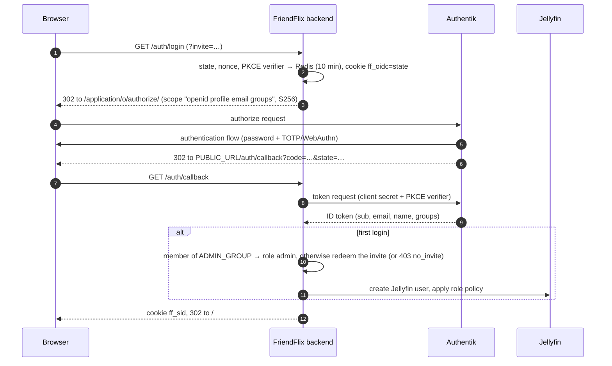
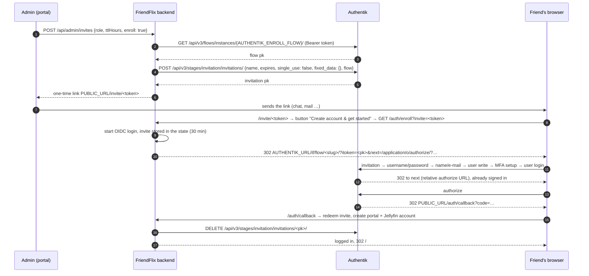

# Authentik for FriendFlix

> **FriendFlix for Plex (preview):** Where this page mentions creating a Jellyfin user, FriendFlix for Plex keeps users in FriendFlix itself (no Jellyfin or plex.tv account); the Authentik setup is unchanged. Media-server setup: [plex.md](plex.md).

**English** · [Deutsch](de/authentik.md)

FriendFlix has no passwords of its own. Every sign-in goes through **Authentik** (OpenID Connect, authorization code flow with PKCE), and Authentik enforces multi-factor authentication. This guide covers installing Authentik and every Authentik object FriendFlix needs, with the exact values the backend expects.

The full FriendFlix installation (Jellyfin, request service, `.env`, Nginx Proxy Manager, first login) is in the [setup guide](setup.md).

> Menu paths follow the Authentik admin interface of the 2025.12 – 2026.x releases (`compose.authentik.yaml` pins `2026.8.3`). Older releases use slightly different labels. Everything marked *(unverified)* could not be checked against code or the official documentation.

## Contents

1. [What FriendFlix needs from Authentik](#1-what-friendflix-needs-from-authentik)
2. [Install Authentik](#2-install-authentik)
3. [Fast path: import the FriendFlix blueprint](#3-fast-path-import-the-friendflix-blueprint)
4. [Groups](#4-groups)
5. [OAuth2/OpenID provider and application](#5-oauth2openid-provider-and-application)
6. [Authentication flow with mandatory MFA](#6-authentication-flow-with-mandatory-mfa)
7. [Enrollment flow for invitations](#7-enrollment-flow-for-invitations)
8. [Service account and API token for invitations](#8-service-account-and-api-token-for-invitations)
9. [FriendFlix `.env` values](#9-friendflix-env-values)
10. [Password recovery by e-mail](#10-password-recovery-by-e-mail)
11. [Optional: passwordless sign-in with passkeys](#11-optional-passwordless-sign-in-with-passkeys)
12. [Optional: branding](#12-optional-branding)
13. [Sessions and logout](#13-sessions-and-logout)
14. [Verification](#14-verification)
15. [Troubleshooting](#15-troubleshooting)
16. [Reference: what the FriendFlix code does](#16-reference-what-the-friendflix-code-does)

## 1. What FriendFlix needs from Authentik

| Authentik object | Name used in this guide | Needed for | FriendFlix setting |
|---|---|---|---|
| OAuth2/OpenID provider | `FriendFlix` | every login | `OIDC_CLIENT_ID`, `OIDC_CLIENT_SECRET` |
| Application | slug `friendflix` | every login | `OIDC_ISSUER=https://auth.example.com/application/o/friendflix/` |
| Group | `friendflix-admins` | portal admins | `ADMIN_GROUP` (default `friendflix-admins`) |
| Group | `friendflix-users` | optional access restriction in Authentik | – (FriendFlix does not read it) |
| Authentication flow with MFA | `default-authentication-flow` (edited) | MFA on every login | – |
| Enrollment flow | `friendflix-enrollment` | invitations that create the Authentik account | `AUTHENTIK_ENROLL_FLOW` |
| Service account + API token | `friendflix-invites` | creating invitations through the API | `AUTHENTIK_API_TOKEN`, `AUTHENTIK_URL` |
| Recovery flow | `default-recovery-flow` | "forgot password" by e-mail (optional) | – |
| Brand | default brand | title, logo, default flows (optional) | – |

Without the last four rows FriendFlix still works: invited people then need an Authentik account that you create by hand (see [§7](#without-the-enrollment-flow)).

### Login



## 2. Install Authentik

Skip this section if you already run Authentik. FriendFlix only needs it reachable over **https** under its own host name, e.g. `auth.example.com`.

### 2.1 Option A: the stack in this repository (`compose.authentik.yaml`)

The file starts Authentik (server + worker, pinned to `2026.8.3` unless `AUTHENTIK_TAG` is set) and its own PostgreSQL 17 on an internal network. Since 2025.10 Authentik needs no Redis. The server is published on `127.0.0.1:9000` only, so it is reachable through Nginx Proxy Manager, never directly. The Docker socket is **not** mounted (no automatic outposts; FriendFlix does not need any).

Keep the Authentik secrets out of the portal's `.env` in a separate file (`.env.*` is gitignored):

```bash
cd /opt/friendflix                     # your clone
cat > .env.authentik <<EOF
AUTHENTIK_PG_PASSWORD=$(openssl rand -hex 24)
AUTHENTIK_SECRET_KEY=$(openssl rand -hex 40)
# AUTHENTIK_TAG=2026.8.3      # pin a release (release notes: https://docs.goauthentik.io/releases/)
# AUTHENTIK_PORT=9100         # if Portainer already uses 9000
# BIND_ADDR=127.0.0.1         # NPM in a bridge container: the Docker host IP, never 0.0.0.0 on a public interface
EOF
chmod 600 .env.authentik
docker compose -f compose.authentik.yaml --env-file .env.authentik up -d
docker compose -f compose.authentik.yaml --env-file .env.authentik logs -f ak-server   # first start: migrations, a few minutes on a NAS
```

`AUTHENTIK_SECRET_KEY` signs sessions and tokens. Never change it after the first start and keep a copy in your password manager.

**Authentik settings (`.env.authentik`).** Authentik reads its configuration from `AUTHENTIK_*` environment variables. `compose.authentik.yaml` loads `.env.authentik` (next to the compose file) into the server and worker containers automatically; the file is optional. So the same file serves two purposes:

- `--env-file .env.authentik` feeds Compose's `${…}` substitutions (`AUTHENTIK_PG_PASSWORD`, `AUTHENTIK_SECRET_KEY`, `AUTHENTIK_TAG`, `AUTHENTIK_PORT`, `BIND_ADDR`). Keep passing it on every command, as above.
- Every other `AUTHENTIK_*` setting in it, e.g. SMTP ([§2.5](#25-e-mail-smtp)) or `AUTHENTIK_LISTEN__TRUSTED_PROXY_CIDRS`, reaches Authentik directly. After editing it, recreate the containers with `… up -d`.

**File storage.** Since 2025.12 Authentik keeps uploaded files (logos, icons, backgrounds) under `/data` ([release notes 2025.12](https://docs.goauthentik.io/releases/2025.12/)). `compose.authentik.yaml` persists it in the volume `ak-data`; `ak-media` (`/media`) is still mounted for older releases.

### 2.2 Option B: the official Docker Compose file

Follow the [official Docker Compose installation](https://docs.goauthentik.io/install-config/install/docker-compose/) (`wget https://docs.goauthentik.io/compose.yml`, generate `PG_PASS` and `AUTHENTIK_SECRET_KEY`, `docker compose up -d`). Differences to option A: it publishes ports `9000`/`9443` on **all** interfaces (set `COMPOSE_PORT_HTTP=127.0.0.1:9000` and `COMPOSE_PORT_HTTPS=127.0.0.1:9443` in its `.env`, or firewall them) and mounts the Docker socket into the worker (remove that line if you do not need automatic outposts). Do not mount `/etc/localtime` into Authentik containers (Authentik works in UTC; a mounted timezone breaks OAuth).

### 2.3 Reverse proxy: Nginx Proxy Manager

*Hosts → Proxy Hosts → Add Proxy Host*:

| Tab | Field | Value |
|---|---|---|
| Details | Domain Names | `auth.example.com` |
| | Scheme | `http` |
| | Forward Hostname / IP | `127.0.0.1` (NPM in a bridge container: the Docker host IP, e.g. `172.17.0.1`) |
| | Forward Port | `9000` (or your `AUTHENTIK_PORT`) |
| | Websockets Support | **on** (Authentik uses WebSockets) |
| | Block Common Exploits | on |
| SSL | SSL Certificate | Request a new Let's Encrypt certificate |
| | Force SSL, HTTP/2 Support, HSTS Enabled | on |
| Advanced | Custom Nginx Configuration | empty |

NPM sets `Host`, `X-Forwarded-Proto` and `X-Forwarded-For`. Authentik only trusts them from private networks (`127.0.0.0/8`, `10.0.0.0/8`, `172.16.0.0/12`, `192.168.0.0/16` by default). If NPM connects from somewhere else, set `AUTHENTIK_LISTEN__TRUSTED_PROXY_CIDRS` in `.env.authentik` ([reverse proxy docs](https://docs.goauthentik.io/install-config/reverse-proxy/)).

DNS: `auth.example.com` must resolve to your proxy **from the Internet, from your LAN and from inside the FriendFlix backend container** (the backend fetches the OIDC discovery document and calls the API through the public URL). If your router has no NAT loopback, add a local DNS entry (router, Pi-hole, AdGuard) for both host names.

### 2.4 Initial admin account

Open `https://auth.example.com/if/flow/initial-setup/` (note the trailing slash). Set the e-mail address and password of the default admin user **`akadmin`**. Then sign in to the admin interface (`https://auth.example.com/if/admin/`).

Recommended right away:

- Under your user menu → *Settings* → *MFA Devices*, enrol a TOTP app or a security key for `akadmin` (once [§6](#6-authentication-flow-with-mandatory-mfa) is done, Authentik forces this anyway).
- Optional: create a personal admin account (*Directory → Users → New User*, then add it to the `authentik Admins` group) and use `akadmin` only as a break-glass account.

### 2.5 E-mail (SMTP)

Needed for password recovery ([§10](#10-password-recovery-by-e-mail)) and admin notifications. Put the settings into `.env.authentik` (option A picks them up automatically, see 2.1; option B: its `.env`):

```bash
AUTHENTIK_EMAIL__HOST=smtp.example.com
AUTHENTIK_EMAIL__PORT=587
AUTHENTIK_EMAIL__USERNAME=authentik@example.com
AUTHENTIK_EMAIL__PASSWORD=<smtp password, no quotes>
AUTHENTIK_EMAIL__USE_TLS=true        # STARTTLS on 587; for implicit TLS on 465: USE_SSL=true, USE_TLS=false
AUTHENTIK_EMAIL__USE_SSL=false
AUTHENTIK_EMAIL__TIMEOUT=10
AUTHENTIK_EMAIL__FROM=FriendFlix <authentik@example.com>
```

Recreate the containers (`… up -d`) and send a test mail:

```bash
docker compose -f compose.authentik.yaml --env-file .env.authentik exec ak-worker ak test_email you@example.com
```

### 2.6 Backups and updates

FriendFlix's backup sidecar only covers the **portal** database. Back up Authentik separately ([official guide](https://docs.goauthentik.io/sys-mgmt/ops/backup-restore/)):

```bash
# daily, e.g. from cron (adjust the compose arguments to your setup)
docker compose -f compose.authentik.yaml --env-file .env.authentik exec -T ak-postgres \
  pg_dump -U authentik -Fc authentik > backups/authentik-$(date +%Y%m%d).dump
```

Also keep `.env.authentik` (above all `AUTHENTIK_SECRET_KEY`) and the volumes `ak-data` (uploads), `ak-certs` and `ak-templates`. Restore: stop `ak-server`/`ak-worker`, `pg_restore --clean --if-exists -U authentik -d authentik < dump`, start again.

Updates: read the release notes of every version in between, raise `AUTHENTIK_TAG` (only one major release, e.g. `2026.5` → `2026.8`, at a time), then `… pull && … up -d`. After an update, run the check in [§14](#14-verification); the invitation API is the part most likely to change.

## 3. Fast path: import the FriendFlix blueprint

[`deploy/authentik/friendflix-blueprint.yaml`](../deploy/authentik/friendflix-blueprint.yaml) creates in one go:

- the service account `friendflix-invites` with exactly the permissions the portal needs, and its non-expiring API token `friendflix-invites-token`;
- the enrollment flow `friendflix-enrollment` (invitation → username/password → name/e-mail → create user → MFA setup → login), see [§7](#7-enrollment-flow-for-invitations).

Import: *Flows and Stages → Flows → Import* → **File upload** → choose the file → *Import*. Re-importing is safe (objects are matched by name/slug and updated).

Variants:

- [`friendflix-service-account.yaml`](../deploy/authentik/friendflix-service-account.yaml): only the service account and token, if you already have an enrollment flow.
- [`friendflix-prompt-fix.yaml`](../deploy/authentik/friendflix-prompt-fix.yaml): a prompt stage without placeholder expressions for an existing enrollment flow that fails with `'AnonymousUser' object has no attribute 'group_attributes'` (bind `friendflix-prompt-fixed` instead of the old prompt stage, same order).

The blueprint does **not** create the groups, the provider/application, MFA in the authentication flow or recovery. Do [§4](#4-groups), [§5](#5-oauth2openid-provider-and-application), [§6](#6-authentication-flow-with-mandatory-mfa) and [§8.3](#83-copy-the-token) (copy the token) by hand. Sections 7 and 8 describe what the blueprint builds, in case you prefer to click it together or need to adapt it.

## 4. Groups

*Directory → Groups → New Group*:

| Name | Members | Purpose |
|---|---|---|
| `friendflix-admins` | you (and co-admins) | Must equal `ADMIN_GROUP` exactly (case-sensitive). Members become portal admins on login, without an invite. |
| `friendflix-users` | everybody else who may use the portal | Optional. Only needed if you restrict the application in Authentik ([§5.2](#52-application)). FriendFlix itself never reads it. |

How FriendFlix uses groups (from `backend/src/routes/auth.ts`):

- The `groups` claim contains the **names** of the user's groups. Authentik's default `profile` scope mapping fills it with the user's directly assigned groups (`request.user.groups.all()`). Add admins **directly** to `friendflix-admins`; membership inherited through a parent group may not appear *(unverified)*.
- **First login:** in `ADMIN_GROUP` → portal role `admin`. Otherwise a valid portal invite is required; the user gets the invite's role (`friend`, `family` or `guest`). No invite → `403 {"error":"no_invite"}`.
- **Later logins:** if an existing user is now in `ADMIN_GROUP`, they are promoted to `admin`. Removing someone from the group does **not** demote them: change the role under *Admin → Users* in the portal.
- `friend`, `family` and `guest` are portal roles stored in the FriendFlix database. They do not map to Authentik groups.
- Disabling a user in Authentik stops new logins, but a running portal session lives on until it expires (max. `SESSION_TTL_SECONDS`). To lock someone out immediately, disable them under *Admin → Users* in the portal as well (that also revokes their sessions).

## 5. OAuth2/OpenID provider and application

*Applications → Applications → New Application* creates both in one wizard ([Authentik docs](https://docs.goauthentik.io/add-secure-apps/providers/oauth2/create-oauth2-provider/)). Alternatively create the provider under *Applications → Providers → New Provider* first.

### 5.1 Provider (type **OAuth2/OpenID Provider**)

| Field | Value | Why |
|---|---|---|
| Name | `FriendFlix` | free |
| Authorization flow | `default-provider-authorization-implicit-consent` (*Authorize Application*) | no consent screen for your friends; the explicit variant works too |
| Client type | **Confidential** | the backend authenticates with the client secret (and additionally uses PKCE S256) |
| Client ID | generated – copy | → `OIDC_CLIENT_ID` |
| Client Secret | generated – copy | → `OIDC_CLIENT_SECRET` (or the Docker secret `oidc_client_secret`) |
| Redirect URIs/Origins | matching mode **Strict**, URL `https://portal.example.com/auth/callback` | must match `${PUBLIC_URL}/auth/callback` character for character (see note) |
| Signing Key | `authentik Self-signed Certificate` | ID tokens signed with RS256; without a key Authentik signs with HS256 and the client secret |
| Encryption Key | **empty** | FriendFlix cannot decrypt encrypted (JWE) ID tokens |
| *Advanced protocol settings* | | |
| Access code validity | `minutes=1` (default) | the code is redeemed within a second |
| Access Token validity | `hours=1` (default) | not used after login: FriendFlix keeps its own session |
| Refresh Token validity | default | not used: FriendFlix does not request `offline_access` |
| Scopes | the defaults: `authentik default OAuth Mapping: OpenID 'openid'`, `… 'email'`, `… 'profile'` | `profile` carries `name`, `preferred_username` **and `groups`** |
| Subject mode | `Based on the User's hashed ID` (default) | **never change it once people have logged in**: FriendFlix links accounts by `sub`; a different `sub` looks like a new person (→ `no_invite`) |
| Include claims in id_token | **on** (default) | required: the backend reads `email`, `name` and `groups` from the ID token only, not from the userinfo endpoint |
| Issuer mode | `Each provider has a different issuer, based on the application slug` (default) | gives the issuer format below |
| Logout URI / Logout method | empty | FriendFlix has no front-/back-channel logout endpoint |
| Invalidation flow | `default-provider-invalidation-flow` | used by the end-session endpoint |
| Authentication flow | empty (= brand default) | or a dedicated flow, see [§6](#6-authentication-flow-with-mandatory-mfa) |

**Redirect URI.** The backend builds it as `new URL('/auth/callback', PUBLIC_URL)` (`backend/src/oidc.ts`). Consequences:

- Scheme and host come from `PUBLIC_URL`; any path in `PUBLIC_URL` is dropped. FriendFlix must run at the root of its own host name (`https://portal.example.com`, not `https://example.com/friendflix`).
- No trailing slash after `callback`. `https://portal.example.com/auth/callback/` or `http://…` will not match.
- One entry is enough. Add a second one only if you really serve the portal under a second host name (and then that host must also be `PUBLIC_URL` for that instance).

**Scopes the backend requests:** `openid profile email groups`. Authentik has no `groups` scope by default and silently drops unknown scopes, so you do **not** need a custom `groups` mapping: the default `profile` mapping already returns `groups`. (A custom scope mapping named `groups` would also work, but is unnecessary.) `email_verified` is not evaluated.

### 5.2 Application

| Field | Value |
|---|---|
| Name | `FriendFlix` |
| Slug | `friendflix` → part of `OIDC_ISSUER` (reserved slugs `authorize`, `token`, `device`, `userinfo`, `introspect`, `revoke` are not allowed) |
| Provider | `FriendFlix` |
| Launch URL | `https://portal.example.com/` (the tile in Authentik's user library) |
| Policy engine mode | `any` |
| Icon | optional, without third-party brand marks (e.g. `docs/images/logo.svg`) |

**Who may sign in (bindings).** Without bindings every Authentik user may authorize the application. FriendFlix still blocks people without an invite (`no_invite`), so that is safe. To also stop them at Authentik: application → *Policy / Group / User Bindings* → *Create or bind…* → *Bind existing group* → `friendflix-admins`, and again for `friendflix-users`.

> If you bind groups, the enrollment flow **must** put new users into `friendflix-users` (*Create users group* in the User Write stage, [§7.2](#72-stages-in-order)). Otherwise a friend finishes sign-up and then gets *Permission denied* from Authentik.

### 5.3 Issuer

```
OIDC_ISSUER=https://auth.example.com/application/o/friendflix/
```

- **With the trailing slash.** The backend fetches `<OIDC_ISSUER>.well-known/openid-configuration` and the issuer inside it must equal `OIDC_ISSUER` exactly; Authentik's issuer ends with `/`.
- **https only.** `openid-client` refuses `http://` issuers; `OIDC_ALLOW_INSECURE=true` is for development only.
- **No redirects.** Discovery does not follow redirects, so use the final https URL.
- Check: `curl -s https://auth.example.com/application/o/friendflix/.well-known/openid-configuration | jq .issuer`

The backend runs discovery once at start. If Authentik is unreachable then, the backend exits and Docker restarts it until it works.

## 6. Authentication flow with mandatory MFA

The default authentication flow already contains the stage `default-authentication-mfa-validation`, but it skips MFA for users without a device. Make it mandatory:

*Flows and Stages → Stages* → `default-authentication-mfa-validation` → *Edit*:

| Field | Value |
|---|---|
| Device classes | `TOTP Authenticators`, `WebAuthn Authenticators` (add `Static Tokens` if you want recovery codes to count) |
| Not configured action | **Force the user to configure an authenticator** (`configure`) |
| Configuration stages | `default-authenticator-totp-setup` and `default-authenticator-webauthn-setup` (the user picks one) |
| Last validation threshold | `seconds=0` (ask every time), or e.g. `days=7` to skip MFA on a device used recently |

This applies to every application that uses this flow, including the Authentik admin interface (good). If you want MFA rules only for FriendFlix, duplicate the flow (*Flows → … → Export/Import* or create a new flow with designation *Authentication* and the same stages), change the MFA stage there, and select the new flow as *Authentication flow* in the FriendFlix provider.

The bound expression policy on the MFA binding (it skips MFA after a passwordless WebAuthn login) stays as it is.

## 7. Enrollment flow for invitations

Goal: the admin creates an invite in FriendFlix, the friend opens the link, clicks **Create account & get started**, signs up in Authentik (including MFA) and lands logged in on the portal with the invite's role. No manual Authentik work per person.



Why it is built this way (from `backend/src/invites.ts`):

- Authentik only follows a **relative** `next` after the last stage. The portal therefore passes the path + query of its own authorize request.
- The invitation's `fixed_data` only pre-fills prompt fields, it cannot carry a redirect; that is why `next` is used.
- The Authentik invitation is created with **`single_use: false`**: Authentik deletes a single-use invitation as soon as its stage passes, i.e. when the link is merely opened, which would lock out a friend who opens it on the phone and finishes on the laptop. The portal invite itself is single-use; the Authentik invitation expires together with it and the portal deletes it once the invite is redeemed or revoked.

### 7.1 Flow

*Flows and Stages → Flows → Create*:

| Field | Value |
|---|---|
| Name | `FriendFlix sign-up` (shown nowhere important) |
| Title | `Welcome to FriendFlix` (heading of the page) |
| Slug | `friendflix-enrollment` → `AUTHENTIK_ENROLL_FLOW` (the **slug**, not the name) |
| Designation | **Enrollment** |
| Authentication | **Require no authentication** (`require_unauthenticated`, like the blueprint). *No requirement* also works. |

### 7.2 Stages in order

Create the stages under *Flows and Stages → Stages* (or directly from the flow's *Stage Bindings* tab → *Create and bind stage*) and bind them in this order (flow → *Stage Bindings* → *Bind existing stage*):

| Order | Stage type | Name (blueprint) | Settings |
|---|---|---|---|
| 10 | **Invitation Stage** | `friendflix-invitation` | *Continue flow without invitation*: **off** (only invited people can sign up). Binding: *Evaluate when flow is planned* and *Evaluate when stage is run* on. |
| 20 | **Prompt Stage** | `friendflix-prompt-credentials` | Fields: `username` (type *Username*), `password` (*Password*), `password_repeat` (*Password*). Optionally add the default password policy under *Validation Policies*. |
| 30 | **Prompt Stage** | `friendflix-prompt-details` | Fields: `name` (*Text*, required), `email` (*Email*, required). |
| 40 | **User Write Stage** | `friendflix-user-write` | *User creation mode*: **Always create new users**. *Create users as inactive*: off. *User type*: Internal. *User path template*: `users/friendflix`. *Create users group*: `friendflix-users` if you bound groups in [§5.2](#52-application). |
| 50 | **Authenticator Validation Stage** | `friendflix-mfa` | Device classes TOTP + WebAuthn, *Not configured action* **Force the user to configure an authenticator**, configuration stages `default-authenticator-totp-setup` + `default-authenticator-webauthn-setup`. |
| 100 | **User Login Stage** | `friendflix-user-login` | **Required.** Without it the person has to sign in again after sign-up. Defaults are fine. |

Prompt fields (*Flows and Stages → Prompts*): use **static** placeholders (*Interpret placeholder as expression* off). Authentik's `default-user-settings-field-*` prompts evaluate an expression on the logged-in user and fail during enrollment (`'AnonymousUser' object has no attribute 'group_attributes'`).

The field keys matter: the User Write stage maps `username`, `name`, `email` and `password` onto the user. FriendFlix then uses `name` (fallback: the part of `email` before `@`) as the Jellyfin user name and the owner profile name, and stores `email`.

**Do not** add a *Redirect stage* or an expression policy that sets a redirect. It overrides `next`, and the person ends up in the Authentik user interface instead of the portal.

### Without the enrollment flow

Leave `AUTHENTIK_URL`, `AUTHENTIK_API_TOKEN` and `AUTHENTIK_ENROLL_FLOW` empty. Then create each friend by hand in *Directory → Users*, send them the portal invite link, and they use **Sign in & unlock**. For someone who already has an Authentik account, tick **already has an Authentik account** when creating the invite (`"enroll": false`); the link then only offers sign-in.

## 8. Service account and API token for invitations

The backend calls the Authentik API with `Authorization: Bearer <AUTHENTIK_API_TOKEN>`. Give it the least privileges that work.

### 8.1 Service account

*Directory → Users → New User → Service Account*: username `friendflix-invites`, *Create group* off. The confirmation screen shows an app password, which FriendFlix does not need (you can delete it under *Tokens and App passwords*).

### 8.2 Role with exactly these global permissions

Since 2025.12 Authentik permissions are assigned to **roles** only. *Directory → Roles → New Role* `friendflix-invites`, then open it → *Permissions* → *Assigned global permissions* → *Assign permission*:

| Permission (UI) | Codename | Used for |
|---|---|---|
| Can view Flow | `authentik_flows.view_flow` | `GET /api/v3/flows/instances/<slug>/` (validates the slug, gets the flow pk) |
| Can add Invitation | `authentik_stages_invitation.add_invitation` | `POST /api/v3/stages/invitation/invitations/` |
| Can view Invitation | `authentik_stages_invitation.view_invitation` | reading invitations (granted by the blueprint; not strictly needed by the current code) |
| Can delete Invitation | `authentik_stages_invitation.delete_invitation` | `DELETE /api/v3/stages/invitation/invitations/<pk>/` after redemption/revocation |

Assign the role to the service account (user → *Roles* → *Assign*, see [Authentik docs](https://docs.goauthentik.io/users-sources/user/user_basic_operations/#add-a-user-to-a-role)). Do **not** make it a superuser and do not use your admin's token: a leaked token could then change everything in Authentik.

Without *Can view Flow* the backend logs `Authentik flow lookup failed` and creates the invitation without a flow binding (still works, less strict). Without *Can delete Invitation* used invitations stay until they expire.

(The blueprint sets these via the user's `permissions` field; Authentik puts them into a managed role for that user.)

### 8.3 Copy the token

*Directory → Tokens and App passwords → Create*:

| Field | Value |
|---|---|
| Identifier | `friendflix-invites-token` |
| User | `friendflix-invites` |
| Intent | **API Token** (an *App password* is rejected with 401) |
| Expiring | off, or on with a reminder to rotate it |

Then click the copy icon in the token's row and put the key into `AUTHENTIK_API_TOKEN`. When you used the blueprint, the token already exists: just copy it.

## 9. FriendFlix `.env` values

```bash
# login (required)
OIDC_ISSUER=https://auth.example.com/application/o/friendflix/   # trailing slash!
OIDC_CLIENT_ID=<client id from the provider>
OIDC_CLIENT_SECRET=<client secret from the provider>
ADMIN_GROUP=friendflix-admins                                     # default

# invitations with account creation (all three, or none)
AUTHENTIK_URL=https://auth.example.com          # public base URL, no path
AUTHENTIK_API_TOKEN=<token key>
AUTHENTIK_ENROLL_FLOW=friendflix-enrollment     # the flow slug

# portal sessions (defaults)
SESSION_TTL_SECONDS=28800    # absolute 8 h
SESSION_IDLE_SECONDS=7200    # 2 h without activity
```

Then recreate the backend: `docker compose -f compose.prod.yaml up -d backend`. Compose passes the `AUTHENTIK_*` variables through with an empty default, so a missing entry silently turns invitations off. If only some of the three are set, the backend logs `Authentik invitations disabled: … not set` at start and whenever an invite is created.

`OIDC_CLIENT_SECRET` can come from a Docker secret ([`compose.secrets.yaml`](../compose.secrets.yaml): `secrets/oidc_client_secret`). The backend reads `<VAR>_FILE` for every setting, so `AUTHENTIK_API_TOKEN_FILE` works too, but `compose.prod.yaml` does not pass that variable through: add it to the backend's `environment` (and mount the secret) in a local override if you want it.

## 10. Password recovery by e-mail

Requires working SMTP ([§2.5](#25-e-mail-smtp)).

1. *Flows and Stages → Flows → Import* → **Local path** → `example/flows-recovery-email-mfa-verification.yaml` → *Import*. This creates the flow `default-recovery-flow`: identification → e-mail with link → **MFA check** → new password → login. (The variant `flows-recovery-email-verification.yaml` skips the MFA check; don't use it if MFA is mandatory.)
2. *System → Brands* → default brand → *Edit* → *Default flows* → **Recovery flow**: `default-recovery-flow`.
3. *Flows and Stages → Stages* → `default-authentication-identification` → *Edit* → **Recovery flow**: `default-recovery-flow`. The login page now shows *Forgot username or password?*.
4. Test it with a test user in a private browser window.

Lost MFA device: there is no self-service reset. As admin open *Directory → Users* → the user → *MFA Devices*, delete the device; on the next login the user is forced to enrol a new one. Alternatively let users create recovery codes (bind `default-authenticator-static-setup` as an additional configuration stage and add *Static Tokens* to the device classes).

## 11. Optional: passwordless sign-in with passkeys

- **Passkey autofill (2025.12+):** in `default-authentication-identification` set *WebAuthn Authenticator Validation Stage* to a validation stage with device class *WebAuthn* only. Browsers then offer stored passkeys right in the username field.
- **Dedicated passwordless flow:** create a flow with designation *Authentication* containing one Authenticator Validation stage (device class WebAuthn, *Not configured action* Deny), then link it in the identification stage as *Passwordless flow*.

Both only replace the password; they do not change anything for FriendFlix. See [authenticator validation stage](https://docs.goauthentik.io/add-secure-apps/flows-stages/stages/authenticator_validate/). *(Field labels unverified in the UI.)*

## 12. Optional: branding

*System → Brands* → default brand → *Edit*:

| Field | Suggestion |
|---|---|
| Domain | `auth.example.com` (or keep the default brand) |
| Title | `FriendFlix` |
| Logo / Favicon | your own artwork, e.g. `docs/images/logo.svg` from this repository (upload under *Customization → Files* first) |
| Default flow background | optional, your own image |
| Default flows | Authentication `default-authentication-flow`, Invalidation `default-invalidation-flow`, Recovery `default-recovery-flow`, User settings `default-user-settings-flow` |

Use your own name and artwork. Do not copy logos, colours or wording of commercial streaming services. The texts of the enrollment flow (flow title, prompt labels) can be changed freely; the blueprint uses German labels.

## 13. Sessions and logout

- **Portal session:** after the callback FriendFlix keeps its own session (`ff_sid` cookie, Redis): absolute `SESSION_TTL_SECONDS` (default 8 h), sliding idle timeout `SESSION_IDLE_SECONDS` (default 2 h). Paired TVs get longer sessions. Authentik's access/refresh tokens are not used after login, so their validity does not influence the portal session.
- **Authentik session:** independent. When the portal session ends, `/auth/login` sends the browser to Authentik; if the Authentik session is still valid, the person is back in without typing anything. How long that is depends on the *Session duration* of the User Login stage (`default-authentication-login`, default `seconds=0` = until the browser closes) and on the MFA *Last validation threshold*.
- **Portal logout** (`POST /auth/logout`) only deletes the portal session (plus that device's push subscriptions and cast tokens). It does **not** call Authentik's end-session endpoint. On a shared computer also sign out of Authentik (`https://auth.example.com/if/user/` → sign out), or keep the Authentik session at `seconds=0`.
- **Forgotten profile PIN:** the portal starts a login with `prompt=login` and `max_age=0`, which makes Authentik ask for the credentials again even if a session exists.
- End-session endpoint, if you want to link it somewhere: `https://auth.example.com/application/o/friendflix/end-session/`.

## 14. Verification

From the Docker host:

```bash
# 1. issuer and discovery (expect exactly OIDC_ISSUER)
curl -s https://auth.example.com/application/o/friendflix/.well-known/openid-configuration | jq -r .issuer

# 2. the backend can reach Authentik (inside the container; expect 200)
docker compose -f compose.prod.yaml exec backend node -e \
  "fetch(process.env.OIDC_ISSUER+'.well-known/openid-configuration').then(r=>console.log(r.status))"

# 3. token, permissions and flow slug (expect 200 and the flow as JSON)
docker compose -f compose.prod.yaml exec backend node -e \
  "fetch(process.env.AUTHENTIK_URL.replace(/\/$/,'')+'/api/v3/flows/instances/'+process.env.AUTHENTIK_ENROLL_FLOW+'/',{headers:{authorization:'Bearer '+process.env.AUTHENTIK_API_TOKEN}}).then(async r=>console.log(r.status,(await r.text()).slice(0,200)))"
```

Same check from the host: `curl -H "Authorization: Bearer <token>" https://auth.example.com/api/v3/flows/instances/friendflix-enrollment/`.

In the browser:

1. Log in to the portal as a member of `friendflix-admins` → you land on the portal as admin (MFA was asked).
2. *Admin → Invitations* → create an invite. The result must say *The link guides through account creation (including two-factor) …*. *not configured* = env vars missing; *could not be created* = API error, see the backend log.
3. Open the link in a **private window** (not logged in to Authentik), click *Create account & get started*, sign up, set up TOTP or a passkey → you land logged in on the portal with the invite's role.
4. In Authentik *Directory → Invitations* the invitation is gone after redemption.

## 15. Troubleshooting

Logs: `docker compose -f compose.prod.yaml logs backend | grep -i -E "oidc|authentik"` and in Authentik *Events → Logs*.

| Symptom | Cause / fix |
|---|---|
| Authentik page *Redirect URI Error* / `redirect_uri` mismatch | The provider's redirect URI is not exactly `${PUBLIC_URL}/auth/callback`. Check scheme, host, no trailing slash, *Strict* mode. |
| Backend restarts in a loop, log `"response" body "issuer" property does not match the expected value` | `OIDC_ISSUER` without trailing slash, wrong slug, or *Issuer mode* set to global. |
| Backend restarts, log mentions `only requests to HTTPS are allowed` or similar | `OIDC_ISSUER` uses `http://`. Use the public https URL (`OIDC_ALLOW_INSECURE` is for development only). |
| Backend restarts, `fetch failed` / `ENOTFOUND` / timeout at start | The backend container cannot reach `auth.example.com` (DNS, NAT loopback, firewall). See [§2.3](#23-reverse-proxy-nginx-proxy-manager). |
| `{"error":"invalid_state"}` on `/auth/callback` | The login started on another host name than `PUBLIC_URL` (e.g. LAN IP), cookies blocked, or more than 10 min (enrollment: 30 min) between start and callback. Start again from `PUBLIC_URL`. |
| `{"error":"login_failed"}` (401) | Token exchange or ID token check failed: wrong client secret, encryption key set on the provider, or the clocks of the hosts differ by more than 30 s (enable NTP on all hosts). Backend log line `oidc callback failed` has the details. |
| `{"error":"no_invite"}` (403) | First login without a valid invite and not in `ADMIN_GROUP`. Admin: check the group name and that *Include claims in id_token* is on. Others: create an invite (with *already has an Authentik account* if they already signed up). |
| Admin is not recognised as admin | Group name differs from `ADMIN_GROUP` (case-sensitive), membership only inherited, or *Include claims in id_token* off. |
| `{"error":"disabled"}` (403) | The account is disabled in the portal (*Admin → Users*). |
| Invite page shows no *Create account* button | Invitations not configured or the Authentik invitation failed. See the invite result text and the backend log. Invites created before the configuration have no Authentik invitation: create a new one. |
| Log `enrollment flow "…" not found` | `AUTHENTIK_ENROLL_FLOW` is not the slug of an existing flow. |
| Log `Authentik API rejected AUTHENTIK_API_TOKEN` | Token wrong, expired, or intent *App password* instead of *API Token*. |
| Log `invitation creation failed (… "Can add Invitation" …)` | 403: the role from [§8.2](#82-role-with-exactly-these-global-permissions) is missing or not assigned. |
| Log `Authentik unreachable` | DNS/TLS/firewall from the backend container to `AUTHENTIK_URL`. |
| You open the enrollment link while signed in to Authentik and land on the portal without any sign-up | Expected: the flow requires no authentication, Authentik denies it and, with the default *Denied action* `MESSAGE_CONTINUE`, follows the relative `next` instead, i.e. you are logged in as the **already signed-in** Authentik user. If that user has no portal account yet, the invite is redeemed for them. Test invites in a private window. |
| `'AnonymousUser' object has no attribute 'group_attributes'` during sign-up | Prompt fields with expression placeholders. Import `friendflix-prompt-fix.yaml` ([§3](#3-fast-path-import-the-friendflix-blueprint)). |
| After sign-up the friend lands in the Authentik user interface | A redirect stage or redirect policy in the enrollment flow, or the User Login stage is missing. |
| After sign-up *Permission denied* for FriendFlix | The application is bound to groups but the User Write stage does not add new users to `friendflix-users`. |
| After changing *Subject mode* nobody can log in (`no_invite`) | Change it back. FriendFlix identifies users by `sub`. |
| Branding uploads disappear after an update | `/data` is not persisted: with option A use the current `compose.authentik.yaml` (volume `ak-data`, [§2.1](#21-option-a-the-stack-in-this-repository-composeauthentikyaml)); with option B keep the `./data` mount. |

## 16. Reference: what the FriendFlix code does

| Item | Value | Source |
|---|---|---|
| Redirect URI | `new URL('/auth/callback', PUBLIC_URL)` | `backend/src/oidc.ts` |
| Scopes | `openid profile email groups` | `backend/src/oidc.ts` |
| PKCE | S256; `state` and `nonce` checked | `backend/src/oidc.ts` |
| Claims read | `sub` (account key), `email`, `name`, `groups` (array of names). `preferred_username` is **not** used. | `backend/src/oidc.ts`, `backend/src/users.ts` |
| Claims source | ID token only | `tokens.claims()` in `backend/src/oidc.ts` |
| Re-authentication | `prompt=login`, `max_age=0` (forgotten PIN) | `backend/src/oidc.ts` |
| Login state | Redis `oidc:<state>`, 600 s (enrollment 1800 s); cookie `ff_oidc` (path `/auth`, SameSite Lax, Secure when `PUBLIC_URL` is https) | `backend/src/routes/auth.ts` |
| Portal routes | `GET /auth/login[?invite=]`, `GET /auth/enroll?invite=`, `GET /auth/callback`, `POST /auth/logout` | `backend/src/routes/auth.ts` |
| Admin rule | `groups` contains `ADMIN_GROUP` → `admin` on first login, promotion on later logins, never demotion | `backend/src/routes/auth.ts` |
| Flow lookup | `GET {AUTHENTIK_URL}/api/v3/flows/instances/{slug}/` | `backend/src/invites.ts` |
| Create invitation | `POST {AUTHENTIK_URL}/api/v3/stages/invitation/invitations/` body `{name: "ff-…", single_use: false, expires, fixed_data: {}, flow}` | `backend/src/invites.ts` (API shape tested against Authentik 2024.x – 2026.x) |
| Delete invitation | `DELETE {AUTHENTIK_URL}/api/v3/stages/invitation/invitations/{pk}/` after redemption or revocation | `backend/src/invites.ts`, `backend/src/routes/admin.ts` |
| Enrollment URL | `{AUTHENTIK_URL}/if/flow/{slug}/?itoken={pk}&next={authorize path+query}` | `backend/src/invites.ts` |
| API timeout | 10 s per call | `backend/src/invites.ts` |
| Invite TTL | 1 – 336 h (default 48 h); the Authentik invitation gets the same expiry | `backend/src/routes/admin.ts` |
