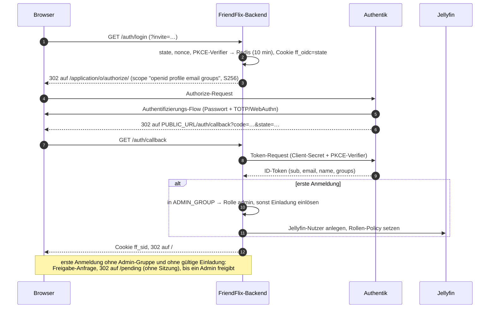
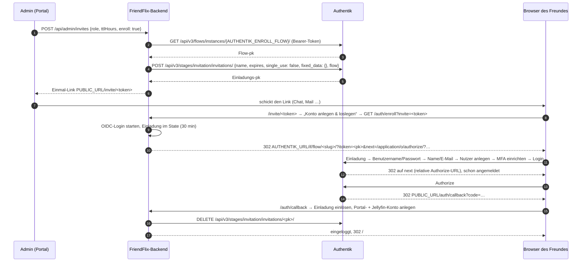

# Authentik für FriendFlix

> **FriendFlix for Plex (Preview):** Wo hier das Anlegen eines Jellyfin-Nutzers steht, hält FriendFlix for Plex die Nutzer selbst (kein Jellyfin- oder plex.tv-Konto); die Authentik-Einrichtung bleibt gleich. Medienserver-Einrichtung: [plex.md](plex.md).

[English](../authentik.md) · **Deutsch**

FriendFlix hat keine eigenen Passwörter. Jede Anmeldung läuft über **Authentik** (OpenID Connect, Authorization-Code-Flow mit PKCE), und Authentik erzwingt die Zwei-Faktor-Anmeldung. Diese Anleitung beschreibt die Installation von Authentik und jedes Authentik-Objekt, das FriendFlix braucht, mit genau den Werten, die das Backend erwartet.

Die komplette FriendFlix-Installation (Jellyfin, Wunsch-Dienst, Nginx Proxy Manager, der Einrichtungsassistent, erste Anmeldung) steht in der [Installationsanleitung](setup.md). Der Assistent kann jedes FriendFlix-Objekt in Authentik für dich anlegen ([§3](#3-automatische-einrichtung-aus-friendflix)); die Abschnitte 4 – 8 beschreiben sie für die Einrichtung von Hand oder zum Anpassen.

> Die Menüpfade entsprechen der Authentik-Admin-Oberfläche der Versionen 2025.12 – 2026.x in englischer Sprache (`compose.authentik.yaml` pinnt `2026.8.3`). Ältere Versionen benennen manches anders. Was mit *(nicht verifiziert)* markiert ist, ließ sich weder im Code noch in der offiziellen Dokumentation prüfen.

## Inhalt

1. [Was FriendFlix von Authentik braucht](#1-was-friendflix-von-authentik-braucht)
2. [Authentik installieren](#2-authentik-installieren)
3. [Automatische Einrichtung aus FriendFlix](#3-automatische-einrichtung-aus-friendflix)
4. [Gruppen](#4-gruppen)
5. [OAuth2/OpenID-Provider und Anwendung](#5-oauth2openid-provider-und-anwendung)
6. [Authentifizierungs-Flow mit Pflicht-MFA](#6-authentifizierungs-flow-mit-pflicht-mfa)
7. [Registrierungs-Flow für Einladungen](#7-registrierungs-flow-für-einladungen)
8. [Service-Account und API-Token](#8-service-account-und-api-token)
9. [Werte für die FriendFlix-`.env`](#9-werte-für-die-friendflix-env)
10. [Passwort-Wiederherstellung per E-Mail](#10-passwort-wiederherstellung-per-e-mail)
    - 10a. [Anmeldung in der App](#10a-anmeldung-in-der-app)
11. [Optional: passwortlos mit Passkeys](#11-optional-passwortlos-mit-passkeys)
12. [Optional: Branding](#12-optional-branding)
13. [Sitzungen und Abmelden](#13-sitzungen-und-abmelden)
14. [Prüfen](#14-prüfen)
15. [Fehlersuche](#15-fehlersuche)
16. [Referenz: was der FriendFlix-Code macht](#16-referenz-was-der-friendflix-code-macht)

## 1. Was FriendFlix von Authentik braucht

| Authentik-Objekt | Name in dieser Anleitung | Wofür | FriendFlix-Einstellung |
|---|---|---|---|
| OAuth2/OpenID-Provider | `FriendFlix` | jede Anmeldung | `OIDC_CLIENT_ID`, `OIDC_CLIENT_SECRET` |
| Anwendung (Application) | Slug `friendflix` | jede Anmeldung | `OIDC_ISSUER=https://auth.example.com/application/o/friendflix/` |
| Gruppe | `friendflix-admins` | Portal-Admins | `ADMIN_GROUP` (Standard `friendflix-admins`) |
| Gruppe | `friendflix-users` | optionale Zugriffsbeschränkung in Authentik | – (FriendFlix liest sie nicht) |
| Authentifizierungs-Flow mit MFA | `default-authentication-flow` (angepasst) | MFA bei jeder Anmeldung | – |
| Registrierungs-Flow (Enrollment) | `friendflix-enrollment` | Einladungen, die das Authentik-Konto gleich mit anlegen | `AUTHENTIK_ENROLL_FLOW` |
| Service-Account + API-Token | `friendflix-invites` | Einladungen über die API anlegen; auf der Admin-Nutzerseite: Authentik-Nutzer finden, Zwei-Faktor-Stand zeigen, Passwort-Link senden; auf der Kontoseite: Namen ändern; Kontolöschung: Authentik-Nutzer deaktivieren | `AUTHENTIK_API_TOKEN`, `AUTHENTIK_URL` |
| Wiederherstellungs-Flow mit E-Mail-Stage | `default-recovery-flow` | „Passwort vergessen“ per E-Mail und *Passwort-Link senden* durch den Admin (optional) | `AUTHENTIK_RECOVERY_FLOW` (Standard `default-recovery-flow`) |
| Brand | Standard-Brand | Titel, Logo, Standard-Flows (optional) | – |

Ohne die letzten vier Zeilen funktioniert FriendFlix trotzdem: Eingeladene brauchen dann ein Authentik-Konto, das du von Hand anlegst (siehe [§7](#ohne-registrierungs-flow)).

### Anmeldung



## 2. Authentik installieren

Diesen Abschnitt überspringen, wenn Authentik schon läuft. FriendFlix braucht es nur per **https** unter einem eigenen Hostnamen, z. B. `auth.example.com`.

### 2.1 Variante A: der Stack in diesem Repository (`compose.authentik.yaml`)

Die Datei startet Authentik (Server + Worker, `2026.8.3`, solange `AUTHENTIK_TAG` nicht gesetzt ist) mit eigenem PostgreSQL 17 in einem internen Netz. Seit 2025.10 braucht Authentik kein Redis mehr. Der Server ist nur auf `127.0.0.1:9000` veröffentlicht, also nur über Nginx Proxy Manager erreichbar. Der Docker-Socket wird **nicht** eingebunden (keine automatischen Outposts; FriendFlix braucht keine).

Die Authentik-Secrets gehören nicht in die `.env` des Portals, sondern in eine eigene Datei (`.env.*` ist in `.gitignore`):

```bash
cd /opt/friendflix                     # dein Klon
cat > .env.authentik <<EOF
AUTHENTIK_PG_PASSWORD=$(openssl rand -hex 24)
AUTHENTIK_SECRET_KEY=$(openssl rand -hex 40)
# AUTHENTIK_TAG=2026.8.3      # Version festlegen (Release Notes: https://docs.goauthentik.io/releases/)
# AUTHENTIK_PORT=9100         # falls Portainer schon 9000 belegt
# BIND_ADDR=127.0.0.1         # NPM im Bridge-Container: IP des Docker-Hosts, nie 0.0.0.0 an einer öffentlichen Schnittstelle
EOF
chmod 600 .env.authentik
docker compose -f compose.authentik.yaml --env-file .env.authentik up -d
docker compose -f compose.authentik.yaml --env-file .env.authentik logs -f ak-server   # erster Start: Migrationen, auf einer NAS einige Minuten
```

`AUTHENTIK_SECRET_KEY` signiert Sitzungen und Tokens. Nach dem ersten Start nie mehr ändern und eine Kopie im Passwort-Manager ablegen.

**Authentik-Einstellungen (`.env.authentik`).** Authentik liest seine Konfiguration aus `AUTHENTIK_*`-Umgebungsvariablen. `compose.authentik.yaml` lädt `.env.authentik` (neben der Compose-Datei) automatisch in die Server- und Worker-Container; die Datei ist optional. Dieselbe Datei erfüllt also zwei Aufgaben:

- `--env-file .env.authentik` liefert die `${…}`-Ersetzungen von Compose (`AUTHENTIK_PG_PASSWORD`, `AUTHENTIK_SECRET_KEY`, `AUTHENTIK_TAG`, `AUTHENTIK_PORT`, `BIND_ADDR`). Bei jedem Befehl wie oben mitgeben.
- Alle anderen `AUTHENTIK_*`-Einstellungen darin, z. B. SMTP ([§2.5](#25-e-mail-smtp)) oder `AUTHENTIK_LISTEN__TRUSTED_PROXY_CIDRS`, kommen direkt bei Authentik an. Nach Änderungen die Container mit `… up -d` neu erstellen.

**Dateiablage.** Seit 2025.12 legt Authentik hochgeladene Dateien (Logos, Icons, Hintergründe) unter `/data` ab ([Release Notes 2025.12](https://docs.goauthentik.io/releases/2025.12/)). `compose.authentik.yaml` sichert das im Volume `ak-data`; `ak-media` (`/media`) bleibt für ältere Versionen eingebunden.

### 2.2 Variante B: die offizielle Docker-Compose-Datei

Der [offiziellen Docker-Compose-Anleitung](https://docs.goauthentik.io/install-config/install/docker-compose/) folgen (`wget https://docs.goauthentik.io/compose.yml`, `PG_PASS` und `AUTHENTIK_SECRET_KEY` erzeugen, `docker compose up -d`). Unterschiede zu Variante A: Sie veröffentlicht die Ports `9000`/`9443` auf **allen** Schnittstellen (in ihrer `.env` `COMPOSE_PORT_HTTP=127.0.0.1:9000` und `COMPOSE_PORT_HTTPS=127.0.0.1:9443` setzen oder per Firewall sperren) und bindet den Docker-Socket in den Worker ein (Zeile entfernen, wenn keine automatischen Outposts nötig sind). `/etc/localtime` nicht in Authentik-Container einbinden (Authentik rechnet in UTC; eine eingebundene Zeitzone stört OAuth).

### 2.3 Reverse Proxy: Nginx Proxy Manager

*Hosts → Proxy Hosts → Add Proxy Host*:

| Reiter | Feld | Wert |
|---|---|---|
| Details | Domain Names | `auth.example.com` |
| | Scheme | `http` |
| | Forward Hostname / IP | `127.0.0.1` (NPM im Bridge-Container: IP des Docker-Hosts, z. B. `172.17.0.1`) |
| | Forward Port | `9000` (bzw. dein `AUTHENTIK_PORT`) |
| | Websockets Support | **an** (Authentik nutzt WebSockets) |
| | Block Common Exploits | an |
| SSL | SSL Certificate | Request a new Let's Encrypt certificate |
| | Force SSL, HTTP/2 Support, HSTS Enabled | an |
| Advanced | Custom Nginx Configuration | leer |

NPM setzt `Host`, `X-Forwarded-Proto` und `X-Forwarded-For`. Authentik vertraut diesen Headern nur aus privaten Netzen (Standard: `127.0.0.0/8`, `10.0.0.0/8`, `172.16.0.0/12`, `192.168.0.0/16`). Verbindet sich NPM von anderswo, `AUTHENTIK_LISTEN__TRUSTED_PROXY_CIDRS` in `.env.authentik` setzen ([Reverse-Proxy-Doku](https://docs.goauthentik.io/install-config/reverse-proxy/)).

DNS: `auth.example.com` muss auf deinen Proxy zeigen, **aus dem Internet, aus dem Heimnetz und aus dem FriendFlix-Backend-Container heraus** (das Backend holt das OIDC-Discovery-Dokument und ruft die API über die öffentliche URL auf). Kann dein Router seine eigene öffentliche IP nicht von innen erreichen (kein NAT-Loopback), für beide Hostnamen einen lokalen DNS-Eintrag anlegen (Router, Pi-hole, AdGuard).

### 2.4 Erstes Admin-Konto

`https://auth.example.com/if/flow/initial-setup/` öffnen (mit Schrägstrich am Ende). E-Mail-Adresse und Passwort des Standard-Admins **`akadmin`** setzen. Danach in die Admin-Oberfläche einloggen (`https://auth.example.com/if/admin/`).

Gleich danach empfohlen:

- Im Benutzermenü → *Settings* → *MFA Devices* eine TOTP-App oder einen Sicherheitsschlüssel für `akadmin` einrichten (nach [§6](#6-authentifizierungs-flow-mit-pflicht-mfa) erzwingt Authentik das ohnehin).
- Optional ein persönliches Admin-Konto anlegen (*Directory → Users → New User*, danach in die Gruppe `authentik Admins`) und `akadmin` nur als Notfallkonto nutzen.

### 2.5 E-Mail (SMTP)

Nötig für die Passwort-Wiederherstellung ([§10](#10-passwort-wiederherstellung-per-e-mail)) und Admin-Benachrichtigungen. Einstellungen in `.env.authentik` eintragen (Variante A übernimmt sie automatisch, siehe 2.1; Variante B: deren `.env`):

```bash
AUTHENTIK_EMAIL__HOST=smtp.example.com
AUTHENTIK_EMAIL__PORT=587
AUTHENTIK_EMAIL__USERNAME=authentik@example.com
AUTHENTIK_EMAIL__PASSWORD=<SMTP-Passwort, ohne Anführungszeichen>
AUTHENTIK_EMAIL__USE_TLS=true        # STARTTLS auf 587; für implizites TLS auf 465: USE_SSL=true, USE_TLS=false
AUTHENTIK_EMAIL__USE_SSL=false
AUTHENTIK_EMAIL__TIMEOUT=10
AUTHENTIK_EMAIL__FROM=FriendFlix <authentik@example.com>
```

Container neu erstellen (`… up -d`) und eine Test-Mail schicken:

```bash
docker compose -f compose.authentik.yaml --env-file .env.authentik exec ak-worker ak test_email du@example.com
```

### 2.6 Backups und Updates

Der Backup-Sidecar von FriendFlix sichert nur die **Portal**-Datenbank. Authentik separat sichern ([offizielle Anleitung](https://docs.goauthentik.io/sys-mgmt/ops/backup-restore/)):

```bash
# täglich, z. B. per Cron (Compose-Argumente an dein Setup anpassen)
docker compose -f compose.authentik.yaml --env-file .env.authentik exec -T ak-postgres \
  pg_dump -U authentik -Fc authentik > backups/authentik-$(date +%Y%m%d).dump
```

Außerdem `.env.authentik` (vor allem `AUTHENTIK_SECRET_KEY`) und die Volumes `ak-data` (Uploads), `ak-certs` und `ak-templates` sichern. Wiederherstellen: `ak-server`/`ak-worker` stoppen, `pg_restore --clean --if-exists -U authentik -d authentik < dump`, wieder starten.

Updates: die Release Notes aller Versionen dazwischen lesen, `AUTHENTIK_TAG` anheben (immer nur ein Release-Schritt, z. B. `2026.5` → `2026.8`), dann `… pull && … up -d`. Nach dem Update die Prüfung aus [§14](#14-prüfen) laufen lassen; am ehesten ändert sich die Einladungs-API.

## 3. Automatische Einrichtung aus FriendFlix

Der Einrichtungsassistent von FriendFlix ([setup.md §8](setup.md#8-der-einrichtungsassistent), Schritt *Anmeldung* → *Automatisch*) richtet Authentik über dessen API mit einem **einmaligen Superuser-API-Token** ein. Nötig ist nur ein installiertes Authentik mit Admin-Konto ([§2](#2-authentik-installieren)). *Plan anzeigen* liest nur und listet, was angelegt, angepasst oder gelassen würde; *Anwenden* führt es aus (etwa 30 Sekunden) und speichert das Ergebnis in FriendFlix. Ein erneuter Lauf ist ungefährlich: alles wird über Name oder Slug gefunden und aktualisiert, nichts doppelt angelegt, und ein vorhandener Provider behält Client-ID und Secret.

### 3.1 Was der Assistent anlegt

| Schritt | In Authentik | In FriendFlix |
|---|---|---|
| Prüfen | der Token muss einem Superuser gehören; Authentik 2024.4 oder neuer | – |
| Gruppen | `friendflix-admins` (oder deine `ADMIN_GROUP`) und `friendflix-users` | `ADMIN_GROUP` |
| Provider und Anwendung | OAuth2/OpenID-Provider `FriendFlix`: vertraulicher Client, nur Grant-Typ `authorization_code`, Redirect-URI genau `<öffentliche Adresse>/auth/callback` (*Strict*), implizite Zustimmung, Scopes `openid`, `email`, `profile`, Issuer pro Provider, Subject-Modus *hashed user ID*, Claims im ID-Token, der selbstsignierte Signaturschlüssel; Anwendung `FriendFlix` (Slug `friendflix`) | `OIDC_ISSUER` (`https://auth.example.com/application/o/friendflix/`), `OIDC_CLIENT_ID`, `OIDC_CLIENT_SECRET` |
| Service-Account | Nutzer `friendflix-invites` mit genau den Berechtigungen aus [§8.2](#82-rolle-mit-genau-diesen-globalen-berechtigungen) und sein nicht ablaufender Token `friendflix-invites-token` | `AUTHENTIK_URL`, `AUTHENTIK_API_TOKEN` (dieser Token, nie der Superuser-Token) |
| Registrierungs-Flow | `friendflix-enrollment` ([§7](#7-registrierungs-flow-für-einladungen)) | `AUTHENTIK_ENROLL_FLOW` |
| Wiederherstellungs-Flow | `default-recovery-flow` aus Authentiks eigenem Beispiel (E-Mail + MFA), nur wenn es ihn noch nicht gibt | `AUTHENTIK_RECOVERY_FLOW` |
| Brand | der Wiederherstellungs-Flow an der Standard-Brand und an der Identification-Stage (*Forgot username or password?*), nur wo keiner gesetzt ist; vorhandene Werte werden nie überschrieben | – |
| Auslesen | Client-ID und Secret, der Service-Token und der Issuer aus dem Discovery-Dokument | – |
| Admin-Gruppe | der Besitzer des Tokens (z. B. `akadmin`) kommt in die Admin-Gruppe, wenn *Mich zur Admin-Gruppe hinzufügen* angehakt ist | – |
| Weitere Flows | der Ablauf für die E-Mail-Änderung `friendflix-email-change` ([§10a, Schritt 7](#10a-anmeldung-in-der-app)), **nur wenn Authentik seine Mail-Vorlage** `friendflix-email-change.html` **schon auflistet** (sonst *übersprungen* mit „Vorlage fehlt“; nichts wird angelegt, und die Einrichtung gelingt trotzdem) | – |

Die Dateien liegen in [`deploy/authentik/`](../../deploy/authentik/): [`friendflix-setup.yaml`](../../deploy/authentik/friendflix-setup.yaml) (Gruppen, Provider, Anwendung), [`friendflix-service-account.yaml`](../../deploy/authentik/friendflix-service-account.yaml) und [`friendflix-blueprint.yaml`](../../deploy/authentik/friendflix-blueprint.yaml). Authentik 2026.8 legt Provider, die über die API oder ein Blueprint entstehen, **ohne** Grant-Typen an (die Anmeldung scheitert dann mit `invalid_request`); `friendflix-setup.yaml` setzt `authorization_code` ausdrücklich, und ein erneutes Anwenden ergänzt den Grant-Typ bei einem Provider, dem er fehlt.

Die erste Anmeldung über den Assistenten wird Admin von FriendFlix, egal in welchen Gruppen das Konto ist. Die Admin-Gruppe zählt für alle danach: ihre Mitglieder werden bei der ersten Anmeldung Admin.

### 3.2 Der einmalige Superuser-Token

1. In Authentik als `akadmin` (oder ein anderer Superuser): *Directory → Tokens and App passwords → Create*. Identifier z. B. `friendflix-setup`, User: du selbst, Intent **API Token** (nicht *App password*). Ein kurzes Ablaufdatum genügt; der Assistent braucht den Token nur ein paar Minuten.
2. Den Schlüssel (*Copy* in der Zeile des Tokens) in den Assistenten kopieren. Wenn beim ersten Start von Authentik `AUTHENTIK_BOOTSTRAP_TOKEN` gesetzt war, geht auch dieser Token.
3. Der Token wird für diesen einen Lauf benutzt und dann vergessen: FriendFlix speichert und loggt ihn nie und schreibt ihn in keine Fehlermeldung. Gespeichert wird der Token des Service-Accounts, der nur kann, was [§8.2](#82-rolle-mit-genau-diesen-globalen-berechtigungen) aufzählt.
4. **Danach widerrufen:** *Directory → Tokens and App passwords*, den Token anhaken, *Delete*. Den Bootstrap-Token (`authentik-bootstrap-token`) genauso löschen und `AUTHENTIK_BOOTSTRAP_TOKEN` aus der Umgebung von Authentik entfernen. Ein Superuser-Token darf in Authentik alles; er soll die Einrichtung nicht überdauern.

### 3.3 Zeitpunkt und Adressen

- **Frisches Authentik:** direkt nach dem ersten Start importiert Authentik im Hintergrund seine Standard-Flows, im Test dauerte das 3 – 4 Minuten. Bis dahin kann *Anwenden* mit *Authentik hat die Einrichtung abgelehnt* (`blueprint_invalid`) stehen bleiben: warten und *Noch einmal versuchen*; bereits angelegte Teile werden wiederverwendet.
- **Eine Adresse für beide:** die Authentik-Adresse so eintragen, wie der Browser sie erreicht (`https://auth.example.com`). Der Backend-Container muss Authentik unter genau dieser Adresse erreichen, denn der Issuer wird daraus abgeleitet ([§2.3](#23-reverse-proxy-nginx-proxy-manager), DNS).
- **http:** ein `http://`-Authentik wird für die Anmeldung abgelehnt, außer das Backend läuft mit `OIDC_ALLOW_INSECURE=true` in seiner Umgebung (nur für Tests, nie im Betrieb).
- Scheitert ein Schritt, wird nichts zurückgerollt; die Liste zeigt den Schritt und einen Grund (`invalid_url`, `unauthorized`, `not_superuser`, `unsupported_version`, `blueprint_invalid`, `unreachable`, `unexpected`, `issuer_mismatch`), und ein neuer Lauf setzt dort fort. Gruppen und Provider kommen aus einer Datei, ein Fehler dort steht deshalb bei beiden.
- Anmelde-Einstellungen, die deine `.env` setzt, bleiben, wie sie sind. Weicht eine davon von dem ab, was Authentik jetzt hat (zum Beispiel eine andere `OIDC_CLIENT_ID`), nennt das Ergebnis sie: aus der `.env` entfernen und das Backend neu starten.

### 3.4 Was von Hand bleibt

- **SMTP** für Einladungs-, Wiederherstellungs- und Benachrichtigungs-Mails ([§2.5](#25-e-mail-smtp)).
- **MFA im Authentifizierungs-Flow** ([§6](#6-authentifizierungs-flow-mit-pflicht-mfa)): der Assistent ändert nicht, wie man sich bei Authentik anmeldet.
- **E-Mail-Vorlagen:** eigene Vorlagen liegen in `/templates` auf dem Authentik-Host, einem Datei-Mount, den die API nicht beschreiben kann. Der Ablauf für die E-Mail-Änderung braucht eine: einbinden, dann *Authentik-Einrichtung reparieren* ([§3.6](#36-einrichtung-einer-bestehenden-installation-reparieren-oder-aktualisieren)).
- Optional: Branding ([§12](#12-optional-branding)), Passkeys ([§11](#11-optional-passwortlos-mit-passkeys)).

### 3.5 Von Hand: FriendFlix-Blueprints importieren

[`deploy/authentik/friendflix-blueprint.yaml`](../../deploy/authentik/friendflix-blueprint.yaml) legt in einem Schritt an:

- den Service-Account `friendflix-invites` mit genau den Berechtigungen, die das Portal braucht (Einladungen, Nutzersuche, Zwei-Faktor-Stand und Passwort-Link der Admin-Nutzerseite sowie Namensänderung und Deaktivieren für Kontoseite und Kontolöschung, siehe [§8.2](#82-rolle-mit-genau-diesen-globalen-berechtigungen)), und sein nicht ablaufendes API-Token `friendflix-invites-token`;
- den Registrierungs-Flow `friendflix-enrollment` (Einladung → Benutzername/Passwort → Name/E-Mail → Nutzer anlegen → MFA einrichten → Login), siehe [§7](#7-registrierungs-flow-für-einladungen).

Import: *Flows and Stages → Flows → Import* → **File upload** → Datei wählen → *Import*. Erneutes Importieren ist unbedenklich (Objekte werden über Name/Slug gefunden und aktualisiert).

Varianten:

- [`friendflix-service-account.yaml`](../../deploy/authentik/friendflix-service-account.yaml): nur Service-Account und Token, wenn es schon einen Registrierungs-Flow gibt.
- [`friendflix-prompt-fix.yaml`](../../deploy/authentik/friendflix-prompt-fix.yaml): eine Prompt-Stage ohne Platzhalter-Ausdrücke für einen bestehenden Registrierungs-Flow, der mit `'AnonymousUser' object has no attribute 'group_attributes'` abbricht (`friendflix-prompt-fixed` statt der alten Prompt-Stage binden, gleiche Order).

Das Blueprint legt **nicht** an: die Gruppen, Provider/Anwendung, MFA im Authentifizierungs-Flow und die Wiederherstellung. [`friendflix-setup.yaml`](../../deploy/authentik/friendflix-setup.yaml) legt Gruppen, Provider und Anwendung an, braucht aber den Kontext `{"public_url": "https://friend.example.com", "admin_group": "friendflix-admins"}`, den der Dialog *Flows → Import* nicht übergeben kann: unter *Customization → Blueprints → Create* mit diesem Kontext importieren *(nicht verifiziert)*, oder [§4](#4-gruppen) und [§5](#5-oauth2openid-provider-und-anwendung) von Hand erledigen. Danach [§6](#6-authentifizierungs-flow-mit-pflicht-mfa) und [§8.3](#83-token-kopieren) (Token kopieren). Die Abschnitte 7 und 8 beschreiben, was das Blueprint baut – für alle, die es lieber zusammenklicken oder anpassen wollen.

### 3.6 Einrichtung einer bestehenden Installation reparieren oder aktualisieren

Der Assistent läuft einmal. Was er damals angelegt hat, bleibt so, auch wenn ein FriendFlix-Update mehr braucht (Phase 3 der Anmeldung in der App hat dem Service-Account die Rechte zum Löschen von Geräten und zwei Leserechte hinzugefügt, dazu den Ablauf für die E-Mail-Änderung). *Admin → Status → Anmeldung* prüft das Dienst-Token bei jedem Laden und bietet **Authentik-Einrichtung reparieren** an:

1. Einen einmaligen Superuser-API-Token wie in [§3.2](#32-der-einmalige-superuser-token) anlegen und in das Feld der Karte einfügen. Er geht nur an die gespeicherte `AUTHENTIK_URL`, wird für diesen Lauf benutzt und nie gespeichert oder geloggt. Danach in Authentik löschen.
2. *Reparieren* (nach einer frischen Anmeldung, wie andere heikle Admin-Aktionen) wendet [`friendflix-service-account.yaml`](../../deploy/authentik/friendflix-service-account.yaml) erneut an (alle Rechte aus [§8.2](#82-rolle-mit-genau-diesen-globalen-berechtigungen); ein gelöschtes `friendflix-invites-token` wird neu angelegt), importiert den Ablauf für die E-Mail-Änderung, wenn seine Vorlage eingebunden ist, und liest das Dienst-Token zurück. Hat sich das Token geändert, speichert FriendFlix das neue; kommt `AUTHENTIK_API_TOKEN` aus der `.env`, bittet die Karte, es dort zu ersetzen und das Backend neu zu starten.
3. Gruppen, Provider, Anwendung, Registrierungs- und Wiederherstellungs-Flow bleiben unberührt, eine angepasste Einrichtung wird also nicht überschrieben. Die Karte zeigt danach das Ergebnis einer frischen Prüfung.

Der Service-Account kann seine eigenen Rechte nicht erweitern, deshalb braucht es den Admin-Token; beim Start ändert sich nichts automatisch.

## 4. Gruppen

*Directory → Groups → New Group*:

| Name | Mitglieder | Zweck |
|---|---|---|
| `friendflix-admins` | du (und Mit-Admins) | Muss exakt `ADMIN_GROUP` entsprechen (Groß-/Kleinschreibung zählt). Mitglieder werden beim Login Portal-Admin, ohne Einladung. |
| `friendflix-users` | alle anderen, die das Portal nutzen dürfen | Optional. Nur nötig, wenn du die Anwendung in Authentik einschränkst ([§5.2](#52-anwendung)). FriendFlix selbst liest sie nie. |

So nutzt FriendFlix Gruppen (aus `backend/src/routes/auth.ts`):

- Der Claim `groups` enthält die **Namen** der Gruppen. Authentiks Standard-Scope-Mapping `profile` füllt ihn mit den direkt zugewiesenen Gruppen (`request.user.groups.all()`). Admins **direkt** in `friendflix-admins` aufnehmen; über eine Elterngruppe geerbte Mitgliedschaft erscheint womöglich nicht *(nicht verifiziert)*.
- **Erste Anmeldung:** in `ADMIN_GROUP` → Portal-Rolle `admin`. Sonst gibt eine gültige Portal-Einladung der Person deren Rolle (`friend`, `family` oder `guest`). Ohne Einladung landet die Person in der **Freigabe-Warteschlange**: FriendFlix zeigt die Seite `/pending` (*Anfrage gesendet*, noch ohne Sitzung) und benachrichtigt die Admins. Ein Admin gibt unter *Admin → Nutzer → Warten auf Freigabe* frei (mit Rolle und optional „Zugang bis“) oder lehnt ab; nach der Freigabe meldet sich die Person erneut an und ist drin.
- **Spätere Anmeldungen:** Ist ein bestehender Nutzer inzwischen in `ADMIN_GROUP`, wird er zum `admin` befördert. Das Entfernen aus der Gruppe stuft **nicht** zurück: Rolle im Portal unter *Admin → Nutzer* ändern.
- `friend`, `family` und `guest` sind Portal-Rollen in der FriendFlix-Datenbank, keine Authentik-Gruppen.
- Ein in Authentik deaktivierter Nutzer kann sich nicht mehr neu anmelden, eine laufende Portal-Sitzung bleibt aber bis zum Ablauf (max. `SESSION_TTL_SECONDS`) bestehen. Für sofortiges Aussperren die Person zusätzlich im Portal unter *Admin → Nutzer* deaktivieren (beendet auch ihre Sitzungen).

## 5. OAuth2/OpenID-Provider und Anwendung

*Applications → Applications → New Application* legt beides in einem Assistenten an ([Authentik-Doku](https://docs.goauthentik.io/add-secure-apps/providers/oauth2/create-oauth2-provider/)). Alternativ zuerst den Provider unter *Applications → Providers → New Provider* anlegen.

### 5.1 Provider (Typ **OAuth2/OpenID Provider**)

| Feld | Wert | Warum |
|---|---|---|
| Name | `FriendFlix` | frei wählbar |
| Authorization flow | `default-provider-authorization-implicit-consent` (*Authorize Application*) | keine Zustimmungsseite für deine Freunde; die explizite Variante geht auch |
| Client type | **Confidential** | das Backend authentifiziert sich mit dem Client-Secret (und nutzt zusätzlich PKCE S256) |
| Client ID | wird erzeugt – kopieren | → `OIDC_CLIENT_ID` |
| Client Secret | wird erzeugt – kopieren | → `OIDC_CLIENT_SECRET` (oder Docker-Secret `oidc_client_secret`) |
| Redirect URIs/Origins | Modus **Strict**, URL `https://friend.example.com/auth/callback` | muss Zeichen für Zeichen `${PUBLIC_URL}/auth/callback` entsprechen (siehe unten) |
| Signing Key | `authentik Self-signed Certificate` | ID-Tokens mit RS256 signiert; ohne Schlüssel signiert Authentik mit HS256 und dem Client-Secret |
| Encryption Key | **leer** | FriendFlix kann verschlüsselte (JWE-)ID-Tokens nicht entschlüsseln |
| *Advanced protocol settings* | | |
| Access code validity | `minutes=1` (Standard) | der Code wird innerhalb einer Sekunde eingelöst |
| Access Token validity | `hours=1` (Standard) | nach dem Login unbenutzt: FriendFlix führt eine eigene Sitzung |
| Refresh Token validity | Standard | unbenutzt: FriendFlix fordert kein `offline_access` an |
| Scopes | die Standards: `authentik default OAuth Mapping: OpenID 'openid'`, `… 'email'`, `… 'profile'` | `profile` liefert `name`, `preferred_username` **und `groups`** |
| Subject mode | `Based on the User's hashed ID` (Standard) | **nie ändern, sobald sich Leute angemeldet haben**: FriendFlix verknüpft Konten über `sub`; ein anderes `sub` wirkt wie eine neue Person (→ Freigabe-Warteschlange) |
| Include claims in id_token | **an** (Standard) | Pflicht: das Backend liest `email`, `name` und `groups` nur aus dem ID-Token, nicht vom Userinfo-Endpunkt |
| Issuer mode | `Each provider has a different issuer, based on the application slug` (Standard) | ergibt das Issuer-Format unten |
| Logout URI / Logout method | leer | FriendFlix hat keinen Front-/Back-Channel-Logout-Endpunkt |
| Invalidation flow | `default-provider-invalidation-flow` | wird vom End-Session-Endpunkt benutzt |
| Authentication flow | leer (= Standard des Brands) | oder ein eigener Flow, siehe [§6](#6-authentifizierungs-flow-mit-pflicht-mfa) |

**Redirect-URI.** Das Backend baut sie als `new URL('/auth/callback', PUBLIC_URL)` (`backend/src/oidc.ts`). Folgen:

- Schema und Host kommen aus `PUBLIC_URL`; ein Pfad in `PUBLIC_URL` fällt weg. FriendFlix muss an der Wurzel eines eigenen Hostnamens laufen (`https://friend.example.com`, nicht `https://example.com/friendflix`).
- Kein Schrägstrich nach `callback`. `https://friend.example.com/auth/callback/` oder `http://…` passen nicht.
- Ein Eintrag genügt. Einen zweiten nur, wenn das Portal wirklich unter einem zweiten Hostnamen läuft (der dann für diese Instanz auch `PUBLIC_URL` sein muss).

**Angeforderte Scopes:** `openid profile email groups`. Authentik hat standardmäßig keinen Scope `groups` und verwirft unbekannte Scopes stillschweigend; ein eigenes `groups`-Mapping ist also **nicht** nötig, das Standard-Mapping `profile` liefert `groups` bereits. (Ein eigenes Scope-Mapping namens `groups` ginge auch, ist aber überflüssig.) `email_verified` wird nicht ausgewertet.

### 5.2 Anwendung

| Feld | Wert |
|---|---|
| Name | `FriendFlix` |
| Slug | `friendflix` → Teil von `OIDC_ISSUER` (die reservierten Slugs `authorize`, `token`, `device`, `userinfo`, `introspect`, `revoke` sind nicht erlaubt) |
| Provider | `FriendFlix` |
| Launch URL | `https://friend.example.com/` (die Kachel in Authentiks Benutzer-Bibliothek) |
| Policy engine mode | `any` |
| Icon | optional, ohne fremde Markenzeichen (z. B. `docs/images/logo.svg`) |

**Wer sich anmelden darf (Bindings).** Ohne Bindings darf jeder Authentik-Nutzer die Anwendung autorisieren. FriendFlix lässt ohne Einladung trotzdem niemanden hinein: Eine solche Person landet nur in der Freigabe-Warteschlange und wartet auf einen Admin, das ist also sicher. Mit Bindings erreichen Leute außerhalb der Gruppen die Warteschlange gar nicht erst. Um sie schon in Authentik abzuweisen: Anwendung → *Policy / Group / User Bindings* → *Create or bind…* → *Bind existing group* → `friendflix-admins`, dasselbe für `friendflix-users`.

> Wer Gruppen bindet, **muss** im Registrierungs-Flow neue Nutzer in `friendflix-users` aufnehmen (*Create users group* in der User-Write-Stage, [§7.2](#72-stages-in-dieser-reihenfolge)). Sonst schließt ein Freund die Registrierung ab und bekommt dann *Permission denied* von Authentik.

### 5.3 Issuer

```
OIDC_ISSUER=https://auth.example.com/application/o/friendflix/
```

- **Mit Schrägstrich am Ende.** Das Backend lädt `<OIDC_ISSUER>.well-known/openid-configuration`, und der Issuer darin muss exakt `OIDC_ISSUER` entsprechen; Authentiks Issuer endet auf `/`.
- **Nur https.** `openid-client` lehnt `http://`-Issuer ab; `OIDC_ALLOW_INSECURE=true` ist nur für die Entwicklung.
- **Keine Weiterleitungen.** Die Discovery folgt keinen Redirects, also die endgültige https-URL eintragen.
- Prüfen: `curl -s https://auth.example.com/application/o/friendflix/.well-known/openid-configuration | jq .issuer`

Das Backend macht die Discovery einmal beim Start. Ist Authentik dann nicht erreichbar, beendet sich das Backend, und Docker startet es neu, bis es klappt.

## 6. Authentifizierungs-Flow mit Pflicht-MFA

Der Standard-Authentifizierungs-Flow enthält schon die Stage `default-authentication-mfa-validation`, überspringt MFA aber für Nutzer ohne Gerät. So wird sie Pflicht:

*Flows and Stages → Stages* → `default-authentication-mfa-validation` → *Edit*:

| Feld | Wert |
|---|---|
| Device classes | `TOTP Authenticators`, `WebAuthn Authenticators` (plus `Static Tokens`, wenn Wiederherstellungscodes zählen sollen) |
| Not configured action | **Force the user to configure an authenticator** (`configure`) |
| Configuration stages | `default-authenticator-totp-setup` und `default-authenticator-webauthn-setup` (die Person wählt eins) |
| Last validation threshold | `seconds=0` (jedes Mal fragen) oder z. B. `days=7`, um MFA auf kürzlich benutzten Geräten zu überspringen |

Das gilt für jede Anwendung, die diesen Flow nutzt, auch für die Authentik-Admin-Oberfläche (gut so). Soll die MFA-Regel nur für FriendFlix gelten, den Flow duplizieren (Export/Import oder neuer Flow mit Designation *Authentication* und denselben Stages), dort die MFA-Stage ändern und den neuen Flow im FriendFlix-Provider als *Authentication flow* wählen.

Die Expression-Policy am MFA-Binding (sie überspringt MFA nach einem passwortlosen WebAuthn-Login) bleibt unverändert.

## 7. Registrierungs-Flow für Einladungen

Ziel: Der Admin erstellt in FriendFlix eine Einladung, der Freund öffnet den Link, klickt **Konto anlegen & loslegen**, registriert sich in Authentik (inklusive MFA) und landet eingeloggt im Portal, mit der Rolle der Einladung. Keine Handarbeit in Authentik pro Person.



Warum es so gebaut ist (aus `backend/src/invites.ts`):

- Authentik folgt nach der letzten Stage nur einem **relativen** `next`. Das Portal übergibt daher Pfad + Query seines eigenen Authorize-Requests.
- `fixed_data` der Einladung füllt nur Prompt-Felder vor und kann keine Weiterleitung transportieren; deshalb `next`.
- Die Authentik-Einladung wird mit **`single_use: false`** angelegt: Authentik löscht eine Einmal-Einladung, sobald ihre Stage durchlaufen ist, also schon beim bloßen Öffnen des Links. Ein Freund, der ihn am Handy öffnet und am Laptop fertig macht, wäre sonst ausgesperrt. Die Portal-Einladung selbst ist einmalig; die Authentik-Einladung läuft mit ihr ab und wird vom Portal gelöscht, sobald die Einladung eingelöst oder widerrufen ist.

### 7.1 Flow

*Flows and Stages → Flows → Create*:

| Feld | Wert |
|---|---|
| Name | `FriendFlix Registrierung` |
| Title | `Willkommen bei FriendFlix` (Überschrift der Seite) |
| Slug | `friendflix-enrollment` → `AUTHENTIK_ENROLL_FLOW` (der **Slug**, nicht der Name) |
| Designation | **Enrollment** |
| Authentication | **Require no authentication** (`require_unauthenticated`, wie im Blueprint). *No requirement* geht auch. |

### 7.2 Stages in dieser Reihenfolge

Stages unter *Flows and Stages → Stages* anlegen (oder direkt im Reiter *Stage Bindings* des Flows → *Create and bind stage*) und in dieser Reihenfolge binden (Flow → *Stage Bindings* → *Bind existing stage*):

| Order | Stage-Typ | Name (Blueprint) | Einstellungen |
|---|---|---|---|
| 10 | **Invitation Stage** | `friendflix-invitation` | *Continue flow without invitation*: **aus** (nur Eingeladene können sich registrieren). Binding: *Evaluate when flow is planned* und *Evaluate when stage is run* an. |
| 20 | **Prompt Stage** | `friendflix-prompt-credentials` | Felder: `username` (Typ *Username*), `password` (*Password*), `password_repeat` (*Password*). Optional die Standard-Passwort-Policy unter *Validation Policies*. |
| 30 | **Prompt Stage** | `friendflix-prompt-details` | Felder: `name` (*Text*, Pflicht), `email` (*Email*, Pflicht). |
| 40 | **User Write Stage** | `friendflix-user-write` | *User creation mode*: **Always create new users**. *Create users as inactive*: aus. *User type*: Internal. *User path template*: `users/friendflix`. *Create users group*: `friendflix-users`, falls du in [§5.2](#52-anwendung) Gruppen gebunden hast. |
| 50 | **Authenticator Validation Stage** | `friendflix-mfa` | Device classes TOTP + WebAuthn, *Not configured action* **Force the user to configure an authenticator**, Configuration stages `default-authenticator-totp-setup` + `default-authenticator-webauthn-setup`. |
| 100 | **User Login Stage** | `friendflix-user-login` | **Pflicht.** Ohne sie muss sich die Person nach der Registrierung noch einmal anmelden. Standardwerte passen. |

Prompt-Felder (*Flows and Stages → Prompts*): **statische** Platzhalter verwenden (*Interpret placeholder as expression* aus). Authentiks `default-user-settings-field-*`-Prompts werten einen Ausdruck auf dem angemeldeten Nutzer aus und scheitern während der Registrierung (`'AnonymousUser' object has no attribute 'group_attributes'`).

Die Feld-Schlüssel sind wichtig: Die User-Write-Stage schreibt `username`, `name`, `email` und `password` in den Nutzer. FriendFlix verwendet dann `name` (ersatzweise den Teil von `email` vor dem `@`) als Jellyfin-Benutzernamen und Namen des Hauptprofils und speichert `email`.

**Keine** *Redirect Stage* und keine Expression-Policy einbauen, die eine Weiterleitung setzt. Sie überschreibt `next`, und die Person landet in der Authentik-Benutzeroberfläche statt im Portal.

### Ohne Registrierungs-Flow

`AUTHENTIK_URL`, `AUTHENTIK_API_TOKEN` und `AUTHENTIK_ENROLL_FLOW` leer lassen. Dann jeden Freund von Hand unter *Directory → Users* anlegen, ihm den Einladungslink des Portals schicken, und er nutzt **Anmelden & freischalten**. Für jemanden, der schon ein Authentik-Konto hat, beim Erstellen der Einladung **hat schon ein Authentik-Konto** ankreuzen (`"enroll": false`); der Link bietet dann nur die Anmeldung an.

## 8. Service-Account und API-Token

Das Backend ruft die Authentik-API mit `Authorization: Bearer <AUTHENTIK_API_TOKEN>` für Einladungen, für die Admin-Nutzerseite (*Admin → Nutzer →* eine Person: Authentik-Nutzer, Zwei-Faktor-Stand, *Passwort-Link senden*), für die Kontoseite (*Mein Bereich → Konto*: Name, Zwei-Faktor-Stand, und unter *Sicherheit* die Liste und das Entfernen der eigenen Geräte sowie die E-Mail-Änderung) und für die Kontolöschung (der Authentik-Nutzer wird deaktiviert) auf. Es bekommt nur die Rechte, die es wirklich braucht.

### 8.1 Service-Account

*Directory → Users → New User → Service Account*: Benutzername `friendflix-invites`, *Create group* aus. Der Bestätigungsdialog zeigt ein App-Passwort, das FriendFlix nicht braucht (kann unter *Tokens and App passwords* gelöscht werden).

### 8.2 Rolle mit genau diesen globalen Berechtigungen

Seit 2025.12 vergibt Authentik Berechtigungen nur noch über **Rollen**. *Directory → Roles → New Role* `friendflix-invites`, dann öffnen → *Permissions* → *Assigned global permissions* → *Assign permission*:

| Berechtigung (UI) | Codename | Wofür |
|---|---|---|
| Can view Flow | `authentik_flows.view_flow` | `GET /api/v3/flows/instances/<slug>/` (prüft den Slug, liefert die Flow-pk) |
| Can add Invitation | `authentik_stages_invitation.add_invitation` | `POST /api/v3/stages/invitation/invitations/` |
| Can view Invitation | `authentik_stages_invitation.view_invitation` | Einladungen lesen (vergibt das Blueprint; vom aktuellen Code nicht zwingend benötigt) |
| Can delete Invitation | `authentik_stages_invitation.delete_invitation` | `DELETE /api/v3/stages/invitation/invitations/<pk>/` nach Einlösen/Widerruf |
| Can view User | `authentik_core.view_user` | `GET /api/v3/core/users/?…` (findet den Authentik-Nutzer eines Portal-Kontos über sein `sub`; den Benutzernamen für die erneute Anmeldung in der App; ob eine neue E-Mail-Adresse schon einem anderen Authentik-Nutzer gehört) und den Nutzer beim Passwort-Link |
| Can view TOTP Device | `authentik_stages_authenticator_totp.view_totpdevice` | Zwei-Faktor-Stand: Authenticator-App (`GET /api/v3/authenticators/admin/all/?user=<pk>`) |
| Can view WebAuthn Device | `authentik_stages_authenticator_webauthn.view_webauthndevice` | Zwei-Faktor-Stand: Passkey / Sicherheitsschlüssel (derselbe Aufruf) |
| Can view Static Device | `authentik_stages_authenticator_static.view_staticdevice` | Zwei-Faktor-Stand: Wiederherstellungscodes (derselbe Aufruf) |
| Can delete TOTP Device | `authentik_stages_authenticator_totp.delete_totpdevice` | *Sicherheit → Entfernen* auf der Kontoseite: `DELETE /api/v3/authenticators/admin/totp/<pk>/` |
| Can delete WebAuthn Device | `authentik_stages_authenticator_webauthn.delete_webauthndevice` | dasselbe für einen Passkey (`…/admin/webauthn/<pk>/`) |
| Can delete Static Device | `authentik_stages_authenticator_static.delete_staticdevice` | dasselbe für Wiederherstellungscodes, und die alten Codes, nachdem neue bestätigt sind (`…/admin/static/<pk>/`) |
| Can view Authenticator Validation Stage | `authentik_stages_authenticator_validate.view_authenticatorvalidatestage` | `GET /api/v3/stages/authenticator/validate/<pk>/`: ob der Anmelde-Flow Leute ohne zweiten Faktor abweist (dann verweigert die Kontoseite das Entfernen des letzten). Die Liste der Bindungen enthält diese Einstellung nicht. Ohne das Recht ist sie unbekannt, das Entfernen ist erlaubt, und die Status-Karte warnt. |
| Can view OAuth2/OpenID Provider | `authentik_providers_oauth2.view_oauth2provider` | `GET /api/v3/providers/oauth2/?client_id=`: die Prüfung von Zustimmung und Grant-Typ auf der Status-Karte. Ohne das Recht antwortet Authentik mit 403, und die Karte zeigt statt dieser Prüfungen eine Rechte-Warnung. |
| Can view Flow Stage Binding | `authentik_flows.view_flowstagebinding` | `GET /api/v3/flows/bindings/?target=<Flow-pk>` (findet die E-Mail-Stage des Wiederherstellungs-Flows) |
| Can view Email Stage | `authentik_stages_email.view_emailstage` | prüft Authentik beim Senden des Passwort-Links (ohne: „Email stage not found“) |
| Reset Password | `authentik_core.reset_user_password` | `POST /api/v3/core/users/<pk>/recovery_email/` (*Passwort-Link senden*) |
| Can change User | `authentik_core.change_user` | `PATCH /api/v3/core/users/<pk>/` mit `name` (jemand benennt sich auf der Kontoseite um), `username` (*Sicherheit → Benutzername → Ändern*, nach einer erneuten Anmeldung) oder `is_active: false` (letzter Schritt einer Kontolöschung). FriendFlix ändert sonst nichts (Name, Benutzername, `is_active`). Ein engeres Recht für ein einzelnes Feld hat Authentik nicht. |

Die Rolle dem Service-Account zuweisen (Nutzer → *Roles* → *Assign*, siehe [Authentik-Doku](https://docs.goauthentik.io/users-sources/user/user_basic_operations/#add-a-user-to-a-role)). **Kein** Superuser und nicht das Token deines Admins verwenden: Ein geleaktes Token könnte sonst alles in Authentik ändern.

> **„Can change User“ gilt global.** Authentik vergibt das Recht für alle Nutzer, nicht nur für die Leute, die FriendFlix nutzen: Ein geleaktes Token könnte jedes Authentik-Konto umbenennen oder deaktivieren, auch Admins. FriendFlix selbst schickt nur `name` und `is_active`, und nur für den Authentik-Nutzer des jeweiligen Kontos, aber die Berechtigung reicht weiter. Wer das nicht will, lässt sie weg (Rolle enger fassen oder die Zeile vor dem Import aus dem Blueprint löschen). Dann meldet die Kontoseite beim Umbenennen „Die Anmeldeseite hat die Änderung nicht angenommen“, und eine Kontolöschung bleibt bei Bereinigungsschritt 6 stehen, bis du den Authentik-Nutzer von Hand deaktivierst: Beim nächsten Versuch (innerhalb einer Minute) sieht FriendFlix, dass der Nutzer schon inaktiv ist, und schließt den Schritt ab, ohne in Authentik etwas zu ändern. Diese Prüfung braucht *Can view User*. Siehe [§8.4](#84-kontoseite-und-kontolöschung).

Ohne *Can view Flow* loggt das Backend `Authentik flow lookup failed` und legt die Einladung ohne Flow-Bindung an (funktioniert, ist aber weniger streng). Ohne *Can delete Invitation* bleiben benutzte Einladungen bis zum Ablauf stehen.

> **Auch die Geräte-Rechte gelten global.** Wie *Can change User* decken die drei Rechte *Can delete … Device* die Geräte aller Authentik-Nutzer ab. FriendFlix löscht nur ein Gerät, das es unmittelbar vorher in der eigenen Liste der angemeldeten Person gefunden hat (`admin/all/?user=<pk>`), nach einer höchstens 10 Minuten alten erneuten Anmeldung; ein geleaktes Token könnte die Geräte beliebiger Nutzer löschen. Ohne diese Rechte scheitert *Entfernen* auf der Kontoseite, und *Neue Wiederherstellungscodes* lässt die alten Codes gültig (der Schritt wird nur mit einem Code geloggt).

> **Der Zwei-Faktor-Stand braucht die drei Geräte-Rechte.** Authentik liefert in der Geräteliste nur die Geräte, die das Token sehen darf, und meldet keinen Fehler. Ein Token ohne *Can view TOTP / WebAuthn / Static Device* bekommt eine leere Liste, und jede Person steht auf der Admin-Nutzerseite stillschweigend mit **„Keine Zwei-Faktor-Anmeldung“** da, auch wenn sie 2FA nutzt. Ohne *Can view User* wird der Authentik-Nutzer gar nicht gefunden: Die Seite zeigt „2FA unbekannt“ und bietet *Passwort-Link senden* nicht an. Nach dem Korrigieren der Rechte kann FriendFlix die alte Antwort noch zeigen, bis sein Cache abläuft: bis zu 10 Minuten für den Zwei-Faktor-Stand, bis zu 1 Stunde für die Nutzersuche.

Die Codenamen oben sind gegen den Quellcode von Authentik 2026.8.3 geprüft (die Version in `compose.authentik.yaml`). Nach einem FriendFlix-Update holen *Authentik-Einrichtung reparieren* ([§3.6](#36-einrichtung-einer-bestehenden-installation-reparieren-oder-aktualisieren)) oder ein erneuter Import des Blueprints neue Rechte dazu: Das aktualisiert den bestehenden Service-Account. *Admin → Status → Anmeldung* prüft jedes Leserecht oben mit dem Dienst-Token (ein Listen-Aufruf, den Authentik ohne das Recht mit 403 beantwortet) und nennt jedes fehlende; die Rechte zum Ändern und Löschen lassen sich nicht prüfen, ohne etwas zu ändern.

(Das Blueprint setzt alle diese Rechte über das Feld `permissions` des Nutzers; Authentik legt sie in eine verwaltete Rolle dieses Nutzers.)

### 8.3 Token kopieren

*Directory → Tokens and App passwords → Create*:

| Feld | Wert |
|---|---|
| Identifier | `friendflix-invites-token` |
| User | `friendflix-invites` |
| Intent | **API Token** (ein *App password* wird mit 401 abgelehnt) |
| Expiring | aus, oder an mit Erinnerung zum Erneuern |

Dann in der Zeile des Tokens auf das Kopier-Symbol klicken und den Schlüssel in `AUTHENTIK_API_TOKEN` eintragen. Mit dem Blueprint existiert das Token schon: nur kopieren.

### 8.4 Kontoseite und Kontolöschung

Jede Person verwaltet ihr Konto selbst unter *Mein Bereich → Konto* (`/me/account`, nur im Hauptprofil). Was dafür von Authentik gebraucht wird:

- **Name:** Mit API-Token wird ein neuer Name zuerst in Authentik geschrieben (`name`, braucht *Can change User*), dann in FriendFlix. Ohne Token bleibt die Änderung in FriendFlix; die Anmeldung übernimmt den Namen nie zurück, also überschreibt ihn nichts.
- **E-Mail:** Das Profil zeigt die Adresse nur lesbar und verweist auf die Zeile *E-Mail-Adresse* unter *Sicherheit*; dort startet *Ändern* den Ablauf für die E-Mail-Änderung ([§10a, Schritt 7](#10a-anmeldung-in-der-app)): erneute Anmeldung, die neue Adresse, ein Bestätigungslink an diese Adresse. Ohne den Ablauf in Authentik hat die Zeile kein *Ändern* (Admins sehen einen Hinweis). Eine auf den eigenen Seiten von Authentik geänderte Adresse wird weder in FriendFlix übernommen noch von FriendFlix erneut bestätigt. Ob Leute Namen oder E-Mail in den Nutzereinstellungen von Authentik überhaupt ändern dürfen, ist eine Authentik-Einstellung (*System → Settings*: *Allow users to change name*, standardmäßig an, und *Allow users to change email*, standardmäßig aus).
- **Benutzername:** *Sicherheit → Benutzername* zeigt den Benutzernamen in Authentik; *Ändern* verlangt eine erneute Anmeldung, prüft den Namen nach den Regeln von Authentik (Buchstaben, Ziffern und `@ . + - _`, höchstens 150 Zeichen) und dass kein anderer Authentik-Nutzer ihn hat (ohne Groß-/Kleinschreibung, weil die Anmeldung Namen so vergleicht), und schreibt ihn mit *Can change User* nach Authentik. Höchstens 3 Änderungen pro Tag und Konto; im Audit-Log als `account.username`, nur mit dem Feldnamen. FriendFlix speichert den Benutzernamen nicht und erkennt Konten am `sub`: Mit dem Subject-Modus *Hashed User ID* (der des Assistenten) bleibt das Konto nach einer Umbenennung dasselbe. Bei einem Provider im Subject-Modus *Username* würde eine Umbenennung bei der nächsten Anmeldung zu einem neuen Konto, deshalb lehnt FriendFlix sie dort ab und sagt warum. Die Authentik-Einstellung *Allow users to change username* (standardmäßig aus) gilt nur für die Seiten von Authentik.
- **Sicherheit** (Passwort, Authenticator-App, Passkeys, Wiederherstellungscodes): Jede Aktion fragt zuerst in einem Dialog noch einmal nach Passwort und zweitem Faktor (die erneute Anmeldung in der App, [§10a](#10a-anmeldung-in-der-app)) und führt dann den Einrichtungs- oder Passwort-Flow von Authentik im selben Dialog aus. Das Entfernen eines Geräts braucht die Geräte-Rechte aus [§8.2](#82-rolle-mit-genau-diesen-globalen-berechtigungen). Können Passkeys nicht auf der eigenen Seite von FriendFlix laufen, verlinkt *Passkey hinzufügen* stattdessen auf die Passkey-Einrichtung von Authentik.
- **Der Link zu den Nutzereinstellungen** („Auf der Anmeldeseite verwalten“, neben dem Zwei-Faktor-Stand und der E-Mail) ist der Ursprung von `OIDC_ISSUER` plus `/if/user/#/settings`, z. B. `https://auth.example.com/if/user/#/settings`. Er braucht kein API-Token. Er fehlt, wenn `OIDC_ISSUER` keine Authentik-Provider-URL ist (kein `/application/o/` im Pfad). Er bleibt der Weg zu den eigenen Nutzereinstellungen von Authentik (zum Beispiel dessen Sitzungen oder verbundene Quellen).
- **Zwei-Faktor-Stand:** wie auf der Admin-Nutzerseite (drei Geräte-Rechte, [§8.2](#82-rolle-mit-genau-diesen-globalen-berechtigungen)); ohne API-Token zeigt die Seite „Nicht verfügbar“.
- **Erneute Anmeldung:** Vor dem Löschen des Kontos, dem Entfernen eines Geräts, den Aktionen unter *Sicherheit* und der E-Mail-Änderung meldet sich die Person noch einmal an. Die Aktionen unter *Sicherheit* und das Entfernen von Geräten nutzen einen Dialog, der über den Anmelde-Flow nach Passwort (und zweitem Faktor) fragt. Die Kontolöschung (und *Stattdessen mit Passkey bestätigen* im Dialog) startet stattdessen einen Login mit `prompt=login` und `max_age=0`, Authentik fragt also auch dann, wenn eine Sitzung besteht. Die Bestätigung gilt 10 Minuten ([§13](#13-sitzungen-und-abmelden)).
- **Die Kontolöschung** deaktiviert den Authentik-Nutzer (`is_active: false`) als letzten von sechs Bereinigungsschritten, 7 Tage nach dem Antrag ([security.md](../security.md#account-deletion), englisch). In diesen 7 Tagen bleibt der Authentik-Nutzer aktiv, denn mit einer Anmeldung stellt die Person ihr Konto wieder her. FriendFlix löscht den Authentik-Nutzer nie.
  - **Ohne API-Token** oder wenn der Authentik-Nutzer nicht gefunden wird, wird die Löschung trotzdem fertig (der Audit-Eintrag `user.deleted` zeigt `authentik: not_configured` oder `not_found`), aber der Authentik-Nutzer bleibt aktiv. Die Person kann sich dann wieder anmelden und landet als neue Person in der Warteschlange (*Warten auf Freigabe*); wer in `ADMIN_GROUP` ist, bekommt stattdessen ein neues Admin-Konto. Deaktiviere oder lösche sie selbst in Authentik.
  - **Ohne *Can change User*** scheitert Schritt 6 mit `authentik_token_rejected` und wird einmal pro Minute wiederholt; *Admin → Nutzer*, Filter *Löschung ausstehend*, zeigt die Bereinigungszeile mit dem Fehler. Das endet, wenn du das Recht ergänzt oder den Authentik-Nutzer von Hand deaktivierst: Schritt 6 sucht den Nutzer zuerst (*Can view User*) und ist ohne Änderung fertig, wenn er schon inaktiv ist. Bis dahin behält der Bereinigungseintrag Name, E-Mail und Authentik-`sub` der Person.

**Den Authentik-Nutzer zu löschen, entscheidest du als Betreiber.** FriendFlix lässt ihn deaktiviert stehen; Benutzername und E-Mail bleiben damit belegt, und Authentiks eigenes Ereignisprotokoll behält seine Geschichte. Zum endgültigen Entfernen:

1. Warten, bis FriendFlix die Löschung abgeschlossen hat: Die Person ist aus *Admin → Nutzer* verschwunden (auch unter *Löschung ausstehend*), und das Audit-Log hat `user.deleted` mit ihrem Pseudonym.
2. In Authentik unter *Directory → Users* die Person über Benutzername oder E-Mail suchen (inaktive Nutzer stehen mit in der Liste; FriendFlix zeigt nur das Pseudonym, du musst also wissen, wer es war).
3. Prüfen, dass es das richtige Konto ist und es inaktiv ist, dann *Delete*. Das entfernt in Authentik auch MFA-Geräte, Tokens und Sitzungen.
4. Registriert sich dieselbe Person später neu, hat ihr neuer Authentik-Nutzer ein neues `sub`, und FriendFlix behandelt sie als neue Person (Einladung oder Warteschlange; ein Mitglied von `ADMIN_GROUP` bekommt sofort ein neues Admin-Konto).

## 9. Werte für die FriendFlix-`.env`

Der Einrichtungsassistent speichert diese Werte in der Datenbank: die automatische Einrichtung ([§3](#3-automatische-einrichtung-aus-friendflix)) füllt alle, *Von Hand* übernimmt sie aus dem Formular. In die `.env` gehören sie nur, wenn du FriendFlix über die Umgebung konfigurierst ([setup.md §15](setup.md#15-fortgeschritten-konfiguration-über-die-umgebung)); ein Wert dort hat Vorrang und ist gesperrt.

```bash
# Anmeldung (Pflicht)
OIDC_ISSUER=https://auth.example.com/application/o/friendflix/   # Schrägstrich am Ende!
OIDC_CLIENT_ID=<Client-ID aus dem Provider>
OIDC_CLIENT_SECRET=<Client-Secret aus dem Provider>
ADMIN_GROUP=friendflix-admins                                     # Standard

# Einladungen mit Konto-Erstellung (alle drei oder keine)
AUTHENTIK_URL=https://auth.example.com          # öffentliche Basis-URL, ohne Pfad
AUTHENTIK_API_TOKEN=<Token-Schlüssel>
AUTHENTIK_ENROLL_FLOW=friendflix-enrollment     # der Flow-Slug

# Admin-Nutzerseite (optional, das sind die Standardwerte)
AUTHENTIK_RECOVERY_FLOW=default-recovery-flow   # Slug des Wiederherstellungs-Flows, dessen erste E-Mail-Stage den Passwort-Link sendet
AUTHENTIK_TOTP_SETUP_FLOW=default-authenticator-totp-setup   # reserviert: „2FA-Einrichtung senden“ hat noch keine Authentik-API und bleibt ausgeblendet

# Portal-Sitzungen (Standardwerte)
SESSION_TTL_SECONDS=28800    # absolut 8 h
SESSION_IDLE_SECONDS=7200    # 2 h ohne Aktivität
```

Nach einer Änderung der `.env` das Backend neu erstellen: `docker compose -f compose.prod.yaml up -d backend`. Alle Werte lassen sich stattdessen im Assistenten oder später unter *Admin → Einstellungen → Anmeldung* eintragen (in der Datenbank gespeichert, sofort wirksam, vor dem Speichern gegen Authentik getestet); ein Wert aus der `.env` hat dort Vorrang. Compose reicht die `AUTHENTIK_*`-Variablen mit leerem Standardwert durch; ein fehlender Eintrag schaltet Einladungen also stillschweigend ab. Sind nur einige der drei gesetzt, loggt das Backend beim Start und bei jeder neuen Einladung `Authentik invitations disabled: … not set`. Die Admin-Nutzerseite braucht nur `AUTHENTIK_URL` und `AUTHENTIK_API_TOKEN`; leere `AUTHENTIK_RECOVERY_FLOW` / `AUTHENTIK_TOTP_SETUP_FLOW` bedeuten die Standardwerte oben.

`OIDC_CLIENT_SECRET` kann aus einem Docker-Secret kommen ([`compose.secrets.yaml`](../../compose.secrets.yaml): `secrets/oidc_client_secret`). Das Backend liest für jede Einstellung auch `<VAR>_FILE`, also geht `AUTHENTIK_API_TOKEN_FILE` ebenfalls – `compose.prod.yaml` reicht diese Variable aber nicht durch: bei Bedarf in einem lokalen Override im `environment` des Backends ergänzen (und das Secret einbinden).

## 10. Passwort-Wiederherstellung per E-Mail

Ein Wiederherstellungs-Flow dient zweierlei: *Forgot username or password?* auf der Authentik-Anmeldeseite und **Passwort-Link senden** auf der Admin-Nutzerseite (*Admin → Nutzer →* eine Person → *Aktionen*). Für das Zweite bittet FriendFlix Authentik, seine Passwort-Reset-Mail über die erste E-Mail-Stage von `AUTHENTIK_RECOVERY_FLOW` (Standard `default-recovery-flow`) zu senden; den Link baut Authentik aus dem Wiederherstellungs-Flow der **Brand**.

**Mindestversion von Authentik: 2024.4.** Seit 2024.4 sendet die API die Wiederherstellungs-Mail per `POST /api/v3/core/users/<pk>/recovery_email/`. Ältere Versionen nehmen dort nur `GET` an und beantworten die Anfrage von FriendFlix mit 405; die Admin-Seite zeigt dann *nicht unterstützt*. (Geprüft am Authentik-Quellcode von 2023.8 – 2026.8.3.)

1. *Flows and Stages → Flows → Import* → **Local path** → eines der beiden Beispiel-Blueprints → *Import*. Beide legen den Flow `default-recovery-flow` mit der E-Mail-Stage `default-recovery-email` an, und FriendFlix funktioniert mit beiden:
   - **A (empfohlen, sobald MFA Pflicht ist, [§6](#6-authentifizierungs-flow-mit-pflicht-mfa)):** `example/flows-recovery-email-mfa-verification.yaml`: Identifikation → E-Mail mit Link → **MFA-Prüfung** → neues Passwort → Login.
   - **B (ohne MFA-Prüfung):** `example/flows-recovery-email-verification.yaml`: Identifikation → E-Mail mit Link → neues Passwort → Login.

   > **Achtung:** Variante B meldet die Person direkt nach dem neuen Passwort an, ohne nach dem zweiten Faktor zu fragen. Wer das Postfach einer Person übernimmt, bekommt so eine volle Sitzung und umgeht die Pflicht-MFA. B nur verwenden, wenn das Postfach allein für die Übernahme eines Kontos reichen darf.
2. *System → Brands* → die Brand deines Authentik-Hosts (z. B. `auth.example.com`, oder die Standard-Brand) → *Edit* → *Default flows* → **Recovery flow**: `default-recovery-flow`. Ohne das antwortet Authentik „No recovery flow set“ und die Admin-Seite zeigt *kein Ablauf zum Zurücksetzen eingerichtet*.
3. SMTP in der E-Mail-Stage: *Flows and Stages → Stages* → `default-recovery-email` → *Edit* → **Use global connection settings** ausschalten und Host, Port, Benutzername, Passwort, *Use TLS* / *Use SSL* und die *From address* (z. B. `FriendFlix <authentik@example.com>`) eintragen. Alternativ den Schalter anlassen und die globalen Einstellungen aus [§2.5](#25-e-mail-smtp) verwenden.
4. *Flows and Stages → Stages* → `default-authentication-identification` → *Edit* → **Recovery flow**: `default-recovery-flow`. Die Anmeldeseite zeigt jetzt *Forgot username or password?*.
5. Dem Service-Account die Rechte für den Passwort-Link aus [§8.2](#82-rolle-mit-genau-diesen-globalen-berechtigungen) geben (ein erneuter Import des Blueprints erledigt das).
6. Beide Wege mit einem Testnutzer mit E-Mail-Adresse ausprobieren: *Forgot username or password?* in einem privaten Fenster und *Passwort-Link senden* auf seiner Admin-Seite. Der Link in der Mail führt auf `https://auth.example.com/if/flow/default-recovery-flow/?flow_token=…`: Authentik nimmt Host und Brand aus der Anfrage, `AUTHENTIK_URL` muss also die öffentliche Authentik-Adresse sein.

Für einen anderen Wiederherstellungs-Flow dessen Slug in `AUTHENTIK_RECOVERY_FLOW` eintragen; an ihn muss eine E-Mail-Stage gebunden sein.

Optional: den Reset-Link statt auf die Seite von Authentik nach FriendFlix schicken. Das gehört zur Anmeldung in der App: [§10a](#10a-anmeldung-in-der-app), Schritt 4.

MFA-Gerät verloren: Es gibt keinen Selbstdienst. Als Admin *Directory → Users* → Nutzer → *MFA Devices* das Gerät löschen; beim nächsten Login muss die Person ein neues einrichten. Alternativ Wiederherstellungscodes erlauben (`default-authenticator-static-setup` als weitere Configuration stage binden und *Static Tokens* zu den Device classes hinzufügen).

## 10a. Anmeldung in der App

Standardmäßig zeigt FriendFlix eigene Anmeldebildschirme über einer Wand aus Covern (`/login`) und spielt die Anmeldung im Hintergrund über den Flow-Executor von Authentik durch: Passwort, zweiter Faktor, „Passwort vergessen?“, Registrierung per Einladung und Passkeys verlassen die FriendFlix-Seite nicht. Authentik bleibt der Identity Provider und erzwingt weiter jede Stage seiner Flows. An der OIDC-Einrichtung aus [§5](#5-oauth2openid-provider-und-anwendung) ändert das nichts; die klassischen Seiten von Authentik bleiben als Ausweg immer erreichbar (`/auth/login?classic=1`, auf jedem Bildschirm verlinkt).

**Admin → Einstellungen → Anmeldung** (und die Statuskarte darunter) steuern es:

| Einstellung | Bedeutung |
|---|---|
| `LOGIN_UI` | `app` (eigene Bildschirme) oder `authentik` (die klassische Weiterleitung). Leer = automatisch: `app`, sobald `AUTHENTIK_URL` und `AUTHENTIK_API_TOKEN` gesetzt sind. Eine Änderung verlangt eine frische Anmeldung. |
| `AUTHENTIK_LOGIN_FLOW` | Slug des Login-Flows, den die App durchspielt (Standard `default-authentication-flow`). |
| `AUTHENTIK_INVALIDATION_FLOW` | Slug des Flows, der beim Abmelden läuft (Standard `default-invalidation-flow`). |
| `AUTHENTIK_RECOVERY_FLOW`, `AUTHENTIK_ENROLL_FLOW` | Wie bisher ([§10](#10-passwort-wiederherstellung-per-e-mail), [§7](#7-registrierungs-flow-für-einladungen)); die App spielt auch diese durch. |
| `AUTHENTIK_TOTP_SETUP_FLOW`, `AUTHENTIK_STATIC_SETUP_FLOW`, `AUTHENTIK_WEBAUTHN_SETUP_FLOW`, `AUTHENTIK_PASSWORD_CHANGE_FLOW` | Die Einrichtungs-Flows, die der Bereich *Sicherheit* der Kontoseite nach einer erneuten Anmeldung ausführt (Schritt 1). |
| `AUTHENTIK_EMAIL_CHANGE_FLOW` | Slug des Ablaufs für die E-Mail-Änderung (Standard `friendflix-email-change`, Schritt 7). Nur setzen, wenn du den Ablauf unter einem anderen Slug importiert hast. |
| `PASSKEYS_IN_APP` | `auto` (Standard) oder `off`, siehe Schritt 5. Eine Änderung braucht eine frische erneute Anmeldung. |
| `LOGIN_COVER_WALL` | Die Coverwand hinter der Anmeldung (Admin → Einstellungen → Allgemein, oder der Schalter auf der Statuskarte). Siehe [security.md](../security.md#in-app-sign-in) (englisch). |

**Admin → Status → Anmeldung** prüft die Authentik-Seite und listet, was zu tun ist. Eine Warnung schaltet den Modus nie um; die klassische Seite bleibt verfügbar.

1. **Flows und Slugs.** Die App spielt die Flows für Anmeldung, Wiederherstellung, Registrierung und Abmeldung durch, dazu die Einrichtungs-Flows für Authenticator-App, Wiederherstellungscodes und Passkeys sowie die Passwortänderung. Die Standard-Flows von Authentik 2026.8 funktionieren unverändert. Ein Flow darf diese Stages enthalten: Identification, Password, Authenticator Validation, TOTP-/Static-/WebAuthn-Einrichtung, E-Mail, Prompt, User Login, User Write, Invitation, Deny und User Logout. Jede andere Stage (Captcha, Consent, Weiterleitung zu einer Quelle) kann FriendFlix nicht zeigen; an dieser Stelle geht es auf der Anmeldeseite von Authentik weiter, und die Prüfung führt den Flow als *Nicht unterstützt*.
2. **Implizite Zustimmung.** Der *Authorization flow* des Providers darf nicht nach Zustimmung fragen (der Standard `default-provider-authorization-implicit-consent`): FriendFlix führt am Ende des Flows still den Authorize-Schritt aus und kann keinen Zustimmungsbildschirm beantworten. Die Prüfung liest die Stages des Autorisierungs-Flows.
3. **Grant types.** Beim Provider muss der Grant-Typ **`authorization_code`** angehakt sein (*Applications → Providers →* Provider → *Edit* → *Advanced protocol settings*). Provider, die unter 2026.8 angelegt wurden, starten mit **keinem**; Authorize scheitert dann mit `invalid_request`, und die Anmeldung schlägt für alle fehl. Die Prüfung zeigt dazu eine Warnung.
4. **Der Reset-Link in FriendFlix** (optional). Mit dem Template [`deploy/authentik/templates/friendflix-recovery.html`](../../deploy/authentik/templates/friendflix-recovery.html) führt der Link in der Mail auf `https://friend.example.com/reset?token=…` statt auf die Seite von Authentik. Die FriendFlix-Seite entfernt das Token beim Laden aus der Adresszeile und tut nichts, bis die Person auf **Weiter** klickt; ein Mail-Scanner, der den Link öffnet, verbraucht ihn also nicht. Danach setzt sie den Wiederherstellungs-Flow von Authentik fort (samt MFA-Prüfung und neuem Passwort) und bittet um die Anmeldung mit dem neuen Passwort.
   1. `friend.example.com` im Link des Templates durch deine FriendFlix-Adresse ersetzen (die erste Zeile nennt den Wert; das ist die eine geänderte Zeile).
   2. Eigene Templates liest Authentik nur aus `/templates`, das das Image nicht anlegt (der `/templates`-Mount gehört nicht zum Standard-Stack): einen Ordner mit der Datei dort in **Server und Worker** einhängen (z. B. `./authentik/templates:/templates:ro`) und beide Container neu erstellen.
   3. *Flows and Stages → Stages* → `default-recovery-email` → *Edit* → **Template**: `friendflix-recovery.html`. *Passwort-Link senden* des Admins nutzt dieselbe Stage, seine Mails führen also ebenfalls zu FriendFlix.

   > **Bevor du das Template setzt:** Es gilt für die gemeinsame Stage `default-recovery-email`, also führt **jede** Wiederherstellungs-Mail auf `/reset` in FriendFlix: auch die von *Forgot username or password?* auf der Seite von Authentik und die von *Passwort-Link senden* des Admins.
   > - **Nur solange die Anmeldung in der App aktiv ist** (`LOGIN_UI=app`, oder `LOGIN_UI` leer bei gesetztem `AUTHENTIK_URL` und `AUTHENTIK_API_TOKEN`). Mit `LOGIN_UI=authentik` leitet die Seite `/reset` das Token nirgendwohin weiter und bietet nur die Anmeldeseite von Authentik an; Wiederherstellungs-Mails funktionieren dann nicht mehr. Vor dem Umstellen von `LOGIN_UI` auf `authentik` das Template wieder auf den Standard von Authentik zurücksetzen.
   > - **Konten, deren einziger zweiter Faktor ein Passkey (WebAuthn) ist, können ihr Passwort nicht selbst zurücksetzen:** FriendFlix führt die Wiederherstellung ohne den App-Host aus, die Passkey-Prüfung kann also nicht in der App laufen, und der Klick hat den Link schon verbraucht. Die Seite sagt das und bittet, eine TOTP-App einzurichten oder einen Admin zu fragen. Als Admin: *Directory → Users →* Nutzer → *MFA Devices* → den Passkey löschen, dann *Passwort-Link senden* auf der Admin-Nutzerseite von FriendFlix. Mit dem Beispiel-Flow (seine MFA-Prüfung überspringt Konten ohne Gerät) klappt das Zurücksetzen dann in FriendFlix, und bei der nächsten Anmeldung muss die Person wieder einen zweiten Faktor einrichten ([§6](#6-authentifizierungs-flow-mit-pflicht-mfa)).
5. **Passkeys in der App.** WebAuthn bindet einen Passkey an den Host der Seite, die ihn abfragt. Damit Passkeys auf der FriendFlix-Seite selbst funktionieren, reicht das Backend den FriendFlix-Host (`X-Forwarded-Host`) an Authentik weiter, wenn es die Anmeldung durchspielt; Authentik stellt die Challenge dann für `friend.example.com` aus. Das klappt, wenn **alles** zutrifft:
   - `PUBLIC_URL` ist `https` (eine `localhost`-Adresse geht für Tests);
   - Authentik vertraut dem Backend als Proxy: `AUTHENTIK_LISTEN__TRUSTED_PROXY_CIDRS` auf **Server** (und Worker) auf einen Bereich setzen, der die Adresse des Backends enthält (z. B. `172.18.0.0/16` für das Compose-Netz), sonst ignoriert Authentik den weitergereichten Host;
   - das Backend erreicht Authentik **direkt** (`AUTHENTIK_URL` zeigt auf Authentik, nicht über den öffentlichen Reverse Proxy): der Proxy würde den weitergereichten Host überschreiben, und Authentik sähe als Client-IP die Adresse des Proxys statt die der Person;
   - `PASSKEYS_IN_APP` ist nicht `off`.

   Die Statuskarte prüft das (eine anonyme Discovery-Anfrage mit weitergereichtem Host) und zeigt *Passkeys: in FriendFlix* oder *auf der Anmeldeseite* samt Grund. Der Browser bindet jede Assertion weiterhin an den App-Ursprung; nur das Backend sendet den weitergereichten Host, und nur bei Anmeldung, erneuter Anmeldung und Passkey-Einrichtung. **Abwägung:** Ein Passkey gehört zu genau einem Host. In FriendFlix angelegte Passkeys funktionieren nur dort; früher auf den Seiten von Authentik angelegte nur auf der Anmeldeseite von Authentik (und umgekehrt). Mit `PASSKEYS_IN_APP=off` (oder bei einer nicht erfüllten Voraussetzung) nutzen die Leute Passkeys weiter auf der Seite von Authentik; der Anmeldebildschirm verlinkt dorthin.
6. **`?classic=1`.** `https://friend.example.com/auth/login?classic=1` führt immer direkt auf die eigene Anmeldeseite von Authentik, egal was `LOGIN_UI` sagt. Das ist der Weg zurück, wenn die Authentik-Seite falsch eingerichtet ist; auch die Ersteinrichtung des ersten Admins (`?setup=1`) nutzt den klassischen Ablauf.
7. **Der Ablauf für die E-Mail-Änderung** (*Sicherheit → E-Mail-Adresse → Ändern* auf der Kontoseite). Seine Bestätigungsmail braucht eine Vorlagen-Datei, die keine API schreiben kann, deshalb in dieser Reihenfolge: die Vorlage einbinden (2.), dann den Ablauf vom Assistenten oder von *Authentik-Einrichtung reparieren* ([§3.6](#36-einrichtung-einer-bestehenden-installation-reparieren-oder-aktualisieren)) importieren lassen; beide importieren ihn erst, wenn Authentik `friendflix-email-change.html` auflistet (`GET /api/v3/stages/email/templates/`). Der Import von Hand (1.) geht auch.
   1. [`deploy/authentik/friendflix-email-change.yaml`](../../deploy/authentik/friendflix-email-change.yaml) in einen Ordner legen, der auf **Server und Worker** von Authentik unter `/blueprints/custom/` eingebunden ist (z. B. `./authentik/blueprints:/blueprints/custom:ro`), und beide Container neu erstellen. Authentik findet die Datei; unter *Customization → Blueprints* anwenden (*FriendFlix - change e-mail with confirmation* → *Apply*). Das legt den Ablauf `friendflix-email-change` an: eine Abfrage der neuen Adresse, eine E-Mail-Stage mit einem 30 Minuten gültigen Link und eine User-Write-Stage.
   2. [`deploy/authentik/templates/friendflix-email-change.html`](../../deploy/authentik/templates/friendflix-email-change.html) in den Ordner `/templates` aus Schritt 4 legen und `friend.example.com` im Link durch deine FriendFlix-Adresse ersetzen (die erste Zeile nennt den Wert; das ist die eine geänderte Zeile). Der Link öffnet `/confirm-email`, das wie `/reset` das Token aus der Adresszeile nimmt und erst nach einem Klick weitermacht.
   3. *Admin → Status → Anmeldung* prüfen (ein fehlender Ablauf wird binnen einer Minute neu gesucht): Die Zeile *E-Mail-Adresse ändern* muss *In Ordnung* zeigen; solange der Ablauf nicht importiert ist, steht dort *Fehlt*, mit einem Hinweis (Vorlage, dann *Reparieren*) statt einer Warnung. Die Kontoseite zeigt dann *Ändern*. Ein eigener Slug kommt in `AUTHENTIK_EMAIL_CHANGE_FLOW`.

   **Warum die Policy `pending_user` und `email` setzt.** Die Expression-Policy des Ablaufs (an die E-Mail-Stage gebunden, ausgewertet, wenn die Stage erreicht ist) legt die angemeldete Person in `pending_user` und die eingetippte Adresse in `email` des Plans. Die E-Mail-Stage von Authentik schickt an `email` des Plans, wenn es gesetzt ist; die Mail geht also **nur an die neue Adresse**, und wer sie bekommt, beweist, dass ihm die Adresse gehört. `pending_user` ist das Konto, für das der Link weitermacht; die bisherige Adresse bleibt unberührt. **Nichts ändert sich, bevor der Link geklickt ist:** Die User-Write-Stage, die die neue Adresse in Authentik speichert, kommt nach der E-Mail-Stage. Nach dem Klick übernimmt FriendFlix die Adresse von Authentik in sein eigenes Konto. Das Audit-Log nennt das Feld (`account.email_requested`, `account.email`, `{ fields: ['email'] }`), nie eine Adresse. Eine Adresse, die zu einem anderen FriendFlix- oder Authentik-Konto gehört, wird abgelehnt, bevor eine Mail rausgeht.

**Einrichtungs-Flows und Stage-Bindungen (Schritt 1).** Nach einer erneuten Anmeldung in derselben Authentik-Sitzung führt die Kontoseite diese Flows aus; die mitgelieferten Flows von Authentik 2026.8 funktionieren unverändert:

| Aktion auf der Kontoseite | Einstellung | Standard-Slug | Gebundene Stages (nach Modell) |
|---|---|---|---|
| Authenticator-App hinzufügen | `AUTHENTIK_TOTP_SETUP_FLOW` | `default-authenticator-totp-setup` | TOTP-Authenticator-Einrichtung |
| Neue Wiederherstellungscodes | `AUTHENTIK_STATIC_SETUP_FLOW` | `default-authenticator-static-setup` | Static-Authenticator-Einrichtung (nachdem die neuen Codes bestätigt sind, entfernt FriendFlix genau die alten Code-Sätze, die es vorher aufgelistet hat) |
| Passkey hinzufügen | `AUTHENTIK_WEBAUTHN_SETUP_FLOW` | `default-authenticator-webauthn-setup` | WebAuthn-Authenticator-Einrichtung (in der App nur, wenn Passkeys in FriendFlix laufen, Schritt 5) |
| Passwort ändern | `AUTHENTIK_PASSWORD_CHANGE_FLOW` | `default-password-change` | Prompt (Passwort ×2), User Write |
| E-Mail-Adresse ändern | `AUTHENTIK_EMAIL_CHANGE_FLOW` | `friendflix-email-change` | Prompt, E-Mail, User Write (Schritt 7) |

**Pflicht-MFA und das Entfernen des letzten Faktors.** Die Kontoseite verweigert das Entfernen des letzten bestätigten zweiten Faktors („letzter Faktor“) nur, wenn die Authenticator-Validation-Stage des Anmelde-Flows bei *Not configured action* **Deny** hat (aus der Stage selbst gelesen, das braucht *Can view Authenticator Validation Stage*, [§8.2](#82-rolle-mit-genau-diesen-globalen-berechtigungen)). Mit **Force the user to configure an authenticator** ([§6](#6-authentifizierungs-flow-mit-pflicht-mfa)) ist das Entfernen erlaubt, und die nächste Anmeldung lässt die Person einen neuen Faktor einrichten. Lässt sich der Anmelde-Flow nicht lesen, ist das Entfernen erlaubt. Der Anmelde-Flow wird über denselben 10-Minuten-Cache gelesen wie die Status-Karte; eine Änderung in Authentik zeigt sich also nach bis zu 10 Minuten.

## 11. Optional: passwortlos mit Passkeys

- **Passkey-Autofill (ab 2025.12):** In `default-authentication-identification` unter *WebAuthn Authenticator Validation Stage* eine Validierungs-Stage nur mit Device class *WebAuthn* wählen. Browser bieten gespeicherte Passkeys dann direkt im Benutzernamen-Feld an.
- **Eigener passwortloser Flow:** einen Flow mit Designation *Authentication* und einer Authenticator Validation Stage (Device class WebAuthn, *Not configured action* Deny) anlegen und in der Identifikations-Stage als *Passwordless flow* verlinken.

Beides ersetzt nur das Passwort; für FriendFlix ändert sich nichts. Siehe [Authenticator Validation Stage](https://docs.goauthentik.io/add-secure-apps/flows-stages/stages/authenticator_validate/). *(Feldbezeichnungen in der Oberfläche nicht verifiziert.)*

## 12. Optional: Branding

*System → Brands* → Standard-Brand → *Edit*:

| Feld | Vorschlag |
|---|---|
| Domain | `auth.example.com` (oder Standard-Brand belassen) |
| Title | `FriendFlix` |
| Logo / Favicon | eigene Grafik, z. B. `docs/images/logo.svg` aus diesem Repository (vorher unter *Customization → Files* hochladen) |
| Default flow background | optional, eigenes Bild |
| Default flows | Authentication `default-authentication-flow`, Invalidation `default-invalidation-flow`, Recovery `default-recovery-flow`, User settings `default-user-settings-flow` |

Eigenen Namen und eigene Grafiken verwenden. Keine Logos, Farben oder Formulierungen kommerzieller Streamingdienste übernehmen. Die Texte des Registrierungs-Flows (Flow-Titel, Prompt-Beschriftungen) sind frei änderbar; das Blueprint verwendet deutsche Beschriftungen.

## 13. Sitzungen und Abmelden

- **Portal-Sitzung:** Nach dem Callback führt FriendFlix eine eigene Sitzung (Cookie `ff_sid`, Redis): absolut `SESSION_TTL_SECONDS` (Standard 8 h), gleitendes Leerlauf-Timeout `SESSION_IDLE_SECONDS` (Standard 2 h). Gekoppelte Fernseher bekommen längere Sitzungen. Access-/Refresh-Tokens von Authentik werden nach dem Login nicht benutzt, ihre Gültigkeit beeinflusst die Portal-Sitzung also nicht.
- **Authentik-Sitzung:** unabhängig davon. Endet die Portal-Sitzung, schickt `/auth/login` den Browser zu Authentik; ist die Authentik-Sitzung noch gültig, ist die Person ohne Eingabe wieder drin. Wie lange, hängt von *Session duration* der User-Login-Stage (`default-authentication-login`, Standard `seconds=0` = bis der Browser geschlossen wird) und vom MFA-*Last validation threshold* ab.
- **Abmelden im Portal** (`POST /auth/logout`) löscht nur die Portal-Sitzung (plus Push-Abos und Cast-Tokens dieses Geräts). Der End-Session-Endpunkt von Authentik wird **nicht** aufgerufen. An einem geteilten Rechner zusätzlich bei Authentik abmelden (`https://auth.example.com/if/user/` → abmelden) oder die Authentik-Sitzung bei `seconds=0` belassen.
- **Profil-PIN vergessen:** Das Portal startet einen Login mit `prompt=login` und `max_age=0`; Authentik fragt die Zugangsdaten dann erneut ab, auch wenn eine Sitzung besteht.
- **Erneute Anmeldung** (Kontolöschung, die Aktionen unter *Sicherheit* auf der Kontoseite, die E-Mail-Änderung, sensible Einstellungen): Der Bereich *Sicherheit* der Kontoseite nutzt einen Dialog, der den Anmelde-Flow ausführt ([§10a](#10a-anmeldung-in-der-app)); sonst dieselbe Art Login (`prompt=login`, `max_age=0`, `GET /auth/reauth`). Danach trägt die Portal-Sitzung 10 Minuten lang einen Zeitstempel der erneuten Anmeldung; Authentiks `auth_time` darf höchstens 2 Minuten alt sein.
- End-Session-Endpunkt, falls du ihn irgendwo verlinken willst: `https://auth.example.com/application/o/friendflix/end-session/`.

## 14. Prüfen

Auf dem Docker-Host:

```bash
# 1. Issuer und Discovery (erwartet: genau OIDC_ISSUER)
curl -s https://auth.example.com/application/o/friendflix/.well-known/openid-configuration | jq -r .issuer

# 2. Backend erreicht Authentik (im Container; erwartet: 200)
docker compose -f compose.prod.yaml exec backend node -e \
  "fetch(process.env.OIDC_ISSUER+'.well-known/openid-configuration').then(r=>console.log(r.status))"

# 3. Token, Berechtigungen und Flow-Slug (erwartet: 200 und den Flow als JSON)
docker compose -f compose.prod.yaml exec backend node -e \
  "fetch(process.env.AUTHENTIK_URL.replace(/\/$/,'')+'/api/v3/flows/instances/'+process.env.AUTHENTIK_ENROLL_FLOW+'/',{headers:{authorization:'Bearer '+process.env.AUTHENTIK_API_TOKEN}}).then(async r=>console.log(r.status,(await r.text()).slice(0,200)))"
```

Dieselbe Prüfung vom Host: `curl -H "Authorization: Bearer <Token>" https://auth.example.com/api/v3/flows/instances/friendflix-enrollment/`.

Im Browser:

1. Als Mitglied von `friendflix-admins` im Portal anmelden → du landest als Admin im Portal (MFA wurde abgefragt).
2. *Admin → Nutzer → Einladungen* → Einladung erstellen. Darunter muss stehen: *Der Link führt durch die Konto-Erstellung (inkl. Zwei-Faktor) …*. *nicht konfiguriert* = Variablen fehlen; *konnte nicht erstellt werden* = API-Fehler, siehe Backend-Log.
3. Den Link in einem **privaten Fenster** öffnen (nicht bei Authentik angemeldet), *Konto anlegen & loslegen*, registrieren, TOTP oder Passkey einrichten → du landest eingeloggt im Portal mit der Rolle der Einladung.
4. In Authentik unter *Directory → Invitations* ist die Einladung nach dem Einlösen verschwunden (bei einer Einladung mit mehreren Nutzungen: nach der letzten).
5. *Admin → Nutzer* → die neue Person: Der Kopf zeigt ihre Zwei-Faktor-Methoden (z. B. *Authenticator-App*). „Keine Zwei-Faktor-Anmeldung“ bei jemandem, der gerade TOTP eingerichtet hat, heißt: Die Geräte-Rechte fehlen ([§8.2](#82-rolle-mit-genau-diesen-globalen-berechtigungen)).
6. Einmal in einem privaten Fenster mit einem Authentik-Konto ohne Einladung anmelden: Du landest auf *Anfrage gesendet* (`/pending`), und der Admin sieht die Anfrage unter *Admin → Nutzer → Warten auf Freigabe*.

## 15. Fehlersuche

Logs: `docker compose -f compose.prod.yaml logs backend | grep -i -E "oidc|authentik"` und in Authentik *Events → Logs*.

| Symptom | Ursache / Lösung |
|---|---|
| Authentik-Seite *Redirect URI Error* / `redirect_uri` passt nicht | Die Redirect-URI im Provider ist nicht exakt `${PUBLIC_URL}/auth/callback`. Schema, Host, kein Schrägstrich am Ende, Modus *Strict* prüfen. |
| Backend startet in Schleife neu, Log `"response" body "issuer" property does not match the expected value` | `OIDC_ISSUER` ohne Schrägstrich am Ende, falscher Slug oder *Issuer mode* global. |
| Backend startet neu, Log erwähnt `only requests to HTTPS are allowed` o. Ä. | `OIDC_ISSUER` mit `http://`. Die öffentliche https-URL verwenden (`OIDC_ALLOW_INSECURE` nur für die Entwicklung). |
| Backend startet neu, `fetch failed` / `ENOTFOUND` / Timeout beim Start | Der Backend-Container erreicht `auth.example.com` nicht (DNS, NAT-Loopback, Firewall). Siehe [§2.3](#23-reverse-proxy-nginx-proxy-manager). |
| `{"error":"invalid_state"}` auf `/auth/callback` | Login auf einem anderen Hostnamen als `PUBLIC_URL` gestartet (z. B. LAN-IP), Cookies blockiert oder mehr als 10 min (Registrierung: 30 min) zwischen Start und Callback. Neu über `PUBLIC_URL` starten. |
| `{"error":"login_failed"}` (401) | Token-Tausch oder ID-Token-Prüfung gescheitert: falsches Client-Secret, Encryption Key am Provider gesetzt oder Uhren der Hosts weichen um mehr als 30 s ab (NTP auf allen Hosts aktivieren). Details in der Backend-Logzeile `oidc callback failed`. |
| Nach der Anmeldung sieht die Person *Anfrage gesendet* (`/pending`) | Erste Anmeldung ohne gültige Einladung und nicht in `ADMIN_GROUP`: Die Anfrage wartet unter *Admin → Nutzer → Warten auf Freigabe*. Landet ein Admin dort: Gruppenname prüfen und ob *Include claims in id_token* an ist. Andere: Anfrage freigeben oder eine Einladung senden (mit *hat schon ein Authentik-Konto*, wenn sie sich schon registriert haben). |
| Admin wird nicht als Admin erkannt | Gruppenname weicht von `ADMIN_GROUP` ab (Groß-/Kleinschreibung), Mitgliedschaft nur geerbt oder *Include claims in id_token* aus. |
| `{"error":"disabled"}` (403) | Das Konto ist im Portal deaktiviert (*Admin → Nutzer*). |
| `{"error":"account_deleted"}` (403) | Die 7 Tage des Kontos sind um, die endgültige Löschung läuft. Wiederherstellen geht nicht mehr; ist die Löschung fertig, ist der Authentik-Nutzer deaktiviert ([§8.4](#84-kontoseite-und-kontolöschung)). |
| Eine gelöschte Person meldet sich wieder an und landet auf *Anfrage gesendet* | Die Löschung wurde fertig, ohne den Authentik-Nutzer zu deaktivieren: kein API-Token, oder der Nutzer wurde nicht gefunden (Audit `user.deleted` mit `authentik: not_configured` oder `not_found`). Deaktiviere oder lösche ihn in Authentik ([§8.4](#84-kontoseite-und-kontolöschung)). |
| Einladungsseite zeigt keinen Knopf *Konto anlegen* | Einladungen nicht konfiguriert oder Authentik-Einladung gescheitert. Ergebnistext der Einladung und Backend-Log ansehen. Einladungen von vor der Konfiguration haben keine Authentik-Einladung: neue erstellen. |
| Log `enrollment flow "…" not found` | `AUTHENTIK_ENROLL_FLOW` ist nicht der Slug eines existierenden Flows. |
| Log `Authentik API rejected AUTHENTIK_API_TOKEN` | Token falsch, abgelaufen oder Intent *App password* statt *API Token*. |
| Log `invitation creation failed (… "Can add Invitation" …)` | 403: Die Rolle aus [§8.2](#82-rolle-mit-genau-diesen-globalen-berechtigungen) fehlt oder ist nicht zugewiesen. |
| Log `Authentik unreachable` | DNS/TLS/Firewall vom Backend-Container zu `AUTHENTIK_URL`. |
| Admin-Nutzerseite: alle zeigen „Keine Zwei-Faktor-Anmeldung“ | Dem Token fehlen *Can view TOTP / WebAuthn / Static Device* ([§8.2](#82-rolle-mit-genau-diesen-globalen-berechtigungen)); Authentik liefert dann eine leere Liste statt eines Fehlers. |
| *Sicherheit → Passwort ändern* (oder eine andere *Sicherheit*-Aktion) zeigt „Der Anmeldedienst verweigert FriendFlix den Zugriff“; *Admin → Status → Fehler* listet `POST /auth/flow/start 502` (vor dieser Korrektur) | Authentik lehnt das Dienst-Token bei der Nutzersuche ab: Das Token wurde gelöscht (etwa statt des einmaligen Einrichtungs-Tokens aus [§3.2](#32-der-einmalige-superuser-token)), ist abgelaufen, in der `.env` steht ein anderes `AUTHENTIK_API_TOKEN`, oder dem Service-Account fehlt *Can view User*. Die Anmeldungs-Karte zeigt *Dienst-Token: Von Authentik abgelehnt* oder das fehlende Recht, das Backend-Log `reauth user lookup failed` mit `cls`, `status` und `endpoint`. Abhilfe: *Authentik-Einrichtung reparieren* ([§3.6](#36-einrichtung-einer-bestehenden-installation-reparieren-oder-aktualisieren)). Die erneute Anmeldung weicht jetzt auf die E-Mail-Adresse des Kontos aus, die Passwortänderung klappt also schon vorher. |
| Eine *Sicherheit*-Aktion meldet „erreicht den Anmeldedienst nicht“ oder „zu lange nicht geantwortet“; die Anmeldungs-Karte sagt *Anmelde-Flow vom Server aus: Fehler* | Der Aufruf des Flow-Executors vom Backend scheitert. Karte und Log-Zeile `flow request refused` nennen die Klasse (`network`, `timeout`, `non_json`: eine HTML-Seite, `redirect`: z. B. http → https, `permission`/`http_error` mit Status) und den Endpunkt-Pfad. Prüf, ob `AUTHENTIK_URL` die Adresse ist, unter der der Backend-Container Authentik erreicht, und ob der Reverse Proxy `/api/v3/flows/executor/` unverändert durchreicht (keine Login-Sperre, kein Bot-Check, keine Zugriffsregel). |
| Kontoseite: „Die Anmeldeseite hat die Änderung nicht angenommen“ beim Speichern des Namens | Dem Token fehlt *Can change User* (Log `authentik_token_rejected`), oder Authentik hat den Wert abgelehnt. Blueprint erneut importieren ([§8.2](#82-rolle-mit-genau-diesen-globalen-berechtigungen)). |
| *Admin → Nutzer*, *Löschung ausstehend*: „Bereinigung: Schritt 6 von 6“ mit `authentik_token_rejected` | Dasselbe fehlende Recht; der Schritt wird einmal pro Minute wiederholt. *Can change User* ergänzen oder den Authentik-Nutzer von Hand deaktivieren: Der nächste Versuch sieht, dass er inaktiv ist, und schließt ab (das braucht *Can view User*). |
| Admin-Nutzerseite: „2FA unbekannt“ | `AUTHENTIK_URL` / `AUTHENTIK_API_TOKEN` nicht gesetzt, dem Token fehlt *Can view User*, oder das Konto hat keinen Authentik-Nutzer (z. B. angelegt vor einer Änderung des *Subject mode*). |
| *Passwort-Link senden*: „kein Ablauf zum Zurücksetzen eingerichtet“ | Kein Recovery-Flow an der Brand, keine E-Mail-Stage in `AUTHENTIK_RECOVERY_FLOW`, der Nutzer hat keine E-Mail-Adresse, oder dem Token fehlen *Can view Email Stage* / *Can view Flow Stage Binding* ([§10](#10-passwort-wiederherstellung-per-e-mail)). |
| *Passwort-Link senden*: „nicht unterstützt“ | Authentik ist älter als 2024.4 (die API antwortet 405). Authentik aktualisieren. |
| *Passwort-Link senden* klappt, aber keine Mail kommt an | SMTP der E-Mail-Stage: in Authentik unter *Events → Logs* nach `email_sent` / Fehlern sehen und die Verbindungseinstellungen der Stage prüfen ([§10](#10-passwort-wiederherstellung-per-e-mail), Schritt 3). |
| Du öffnest den Registrierungslink, während du bei Authentik angemeldet bist, und landest ohne Registrierung im Portal | Erwartet: Der Flow verlangt „nicht angemeldet“, Authentik verweigert ihn und folgt mit der Standard-*Denied action* `MESSAGE_CONTINUE` stattdessen dem relativen `next` – du bist also als der **schon angemeldete** Authentik-Nutzer drin. Hat dieser noch kein Portal-Konto, wird die Einladung für ihn eingelöst. Einladungen im privaten Fenster testen. |
| `'AnonymousUser' object has no attribute 'group_attributes'` bei der Registrierung | Prompt-Felder mit Ausdrucks-Platzhaltern. `friendflix-prompt-fix.yaml` importieren ([§3.5](#35-von-hand-friendflix-blueprints-importieren)). |
| Nach der Registrierung landet der Freund in der Authentik-Oberfläche | Redirect-Stage oder Redirect-Policy im Registrierungs-Flow, oder die User-Login-Stage fehlt. |
| Nach der Registrierung *Permission denied* für FriendFlix | Die Anwendung ist an Gruppen gebunden, aber die User-Write-Stage nimmt neue Nutzer nicht in `friendflix-users` auf. |
| Nach Änderung des *Subject mode* landen alle auf *Anfrage gesendet* (`/pending`) | Zurückstellen. FriendFlix erkennt Nutzer am `sub`. |
| Branding-Uploads verschwinden nach einem Update | `/data` wird nicht gesichert: bei Variante A die aktuelle `compose.authentik.yaml` verwenden (Volume `ak-data`, [§2.1](#21-variante-a-der-stack-in-diesem-repository-composeauthentikyaml)); bei Variante B den Mount `./data` behalten. |

## 16. Referenz: was der FriendFlix-Code macht

| Punkt | Wert | Quelle |
|---|---|---|
| Redirect-URI | `new URL('/auth/callback', PUBLIC_URL)` | `backend/src/oidc.ts` |
| Scopes | `openid profile email groups` | `backend/src/oidc.ts` |
| PKCE | S256; `state` und `nonce` werden geprüft | `backend/src/oidc.ts` |
| Gelesene Claims | `sub` (Kontoschlüssel), `email`, `name`, `groups` (Liste von Namen). `preferred_username` wird **nicht** benutzt. | `backend/src/oidc.ts`, `backend/src/users.ts` |
| Quelle der Claims | nur das ID-Token | `tokens.claims()` in `backend/src/oidc.ts` |
| Erneute Anmeldung | `prompt=login`, `max_age=0` (vergessene PIN; Kontolöschung über `GET /auth/reauth`, 10 min gültig) | `backend/src/oidc.ts`, `backend/src/reauth.ts` |
| Login-State | Redis `oidc:<state>`, 600 s (Registrierung 1800 s); Cookie `ff_oidc` (Pfad `/auth`, SameSite Lax, Secure bei https-`PUBLIC_URL`) | `backend/src/routes/auth.ts` |
| Portal-Routen | `GET /auth/login[?invite=]`, `GET /auth/enroll?invite=`, `GET /auth/callback`, `POST /auth/logout` | `backend/src/routes/auth.ts` |
| Admin-Regel | `groups` enthält `ADMIN_GROUP` → `admin` bei der ersten Anmeldung, Beförderung bei späteren, nie Herabstufung | `backend/src/routes/auth.ts` |
| Flow-Abfrage | `GET {AUTHENTIK_URL}/api/v3/flows/instances/{slug}/` | `backend/src/invites.ts` |
| Einladung anlegen | `POST {AUTHENTIK_URL}/api/v3/stages/invitation/invitations/` mit `{name: "ff-…", single_use: false, expires, fixed_data: {}, flow}` | `backend/src/invites.ts` (API-Form getestet mit Authentik 2024.x – 2026.x) |
| Einladung löschen | `DELETE {AUTHENTIK_URL}/api/v3/stages/invitation/invitations/{pk}/` nach Einlösen oder Widerruf | `backend/src/invites.ts`, `backend/src/routes/admin.ts` |
| Registrierungs-URL | `{AUTHENTIK_URL}/if/flow/{slug}/?itoken={pk}&next={Authorize-Pfad+Query}` | `backend/src/invites.ts` |
| Nutzersuche | `GET {AUTHENTIK_URL}/api/v3/core/users/?uuid=` / `?search=<E-Mail>` / seitenweise Liste, Treffer über `uid` (gehashtes sub) oder `uuid`; 1 h gecacht (kein Treffer 5 min) | `backend/src/authentik.ts` |
| Zwei-Faktor-Stand | `GET {AUTHENTIK_URL}/api/v3/authenticators/admin/all/?user={pk}`, bestätigte TOTP- / WebAuthn- / Static-Geräte; 10 min gecacht | `backend/src/authentik.ts` |
| Passwort-Link | `GET /api/v3/flows/instances/{AUTHENTIK_RECOVERY_FLOW}/`, `GET /api/v3/flows/bindings/?target={Flow-pk}` (erste `ak-stage-email`), dann `POST /api/v3/core/users/{pk}/recovery_email/` mit `email_stage`; 400 → „nicht eingerichtet“, 405 → „nicht unterstützt“ | `backend/src/authentik.ts` (geprüft mit Authentik 2026.8.3; mindestens 2024.4) |
| Namen ändern / deaktivieren | `PATCH {AUTHENTIK_URL}/api/v3/core/users/{pk}/` mit `{name}` (Kontoseite) oder `{is_active: false}` (Löschschritt 6); 401/403 → `authentik_token_rejected`, 404 → Nutzer nicht gefunden | `backend/src/authentik.ts` |
| Link zu den Nutzereinstellungen | Ursprung von `OIDC_ISSUER` + `/if/user/#/settings` (nur wenn der Issuer-Pfad `/application/o/` enthält) | `backend/src/authentik.ts` |
| API-Timeout (Admin-Nutzerseite) | 5 s pro Aufruf | `backend/src/authentik.ts` |
| API-Timeout | 10 s pro Aufruf | `backend/src/invites.ts` |
| Gültigkeit der Einladung | 1 – 336 h (Standard 48 h); die Authentik-Einladung läuft gleichzeitig ab | `backend/src/routes/admin.ts` |
