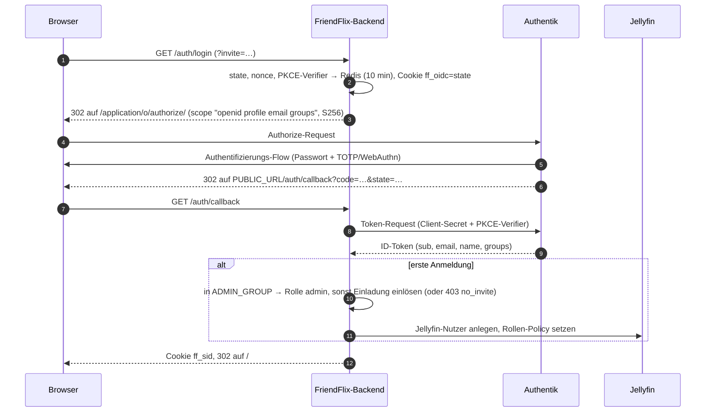
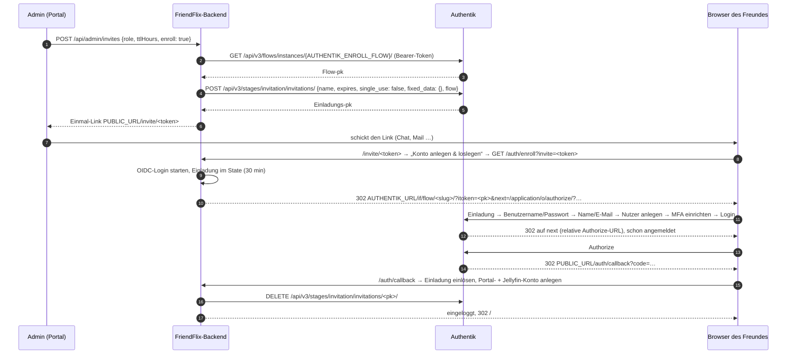

# Authentik für FriendFlix

> **FriendFlix for Plex (Preview):** Wo hier das Anlegen eines Jellyfin-Nutzers steht, hält FriendFlix for Plex die Nutzer selbst (kein Jellyfin- oder plex.tv-Konto); die Authentik-Einrichtung bleibt gleich. Medienserver-Einrichtung: [plex.md](plex.md).

[English](../authentik.md) · **Deutsch**

FriendFlix hat keine eigenen Passwörter. Jede Anmeldung läuft über **Authentik** (OpenID Connect, Authorization-Code-Flow mit PKCE), und Authentik erzwingt die Zwei-Faktor-Anmeldung. Diese Anleitung beschreibt die Installation von Authentik und jedes Authentik-Objekt, das FriendFlix braucht, mit genau den Werten, die das Backend erwartet.

Die komplette FriendFlix-Installation (Jellyfin, Seerr, `.env`, Nginx Proxy Manager, erste Anmeldung) steht in der [Installationsanleitung](setup.md).

> Die Menüpfade entsprechen der Authentik-Admin-Oberfläche der Versionen 2025.12 – 2026.x in englischer Sprache (`compose.authentik.yaml` pinnt `2026.8.3`). Ältere Versionen benennen manches anders. Was mit *(nicht verifiziert)* markiert ist, ließ sich weder im Code noch in der offiziellen Dokumentation prüfen.

## Inhalt

1. [Was FriendFlix von Authentik braucht](#1-was-friendflix-von-authentik-braucht)
2. [Authentik installieren](#2-authentik-installieren)
3. [Schnellweg: FriendFlix-Blueprint importieren](#3-schnellweg-friendflix-blueprint-importieren)
4. [Gruppen](#4-gruppen)
5. [OAuth2/OpenID-Provider und Anwendung](#5-oauth2openid-provider-und-anwendung)
6. [Authentifizierungs-Flow mit Pflicht-MFA](#6-authentifizierungs-flow-mit-pflicht-mfa)
7. [Registrierungs-Flow für Einladungen](#7-registrierungs-flow-für-einladungen)
8. [Service-Account und API-Token für Einladungen](#8-service-account-und-api-token-für-einladungen)
9. [Werte für die FriendFlix-`.env`](#9-werte-für-die-friendflix-env)
10. [Passwort-Wiederherstellung per E-Mail](#10-passwort-wiederherstellung-per-e-mail)
11. [Optional: passwortlos mit Passkeys](#11-optional-passwortlos-mit-passkeys)
12. [Optional: Branding](#12-optional-branding)
13. [Sitzungen und Abmelden](#13-sitzungen-und-abmelden)
14. [Prüfen](#14-prüfen)
15. [Fehlersuche](#15-fehlersuche)
16. [Referenz: was der FriendFlix-Code macht](#16-referenz-was-der-friendflix-code-macht)

## 1. Was FriendFlix von Authentik braucht

| Authentik-Objekt | Name in dieser Anleitung | Wofür | FriendFlix-Einstellung |
|---|---|---|---|
| OAuth2/OpenID-Provider | `FriendFlix` | jede Anmeldung | `OIDC_CLIENT_ID`, `OIDC_CLIENT_SECRET` |
| Anwendung (Application) | Slug `friendflix` | jede Anmeldung | `OIDC_ISSUER=https://auth.example.com/application/o/friendflix/` |
| Gruppe | `friendflix-admins` | Portal-Admins | `ADMIN_GROUP` (Standard `friendflix-admins`) |
| Gruppe | `friendflix-users` | optionale Zugriffsbeschränkung in Authentik | – (FriendFlix liest sie nicht) |
| Authentifizierungs-Flow mit MFA | `default-authentication-flow` (angepasst) | MFA bei jeder Anmeldung | – |
| Registrierungs-Flow (Enrollment) | `friendflix-enrollment` | Einladungen, die das Authentik-Konto gleich mit anlegen | `AUTHENTIK_ENROLL_FLOW` |
| Service-Account + API-Token | `friendflix-invites` | Einladungen über die API anlegen | `AUTHENTIK_API_TOKEN`, `AUTHENTIK_URL` |
| Wiederherstellungs-Flow | `default-recovery-flow` | „Passwort vergessen“ per E-Mail (optional) | – |
| Brand | Standard-Brand | Titel, Logo, Standard-Flows (optional) | – |

Ohne die letzten vier Zeilen funktioniert FriendFlix trotzdem: Eingeladene brauchen dann ein Authentik-Konto, das du von Hand anlegst (siehe [§7](#ohne-registrierungs-flow)).

### Anmeldung



## 2. Authentik installieren

Diesen Abschnitt überspringen, wenn Authentik schon läuft. FriendFlix braucht es nur per **https** unter einem eigenen Hostnamen, z. B. `auth.example.com`.

### 2.1 Variante A: der Stack in diesem Repository (`compose.authentik.yaml`)

Die Datei startet Authentik (Server + Worker, `2026.8.3`, solange `AUTHENTIK_TAG` nicht gesetzt ist) mit eigenem PostgreSQL 17 in einem internen Netz. Seit 2025.10 braucht Authentik kein Redis mehr. Der Server ist nur auf `127.0.0.1:9000` veröffentlicht, also nur über Nginx Proxy Manager erreichbar. Der Docker-Socket wird **nicht** eingebunden (keine automatischen Outposts; FriendFlix braucht keine).

Die Authentik-Secrets gehören nicht in die `.env` des Portals, sondern in eine eigene Datei (`.env.*` ist in `.gitignore`):

```bash
cd /opt/friendflix                     # dein Klon
cat > .env.authentik <<EOF
AUTHENTIK_PG_PASSWORD=$(openssl rand -hex 24)
AUTHENTIK_SECRET_KEY=$(openssl rand -hex 40)
# AUTHENTIK_TAG=2026.8.3      # Version festlegen (Release Notes: https://docs.goauthentik.io/releases/)
# AUTHENTIK_PORT=9100         # falls Portainer schon 9000 belegt
# BIND_ADDR=127.0.0.1         # NPM im Bridge-Container: IP des Docker-Hosts, nie 0.0.0.0 an einer öffentlichen Schnittstelle
EOF
chmod 600 .env.authentik
docker compose -f compose.authentik.yaml --env-file .env.authentik up -d
docker compose -f compose.authentik.yaml --env-file .env.authentik logs -f ak-server   # erster Start: Migrationen, auf einer NAS einige Minuten
```

`AUTHENTIK_SECRET_KEY` signiert Sitzungen und Tokens. Nach dem ersten Start nie mehr ändern und eine Kopie im Passwort-Manager ablegen.

**Authentik-Einstellungen (`.env.authentik`).** Authentik liest seine Konfiguration aus `AUTHENTIK_*`-Umgebungsvariablen. `compose.authentik.yaml` lädt `.env.authentik` (neben der Compose-Datei) automatisch in die Server- und Worker-Container; die Datei ist optional. Dieselbe Datei erfüllt also zwei Aufgaben:

- `--env-file .env.authentik` liefert die `${…}`-Ersetzungen von Compose (`AUTHENTIK_PG_PASSWORD`, `AUTHENTIK_SECRET_KEY`, `AUTHENTIK_TAG`, `AUTHENTIK_PORT`, `BIND_ADDR`). Bei jedem Befehl wie oben mitgeben.
- Alle anderen `AUTHENTIK_*`-Einstellungen darin, z. B. SMTP ([§2.5](#25-e-mail-smtp)) oder `AUTHENTIK_LISTEN__TRUSTED_PROXY_CIDRS`, kommen direkt bei Authentik an. Nach Änderungen die Container mit `… up -d` neu erstellen.

**Dateiablage.** Seit 2025.12 legt Authentik hochgeladene Dateien (Logos, Icons, Hintergründe) unter `/data` ab ([Release Notes 2025.12](https://docs.goauthentik.io/releases/2025.12/)). `compose.authentik.yaml` sichert das im Volume `ak-data`; `ak-media` (`/media`) bleibt für ältere Versionen eingebunden.

### 2.2 Variante B: die offizielle Docker-Compose-Datei

Der [offiziellen Docker-Compose-Anleitung](https://docs.goauthentik.io/install-config/install/docker-compose/) folgen (`wget https://docs.goauthentik.io/compose.yml`, `PG_PASS` und `AUTHENTIK_SECRET_KEY` erzeugen, `docker compose up -d`). Unterschiede zu Variante A: Sie veröffentlicht die Ports `9000`/`9443` auf **allen** Schnittstellen (in ihrer `.env` `COMPOSE_PORT_HTTP=127.0.0.1:9000` und `COMPOSE_PORT_HTTPS=127.0.0.1:9443` setzen oder per Firewall sperren) und bindet den Docker-Socket in den Worker ein (Zeile entfernen, wenn keine automatischen Outposts nötig sind). `/etc/localtime` nicht in Authentik-Container einbinden (Authentik rechnet in UTC; eine eingebundene Zeitzone stört OAuth).

### 2.3 Reverse Proxy: Nginx Proxy Manager

*Hosts → Proxy Hosts → Add Proxy Host*:

| Reiter | Feld | Wert |
|---|---|---|
| Details | Domain Names | `auth.example.com` |
| | Scheme | `http` |
| | Forward Hostname / IP | `127.0.0.1` (NPM im Bridge-Container: IP des Docker-Hosts, z. B. `172.17.0.1`) |
| | Forward Port | `9000` (bzw. dein `AUTHENTIK_PORT`) |
| | Websockets Support | **an** (Authentik nutzt WebSockets) |
| | Block Common Exploits | an |
| SSL | SSL Certificate | Request a new Let's Encrypt certificate |
| | Force SSL, HTTP/2 Support, HSTS Enabled | an |
| Advanced | Custom Nginx Configuration | leer |

NPM setzt `Host`, `X-Forwarded-Proto` und `X-Forwarded-For`. Authentik vertraut diesen Headern nur aus privaten Netzen (Standard: `127.0.0.0/8`, `10.0.0.0/8`, `172.16.0.0/12`, `192.168.0.0/16`). Verbindet sich NPM von anderswo, `AUTHENTIK_LISTEN__TRUSTED_PROXY_CIDRS` in `.env.authentik` setzen ([Reverse-Proxy-Doku](https://docs.goauthentik.io/install-config/reverse-proxy/)).

DNS: `auth.example.com` muss auf deinen Proxy zeigen, **aus dem Internet, aus dem Heimnetz und aus dem FriendFlix-Backend-Container heraus** (das Backend holt das OIDC-Discovery-Dokument und ruft die API über die öffentliche URL auf). Kann dein Router seine eigene öffentliche IP nicht von innen erreichen (kein NAT-Loopback), für beide Hostnamen einen lokalen DNS-Eintrag anlegen (Router, Pi-hole, AdGuard).

### 2.4 Erstes Admin-Konto

`https://auth.example.com/if/flow/initial-setup/` öffnen (mit Schrägstrich am Ende). E-Mail-Adresse und Passwort des Standard-Admins **`akadmin`** setzen. Danach in die Admin-Oberfläche einloggen (`https://auth.example.com/if/admin/`).

Gleich danach empfohlen:

- Im Benutzermenü → *Settings* → *MFA Devices* eine TOTP-App oder einen Sicherheitsschlüssel für `akadmin` einrichten (nach [§6](#6-authentifizierungs-flow-mit-pflicht-mfa) erzwingt Authentik das ohnehin).
- Optional ein persönliches Admin-Konto anlegen (*Directory → Users → New User*, danach in die Gruppe `authentik Admins`) und `akadmin` nur als Notfallkonto nutzen.

### 2.5 E-Mail (SMTP)

Nötig für die Passwort-Wiederherstellung ([§10](#10-passwort-wiederherstellung-per-e-mail)) und Admin-Benachrichtigungen. Einstellungen in `.env.authentik` eintragen (Variante A übernimmt sie automatisch, siehe 2.1; Variante B: deren `.env`):

```bash
AUTHENTIK_EMAIL__HOST=smtp.example.com
AUTHENTIK_EMAIL__PORT=587
AUTHENTIK_EMAIL__USERNAME=authentik@example.com
AUTHENTIK_EMAIL__PASSWORD=<SMTP-Passwort, ohne Anführungszeichen>
AUTHENTIK_EMAIL__USE_TLS=true        # STARTTLS auf 587; für implizites TLS auf 465: USE_SSL=true, USE_TLS=false
AUTHENTIK_EMAIL__USE_SSL=false
AUTHENTIK_EMAIL__TIMEOUT=10
AUTHENTIK_EMAIL__FROM=FriendFlix <authentik@example.com>
```

Container neu erstellen (`… up -d`) und eine Test-Mail schicken:

```bash
docker compose -f compose.authentik.yaml --env-file .env.authentik exec ak-worker ak test_email du@example.com
```

### 2.6 Backups und Updates

Der Backup-Sidecar von FriendFlix sichert nur die **Portal**-Datenbank. Authentik separat sichern ([offizielle Anleitung](https://docs.goauthentik.io/sys-mgmt/ops/backup-restore/)):

```bash
# täglich, z. B. per Cron (Compose-Argumente an dein Setup anpassen)
docker compose -f compose.authentik.yaml --env-file .env.authentik exec -T ak-postgres \
  pg_dump -U authentik -Fc authentik > backups/authentik-$(date +%Y%m%d).dump
```

Außerdem `.env.authentik` (vor allem `AUTHENTIK_SECRET_KEY`) und die Volumes `ak-data` (Uploads), `ak-certs` und `ak-templates` sichern. Wiederherstellen: `ak-server`/`ak-worker` stoppen, `pg_restore --clean --if-exists -U authentik -d authentik < dump`, wieder starten.

Updates: die Release Notes aller Versionen dazwischen lesen, `AUTHENTIK_TAG` anheben (immer nur ein Release-Schritt, z. B. `2026.5` → `2026.8`), dann `… pull && … up -d`. Nach dem Update die Prüfung aus [§14](#14-prüfen) laufen lassen; am ehesten ändert sich die Einladungs-API.

## 3. Schnellweg: FriendFlix-Blueprint importieren

[`deploy/authentik/friendflix-blueprint.yaml`](../../deploy/authentik/friendflix-blueprint.yaml) legt in einem Schritt an:

- den Service-Account `friendflix-invites` mit genau den Berechtigungen, die das Portal braucht, und sein nicht ablaufendes API-Token `friendflix-invites-token`;
- den Registrierungs-Flow `friendflix-enrollment` (Einladung → Benutzername/Passwort → Name/E-Mail → Nutzer anlegen → MFA einrichten → Login), siehe [§7](#7-registrierungs-flow-für-einladungen).

Import: *Flows and Stages → Flows → Import* → **File upload** → Datei wählen → *Import*. Erneutes Importieren ist unbedenklich (Objekte werden über Name/Slug gefunden und aktualisiert).

Varianten:

- [`friendflix-service-account.yaml`](../../deploy/authentik/friendflix-service-account.yaml): nur Service-Account und Token, wenn es schon einen Registrierungs-Flow gibt.
- [`friendflix-prompt-fix.yaml`](../../deploy/authentik/friendflix-prompt-fix.yaml): eine Prompt-Stage ohne Platzhalter-Ausdrücke für einen bestehenden Registrierungs-Flow, der mit `'AnonymousUser' object has no attribute 'group_attributes'` abbricht (`friendflix-prompt-fixed` statt der alten Prompt-Stage binden, gleiche Order).

Das Blueprint legt **nicht** an: die Gruppen, Provider/Anwendung, MFA im Authentifizierungs-Flow und die Wiederherstellung. [§4](#4-gruppen), [§5](#5-oauth2openid-provider-und-anwendung), [§6](#6-authentifizierungs-flow-mit-pflicht-mfa) und [§8.3](#83-token-kopieren) (Token kopieren) also von Hand erledigen. Die Abschnitte 7 und 8 beschreiben, was das Blueprint baut – für alle, die es lieber zusammenklicken oder anpassen wollen.

## 4. Gruppen

*Directory → Groups → New Group*:

| Name | Mitglieder | Zweck |
|---|---|---|
| `friendflix-admins` | du (und Mit-Admins) | Muss exakt `ADMIN_GROUP` entsprechen (Groß-/Kleinschreibung zählt). Mitglieder werden beim Login Portal-Admin, ohne Einladung. |
| `friendflix-users` | alle anderen, die das Portal nutzen dürfen | Optional. Nur nötig, wenn du die Anwendung in Authentik einschränkst ([§5.2](#52-anwendung)). FriendFlix selbst liest sie nie. |

So nutzt FriendFlix Gruppen (aus `backend/src/routes/auth.ts`):

- Der Claim `groups` enthält die **Namen** der Gruppen. Authentiks Standard-Scope-Mapping `profile` füllt ihn mit den direkt zugewiesenen Gruppen (`request.user.groups.all()`). Admins **direkt** in `friendflix-admins` aufnehmen; über eine Elterngruppe geerbte Mitgliedschaft erscheint womöglich nicht *(nicht verifiziert)*.
- **Erste Anmeldung:** in `ADMIN_GROUP` → Portal-Rolle `admin`. Sonst ist eine gültige Portal-Einladung nötig; die Person bekommt deren Rolle (`friend`, `family` oder `guest`). Keine Einladung → `403 {"error":"no_invite"}`.
- **Spätere Anmeldungen:** Ist ein bestehender Nutzer inzwischen in `ADMIN_GROUP`, wird er zum `admin` befördert. Das Entfernen aus der Gruppe stuft **nicht** zurück: Rolle im Portal unter *Admin → Nutzer* ändern.
- `friend`, `family` und `guest` sind Portal-Rollen in der FriendFlix-Datenbank, keine Authentik-Gruppen.
- Ein in Authentik deaktivierter Nutzer kann sich nicht mehr neu anmelden, eine laufende Portal-Sitzung bleibt aber bis zum Ablauf (max. `SESSION_TTL_SECONDS`) bestehen. Für sofortiges Aussperren die Person zusätzlich im Portal unter *Admin → Nutzer* deaktivieren (beendet auch ihre Sitzungen).

## 5. OAuth2/OpenID-Provider und Anwendung

*Applications → Applications → New Application* legt beides in einem Assistenten an ([Authentik-Doku](https://docs.goauthentik.io/add-secure-apps/providers/oauth2/create-oauth2-provider/)). Alternativ zuerst den Provider unter *Applications → Providers → New Provider* anlegen.

### 5.1 Provider (Typ **OAuth2/OpenID Provider**)

| Feld | Wert | Warum |
|---|---|---|
| Name | `FriendFlix` | frei wählbar |
| Authorization flow | `default-provider-authorization-implicit-consent` (*Authorize Application*) | keine Zustimmungsseite für deine Freunde; die explizite Variante geht auch |
| Client type | **Confidential** | das Backend authentifiziert sich mit dem Client-Secret (und nutzt zusätzlich PKCE S256) |
| Client ID | wird erzeugt – kopieren | → `OIDC_CLIENT_ID` |
| Client Secret | wird erzeugt – kopieren | → `OIDC_CLIENT_SECRET` (oder Docker-Secret `oidc_client_secret`) |
| Redirect URIs/Origins | Modus **Strict**, URL `https://portal.example.com/auth/callback` | muss Zeichen für Zeichen `${PUBLIC_URL}/auth/callback` entsprechen (siehe unten) |
| Signing Key | `authentik Self-signed Certificate` | ID-Tokens mit RS256 signiert; ohne Schlüssel signiert Authentik mit HS256 und dem Client-Secret |
| Encryption Key | **leer** | FriendFlix kann verschlüsselte (JWE-)ID-Tokens nicht entschlüsseln |
| *Advanced protocol settings* | | |
| Access code validity | `minutes=1` (Standard) | der Code wird innerhalb einer Sekunde eingelöst |
| Access Token validity | `hours=1` (Standard) | nach dem Login unbenutzt: FriendFlix führt eine eigene Sitzung |
| Refresh Token validity | Standard | unbenutzt: FriendFlix fordert kein `offline_access` an |
| Scopes | die Standards: `authentik default OAuth Mapping: OpenID 'openid'`, `… 'email'`, `… 'profile'` | `profile` liefert `name`, `preferred_username` **und `groups`** |
| Subject mode | `Based on the User's hashed ID` (Standard) | **nie ändern, sobald sich Leute angemeldet haben**: FriendFlix verknüpft Konten über `sub`; ein anderes `sub` wirkt wie eine neue Person (→ `no_invite`) |
| Include claims in id_token | **an** (Standard) | Pflicht: das Backend liest `email`, `name` und `groups` nur aus dem ID-Token, nicht vom Userinfo-Endpunkt |
| Issuer mode | `Each provider has a different issuer, based on the application slug` (Standard) | ergibt das Issuer-Format unten |
| Logout URI / Logout method | leer | FriendFlix hat keinen Front-/Back-Channel-Logout-Endpunkt |
| Invalidation flow | `default-provider-invalidation-flow` | wird vom End-Session-Endpunkt benutzt |
| Authentication flow | leer (= Standard des Brands) | oder ein eigener Flow, siehe [§6](#6-authentifizierungs-flow-mit-pflicht-mfa) |

**Redirect-URI.** Das Backend baut sie als `new URL('/auth/callback', PUBLIC_URL)` (`backend/src/oidc.ts`). Folgen:

- Schema und Host kommen aus `PUBLIC_URL`; ein Pfad in `PUBLIC_URL` fällt weg. FriendFlix muss an der Wurzel eines eigenen Hostnamens laufen (`https://portal.example.com`, nicht `https://example.com/friendflix`).
- Kein Schrägstrich nach `callback`. `https://portal.example.com/auth/callback/` oder `http://…` passen nicht.
- Ein Eintrag genügt. Einen zweiten nur, wenn das Portal wirklich unter einem zweiten Hostnamen läuft (der dann für diese Instanz auch `PUBLIC_URL` sein muss).

**Angeforderte Scopes:** `openid profile email groups`. Authentik hat standardmäßig keinen Scope `groups` und verwirft unbekannte Scopes stillschweigend; ein eigenes `groups`-Mapping ist also **nicht** nötig, das Standard-Mapping `profile` liefert `groups` bereits. (Ein eigenes Scope-Mapping namens `groups` ginge auch, ist aber überflüssig.) `email_verified` wird nicht ausgewertet.

### 5.2 Anwendung

| Feld | Wert |
|---|---|
| Name | `FriendFlix` |
| Slug | `friendflix` → Teil von `OIDC_ISSUER` (die reservierten Slugs `authorize`, `token`, `device`, `userinfo`, `introspect`, `revoke` sind nicht erlaubt) |
| Provider | `FriendFlix` |
| Launch URL | `https://portal.example.com/` (die Kachel in Authentiks Benutzer-Bibliothek) |
| Policy engine mode | `any` |
| Icon | optional, ohne fremde Markenzeichen (z. B. `docs/images/logo.svg`) |

**Wer sich anmelden darf (Bindings).** Ohne Bindings darf jeder Authentik-Nutzer die Anwendung autorisieren. FriendFlix blockiert Leute ohne Einladung trotzdem (`no_invite`), das ist also sicher. Um sie schon in Authentik abzuweisen: Anwendung → *Policy / Group / User Bindings* → *Create or bind…* → *Bind existing group* → `friendflix-admins`, dasselbe für `friendflix-users`.

> Wer Gruppen bindet, **muss** im Registrierungs-Flow neue Nutzer in `friendflix-users` aufnehmen (*Create users group* in der User-Write-Stage, [§7.2](#72-stages-in-dieser-reihenfolge)). Sonst schließt ein Freund die Registrierung ab und bekommt dann *Permission denied* von Authentik.

### 5.3 Issuer

```
OIDC_ISSUER=https://auth.example.com/application/o/friendflix/
```

- **Mit Schrägstrich am Ende.** Das Backend lädt `<OIDC_ISSUER>.well-known/openid-configuration`, und der Issuer darin muss exakt `OIDC_ISSUER` entsprechen; Authentiks Issuer endet auf `/`.
- **Nur https.** `openid-client` lehnt `http://`-Issuer ab; `OIDC_ALLOW_INSECURE=true` ist nur für die Entwicklung.
- **Keine Weiterleitungen.** Die Discovery folgt keinen Redirects, also die endgültige https-URL eintragen.
- Prüfen: `curl -s https://auth.example.com/application/o/friendflix/.well-known/openid-configuration | jq .issuer`

Das Backend macht die Discovery einmal beim Start. Ist Authentik dann nicht erreichbar, beendet sich das Backend, und Docker startet es neu, bis es klappt.

## 6. Authentifizierungs-Flow mit Pflicht-MFA

Der Standard-Authentifizierungs-Flow enthält schon die Stage `default-authentication-mfa-validation`, überspringt MFA aber für Nutzer ohne Gerät. So wird sie Pflicht:

*Flows and Stages → Stages* → `default-authentication-mfa-validation` → *Edit*:

| Feld | Wert |
|---|---|
| Device classes | `TOTP Authenticators`, `WebAuthn Authenticators` (plus `Static Tokens`, wenn Wiederherstellungscodes zählen sollen) |
| Not configured action | **Force the user to configure an authenticator** (`configure`) |
| Configuration stages | `default-authenticator-totp-setup` und `default-authenticator-webauthn-setup` (die Person wählt eins) |
| Last validation threshold | `seconds=0` (jedes Mal fragen) oder z. B. `days=7`, um MFA auf kürzlich benutzten Geräten zu überspringen |

Das gilt für jede Anwendung, die diesen Flow nutzt, auch für die Authentik-Admin-Oberfläche (gut so). Soll die MFA-Regel nur für FriendFlix gelten, den Flow duplizieren (Export/Import oder neuer Flow mit Designation *Authentication* und denselben Stages), dort die MFA-Stage ändern und den neuen Flow im FriendFlix-Provider als *Authentication flow* wählen.

Die Expression-Policy am MFA-Binding (sie überspringt MFA nach einem passwortlosen WebAuthn-Login) bleibt unverändert.

## 7. Registrierungs-Flow für Einladungen

Ziel: Der Admin erstellt in FriendFlix eine Einladung, der Freund öffnet den Link, klickt **Konto anlegen & loslegen**, registriert sich in Authentik (inklusive MFA) und landet eingeloggt im Portal, mit der Rolle der Einladung. Keine Handarbeit in Authentik pro Person.



Warum es so gebaut ist (aus `backend/src/invites.ts`):

- Authentik folgt nach der letzten Stage nur einem **relativen** `next`. Das Portal übergibt daher Pfad + Query seines eigenen Authorize-Requests.
- `fixed_data` der Einladung füllt nur Prompt-Felder vor und kann keine Weiterleitung transportieren; deshalb `next`.
- Die Authentik-Einladung wird mit **`single_use: false`** angelegt: Authentik löscht eine Einmal-Einladung, sobald ihre Stage durchlaufen ist, also schon beim bloßen Öffnen des Links. Ein Freund, der ihn am Handy öffnet und am Laptop fertig macht, wäre sonst ausgesperrt. Die Portal-Einladung selbst ist einmalig; die Authentik-Einladung läuft mit ihr ab und wird vom Portal gelöscht, sobald die Einladung eingelöst oder widerrufen ist.

### 7.1 Flow

*Flows and Stages → Flows → Create*:

| Feld | Wert |
|---|---|
| Name | `FriendFlix Registrierung` |
| Title | `Willkommen bei FriendFlix` (Überschrift der Seite) |
| Slug | `friendflix-enrollment` → `AUTHENTIK_ENROLL_FLOW` (der **Slug**, nicht der Name) |
| Designation | **Enrollment** |
| Authentication | **Require no authentication** (`require_unauthenticated`, wie im Blueprint). *No requirement* geht auch. |

### 7.2 Stages in dieser Reihenfolge

Stages unter *Flows and Stages → Stages* anlegen (oder direkt im Reiter *Stage Bindings* des Flows → *Create and bind stage*) und in dieser Reihenfolge binden (Flow → *Stage Bindings* → *Bind existing stage*):

| Order | Stage-Typ | Name (Blueprint) | Einstellungen |
|---|---|---|---|
| 10 | **Invitation Stage** | `friendflix-invitation` | *Continue flow without invitation*: **aus** (nur Eingeladene können sich registrieren). Binding: *Evaluate when flow is planned* und *Evaluate when stage is run* an. |
| 20 | **Prompt Stage** | `friendflix-prompt-credentials` | Felder: `username` (Typ *Username*), `password` (*Password*), `password_repeat` (*Password*). Optional die Standard-Passwort-Policy unter *Validation Policies*. |
| 30 | **Prompt Stage** | `friendflix-prompt-details` | Felder: `name` (*Text*, Pflicht), `email` (*Email*, Pflicht). |
| 40 | **User Write Stage** | `friendflix-user-write` | *User creation mode*: **Always create new users**. *Create users as inactive*: aus. *User type*: Internal. *User path template*: `users/friendflix`. *Create users group*: `friendflix-users`, falls du in [§5.2](#52-anwendung) Gruppen gebunden hast. |
| 50 | **Authenticator Validation Stage** | `friendflix-mfa` | Device classes TOTP + WebAuthn, *Not configured action* **Force the user to configure an authenticator**, Configuration stages `default-authenticator-totp-setup` + `default-authenticator-webauthn-setup`. |
| 100 | **User Login Stage** | `friendflix-user-login` | **Pflicht.** Ohne sie muss sich die Person nach der Registrierung noch einmal anmelden. Standardwerte passen. |

Prompt-Felder (*Flows and Stages → Prompts*): **statische** Platzhalter verwenden (*Interpret placeholder as expression* aus). Authentiks `default-user-settings-field-*`-Prompts werten einen Ausdruck auf dem angemeldeten Nutzer aus und scheitern während der Registrierung (`'AnonymousUser' object has no attribute 'group_attributes'`).

Die Feld-Schlüssel sind wichtig: Die User-Write-Stage schreibt `username`, `name`, `email` und `password` in den Nutzer. FriendFlix verwendet dann `name` (ersatzweise den Teil von `email` vor dem `@`) als Jellyfin-Benutzernamen und Namen des Hauptprofils und speichert `email`.

**Keine** *Redirect Stage* und keine Expression-Policy einbauen, die eine Weiterleitung setzt. Sie überschreibt `next`, und die Person landet in der Authentik-Benutzeroberfläche statt im Portal.

### Ohne Registrierungs-Flow

`AUTHENTIK_URL`, `AUTHENTIK_API_TOKEN` und `AUTHENTIK_ENROLL_FLOW` leer lassen. Dann jeden Freund von Hand unter *Directory → Users* anlegen, ihm den Einladungslink des Portals schicken, und er nutzt **Anmelden & freischalten**. Für jemanden, der schon ein Authentik-Konto hat, beim Erstellen der Einladung **hat schon ein Authentik-Konto** ankreuzen (`"enroll": false`); der Link bietet dann nur die Anmeldung an.

## 8. Service-Account und API-Token für Einladungen

Das Backend ruft die Authentik-API mit `Authorization: Bearer <AUTHENTIK_API_TOKEN>` auf. Es bekommt nur die Rechte, die es wirklich braucht.

### 8.1 Service-Account

*Directory → Users → New User → Service Account*: Benutzername `friendflix-invites`, *Create group* aus. Der Bestätigungsdialog zeigt ein App-Passwort, das FriendFlix nicht braucht (kann unter *Tokens and App passwords* gelöscht werden).

### 8.2 Rolle mit genau diesen globalen Berechtigungen

Seit 2025.12 vergibt Authentik Berechtigungen nur noch über **Rollen**. *Directory → Roles → New Role* `friendflix-invites`, dann öffnen → *Permissions* → *Assigned global permissions* → *Assign permission*:

| Berechtigung (UI) | Codename | Wofür |
|---|---|---|
| Can view Flow | `authentik_flows.view_flow` | `GET /api/v3/flows/instances/<slug>/` (prüft den Slug, liefert die Flow-pk) |
| Can add Invitation | `authentik_stages_invitation.add_invitation` | `POST /api/v3/stages/invitation/invitations/` |
| Can view Invitation | `authentik_stages_invitation.view_invitation` | Einladungen lesen (vergibt das Blueprint; vom aktuellen Code nicht zwingend benötigt) |
| Can delete Invitation | `authentik_stages_invitation.delete_invitation` | `DELETE /api/v3/stages/invitation/invitations/<pk>/` nach Einlösen/Widerruf |

Die Rolle dem Service-Account zuweisen (Nutzer → *Roles* → *Assign*, siehe [Authentik-Doku](https://docs.goauthentik.io/users-sources/user/user_basic_operations/#add-a-user-to-a-role)). **Kein** Superuser und nicht das Token deines Admins verwenden: Ein geleaktes Token könnte sonst alles in Authentik ändern.

Ohne *Can view Flow* loggt das Backend `Authentik flow lookup failed` und legt die Einladung ohne Flow-Bindung an (funktioniert, ist aber weniger streng). Ohne *Can delete Invitation* bleiben benutzte Einladungen bis zum Ablauf stehen.

(Das Blueprint setzt diese Rechte über das Feld `permissions` des Nutzers; Authentik legt sie in eine verwaltete Rolle dieses Nutzers.)

### 8.3 Token kopieren

*Directory → Tokens and App passwords → Create*:

| Feld | Wert |
|---|---|
| Identifier | `friendflix-invites-token` |
| User | `friendflix-invites` |
| Intent | **API Token** (ein *App password* wird mit 401 abgelehnt) |
| Expiring | aus, oder an mit Erinnerung zum Erneuern |

Dann in der Zeile des Tokens auf das Kopier-Symbol klicken und den Schlüssel in `AUTHENTIK_API_TOKEN` eintragen. Mit dem Blueprint existiert das Token schon: nur kopieren.

## 9. Werte für die FriendFlix-`.env`

```bash
# Anmeldung (Pflicht)
OIDC_ISSUER=https://auth.example.com/application/o/friendflix/   # Schrägstrich am Ende!
OIDC_CLIENT_ID=<Client-ID aus dem Provider>
OIDC_CLIENT_SECRET=<Client-Secret aus dem Provider>
ADMIN_GROUP=friendflix-admins                                     # Standard

# Einladungen mit Konto-Erstellung (alle drei oder keine)
AUTHENTIK_URL=https://auth.example.com          # öffentliche Basis-URL, ohne Pfad
AUTHENTIK_API_TOKEN=<Token-Schlüssel>
AUTHENTIK_ENROLL_FLOW=friendflix-enrollment     # der Flow-Slug

# Portal-Sitzungen (Standardwerte)
SESSION_TTL_SECONDS=28800    # absolut 8 h
SESSION_IDLE_SECONDS=7200    # 2 h ohne Aktivität
```

Danach das Backend neu erstellen: `docker compose -f compose.prod.yaml up -d backend`. Compose reicht die `AUTHENTIK_*`-Variablen mit leerem Standardwert durch; ein fehlender Eintrag schaltet Einladungen also stillschweigend ab. Sind nur einige der drei gesetzt, loggt das Backend beim Start und bei jeder neuen Einladung `Authentik invitations disabled: … not set`.

`OIDC_CLIENT_SECRET` kann aus einem Docker-Secret kommen ([`compose.secrets.yaml`](../../compose.secrets.yaml): `secrets/oidc_client_secret`). Das Backend liest für jede Einstellung auch `<VAR>_FILE`, also geht `AUTHENTIK_API_TOKEN_FILE` ebenfalls – `compose.prod.yaml` reicht diese Variable aber nicht durch: bei Bedarf in einem lokalen Override im `environment` des Backends ergänzen (und das Secret einbinden).

## 10. Passwort-Wiederherstellung per E-Mail

Setzt funktionierendes SMTP voraus ([§2.5](#25-e-mail-smtp)).

1. *Flows and Stages → Flows → Import* → **Local path** → `example/flows-recovery-email-mfa-verification.yaml` → *Import*. Das legt den Flow `default-recovery-flow` an: Identifikation → E-Mail mit Link → **MFA-Prüfung** → neues Passwort → Login. (Die Variante `flows-recovery-email-verification.yaml` lässt die MFA-Prüfung weg; bei Pflicht-MFA nicht verwenden.)
2. *System → Brands* → Standard-Brand → *Edit* → *Default flows* → **Recovery flow**: `default-recovery-flow`.
3. *Flows and Stages → Stages* → `default-authentication-identification` → *Edit* → **Recovery flow**: `default-recovery-flow`. Die Anmeldeseite zeigt jetzt *Forgot username or password?*.
4. Mit einem Testnutzer in einem privaten Fenster ausprobieren.

MFA-Gerät verloren: Es gibt keinen Selbstdienst. Als Admin *Directory → Users* → Nutzer → *MFA Devices* das Gerät löschen; beim nächsten Login muss die Person ein neues einrichten. Alternativ Wiederherstellungscodes erlauben (`default-authenticator-static-setup` als weitere Configuration stage binden und *Static Tokens* zu den Device classes hinzufügen).

## 11. Optional: passwortlos mit Passkeys

- **Passkey-Autofill (ab 2025.12):** In `default-authentication-identification` unter *WebAuthn Authenticator Validation Stage* eine Validierungs-Stage nur mit Device class *WebAuthn* wählen. Browser bieten gespeicherte Passkeys dann direkt im Benutzernamen-Feld an.
- **Eigener passwortloser Flow:** einen Flow mit Designation *Authentication* und einer Authenticator Validation Stage (Device class WebAuthn, *Not configured action* Deny) anlegen und in der Identifikations-Stage als *Passwordless flow* verlinken.

Beides ersetzt nur das Passwort; für FriendFlix ändert sich nichts. Siehe [Authenticator Validation Stage](https://docs.goauthentik.io/add-secure-apps/flows-stages/stages/authenticator_validate/). *(Feldbezeichnungen in der Oberfläche nicht verifiziert.)*

## 12. Optional: Branding

*System → Brands* → Standard-Brand → *Edit*:

| Feld | Vorschlag |
|---|---|
| Domain | `auth.example.com` (oder Standard-Brand belassen) |
| Title | `FriendFlix` |
| Logo / Favicon | eigene Grafik, z. B. `docs/images/logo.svg` aus diesem Repository (vorher unter *Customization → Files* hochladen) |
| Default flow background | optional, eigenes Bild |
| Default flows | Authentication `default-authentication-flow`, Invalidation `default-invalidation-flow`, Recovery `default-recovery-flow`, User settings `default-user-settings-flow` |

Eigenen Namen und eigene Grafiken verwenden. Keine Logos, Farben oder Formulierungen kommerzieller Streamingdienste übernehmen. Die Texte des Registrierungs-Flows (Flow-Titel, Prompt-Beschriftungen) sind frei änderbar; das Blueprint verwendet deutsche Beschriftungen.

## 13. Sitzungen und Abmelden

- **Portal-Sitzung:** Nach dem Callback führt FriendFlix eine eigene Sitzung (Cookie `ff_sid`, Redis): absolut `SESSION_TTL_SECONDS` (Standard 8 h), gleitendes Leerlauf-Timeout `SESSION_IDLE_SECONDS` (Standard 2 h). Gekoppelte Fernseher bekommen längere Sitzungen. Access-/Refresh-Tokens von Authentik werden nach dem Login nicht benutzt, ihre Gültigkeit beeinflusst die Portal-Sitzung also nicht.
- **Authentik-Sitzung:** unabhängig davon. Endet die Portal-Sitzung, schickt `/auth/login` den Browser zu Authentik; ist die Authentik-Sitzung noch gültig, ist die Person ohne Eingabe wieder drin. Wie lange, hängt von *Session duration* der User-Login-Stage (`default-authentication-login`, Standard `seconds=0` = bis der Browser geschlossen wird) und vom MFA-*Last validation threshold* ab.
- **Abmelden im Portal** (`POST /auth/logout`) löscht nur die Portal-Sitzung (plus Push-Abos und Cast-Tokens dieses Geräts). Der End-Session-Endpunkt von Authentik wird **nicht** aufgerufen. An einem geteilten Rechner zusätzlich bei Authentik abmelden (`https://auth.example.com/if/user/` → abmelden) oder die Authentik-Sitzung bei `seconds=0` belassen.
- **Profil-PIN vergessen:** Das Portal startet einen Login mit `prompt=login` und `max_age=0`; Authentik fragt die Zugangsdaten dann erneut ab, auch wenn eine Sitzung besteht.
- End-Session-Endpunkt, falls du ihn irgendwo verlinken willst: `https://auth.example.com/application/o/friendflix/end-session/`.

## 14. Prüfen

Auf dem Docker-Host:

```bash
# 1. Issuer und Discovery (erwartet: genau OIDC_ISSUER)
curl -s https://auth.example.com/application/o/friendflix/.well-known/openid-configuration | jq -r .issuer

# 2. Backend erreicht Authentik (im Container; erwartet: 200)
docker compose -f compose.prod.yaml exec backend node -e \
  "fetch(process.env.OIDC_ISSUER+'.well-known/openid-configuration').then(r=>console.log(r.status))"

# 3. Token, Berechtigungen und Flow-Slug (erwartet: 200 und den Flow als JSON)
docker compose -f compose.prod.yaml exec backend node -e \
  "fetch(process.env.AUTHENTIK_URL.replace(/\/$/,'')+'/api/v3/flows/instances/'+process.env.AUTHENTIK_ENROLL_FLOW+'/',{headers:{authorization:'Bearer '+process.env.AUTHENTIK_API_TOKEN}}).then(async r=>console.log(r.status,(await r.text()).slice(0,200)))"
```

Dieselbe Prüfung vom Host: `curl -H "Authorization: Bearer <Token>" https://auth.example.com/api/v3/flows/instances/friendflix-enrollment/`.

Im Browser:

1. Als Mitglied von `friendflix-admins` im Portal anmelden → du landest als Admin im Portal (MFA wurde abgefragt).
2. *Admin → Einladungen* → Einladung erstellen. Darunter muss stehen: *Der Link führt durch die Konto-Erstellung (inkl. Zwei-Faktor) …*. *nicht konfiguriert* = Variablen fehlen; *konnte nicht erstellt werden* = API-Fehler, siehe Backend-Log.
3. Den Link in einem **privaten Fenster** öffnen (nicht bei Authentik angemeldet), *Konto anlegen & loslegen*, registrieren, TOTP oder Passkey einrichten → du landest eingeloggt im Portal mit der Rolle der Einladung.
4. In Authentik unter *Directory → Invitations* ist die Einladung nach dem Einlösen verschwunden.

## 15. Fehlersuche

Logs: `docker compose -f compose.prod.yaml logs backend | grep -i -E "oidc|authentik"` und in Authentik *Events → Logs*.

| Symptom | Ursache / Lösung |
|---|---|
| Authentik-Seite *Redirect URI Error* / `redirect_uri` passt nicht | Die Redirect-URI im Provider ist nicht exakt `${PUBLIC_URL}/auth/callback`. Schema, Host, kein Schrägstrich am Ende, Modus *Strict* prüfen. |
| Backend startet in Schleife neu, Log `"response" body "issuer" property does not match the expected value` | `OIDC_ISSUER` ohne Schrägstrich am Ende, falscher Slug oder *Issuer mode* global. |
| Backend startet neu, Log erwähnt `only requests to HTTPS are allowed` o. Ä. | `OIDC_ISSUER` mit `http://`. Die öffentliche https-URL verwenden (`OIDC_ALLOW_INSECURE` nur für die Entwicklung). |
| Backend startet neu, `fetch failed` / `ENOTFOUND` / Timeout beim Start | Der Backend-Container erreicht `auth.example.com` nicht (DNS, NAT-Loopback, Firewall). Siehe [§2.3](#23-reverse-proxy-nginx-proxy-manager). |
| `{"error":"invalid_state"}` auf `/auth/callback` | Login auf einem anderen Hostnamen als `PUBLIC_URL` gestartet (z. B. LAN-IP), Cookies blockiert oder mehr als 10 min (Registrierung: 30 min) zwischen Start und Callback. Neu über `PUBLIC_URL` starten. |
| `{"error":"login_failed"}` (401) | Token-Tausch oder ID-Token-Prüfung gescheitert: falsches Client-Secret, Encryption Key am Provider gesetzt oder Uhren der Hosts weichen um mehr als 30 s ab (NTP auf allen Hosts aktivieren). Details in der Backend-Logzeile `oidc callback failed`. |
| `{"error":"no_invite"}` (403) | Erste Anmeldung ohne gültige Einladung und nicht in `ADMIN_GROUP`. Admin: Gruppenname prüfen und ob *Include claims in id_token* an ist. Andere: Einladung erstellen (mit *hat schon ein Authentik-Konto*, wenn sie sich schon registriert haben). |
| Admin wird nicht als Admin erkannt | Gruppenname weicht von `ADMIN_GROUP` ab (Groß-/Kleinschreibung), Mitgliedschaft nur geerbt oder *Include claims in id_token* aus. |
| `{"error":"disabled"}` (403) | Das Konto ist im Portal deaktiviert (*Admin → Nutzer*). |
| Einladungsseite zeigt keinen Knopf *Konto anlegen* | Einladungen nicht konfiguriert oder Authentik-Einladung gescheitert. Ergebnistext der Einladung und Backend-Log ansehen. Einladungen von vor der Konfiguration haben keine Authentik-Einladung: neue erstellen. |
| Log `enrollment flow "…" not found` | `AUTHENTIK_ENROLL_FLOW` ist nicht der Slug eines existierenden Flows. |
| Log `Authentik API rejected AUTHENTIK_API_TOKEN` | Token falsch, abgelaufen oder Intent *App password* statt *API Token*. |
| Log `invitation creation failed (… "Can add Invitation" …)` | 403: Die Rolle aus [§8.2](#82-rolle-mit-genau-diesen-globalen-berechtigungen) fehlt oder ist nicht zugewiesen. |
| Log `Authentik unreachable` | DNS/TLS/Firewall vom Backend-Container zu `AUTHENTIK_URL`. |
| Du öffnest den Registrierungslink, während du bei Authentik angemeldet bist, und landest ohne Registrierung im Portal | Erwartet: Der Flow verlangt „nicht angemeldet“, Authentik verweigert ihn und folgt mit der Standard-*Denied action* `MESSAGE_CONTINUE` stattdessen dem relativen `next` – du bist also als der **schon angemeldete** Authentik-Nutzer drin. Hat dieser noch kein Portal-Konto, wird die Einladung für ihn eingelöst. Einladungen im privaten Fenster testen. |
| `'AnonymousUser' object has no attribute 'group_attributes'` bei der Registrierung | Prompt-Felder mit Ausdrucks-Platzhaltern. `friendflix-prompt-fix.yaml` importieren ([§3](#3-schnellweg-friendflix-blueprint-importieren)). |
| Nach der Registrierung landet der Freund in der Authentik-Oberfläche | Redirect-Stage oder Redirect-Policy im Registrierungs-Flow, oder die User-Login-Stage fehlt. |
| Nach der Registrierung *Permission denied* für FriendFlix | Die Anwendung ist an Gruppen gebunden, aber die User-Write-Stage nimmt neue Nutzer nicht in `friendflix-users` auf. |
| Nach Änderung des *Subject mode* kann sich niemand mehr anmelden (`no_invite`) | Zurückstellen. FriendFlix erkennt Nutzer am `sub`. |
| Branding-Uploads verschwinden nach einem Update | `/data` wird nicht gesichert: bei Variante A die aktuelle `compose.authentik.yaml` verwenden (Volume `ak-data`, [§2.1](#21-variante-a-der-stack-in-diesem-repository-composeauthentikyaml)); bei Variante B den Mount `./data` behalten. |

## 16. Referenz: was der FriendFlix-Code macht

| Punkt | Wert | Quelle |
|---|---|---|
| Redirect-URI | `new URL('/auth/callback', PUBLIC_URL)` | `backend/src/oidc.ts` |
| Scopes | `openid profile email groups` | `backend/src/oidc.ts` |
| PKCE | S256; `state` und `nonce` werden geprüft | `backend/src/oidc.ts` |
| Gelesene Claims | `sub` (Kontoschlüssel), `email`, `name`, `groups` (Liste von Namen). `preferred_username` wird **nicht** benutzt. | `backend/src/oidc.ts`, `backend/src/users.ts` |
| Quelle der Claims | nur das ID-Token | `tokens.claims()` in `backend/src/oidc.ts` |
| Erneute Anmeldung | `prompt=login`, `max_age=0` (vergessene PIN) | `backend/src/oidc.ts` |
| Login-State | Redis `oidc:<state>`, 600 s (Registrierung 1800 s); Cookie `ff_oidc` (Pfad `/auth`, SameSite Lax, Secure bei https-`PUBLIC_URL`) | `backend/src/routes/auth.ts` |
| Portal-Routen | `GET /auth/login[?invite=]`, `GET /auth/enroll?invite=`, `GET /auth/callback`, `POST /auth/logout` | `backend/src/routes/auth.ts` |
| Admin-Regel | `groups` enthält `ADMIN_GROUP` → `admin` bei der ersten Anmeldung, Beförderung bei späteren, nie Herabstufung | `backend/src/routes/auth.ts` |
| Flow-Abfrage | `GET {AUTHENTIK_URL}/api/v3/flows/instances/{slug}/` | `backend/src/invites.ts` |
| Einladung anlegen | `POST {AUTHENTIK_URL}/api/v3/stages/invitation/invitations/` mit `{name: "ff-…", single_use: false, expires, fixed_data: {}, flow}` | `backend/src/invites.ts` (API-Form getestet mit Authentik 2024.x – 2026.x) |
| Einladung löschen | `DELETE {AUTHENTIK_URL}/api/v3/stages/invitation/invitations/{pk}/` nach Einlösen oder Widerruf | `backend/src/invites.ts`, `backend/src/routes/admin.ts` |
| Registrierungs-URL | `{AUTHENTIK_URL}/if/flow/{slug}/?itoken={pk}&next={Authorize-Pfad+Query}` | `backend/src/invites.ts` |
| API-Timeout | 10 s pro Aufruf | `backend/src/invites.ts` |
| Gültigkeit der Einladung | 1 – 336 h (Standard 48 h); die Authentik-Einladung läuft gleichzeitig ab | `backend/src/routes/admin.ts` |
