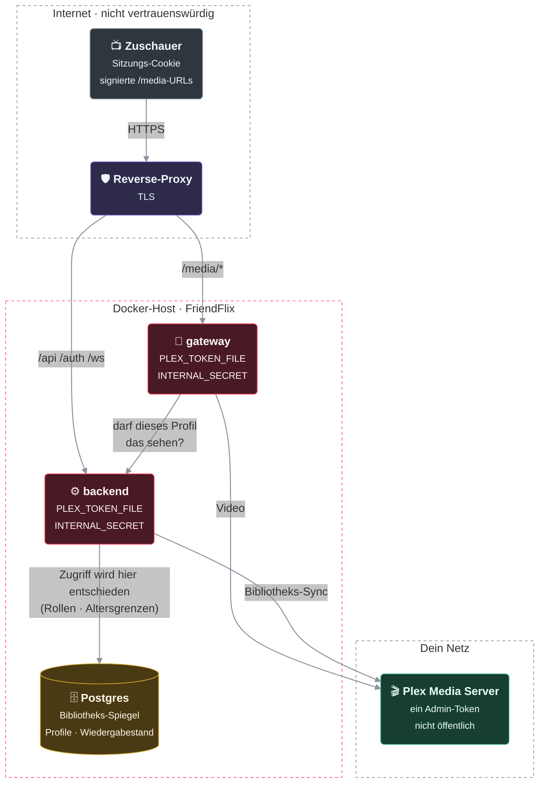
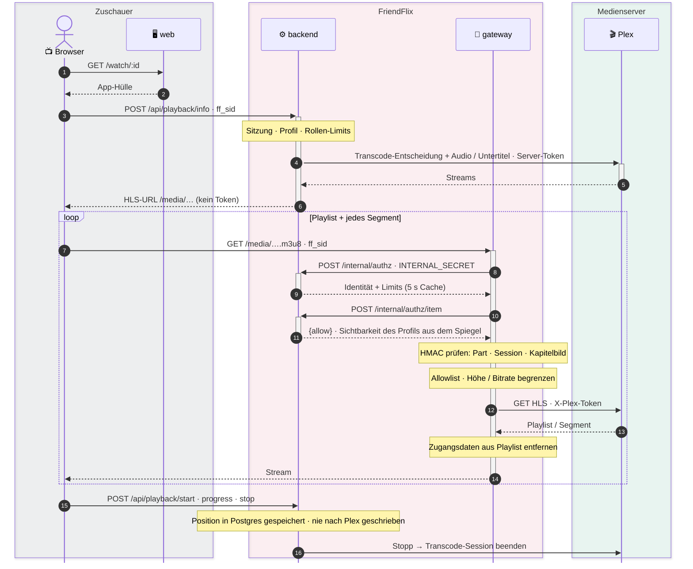

# FriendFlix for Plex – Einrichtung

> **Status: Preview, nicht veröffentlicht.** Plex-Backend, Gateway-Adapter und `compose.plex.yaml` sind im Entwicklungszweig umgesetzt und gegen einen Fake-Plex-Server getestet, der aus echten Antworten eines Plex Media Server 1.43 gebaut ist. Es gibt **noch kein Release**: Die Images `friendflix-plex-*` werden erst nach Merge und Release veröffentlicht, und an vielen echten Servern lief es noch nicht. Wer helfen möchte: [Mit einem echten Plex-Server testen](#mit-einem-echten-plex-server-testen).
>
> Du nutzt Jellyfin? Dann nimm das Originalprojekt [LetsManu/friendflix](https://github.com/LetsManu/friendflix). English: [../plex.md](../plex.md).

Zurück zur [README](../../README.de.md).

## So funktioniert es in einer Minute

- **Ein Plex-Server pro FriendFlix-Instanz.**
- FriendFlix verwaltet seine Nutzer selbst mit **einem Plex-Admin-Token**. Deine Freunde brauchen kein plex.tv-Konto, und es funktioniert ohne Plex Pass.
- Profile, Kinderprofile, Altersgrenzen, Wiedergabefortschritt und Favoriten liegen **in FriendFlix**, nicht in Plex. FriendFlix schreibt nie Wiedergabestatus nach Plex.
- Das Token benutzen nur Gateway und Backend auf dem Server. Es geht nie an einen Browser; Clients sehen nur FriendFlix-URLs.
- `compose.plex.yaml` **verbindet nur mit deinem vorhandenen Plex-Server**. Es startet keinen Plex-Container. Plex-Adresse und Token trägst du im Einrichtungsassistenten ein (oder später unter *Admin → Einstellungen*); die `.env` brauchst du nur, wenn du sie festschreiben willst (`PLEX_URL`, `PLEX_TOKEN` oder `PLEX_TOKEN_FILE`).

Dasselbe als Bild – wer was hält und was welche Grenze überquert (alle Diagramme, mit Container-Ansicht und dem Ablauf bei „Play“: [architecture.md](../architecture.md), englisch):



> 🟥 FriendFlix · 🟩 Medienserver · 🟦 weitere Dienste · 🟪 Reverse-Proxy · 🟨 Datenspeicher · ⬛ Zuschauer / extern · gestrichelter Rahmen = Netz bzw. Grenze · dicke Linie = Videostream · gepunktet = optional / über öffentliche URL

Was passiert, wenn jemand Play drückt: FriendFlix entscheidet (Profil, Rollen-Limits, Altersregeln) und startet den Plex-Stream mit dem eigenen Token; jede Playlist und jedes Segment läuft danach durchs Gateway, das beim Backend nachfragt und die Signatur des Pfads prüft.



## 1. Server claimen

FriendFlix braucht einen **geclaimten** Server und ein Token. Ein ungeclaimter Plex-Server beantwortet tokenlose Anfragen nur von der Maschine, auf der er läuft; aus einem Container oder von einem anderen Host ist er so nicht nutzbar.

1. Plex-Web-App öffnen (`http://<server>:32400/web`) und mit einem Plex-Konto anmelden. Damit ist der Server geclaimt.
2. Bei Plex im Docker kannst du beim ersten Start mit einem Claim-Token von <https://plex.tv/claim> claimen (`PLEX_CLAIM`); das Token gilt nur wenige Minuten.

## 2. Admin-Token holen

Folge dem Plex-Supportartikel **„Finding an authentication token / X-Plex-Token“** (diesen Titel auf support.plex.tv suchen). Das Token wird als `X-Plex-Token` gesendet.

Empfehlungen:

- Nimm ein **eigenes Plex-Konto** (mindestens ein eigenes Token) für FriendFlix, nicht dein Alltagskonto. Plex speichert die gewählte Tonspur pro Plex-Konto, und FriendFlix muss sie ändern, wenn jemand eine Sprache wählt (siehe [Tonspuren](#tonspuren)). Nutzen andere Plex-Apps dasselbe Konto, sehen sie diese Änderungen.
- Das Token ist ein Passwort: Lege es möglichst in `PLEX_TOKEN_FILE` (Docker Secret, siehe Kommentar am Ende von `compose.plex.yaml`) statt in `.env` und poste es nie in Issues oder Chats. Ist es durchgesickert, widerrufe es (siehe [Token wechseln oder widerrufen](#token-wechseln-oder-widerrufen)) und trage ein neues ein.

Prüfen von der Maschine aus, auf der FriendFlix läuft:

```bash
curl -s -H "X-Plex-Token: $PLEX_TOKEN" -H "Accept: application/json" "$PLEX_URL/identity"
```

`"claimed": true` und eine Versionsnummer heißen: Server erreichbar; `401` heißt: Token falsch oder Server nicht geclaimt.

## 3. FriendFlix konfigurieren

`compose.plex.yaml` ist ein Override für `compose.prod.yaml` (fertige Images) oder `compose.yaml` (lokaler Build). Es setzt `MEDIA_SERVER=plex` für Backend und Gateway, wechselt auf die Images `friendflix-plex-*` und entfernt die Jellyfin-Variablen wieder aus den Containern. **In der `.env` ist nichts Plex-Spezifisches nötig**: Adresse und Token kommen in den Einrichtungsassistenten.

```bash
# .env: nur die allgemeinen Werte (siehe .env.example); keine Plex-Werte nötig
REQUESTS_URL=http://requests:5055      # verlangt compose.prod.yaml ebenfalls (siehe „Wünsche“ im Funktionsvergleich)

docker compose -f compose.prod.yaml -f compose.plex.yaml config --quiet   # prüft die zusammengeführte Konfiguration
docker compose -f compose.prod.yaml -f compose.plex.yaml up -d
docker compose logs backend | grep "setup code"                           # der Code, nach dem der Assistent fragt
```

Tipp: Mit `COMPOSE_FILE=compose.prod.yaml:compose.plex.yaml` in `.env` reicht `docker compose up -d` / `ps` / `logs`.

### Einrichtungsassistent mit Plex

Öffne deine FriendFlix-Adresse; solange die Einrichtung offen ist, führt jede Seite nach `/setup` (allgemeine Schritte: [setup.md](setup.md)). Im **Mediaserver-Schritt** trägst du ein:

- die **Adresse** von Plex, wie Backend und Gateway sie erreichen, zum Beispiel `http://plex.example.com:32400` (siehe [Netzwerk](#netzwerk)), und
- das **Token** aus [Abschnitt 2](#2-admin-token-holen).

Vor dem Speichern prüft das Backend: `/identity` (ist es überhaupt ein Plex-Server, ohne Token), `/library/sections` (nimmt Plex das Token an) und `/status/sessions` (ist es das Token des Server-Besitzers). Das Token geht nur als Header raus, Weiterleitungen werden nicht verfolgt, und die Antwort ist ein kurzer Code, nie das Token oder ein Fehlertext. Danach werden beide Werte in der Datenbank gespeichert; das Token **verschlüsselt** (`APP_ENC_KEY`), es wird nie wieder angezeigt und nie an einen Browser geschickt. Beides lässt sich später unter *Admin → Einstellungen* (Gruppe Mediaserver) ändern; ein leeres Feld lässt das gespeicherte Token unverändert.

Der erste Admin sieht nach der ersten Anmeldung eine Weile eine leere Bibliothek, bis der erste Bibliotheksabgleich gelaufen ist (alle 5 Minuten).

**Nicht das Token des Besitzers.** Funktioniert das Token, ist aber nicht das des Server-Besitzers (Plex verweigert `/status/sessions`), endet die Prüfung mit einem Hinweis: *Das Token funktioniert, ist aber nicht das des Plex-Server-Besitzers, daher können einige Funktionen eingeschränkt sein.* Das Token wird trotzdem gespeichert. Bibliothek, Wiedergabe und Konten funktionieren; was Besitzerrechte braucht (z. B. *Live-Streams* anderer Plex-Apps und manche Bibliothekspflege-Aktionen), kann eingeschränkt sein. Nimm das Token des Besitzerkontos, wenn du alles willst.

**Warum es kein „Mit Plex anmelden“ und kein automatisches Token gibt.** FriendFlix nutzt **ein gemeinsames Dienst-Token** für alle, und deine Freunde haben keine mit FriendFlix verknüpften Plex-Konten. Eine Passwort-Anmeldung im Assistenten würde dein plex.tv-Passwort an einen dritten Host schicken statt an den Server, den du eingegeben hast, kommt mit Zwei-Faktor-Konten schlecht zurecht und hinterlässt ein Konto-Token, das sich nicht sauber widerrufen lässt. Deshalb wird das Token von Hand eingetragen. Ein Plex-PIN-Ablauf („Seite öffnen und bestätigen“) kann später kommen.

**Umgebungswerte gewinnen.** Ein Wert in der `.env` (oder als `_FILE`-Secret) gewinnt gegen die Datenbank und steht im Assistenten und unter *Admin → Einstellungen* **gesperrt** (*Aus der Umgebung*). Das ist optional:

| Variable | Pflicht | Zweck |
|---|---|---|
| `MEDIA_SERVER` | setzt `compose.plex.yaml` auf `plex` | wählt die Plex-Implementierung in Backend und Gateway |
| `PLEX_URL` | nein (fest vorgeben) | Plex-Adresse aus Sicht der Container (LAN-IP, `http://host.docker.internal:32400` für Plex auf dem Docker-Host, oder ein Containername in einem gemeinsamen Netz). `compose.plex.yaml` gibt sie an Backend **und** Gateway weiter: für beide setzen oder für keins, nie bei nur einem entfernen |
| `PLEX_TOKEN` / `PLEX_TOKEN_FILE` | nein (fest vorgeben) | das Plex-Token, das FriendFlix für alle nutzt. Dieser Wert gilt **nur im Backend**: das Gateway hat kein `PLEX_TOKEN` in seiner Umgebung |

**Wie das Gateway das Token bekommt.** Das Gateway hat keine Datenbank. Es fragt das Backend im internen Netz nach Plex-Adresse und Token (`/internal/gateway-config`), geschützt durch das gemeinsame Geheimnis aus dem Bootstrap-Volume, und hält sie nur im Speicher. Eine Änderung unter *Admin → Einstellungen* erreicht das Gateway innerhalb von Sekunden. Das Token wird nie geloggt und nie an einen Browser geschickt.

**Token als Docker-Secret.** `compose.secrets.yaml` hat keinen Eintrag `plex_token`. Lege die Secret-Datei an und hänge `plex_token` selbst an die Liste des **Backends** an, wie am Ende von `compose.plex.yaml` beschrieben; setze `PLEX_TOKEN_FILE=/run/secrets/plex_token` und lass `PLEX_TOKEN` leer. Ein `_FILE`-Wert sperrt das Feld im Assistenten.

**Admin → Einstellungen mit Plex** zeigt nur die Plex-Medieneinstellungen (`PLEX_URL`, `PLEX_TOKEN`); die Jellyfin-Felder sind ausgeblendet. *Übernehmen* / *Alle übernehmen* (Import aus der Umgebung) kopiert nie `JELLYFIN_*`-Werte.

### Bestehende Installationen (Einstellungen in der `.env`)

Eine Installation, die `PLEX_URL` / `PLEX_TOKEN` schon in der `.env` hat, läuft nach dem Update weiter: Die Umgebung gewinnt gegen die Datenbank, und der Assistent erscheint nicht mehr, sobald Konten existieren. Die Felder stehen gesperrt. So übernimmst du sie in die Datenbank:

1. *Admin → Einstellungen*, Gruppe Mediaserver: **Übernehmen** je Zeile oder **Alle übernehmen** (Import aus der Umgebung). Die Werte werden kopiert (Token verschlüsselt); bis du sie entfernst, gewinnt weiter die Umgebung.
2. Entferne `PLEX_URL`, `PLEX_TOKEN` und `PLEX_TOKEN_FILE` (und einen `plex_token`-Secret-Eintrag) aus `.env` / Compose und führe `docker compose up -d` aus. Die Felder sind dann bearbeitbar. Lässt du `PLEX_URL` in der `.env`, dann für Backend und Gateway gleichermaßen.

Mehr zum Übernehmen von Einstellungen: [setup.md, Abschnitt 14](setup.md#14-umstieg-auf-einstellungen-in-der-datenbank).

### Plex-Server wechseln

Zeigt die Adresse auf einen **anderen Plex-Server** (andere `machineIdentifier`), baut FriendFlix sein Bibliotheksabbild komplett neu auf und schreibt eine Warnung ins Log. Während des Aufbaus kann die Bibliothek eine Weile leer oder nur teilweise gefüllt wirken. Derselbe Server unter neuer Adresse behält das Abbild.

Grenzen:

- **Der Wiedergabestand wird nicht gelöscht.** Gesehen-Markierungen, Fortsetzen-Positionen und Favoriten (`plex_userdata`) bleiben erhalten, und Titel des neuen Servers können dieselben internen Nummern haben wie Titel des alten, daher können einzelne Markierungen falsch sein. Einen Admin-Befehl, der sie löscht, gibt es nicht. Nutzer können einzelne Titel als ungesehen markieren; das Löschen eines Kontos entfernt alle seine Markierungen.
- Der Wechsel wird bei einem Abgleich erkannt, indem die Kennung mit der beim vorigen Durchlauf gespeicherten verglichen wird. Wer **FriendFlix aktualisiert und im selben Neustart den Server wechselt**, hat noch keine gespeicherte Kennung, und der Wechsel wird nicht erkannt. Erst aktualisieren, laufen lassen, dann die Adresse ändern.

### Token wechseln oder widerrufen

Ist das Token durchgesickert oder willst du ein neues: Widerrufe es zuerst bei Plex (Plex-Konto → *Autorisierte Geräte* oder auf allen Geräten abmelden; die genauen Namen ändern sich, siehe die Plex-Supportseiten), erzeuge ein neues Token wie in [Abschnitt 2](#2-admin-token-holen) und trage es unter *Admin → Einstellungen* ein. Das Gateway übernimmt es innerhalb von Sekunden. Ist das Token in der `.env` oder als `_FILE`-Secret festgeschrieben, ändere es dort und erstelle das Backend neu.

Bis du das neue Token einträgst, nutzt FriendFlix weiter das alte (das nach dem Widerruf fehlschlägt). **Ein geleertes Tokenfeld entfernt es nicht**: Bei Plex ist das Token Pflicht, das Speichern wird abgelehnt („erforderlich“) und das letzte gute Token bleibt; ein leeres Feld heißt „unverändert“.

### Netzwerk

- **Gateway und Backend müssen `PLEX_URL` erreichen.** Nimm die **lokale Adresse** des Plex-Servers (LAN-IP oder ein Name, den der Docker-Host auflöst, Port 32400). Nicht die öffentliche `plex.direct`-/Fernzugriff-Adresse: Sie bringt Latenz, kann über Plex' Relay laufen und ist unnötig.
- Browser müssen Plex nicht erreichen. Öffentlich ist nur das FriendFlix-Portal.
- Läuft Plex auf demselben Host: nativ oder mit Host-Netzwerk `http://host.docker.internal:32400` nehmen (`compose.plex.yaml` bildet den Namen auf den Host ab); als Container in ein gemeinsames Docker-Netz hängen oder die LAN-IP des Hosts nehmen.
- FriendFlix sendet immer das Token und hängt deshalb nicht davon ab, dass Plex die Verbindung als „lokal“ einstuft.

## 4. Bibliotheksnamen und Zugriff pro Rolle

FriendFlix spiegelt deine Plex-Bibliotheken (Sections) und lässt dich **pro Rolle festlegen, welche Bibliotheken sichtbar sind** (z. B. die Rolle *Kinder* sieht nur `Kinderfilme` und `Kinderserien`).

- Gib Bibliotheken klare, stabile Namen. Mit diesen Namen wählst du sie im Admin-Bereich.
- Lege Inhalte, die nur manche sehen sollen (Kinder, Erwachsene, Familienvideos), in eigene Bibliotheken, statt dich nur auf Altersfreigaben zu verlassen.
- Eine für die Rolle nicht erlaubte Bibliothek ist unsichtbar – auch in Suche, Empfehlungen, bei direkten Links und im Medien-Gateway.
- Der Zugriff hängt am **Namen** der Bibliothek (Groß-/Kleinschreibung egal). **Benennst du eine Bibliothek in Plex um, verschwindet sie für Rollen, die sie über den Namen freigeben**, bis du die Rolleneinstellungen anpasst.

## 5. Altersfreigaben

Altersgrenzen und Kinderprofile stützen sich auf die Plex-**Altersfreigabe** (`contentRating`) jedes Titels.

- FriendFlix ordnet gängigen Plex-Freigaben ein Mindestalter zu (z. B. `G`, `PG`, `PG-13`, `R`, `NC-17`, `TV-Y`, `TV-G`, `TV-PG`, `TV-14`, `TV-MA` und Werte mit Länderpräfix wie `de/12`). Die Tabelle steht in `backend/src/plex/access.ts` (`ratingAge`): US-MPAA- und TV-Freigaben, `de/` (FSK), `gb/`, `ie/`, `au/`, `nz/`, `ca/`, `fr/`, `nl/`, `jp/` und reine Zahlen (`12`, `FSK 16`, `16+`).
- **Unbekannte oder leere Freigaben sind für Profile mit Altersgrenze und für Kinderprofile gesperrt** (im Zweifel zu). Profile ohne Grenze sehen alles, was ihre Rolle erlaubt.
- Folgen erben die Freigabe ihrer Serie, sofern sie keine eigene haben.

Falsche oder fehlende Freigabe in Plex korrigieren:

1. Titel in Plex öffnen, **Bearbeiten** (Stift) → **Erweitert** → **Altersfreigabe** (Content Rating).
2. Einen gängigen Wert eintragen und das Feld **sperren**, damit eine Metadaten-Aktualisierung es nicht überschreibt.
3. Plex ändert beim Bearbeiten von Metadaten das Änderungsdatum des Titels **nicht**; FriendFlix kann es daher nicht allein an Zeitstempeln erkennen. Es fragt alle 5 Minuten ab, hört auf Plex' Benachrichtigungs-Websocket und liest nachts alle Details neu; eine Freigaben-Änderung kann daher bis zum nächsten nächtlichen Durchlauf dauern.

Tipp: In Plex die Bibliothek nach *Altersfreigabe* filtern, um Titel ohne Freigabe zu finden. „Zuordnung korrigieren“ (Fix Match) füllt die Freigabe oft aus.

## 6. Vorschaubilder (Spulen)

Vorschau beim Spulen braucht Plex' **Video-Vorschaubilder** (BIF-Dateien). Sie funktionieren ohne Plex Pass, sind aber standardmäßig aus.

1. Plex → **Einstellungen → Bibliothek → „Video-Vorschaubilder erstellen“**: auf *als geplante Aufgabe* oder *so schnell wie möglich* stellen.
2. Pro Bibliothek: **Verwalten → Bibliothek bearbeiten → Erweitert → Video-Vorschaubilder aktivieren**.
3. Vorhandene Titel analysieren (**…** → *Analysieren*) oder die geplante Aufgabe abwarten.

Ohne sie zeigt FriendFlix keine Vorschaubilder beim Spulen. Mit ihnen zeigt es Einzelbilder (etwa alle 2 s), kein durchgehendes Sprite-Bild.

**Kapitelbilder** im „Szenen“-Panel des Players kommen aus Plex' Kapitel-Vorschaubildern: **Einstellungen → Bibliothek → „Kapitel-Vorschaubilder erstellen“** (*als geplante Aufgabe* oder *so schnell wie möglich*), dann analysieren oder abwarten. Die Kapitelmarken selbst (Namen, Marken auf der Zeitleiste) brauchen nichts: Sie stehen in den Dateien.

## 7. Plex Pass (optional)

Du brauchst **kein** Plex Pass für FriendFlix. Plex Pass bringt nur zusätzliche Dinge, die FriendFlix dann nutzen kann:

- **Intro / Abspann überspringen**: braucht Intro- und Abspann-Marker, die Plex nur mit Plex Pass erkennt. Ohne Marker erscheint der Knopf nie. Recap und Vorschau überspringen gibt es nie.
- **Hardware-Transcoding** ist eine Plex-Funktion (laut Plex braucht sie Plex Pass). Sie wird in Plex eingestellt, nicht in FriendFlix.

## 8. Plex-Einstellungen, die du lassen kannst

- Lege in Plex **keine** Nutzer, Home-Nutzer oder Freigaben für FriendFlix-Mitglieder an; FriendFlix nutzt sie nicht.
- **Fernzugriff / Relay** kannst du halten, wie du willst; FriendFlix nutzt ihn nicht.
- **Transcoder-Einstellungen** (temporäres Verzeichnis, Qualität) kannst du lassen oder für deine Hardware anpassen; FriendFlix fordert vom Plex-Transcoder nur HLS-Streams an.
- Bibliotheken nicht ohne Not löschen und neu anlegen: Titel können neue interne IDs bekommen, FriendFlix könnte sie als neu behandeln (Fortschritt, Listen und Favoriten folgen dann nicht).

## Funktionsvergleich

Was die Preview umsetzt (von der Testsuite gegen den Fake-Plex-Server geprüft; *Eingeschränkt* = funktioniert mit der Einschränkung in der Notiz):

| Funktion | Plex | Hinweis |
|---|---|---|
| Profile, Kinderprofile, PIN, Altersgrenzen | Funktioniert | Von FriendFlix bei jeder Liste, Suche, jedem Titel und jeder Medienanfrage durchgesetzt; braucht korrekte `contentRating`, unbekannte Freigaben sind für begrenzte Profile gesperrt |
| Bibliothekszugriff pro Rolle | Funktioniert | Über den Bibliotheksnamen, siehe Abschnitt 4 |
| Bibliothek, Suche, Detailseiten, Sammlungen, Genres, Studios | Funktioniert | Aus FriendFlix' Spiegel der Plex-Bibliothek |
| Bilder | Funktioniert | Poster, Hintergründe, Logos (falls Plex eins hat) über Plex' Bild-Transcoder. Sammlungen ohne eigenes Poster zeigen ihren Titel: Plex' zusammengesetztes Poster wird nie benutzt, weil es Titel zeigen kann, die ein Profil nicht sehen darf |
| „Besetzung & Infos“ | Eingeschränkt | Darsteller mit Rollennamen, Regie, Drehbuch, Produktion, Studio und Plex-Labels; bei Folgen ist jeder Gaststar, der bei der Folge, aber nicht bei der Serie steht; **keine Personenbilder** |
| Kapitel („Szenen“-Panel, Marken auf der Zeitleiste) | Funktioniert | Kapitelmarken der Datei (Plex `includeChapters`); Bilder nur, wenn Plex Kapitel-Vorschaubilder erzeugt (Abschnitt 6); unbenannte Kapitel („Chapter 3“) heißen übersetzt „Kapitel 3“ |
| Qualitäts-Chips, Filter 4K / HDR | Funktioniert | Aus Plex' Stream-Angaben: Auflösung, Dolby Vision, HDR10 / HDR10+ / HLG, Kanäle, Atmos (aus dem Spurtitel). Vor dieser Version gespiegelte Bibliotheken werden beim nächsten Sync automatisch neu gelesen |
| Bewertungen auf der Detailseite (Community, Kritik) | Eingeschränkt | Aus Plex' `audienceRating` (Community, 0-10) und `rating` (Kritik, auf 0-100 nur, wenn Plex sie als Rotten Tomatoes kennzeichnet); bei IMDb-/TMDB-Quelle oder altem Agenten zählt `rating` als Community-Wert. IMDb, Rotten Tomatoes und Metacritic brauchen den optionalen OMDb-Schlüssel, Freunde-Bewertungen gehen immer |
| Fakten auf der Detailseite (Tagline, Originaltitel, Erscheinungsdatum, Länder, Studios, Tags) | Funktioniert | Aus den Plex-Metadaten; Tags sind Plex-Labels (Genres stehen in ihrer eigenen Zeile). Vor dieser Version gespiegelte Bibliotheken werden beim nächsten Sync einmal neu gelesen |
| Sammlungsreihe („Teil 2 von 3“) | Funktioniert | Plex-Sammlungen des Films in Erscheinungsreihenfolge, mit Bibliotheks-, Alters- und Kinder-Grenzen des Profils; Teile, die ein Profil nicht sehen darf, fehlen einfach und werden nie als fehlend gezeigt. Mit dem optionalen TMDB-Schlüssel erscheinen fehlende Teile der TMDB-Sammlung (nicht für Kinderprofile) |
| Links (TMDB, IMDb, TVDB, Trakt) | Funktioniert | Aus Plex' `Guid`-Einträgen (`imdb://`, `tmdb://`, `tvdb://`) oder einer GUID eines alten Agenten (`com.plexapp.agents.imdb://…`, `themoviedb`, `thetvdb`); Titel ohne externe IDs bekommen keine Links |
| Neu-Labels (neu, neue Staffel, neue Folge, Staffelfinale) | Eingeschränkt | „Staffelfinale“ braucht eine sicher beendete Serie; Plex kennt keinen Serienstatus, deshalb gilt eine Serie nur als beendet, wenn jede Folge ein Ausstrahlungsdatum hat und die neueste älter als 60 Tage ist. Sonst steht „Neue Folge“ |
| Bald nicht mehr verfügbar, „Bisher geschah“, Themenlisten, ruhiger Modus, klare Stimmen, Handy-Kurzbefehle und Badge | Funktioniert | FriendFlix-Funktionen; „Bisher geschah“ nutzt die Staffel- und Folgenbeschreibungen aus Plex (ohne Metadaten-Agent gibt es keine) |
| Admin-Seiten (Übersicht, Personen, Inhalte, Live-Streams, Vorschauen, Bald nicht mehr verfügbar, Status, Nutzung) | Funktioniert | „Live-Streams“ zeigt auch Sitzungen anderer Plex-Apps aus Plex' `/status/sessions` (Wiedergabeart, Codecs, Hardware-Transcoding); „Beenden“ stoppt FriendFlix' Plex-Transcode-Sitzung, eine Direct-Play-Datei lässt sich nicht unterbrechen. Plex nennt keine Transcode-Gründe: eine Sitzung einer anderen App erscheint als „Untertitel“ (eingebrannt), „Audio-Codec“ (Ton umgewandelt) oder „Sonstiges“ |
| Bibliothekspflege (Admin) | Funktioniert | Liest Plex' Bibliothekslisten (`includeGuids`); Sprach- und Untertitel-Prüfungen nutzen die Stream-Details aus FriendFlix' Spiegel, ein Titel, den der Spiegel noch nicht im Detail gelesen hat, wird beim nächsten Durchlauf geprüft. Teil-Prüfungen nutzen Plex' `updatedAt`, das Metadaten-Änderungen nicht erhöhen: die wöchentliche vollständige Prüfung (oder „Jetzt prüfen“) erfasst sie. „Metadaten aktualisieren“ lässt Plex den Titel neu einlesen |
| „Mehr davon“ | Eingeschränkt | Von FriendFlix aus gemeinsamen Genres und Besetzung berechnet, nicht Plex' eigene Empfehlungen |
| Weiterschauen, Merkliste, Favoriten, Bewertungen, Verlauf | Funktioniert | In FriendFlix; nichts wird in Plex geschrieben |
| Direct Play | Funktioniert | Browser-taugliche Dateien (MP4/WebM, H.264/VP9/AV1, AAC/MP3/Opus/FLAC) innerhalb der Rollengrenzen |
| Adaptives Streaming (HLS) | Funktioniert | Plex-Universal-Transcoder (MPEG-TS-Segmente), sitzungsgebundene URLs über das Gateway |
| Rollengrenzen | Funktioniert | Bitrate- und Höhenlimit beim Transcode-Start; Rollen ohne Transcoding bekommen nur Direct Play (sonst `403 transcoding_not_allowed`); max. Streams pro Konto und pro Profil |
| Ruckelfreies Streaming (Qualität „Automatisch“, Limit unterwegs, Qualitäts-Chip) | Funktioniert | Jeder Qualitätswechsel startet einen neuen Plex-Transcode auf der gewählten Stufe (Bitrate plus 1080p / 720p / 480p / 360p); das Limit unterwegs gilt ab dem Transcode-Start; der Grund im Chip kommt aus der Quelle und Plex' Entscheidung je Spur (kopieren / umwandeln) |
| Untertitel | Eingeschränkt | Nur Text-Untertitel (SRT, ASS/SSA, VTT, mov_text …); externe Dateien werden konvertiert, **eingebettete Spuren extrahiert FriendFlix** mit ffmpeg; kein PGS/VobSub; keine Untertitelsuche |
| Tonspurwahl | Eingeschränkt | Plex speichert sie pro Plex-Konto; FriendFlix startet Streams nacheinander, siehe [Tonspuren](#tonspuren) |
| Intro / Abspann überspringen | Eingeschränkt | Nur mit Plex-Pass-Markern; Rückblick und Vorschau überspringen gibt es nie |
| Vorschaubilder beim Spulen | Eingeschränkt | Einzelbilder aus Plex' BIF-Index, nur wenn Vorschaubilder erzeugt sind |
| Offline-Downloads | Funktioniert | Originaldatei, wenn sie schon MP4/H.264/AAC ist, sonst von Plex transkodiert und von FriendFlix umverpackt |
| Chromecast | Funktioniert | HLS; Text-Untertitel über signierte FriendFlix-Untertitel-URLs |
| TV-Modus, Watch-Partys, Empfehlungen, Benachrichtigungen, Hubs | Funktioniert | FriendFlix-Funktionen |
| „Kommende Folgen“ / Kalender | Nicht verfügbar | Plex bietet das nicht |
| Kontoseite (*Mein Bereich → Konto*) | Funktioniert | Nur das Hauptprofil. Zeigt Konto und Geräte; nichts auf der Seite stammt von Plex |
| Meine Daten herunterladen | Funktioniert | Eine JSON-Datei aus FriendFlix' eigenen Daten, auch dem Wiedergabeverlauf über die Plex-Implementierung (bis 1000 Zeilen, als gekürzt oder teilweise markiert, wenn Plex mittendrin ausfällt). Sie enthält keine Plex-Adresse, keinen Bibliothekspfad und kein Token |
| Mein Konto löschen (7 Tage Frist, Wiederherstellen) | Funktioniert | Nach der Frist werden die Plex-Identitäten des Kontos, ihre Limits und ihr Wiedergabestand in FriendFlix entfernt. Innerhalb der 7 Tage aktiviert eine Wiederherstellung jede Identität wieder. In Plex selbst existiert nichts, also wird dort nichts gelöscht |
| Admin → Nutzer: Freigaben, Sperren, Zugang bis, Limits je Nutzer, Sammelaktionen | Funktioniert | Eine Freigabe legt die Identität des Kontos in FriendFlix an; Rolle und Limit-Überschreibungen gelten für jedes Profil des Kontos. Der Reiter *Aktivität* zeigt den Plex-Verlauf jedes Profils. Ein aktives Konto, dessen Plex-Identität verloren ging, zeigt seine Verknüpfung als **Gestört**, bis du *Verknüpfungen reparieren* nutzt |
| Admin → Einstellungen und Einrichtungsassistent | Funktioniert | Plex-Adresse und Token, siehe [Einrichtungsassistent mit Plex](#einrichtungsassistent-mit-plex). Das Token ist verschlüsselt und nur schreibbar; Umgebungswerte stehen gesperrt. Kein automatisches Token (Begründung dort) |
| Wünsche (Request-Dienst) | Funktioniert | Jedes FriendFlix-Konto bekommt beim ersten Wunsch einen eigenen lokalen Wunsch-Dienst-Nutzer (nur Wunsch-Recht) |
| „Aktuell läuft“ anderer Plex-Apps | Nicht verfügbar | Zuschauer sehen nur FriendFlix' eigene Sitzungen (Admins sehen alle unter „Live-Streams“) |
| nginx-„Plan B“ für Medien | Nicht verfügbar | Mit Plex nicht unterstützt: `/internal/authz-nginx` antwortet `501 plan_b_unsupported` |

### Tonspuren

Plex' Transcoder ignoriert eine in der Anfrage gewählte Tonspur; er nimmt die Spur, die für das **Plex-Konto des Tokens** ausgewählt ist, und zwar beim Start des Streams. Damit jede Person ihre eigene Sprache bekommt, setzt FriendFlix die Auswahl für das Token und startet Streams **einzeln nacheinander**, sodass auch gleichzeitige Zuschauer ihre Spur bekommen. Folgen:

- Starten mehrere Streams im selben Moment, dauert es etwas länger (sie reihen sich kurz ein).
- Die Auswahl deines FriendFlix-Tokens ändert sich ständig. **Nimm nicht das Konto, mit dem du Plex selbst schaust**, sonst springt dessen Tonspur. Nimm ein eigenes Plex-Konto bzw. Token.

### Rollengrenzen

Plex kennt nur ein Token, also setzt FriendFlix die Rolleneinstellungen selbst durch:

- **Bitrate-/Höhenlimit** wird bei jedem Transcode-Start mitgeschickt; eine begrenzte Rolle bekommt nie Direct Play einer größeren Datei.
- **Limit unterwegs** (Block 20, `HOME_NETWORKS`): Außerhalb des Heimnetzes ist das Limit unterwegs der Rolle die Grenze von `POST /api/playback/info` und damit Teil des Transcode-Starts (`maxVideoBitrate` = Grenze − 192 kbit/s für den Ton, `videoResolution` = Höhe der Stufe: 1080p ab 8 Mbit/s, 720p ab 4, 480p ab 1,5, sonst 360p; nie über dem Höhenlimit der Rolle). Das Gateway kann einen laufenden Plex-Transcode nicht ändern und braucht dafür keine Bitrate-Regel: Es reicht nie Parameter des Clients an Plex weiter. Eine zu Hause gestartete Sitzung behält ihr Limit, wenn man das Heimnetz verlässt, bis zum nächsten Qualitätswechsel oder Wiedergabestart.
- **Transcoding aus** (Rollenvorlage oder *Admin → Rollen*): nur Direct Play. Titel, die den Transcoder bräuchten, antworten mit `403 transcoding_not_allowed`; Plex startet keinen Transcode. Casten und transkodierte Downloads werden genauso abgelehnt.
- **Max. Streams**: pro Konto (wie im Original) und pro Profil-Identität gezählt, auf dem Server: Jeder Plex-Transcode, den FriendFlix für das Profil gestartet hat, zählt, solange Plex ihn noch ausführt (`/transcode/sessions`; Plex beendet Transcodes, die niemand mehr abruft), dazu Direct-Play-Sitzungen mit Fortschrittsmeldung in den letzten 60 s. Ein Titel über der Grenze antwortet mit `429 max_streams`, bevor ein Transcode startet. Qualitäts- oder Tonspurwechsel beim selben Titel zählt nie doppelt. Eine Stopp-Meldung beendet den Plex-Transcode sofort.

## Fehlersuche

| Symptom | Wahrscheinliche Ursache und Lösung |
|---|---|
| Health-Check oder Login schlägt fehl, Log zeigt `401` von Plex | Plex-Token falsch oder widerrufen, oder Server nicht geclaimt. `curl`-Prüfung aus Abschnitt 2 ausführen, dann unter *Admin → Einstellungen* ein neues Token eintragen. |
| Der Assistent sagt, das Token sei nicht das des Besitzers | Ein Hinweis, kein Fehler: Das Token wird gespeichert und das meiste funktioniert. Für alle Admin-Funktionen das Token des Besitzerkontos nehmen. |
| Bibliothek leer oder teilweise nach dem Wechsel der Plex-Adresse | Erwartet, während FriendFlix sein Abbild für den neuen Server aufbaut; Markierungen des alten Servers bleiben, siehe [Plex-Server wechseln](#plex-server-wechseln). |
| Die Mediaserver-Verknüpfung eines Kontos zeigt *Gestört* | Die Plex-Identität des Kontos ging verloren. *Admin → Nutzer →* Person → *Verknüpfungen reparieren*. |
| `ECONNREFUSED` / Timeouts zu Plex | Gateway oder Backend erreicht `PLEX_URL` nicht. Aus dem Container testen; LAN-Adresse nehmen; Firewalls und Docker-Netze prüfen. |
| Bibliothek oder Titel fehlt | Rolle hat keinen Zugriff auf die Bibliothek, oder Plex hat den Scan nicht beendet. In Plex scannen und den nächsten FriendFlix-Sync abwarten. |
| Eine in Plex gelöschte Bibliothek ist noch da | Für eine Weile erwartet: FriendFlix entfernt (oder leert) eine Bibliothek erst, wenn sie in 3 Syncs hintereinander fehlt (etwa 15 Minuten), damit ein Plex-Schluckauf nie den Spiegel löscht. Listet Plex gar keine Bibliotheken, behält FriendFlix alles. |
| Kinder-/altersbeschränkte Profile sehen nichts | Titel haben keine oder unbekannte `contentRating`. Siehe [Altersfreigaben](#5-altersfreigaben). |
| Freigaben-Änderung in Plex erscheint nicht | Plex ändert bei Metadaten-Bearbeitung keine Zeitstempel; nächsten Durchlauf abwarten (einige Minuten). |
| Kein „Intro überspringen“ | Keine Marker (braucht Plex Pass) oder noch nicht erkannt. |
| Keine Vorschaubilder beim Spulen | Vorschaubilder in Plex nicht aktiviert/erzeugt, siehe Abschnitt 6. |
| „Szenen“-Panel ohne Bilder | Kapitel-Vorschaubilder in Plex nicht aktiviert/erzeugt, siehe Abschnitt 6. Dateien ohne Kapitel haben gar keine „Szenen“. |
| Direkt nach einem Update keine 4K-/HDR-Chips | Der erste Sync nach dem Update liest die Stream-Angaben aller Titel neu; abwarten (bei großen Bibliotheken einige Minuten). |
| Falsche Tonsprache oder sie wechselt, während andere schauen | Eine andere App nutzt dasselbe Plex-Konto. Eigenes Token nehmen, siehe [Tonspuren](#tonspuren). |
| Stream startet nicht / hängt am Anfang | Der Plex-Transcoder braucht einige Sekunden für das erste Segment; Platz im Transcoder-Temp, CPU-Last und Plex-Logs prüfen. |
| Untertitel fehlen | Es gibt nur Text-Untertitel; bildbasierte (PGS) nicht. |
| FriendFlix-Wiedergabe erscheint nicht in Plex „Aktuell läuft“ | Erwartet: FriendFlix meldet keine Wiedergabe an Plex. |
| `403 transcoding_not_allowed` | Die Rolle hat Transcoding aus, und die Datei lässt sich nicht direkt im Browser abspielen. |

## Mit einem echten Plex-Server testen

Die Preview ist gegen einen Fake-Plex-Server getestet, der aus aufgezeichneten Antworten von Plex Media Server 1.43 besteht. Berichte von echten Servern helfen am meisten. Nimm bitte eine **Testinstanz** (eigene Datenbank, eigenes Plex-Konto/Token) und notiere Plex-Version, Betriebssystem und ob du Plex Pass hast. Poste nie dein Token in ein Issue.

1. **Verbindung:** Die `curl`-Prüfung aus Abschnitt 2 klappt vom Docker-Host; `docker compose -f compose.prod.yaml -f compose.plex.yaml config --quiet` läuft durch; Backend und Gateway werden healthy; das Backend-Log zeigt den ersten Sync ohne Fehler.
2. **Bibliotheken:** Alle Plex-Bibliotheken erscheinen unter *Admin → Rollen*; eine auf eine Bibliothek beschränkte Rolle sieht nur diese (Listen, Suche, Direktlink auf einen Titel einer anderen Bibliothek = nicht gefunden).
3. **Alter:** Ein Kinderprofil mit Grenze 6 sieht nur Titel bis 6; ein Titel ohne Freigabe ist versteckt; eine in Plex geänderte Freigabe kommt an (spätestens nach dem nächtlichen Durchlauf).
4. **Stöbern:** Startseiten-Reihen, Detailseiten von Film, Serie, Staffel, Folge und Sammlung; Poster, Hintergründe und Logos laden; die Suche findet Titel und Personen.
5. **Direct Play:** Eine MP4/H.264/AAC-Datei spielt, ohne dass das Plex-Dashboard einen Transcode zeigt.
6. **Transcode:** Eine MKV/HEVC-Datei spielt per HLS; weit vorspulen klappt; das Plex-Dashboard zeigt genau eine Transcode-Sitzung, und sie verschwindet kurz nach dem Schließen des Players.
7. **Ton:** Ein Titel mit zwei Tonsprachen spielt in der gewählten Sprache; zwei Geräte gleichzeitig mit verschiedenen Sprachen starten – jedes bekommt seine.
8. **Untertitel:** Eine SRT-Datei daneben und ein eingebetteter Text-Untertitel (MKV) erscheinen synchron; Bild-Untertitel (PGS) werden nicht angeboten.
9. **Marker / Vorschaubilder:** Mit Plex Pass und erkannten Intros erscheint der Überspringen-Knopf; mit erzeugten Vorschaubildern zeigt das Spulen Bilder.
10. **Fortschritt:** 5 Minuten schauen, schließen, wieder öffnen: Fortsetzungsposition und *Weiterschauen* stimmen; Plex' eigener Gesehen-Status des Token-Kontos bleibt unverändert.
11. **Downloads und Casten** (falls genutzt): Ein Download wird fertig und spielt offline; Casten startet, und ein vorher gewählter Text-Untertitel erscheint auf dem Fernseher.
12. **Grenzen:** Eine Rolle ohne Transcoding spielt nur direkt abspielbare Dateien; eine Rolle mit 1 Stream kann auf einem zweiten Gerät keinen zweiten Titel starten.
13. **Token-Hygiene:** In den Entwicklerwerkzeugen des Browsers (Netzwerk) enthält keine Anfrage-URL, Antwort oder Playlist dein Plex-Token oder die Adresse deines Plex-Servers.

Ergebnisse (was ging, was nicht, Logs ohne Token) bitte als Issue in [LetsManu/friendflix-plex](https://github.com/LetsManu/friendflix-plex/issues).

## Abgleich mit dem Original (für Maintainer)

Sicherheitshinweise zum Plex-Adapter: Altersgrenzen schlagen im Zweifel zu (ein neu eingestufter Titel ist für begrenzte Profile versteckt, bis sein Alter neu berechnet ist, auch wenn ein Sync abbricht); Direct-Stream-, Trickplay- und Kapitelbild-URLs sind in getrennten Domänen signiert (ein Kapitelbild bindet die Plex-Medienversion an den Titel); das Gateway merkt sich die Sichtbarkeit pro Sitzungs-ID 5 s lang, genau wie seinen Credential-Cache bei Jellyfin – ein Profilwechsel vergibt eine neue Sitzungs-ID, der Cache des vorherigen Profils gilt also nie für das neue.


Dieses Repository ist ein Fork von [LetsManu/friendflix](https://github.com/LetsManu/friendflix). So bleiben Merges klein:

```bash
git remote add upstream https://github.com/LetsManu/friendflix.git   # einmalig
git fetch upstream
git switch main && git merge upstream/main          # regelmäßig, z. B. wöchentlich oder pro Upstream-Release
```

- Plex-Code liegt in `backend/src/plex/` und im Upstream-Adapter des Gateways; gemeinsamer Code bekommt nur die nötigsten Änderungen (die Medienserver-Schnittstelle). Lieber Dateien hinzufügen als Upstream-Dateien ändern.
- Jellyfin-spezifische Doku (`docs/integrations.md`, `docs/operations.md`, `docs/monitoring.md`, `docs/downloads.md`, `docs/discovery.md`, `docs/setup.md`, `docs/authentik.md` and their `docs/de/` twins) bekommt oben nur einen kurzen Hinweis hierher, damit Upstream-Änderungen sauber mergen. Nicht in diesem Fork umschreiben.
- README, `docs/plex.md`, `docs/de/plex.md` und Branding gibt es nur im Fork; Konflikte entstehen höchstens in der README: Fork-Text behalten und sachliche Änderungen des Originals (neue Variablen, Funktionen) nachziehen.
- PWA-Manifest: Die übersetzte Route des Originals (`web/src/routes/manifest.webmanifest`) nimmt den Namen aus `common.appName` (= `{brand}`, `web/src/lib/brand.ts`); der Fork ändert nur eine Zeile in `web/src/lib/manifest.ts` (`short_name: BRAND_SHORT`) und die Erwartung in `manifest.test.ts`. Ein statisches `web/static/manifest.webmanifest` gibt es nicht mehr.
- Nach jedem Merge Lint, Typecheck und Tests laufen lassen, auch die Plex-Tests gegen den Fake-Plex-Server.
- Neue Upstream-Funktionen, die von Jellyfin abhängen, brauchen ein Plex-Pendant oder einen Eintrag in der Vergleichstabelle oben.

## Markenhinweis

Plex is a trademark of Plex, Inc.; this project is not affiliated with or endorsed by Plex. (Plex ist eine Marke von Plex, Inc.; dieses Projekt steht in keiner Verbindung zu Plex und wird von Plex nicht unterstützt.)
