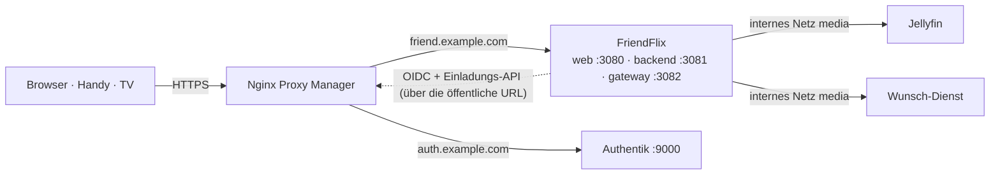

# Installationsanleitung

> **FriendFlix for Plex (Preview):** In FriendFlix for Plex ersetzt [plex.md](plex.md) die Jellyfin-Schritte (Jellyfin-API-Key, Webhook-Plugin, `JELLYFIN_*`-Variablen) durch `MEDIA_SERVER=plex` und `compose.plex.yaml`; Plex-Adresse und Token kommen in den Einrichtungsassistenten, `PLEX_URL` / `PLEX_TOKEN` sind optionale feste Vorgaben. Alles andere (Authentik, Proxy, `.env`-Grundlagen) gilt unverändert.

[English](../setup.md) · **Deutsch**

Diese Anleitung führt vom leeren Server bis zu einem laufenden FriendFlix mit dem ersten eingeladenen Freund. Sie verwendet den Produktions-Stack ([`compose.prod.yaml`](../../compose.prod.yaml), fertige Images), Authentik für die Anmeldung und Nginx Proxy Manager (NPM) als einzigen öffentlichen Zugang.

Eine neue Installation braucht **keine `.env`-Datei**: Du startest den Stack, liest einen einmaligen Einrichtungscode aus dem Backend-Log und erledigst den Rest im Browser. Der Einrichtungsassistent setzt die öffentliche Adresse, verbindet Jellyfin und Authentik (automatisch oder von Hand) und macht deine erste Anmeldung zum Admin. Alles über die `.env` zu konfigurieren geht weiterhin ([Abschnitt 15](#15-fortgeschritten-konfiguration-über-die-umgebung)).

Platzhalter in der ganzen Anleitung: `friend.example.com` (FriendFlix), `auth.example.com` (Authentik), `/opt/friendflix` (dein Klon). Durch eigene Werte ersetzen. Echte Secrets nie in Issues, Chats oder Commits einfügen.

## Inhalt

1. [Überblick und Reihenfolge](#1-überblick-und-reihenfolge)
2. [Voraussetzungen](#2-voraussetzungen)
3. [Authentik](#3-authentik)
4. [Jellyfin](#4-jellyfin)
5. [Wunsch-Dienst](#5-wunsch-dienst)
6. [Nginx Proxy Manager: Proxy Host für das Portal](#6-nginx-proxy-manager-proxy-host-für-das-portal)
7. [Stack starten](#7-stack-starten)
8. [Der Einrichtungsassistent](#8-der-einrichtungsassistent)
9. [Erste Schritte als Admin](#9-erste-schritte-als-admin) (mit [Authentik absichern](#authentik-absichern))
10. [Freunde einladen](#10-freunde-einladen) (mit [Was ein Freund sieht](#was-ein-freund-sieht))
11. [Optionale Funktionen](#11-optionale-funktionen)
12. [Checkliste](#12-checkliste)
13. [Fehlersuche](#13-fehlersuche)
14. [Umstieg auf Einstellungen in der Datenbank](#14-umstieg-auf-einstellungen-in-der-datenbank)
15. [Fortgeschritten: Konfiguration über die Umgebung](#15-fortgeschritten-konfiguration-über-die-umgebung)

## 1. Überblick und Reihenfolge



Das Gesamtbild aus Containern, Netzen und Ports steht in [architecture.md](../architecture.md#containers-and-networks) (englisch).

Der Weg: Authentik und Jellyfin **installieren** (Schritte 3–4), den Stack **starten** ([Schritt 7](#7-stack-starten)), den **Einrichtungscode** aus dem Backend-Log lesen ([Schritt 7](#7-stack-starten), [Der Einrichtungscode](#der-einrichtungscode)) und den **Assistenten** im Browser durcharbeiten ([Schritt 8](#8-der-einrichtungsassistent)). Die Dienste, die der Assistent verbindet, müssen vorher existieren:

| Schritt | Was du tust | Was der Assistent davon braucht |
|---|---|---|
| 2. DNS, Docker, NPM | Hostnamen mit TLS | – |
| 3. Authentik | installieren und Admin-Konto anlegen | seine Adresse und einen einmaligen Superuser-API-Token |
| 4. Jellyfin | Jellyfins eigenen Einrichtungsassistenten abschließen | seine interne Adresse und Benutzername und Passwort eines Administrators (einmal benutzt) |
| 5. Wunsch-Dienst (optional) | seinen Einrichtungsassistenten abschließen | seine Adresse und seinen API-Schlüssel (Extras des Assistenten oder später) |
| 6.–7. NPM-Proxy-Host, Stack | das laufende Portal, ohne `.env` | – |
| 8. Einrichtungsassistent | Einrichtungscode, öffentliche Adresse, Jellyfin, Authentik, erster Admin | – |
| 9.–10. erste Schritte, Einladungen | Authentik absichern, Freunde einladen | – |

## 2. Voraussetzungen

**Server.** Ein Linux-Host oder eine NAS (z. B. TerraMaster, Synology, Unraid, Mini-PC) mit:

- Docker Engine und dem **Compose-v2**-Plugin (`docker compose version`).
- Etwa 2 GB RAM für FriendFlix (Postgres, Redis, Backend, Gateway, Web) plus 2 GB für Authentik, plus was Jellyfin fürs Transkodieren braucht.
- `git` und `openssl`.
- Zeit per NTP synchronisiert (`timedatectl` → *System clock synchronized: yes*). OIDC-Tokens werden abgelehnt, wenn die Uhren mehr als 30 s auseinanderliegen.

**Domains und DNS.** Zwei Hostnamen, die auf deine öffentliche IP zeigen (A/AAAA-Einträge oder ein DynDNS-Name mit CNAMEs):

- `friend.example.com` → FriendFlix
- `auth.example.com` → Authentik

Ports 80 und 443 vom Router an NPM weitergeleitet. Das FriendFlix-Backend ruft `https://auth.example.com/…` selbst auf; erreicht dein Router seine eigene öffentliche IP nicht von innen (kein NAT-Loopback), lokale DNS-Einträge anlegen (Router, Pi-hole, AdGuard), damit beide Namen auch im Heimnetz auf den NPM-Host zeigen.

**Nginx Proxy Manager** läuft ([Installation](https://nginxproxymanager.com/setup/)), ist auf 80/443 erreichbar und hat eine E-Mail-Adresse für Let's Encrypt. FriendFlix und Authentik veröffentlichen ihre Ports nur auf `127.0.0.1`, NPM muss daher auf demselben Host laufen:

- NPM mit Host-Netzwerk oder nativ installiert: an `127.0.0.1` weiterleiten.
- NPM in einem normalen Bridge-Container: `127.0.0.1` ist dort NPM selbst. `BIND_ADDR` (FriendFlix und Authentik) auf die Bridge-Adresse des Docker-Hosts setzen, z. B. `172.17.0.1`, und an diese Adresse weiterleiten. Nie `0.0.0.0` auf einem Host mit öffentlicher Schnittstelle. `BIND_ADDR` gehört zu den wenigen Werten, die keine Einstellungen sind: in eine `.env` neben der Compose-Datei schreiben (`echo BIND_ADDR=172.17.0.1 > .env`) oder auf der Kommandozeile mitgeben.

**Repository klonen:**

```bash
sudo mkdir -p /opt/friendflix && sudo chown "$USER" /opt/friendflix
git clone https://github.com/LetsManu/friendflix-plex.git /opt/friendflix
cd /opt/friendflix
```

## 3. Authentik

Authentik installieren und sein Admin-Konto anlegen: **[docs/de/authentik.md §2](authentik.md#2-authentik-installieren)** (`compose.authentik.yaml` oder die offizielle Compose-Datei, der NPM-Proxy-Host `auth.example.com`, das Admin-Konto `akadmin`, optional SMTP).

Mehr braucht es vor dem Assistenten nicht. Im Schritt *Anmeldung* des Assistenten richtet FriendFlix den Rest mit einem einmaligen Superuser-API-Token **automatisch** ein: die Gruppen, den OAuth2/OpenID-Provider und die Anwendung, den Service-Account für Einladungen, den Registrierungs- und den Wiederherstellungs-Flow. Was dabei entsteht, wie du den Token bekommst und wie du ihn danach widerrufst: [authentik.md §3](authentik.md#3-automatische-einrichtung-aus-friendflix).

MFA und SMTP bleiben Handarbeit: siehe [Authentik absichern](#authentik-absichern) nach dem Assistenten.

Lieber alles selbst zusammenklicken? [authentik.md §4–§8](authentik.md#4-gruppen) folgen und die Werte im Assistenten unter *Von Hand* eintragen.

**Ein frisch installiertes Authentik** importiert in den ersten 3 – 4 Minuten im Hintergrund seine Standard-Flows. Den Schritt *Anmeldung* erst danach starten; bleibt er mit *Authentik hat die Einrichtung abgelehnt* (`blueprint_invalid`) stehen, eine Minute warten und *Noch einmal versuchen*.

## 4. Jellyfin

FriendFlix spricht mit Jellyfin über das interne Docker-Netz `friendflix_media`; Jellyfin ist nie öffentlich erreichbar.

**A) Bestehendes Jellyfin** (eigener Container oder Stack): Nachdem der FriendFlix-Stack einmal gestartet wurde ([Schritt 7](#7-stack-starten) legt das Netz `friendflix_media` an), den Container anhängen:

```bash
docker network connect friendflix_media <jellyfin-container>
```

Die Adresse für den Assistenten ist `http://<jellyfin-containername>:8096`. Ein `docker network connect` überlebt das Neuerstellen des Jellyfin-Containers nicht; dauerhaft wird es, wenn du `friendflix_media` in Jellyfins eigener Compose-Datei als Netz mit `external: true` einträgst. Sobald FriendFlix läuft, Jellyfins öffentliches Port-Mapping und einen eventuellen öffentlichen Proxy Host entfernen (oder zumindest per Firewall sperren, siehe [operations.md](../operations.md#host-firewall-zusätzlich-zum-fehlenden-port-mapping)).
Läuft Jellyfin nativ auf dem Host (nicht in Docker), erreicht das Backend kein `localhost`; Jellyfin in einen Container packen oder über die Bridge-IP des Hosts anbinden *(von den mitgelieferten Compose-Dateien nicht abgedeckt)*.

**B) Mitgeliefertes Jellyfin** (`--profile bundled`): Die Container `jellyfin` und `requests` (der Wunsch-Dienst) starten im Stack, ganz ohne Ports. Für ihre einmaligen Einrichtungsassistenten beide Dienste vorübergehend auf Loopback veröffentlichen, mit einer lokalen Override-Datei (nicht committen):

```yaml
# compose.setup.yaml - VORÜBERGEHEND, nach den Assistenten wieder entfernen
services:
  jellyfin:
    ports: ["127.0.0.1:8096:8096"]
    networks: [media, egress, front]
  requests:
    ports: ["127.0.0.1:5055:5055"]
    networks: [media, egress, front]
```

```bash
MEDIA_PATH=/mnt/data/media docker compose -f compose.prod.yaml -f compose.setup.yaml --profile bundled up -d jellyfin requests
ssh -L 8096:127.0.0.1:8096 -L 5055:127.0.0.1:5055 du@server     # vom eigenen PC; dann http://localhost:8096 öffnen
```

(`MEDIA_PATH` wird in Jellyfin schreibgeschützt unter `/media` eingebunden.) Assistenten abschließen, dann ohne `compose.setup.yaml` neu starten, damit die Ports verschwinden. Die Adresse für den Assistenten ist `http://jellyfin:8096`.

**In Jellyfin:**

1. **Zuerst Jellyfins eigenen Einrichtungsassistenten abschließen**: Admin-Nutzer, Metadaten-Sprache, Bibliotheken (Filme, Serien …). Die Bibliotheksnamen sind nur wichtig, wenn du Rollen auf bestimmte Bibliotheken beschränkst (`ROLE_TEMPLATES`). Vorher verweigert der FriendFlix-Assistent den automatischen API-Schlüssel (*Der Medienserver ist selbst noch nicht eingerichtet*).
2. Der API-Schlüssel: Der FriendFlix-Assistent legt ihn für dich an (*API-Schlüssel automatisch anlegen*, [Abschnitt 8](#8-der-einrichtungsassistent)). Von Hand stattdessen: *Dashboard → API Keys* (in neueren Versionen unter *Dashboard → Advanced → API Keys*) → **+** → App-Name `FriendFlix` → Schlüssel kopieren und im Assistenten *Von Hand* wählen. Der Schlüssel hat Admin-Rechte: FriendFlix legt damit pro Portal-Nutzer einen Jellyfin-Nutzer an (Zufallspasswort, mit `APP_ENC_KEY` verschlüsselt gespeichert) und setzt die Rollen-Policies.
3. Optional: das Webhook-Plugin für sofortige „läuft gerade“- und „neu in der Bibliothek“-Ereignisse, siehe [integrations.md](../integrations.md#jellyfin-webhook-plugin-optional-polling-sessions-every-10-s-is-the-fallback).
4. Hardware-Transkodierung wie für deine Hardware üblich (Intel QSV/VAAPI: Hinweis zu „VPP Tone mapping“ in der README beachten).

## 5. Wunsch-Dienst

Wünsche laufen über einen Wunsch-Dienst: den mitgelieferten Container `requests` (Upstream-Projekt: siehe seine `image:`-Zeile in [`compose.prod.yaml`](../../compose.prod.yaml)) oder eine kompatible Instanz, die du schon betreibst.

Der Wunsch-Dienst ist **optional**. Ohne `REQUESTS_URL` und `REQUESTS_API_KEY` blendet FriendFlix Wünsche, die Reihe „Demnächst“ und die Wunsch-Seiten im Admin-Bereich aus; *Wünsche* zeigt dann nur die Erinnerungen. Verbinden lässt er sich in den Extras des Assistenten oder später unter *Admin → Einstellungen → Anfragen*.

1. Den Wunsch-Dienst öffnen (bestehende Instanz oder `http://localhost:5055` über den Tunnel oben) und den Assistenten mit **Jellyfin** als Medienserver abschließen: URL `http://jellyfin:8096` (mitgeliefert) bzw. dein Containername, dazu ein Jellyfin-Admin-Login. Bibliotheken synchronisieren, ggf. Radarr/Sonarr hinzufügen.
2. *Settings → General* → **API Key** kopieren (`REQUESTS_API_KEY`). Die Adresse ist `http://requests:5055` (mitgeliefert) bzw. `http://<containername>:5055` nach `docker network connect friendflix_media <containername>`.
3. *Settings → Users*: den automatischen Jellyfin-Nutzerimport ausschalten (FriendFlix-Profile sind versteckte Jellyfin-Nutzer und tauchten sonst auf). Auto-Approve aus lassen, wenn du jeden Wunsch freigeben willst.
4. Webhook für „Wunsch freigegeben/verfügbar“: siehe [integrations.md](../integrations.md#request-service).

## 6. Nginx Proxy Manager: Proxy Host für das Portal

*Hosts → Proxy Hosts → Add Proxy Host*:

| Reiter | Feld | Wert |
|---|---|---|
| Details | Domain Names | `friend.example.com` |
| | Scheme | `http` |
| | Forward Hostname / IP | `127.0.0.1` (bzw. dein `BIND_ADDR`) |
| | Forward Port | `3080` (`WEB_PORT`, die SvelteKit-Oberfläche) |
| | Cache Assets | aus |
| | Block Common Exploits | an |
| | Websockets Support | **an** |
| SSL | SSL Certificate | Request a new Let's Encrypt certificate |
| | Force SSL, HTTP/2 Support, HSTS Enabled | an |
| Advanced | Custom Nginx Configuration | der komplette Inhalt von [`deploy/npm/portal.advanced.conf`](../../deploy/npm/portal.advanced.conf) |

Die Advanced-Konfiguration leitet `/api/`, `/auth/` und `/ws/` ans Backend (`:3081`), `/media/` ans Gateway (`:3082`, ungepuffert, mit HTTP-Range), hält `/media/c/` (Chromecast-Tokens) aus den Logs heraus und beantwortet `/internal/`, `/metrics` und `/health/ready` mit 404. Wer `BIND_ADDR` oder die Ports geändert hat, passt `127.0.0.1:3081`/`:3082` im eingefügten Text an. Den `/media/c/`-Block auch ohne Chromecast stehen lassen.

Das Backend vertraut `X-Forwarded-*`-Headern (`trustProxy`), NPM muss daher der einzige Zugang sein: Die Ports bleiben auf `BIND_ADDR`.

Solange der Einrichtungsassistent nicht abgeschlossen ist, sieht jeder, der das Portal erreicht, dessen erste Seite (die Abfrage des Codes). Ohne den Code kommt niemand weiter, aber jeder kann dessen Versuche aufbrauchen ([Abschnitt 8](#der-einrichtungscode)). Den Assistenten deshalb direkt nach dem Start abschließen oder das Portal bis dahin privat halten, z. B. mit einer *Access List* in NPM, die nur deine eigene Adresse zulässt, oder indem du den Assistenten über einen SSH-Tunnel auf `127.0.0.1:3080` öffnest.

## 7. Stack starten

```bash
docker login ghcr.io -u <github-nutzer>                 # nur bei privaten Paketen (PAT mit read:packages)
docker compose -f compose.prod.yaml up -d               # mit --profile bundled für das mitgelieferte Jellyfin + den Wunsch-Dienst
docker compose -f compose.prod.yaml logs bootstrap      # Dateinamen und Aktionen ("generated"), nie Werte
docker compose -f compose.prod.yaml ps                  # postgres/redis healthy, backend/gateway/web laufen
docker compose -f compose.prod.yaml logs backend | grep "setup code"
```

Noch keine Ausgabe? `up -d` kehrt zurück, bevor das Backend gestartet ist: ein paar Sekunden warten und den letzten Befehl wiederholen; die Zeile erscheint, sobald das Backend läuft.

Eine `.env` ist nicht nötig. Der Dienst `bootstrap` startet zuerst, erzeugt die Passwörter für Datenbank und Redis, `APP_ENC_KEY` und `INTERNAL_SECRET` im Docker-Volume `friendflix_bootstrap` und beendet sich (`docker compose -f compose.prod.yaml ps -a` zeigt ihn als *Exited (0)*); alle anderen Dienste warten auf ihn. Startet das Backend in einer Schleife neu, den ersten Fehler im Log lesen: eine ungültige Variable (die Konfigurationsprüfung nennt sie) oder eine fehlende Datei im Bootstrap-Volume (siehe [Fehlersuche](#13-fehlersuche)).

Bis die Einrichtung abgeschlossen ist, läuft das Backend im **Einrichtungsmodus**: Alles außer dem Assistenten antwortet mit `503 setup_required`, Hintergrundjobs warten, `/health` bleibt OK, und das Gateway beantwortet `/media/…` mit 503, bis der Medienserver eingerichtet ist. Der letzte Befehl zeigt die Zeile mit dem Einrichtungscode:

```
FriendFlix setup: open the portal in your browser and enter the setup code K7QM-3XA9-PT2D (valid until 2026-10-15 14:03 UTC). Restart the backend for a new code.
```

**Jetzt die erzeugten Secrets sichern:** `./scripts/backup-bootstrap.sh` schreibt `backups/friendflix-bootstrap-<zeit>.tgz`. Getrennt von den Datenbank-Dumps aufbewahren (Passwort-Manager, andere Platte): Ohne diese Datei kann eine wiederhergestellte Datenbank ihre verschlüsselten Werte nicht lesen. Details: [operations.md](../operations.md#backups--wiederherstellung).

## 8. Der Einrichtungsassistent

`https://friend.example.com` öffnen. Solange die Einrichtung nicht abgeschlossen ist, führt jede Seite zu `/setup`. Jeder Schritt lässt sich später unter *Admin → Einstellungen* ändern; ein Schritt, dessen Werte aus der Umgebung kommen, zeigt sie gesperrt (*Aus der Umgebung*) und lässt sich überspringen.

1. **Einrichtungscode.** Den Code aus dem Log einfügen. Groß- und Kleinschreibung, Leerzeichen und Bindestriche sind egal (`O` zählt als `0`, `I` und `L` als `1`).
2. **Öffentliche Adresse.** Die Adresse, die alle benutzen, ohne Pfad: `https://friend.example.com`. Der Assistent schlägt die vor, die dein Browser benutzt hat. FriendFlix ruft dann eine Testseite unter dieser Adresse ab; klappt das nicht, gibt es nur eine Warnung (häufig ohne NAT-Loopback), keine Sperre. `http://` geht für Tests, schaltet aber sichere Cookies, Chromecast und Passkeys ab.
3. **Medienserver.** *Automatisch*: die Jellyfin-Adresse, wie das Backend sie erreicht (`http://jellyfin:8096` bzw. dein Containername, nie die öffentliche URL), dazu Benutzername und Passwort eines Jellyfin-**Administrators** → *API-Schlüssel automatisch anlegen*. *Von Hand*: Adresse und ein API-Schlüssel aus Jellyfin. Beides wird vor dem Speichern geprüft.
4. **Anmeldung.** *Automatisch*: die Authentik-Adresse, wie der Browser sie erreicht (`https://auth.example.com`; das Backend muss dieselbe Adresse erreichen), und ein Superuser-API-Token → *Plan anzeigen* listet, was angelegt oder angepasst wird, noch ändert sich nichts → *Anwenden* (etwa 30 Sekunden). *Mich zur Admin-Gruppe hinzufügen* angehakt lassen, damit der Besitzer des Tokens in `friendflix-admins` kommt. Das Ergebnis listet, was noch von Hand zu tun ist (SMTP, MFA, E-Mail-Vorlagen). Details: [authentik.md §3](authentik.md#3-automatische-einrichtung-aus-friendflix). *Von Hand*: Issuer, Client-ID, Client-Secret und Admin-Gruppe aus deinem eigenen Provider, mit einer Checkliste, wie der Provider eingestellt sein muss; optional die Authentik-API-Werte für Einladungen.
5. **Erster Admin.** *Mit Authentik anmelden*. Mit dem Konto anmelden, das FriendFlix verwalten soll (es braucht eingerichtetes MFA, sobald MFA Pflicht ist). **Diese Anmeldung wird Admin und schließt die Einrichtung ab**, egal in welchen Gruppen das Konto ist; FriendFlix legt seinen Jellyfin-Nutzer und das Hauptprofil an wie bei jeder ersten Anmeldung. Genau ein Konto wird so Admin, auch mit mehreren Backends.
6. **Extras** (jetzt angemeldet; jede Karte hat *Überspringen*): Wunsch-Dienst, TMDB-/OMDb-Schlüssel, Downloads, Push-Schlüssel (*Push-Schlüssel erzeugen*), ntfy/Discord, Webhook-Geheimnis (*Webhook-Geheimnis erzeugen*, einmal angezeigt mit den Headerzeilen für Jellyfin und den Wunsch-Dienst), Updates über Portainer. *Fertig* öffnet die Startseite.

### Der Einrichtungscode

- Das Backend schreibt ihn **einmal**, beim Start, in sein Log (`docker compose -f compose.prod.yaml logs backend | grep "setup code"`). Gespeichert wird nur sein Hash. Er gilt **24 Stunden**.
- **Jeder Neustart des Backends erzeugt einen neuen Code**, der alte gilt dann nicht mehr: `docker compose -f compose.prod.yaml restart backend`. So vorgehen, wenn der Code abgelaufen oder gesperrt ist.
- **Grenzen:** 5 Versuche pro 15 Minuten pro Client-Adresse; nach **insgesamt 10 falschen Codes** ist der Code gesperrt (Log: `Too many wrong setup codes; restart the backend for a new code`). Die Grenze pro Adresse zählt pro Backend-Instanz und verlässt sich darauf, dass der Proxy die Client-Adresse meldet (`trustProxy`); ein Client, der sein eigenes `X-Forwarded-For` durch deinen Proxy schicken kann, umgeht sie, nicht aber die Gesamtzahl von 10.
- **Wer das Portal vor dem Abschluss erreicht, kann den Code sperren**, indem er rät. Erraten kann er ihn nicht (60 Zufallsbits), aber die Sperre erzwingt einen Neustart. Den Assistenten zügig abschließen oder den Zugang bis dahin beschränken ([Abschnitt 6](#6-nginx-proxy-manager-proxy-host-für-das-portal)).
- Nur ein Backend mit `BACKGROUND_JOBS=true` (Standard) erzeugt einen Code. Tut das keines, meldet der Assistent *Es wurde noch kein Code ausgegeben* (`no_code`).
- Ein gültiger Code öffnet in diesem Browser eine **Einrichtungssitzung** (2 Stunden, verlängert sich beim Arbeiten). Derselbe Code geht bis zum Abschluss auch auf einem anderen Gerät. Der Abschluss macht den Code ungültig und beendet jede Einrichtungssitzung.

### Was der Assistent nie behält

Der Superuser-Token von Authentik und das Passwort des Jellyfin-Administrators werden für diese eine Anfrage benutzt und dann vergessen: nie gespeichert, nie geloggt, nie in einer Fehlermeldung. Gespeichert wird, was sonst in einer `.env` stünde: der Jellyfin-API-Schlüssel `FriendFlix`, Client-ID und Secret des Providers und der Token des Service-Accounts `friendflix-invites` (mit nur den Rechten, die FriendFlix braucht). **Den Superuser-Token danach in Authentik widerrufen** ([Authentik absichern](#authentik-absichern)).

## 9. Erste Schritte als Admin

1. **Sprache der Instanz:** FriendFlix fragt den ersten Admin einmal, welche Sprache die ganze Instanz standardmäßig nutzt (Englisch, Deutsch, Französisch, Spanisch, Italienisch, Türkisch, Polnisch). Jedes Profil kann später seine eigene Sprache wählen; neue Profile werden bei der ersten Anmeldung gefragt, mit der Browsersprache als Vorschlag.
2. Dein erstes Gerät ist automatisch freigegeben; weitere Geräte müssen unter *Geräte* freigegeben werden. Weitere Admins: in die Authentik-Gruppe `friendflix-admins` (`ADMIN_GROUP`) aufnehmen; bei ihrer ersten Anmeldung macht FriendFlix sie ohne Einladung zum Admin.
3. Authentik absichern, siehe unten.
4. Im *Admin*-Bereich umsehen: die **Übersicht** (Zustand von Medienserver und Wunsch-Dienst, offene Entscheidungen, letzte Aktivität), Rollen und Limits, Wochenrückblick. Unter *Inhalte* lassen sich **Marken-Hubs** anlegen, Themenlisten auf der Startseite anheften und Bald-weg-Termine setzen; das Hauptprofil legt Kinderprofile unter *Profile* an.

### Authentik absichern

Gleich nach dem Assistenten, in Authentik:

1. **Den einmaligen Superuser-Token widerrufen** (nur wenn du *Automatisch* benutzt hast): *Directory → Tokens and App passwords*, Token anhaken, *Delete*. Ein Bootstrap-Token (`authentik-bootstrap-token`) wird genauso gelöscht, und `AUTHENTIK_BOOTSTRAP_TOKEN` verschwindet aus der Umgebung von Authentik. FriendFlix behält nur den Token des Service-Accounts `friendflix-invites`. [authentik.md §3.2](authentik.md#32-der-einmalige-superuser-token).
2. **MFA zur Pflicht machen** im Authentifizierungs-Flow, damit jeder Freund bei der Registrierung eine Authenticator-App oder einen Sicherheitsschlüssel einrichtet: [authentik.md §6](authentik.md#6-authentifizierungs-flow-mit-pflicht-mfa). Der Assistent ändert nicht, wie man sich bei Authentik anmeldet.
3. **SMTP einrichten** für Einladungs- und Passwort-Mails: [authentik.md §2.5](authentik.md#25-e-mail-smtp).
4. **Die Anmeldung in der App vorbereiten.** FriendFlix zeigt eigene Anmeldebildschirme, sobald Authentik verbunden ist (`LOGIN_UI`, [authentik.md §10a](authentik.md#10a-anmeldung-in-der-app)). Öffne *Admin → Status → Anmeldung*: Die Karte prüft die Abläufe, die implizite Zustimmung, den Grant-Typ `authorization_code` und ob Passkeys auf der eigenen Seite von FriendFlix laufen können, und nennt, was zu korrigieren ist. Zwei Dinge bleiben Handarbeit:
   - **Der Ablauf für die E-Mail-Änderung** (die Zeile *E-Mail-Adresse → Ändern* unter *Sicherheit* auf der Kontoseite) braucht zuerst seine Mail-Vorlage unter `/templates` (mit deiner FriendFlix-Adresse im Link); der Assistent importiert den Ablauf erst, wenn Authentik die Vorlage auflistet, und *Authentik-Einrichtung reparieren* unter *Admin → Status → Anmeldung* holt das später nach ([authentik.md §10a, Schritt 7](authentik.md#10a-anmeldung-in-der-app)). Bis dahin zeigt die Zeile die Adresse ohne *Ändern*, und Admins sehen einen Hinweis.
   - **Optional:** Passwort-Mails mit der Wiederherstellungs-Vorlage in FriendFlix öffnen lassen (`/reset`, [authentik.md §10a, Schritt 4](authentik.md#10a-anmeldung-in-der-app)).

   Update einer Installation von vor der Anmeldung in der App? *Authentik-Einrichtung reparieren* unter *Admin → Status → Anmeldung* mit einem einmaligen Superuser-Token ([authentik.md §3.6](authentik.md#36-einrichtung-einer-bestehenden-installation-reparieren-oder-aktualisieren)), oder `deploy/authentik/friendflix-service-account.yaml` (oder `friendflix-blueprint.yaml`) von Hand neu importieren: Der Service-Account braucht die neuen Rechte zum Löschen von Geräten für *Entfernen* auf der Kontoseite und Leserechte für die Validation-Stage und den OAuth2-Provider (die Regel zum letzten Faktor und die Prüfung von Zustimmung und Grant-Typ auf der Status-Karte) ([authentik.md §8.2](authentik.md#82-rolle-mit-genau-diesen-globalen-berechtigungen)).
5. Ergebnis mit [authentik.md §14](authentik.md#14-prüfen) prüfen und die Checkliste in [Abschnitt 12](#12-checkliste) abhaken.

### Einstellungen in der Datenbank

*Admin → Einstellungen* zeigt jede Einstellung mit ihrer Quelle: **Aus der Umgebung** (`.env`, ein `_FILE`-Secret oder ein älterer Variablenname; gesperrt, das Feld ist nicht änderbar), **Gespeichert** (Datenbank) oder **Standard**. Die erzeugten Werte der Gruppe *Server* (`DATABASE_URL`, `REDIS_URL`, `APP_ENC_KEY`, `INTERNAL_SECRET`) zeigen **Aus der Startdatei**: Der Dienst `bootstrap` hat sie in seinem Volume angelegt; hier sind sie nur lesbar. Die Umgebung hat Vorrang vor der Datenbank, die Datenbank vor dem Standard.

Die Anmeldung in der App hat eigene Einstellungen unter *Admin → Einstellungen → Anmeldung* (`LOGIN_UI`, die Slugs für Anmelde- und Abmelde-Flow, die Slugs der Abläufe der Kontoseite für Wiederherstellungscodes, Passkeys, Passwort- und E-Mail-Änderung, `PASSKEYS_IN_APP`) und *Allgemein* (`LOGIN_COVER_WALL`); `.env`-Zeilen sind dafür nicht nötig. *Admin → Status* zeigt eine Karte „Anmeldung“, die die Authentik-Seite prüft. Siehe [authentik.md §10a](authentik.md#10a-anmeldung-in-der-app).

- **Sofort wirksam:** Die meisten Einstellungen gelten sofort auf jedem Backend; Speichern erhöht eine Revision, andere Instanzen und das Gateway laden binnen Sekunden nach (spätestens nach 30 s). `API_COMPRESSION` gilt ab der nächsten Antwort. Einstellungen mit *Neustart nötig* (`DOWNLOAD_CREATE_PER_HOUR`) wirken erst nach `docker compose -f compose.prod.yaml restart backend`; ein Hinweisband listet sie.
- **Secrets nur schreibbar:** Die Seite zeigt *Gesetzt* oder *Nicht gesetzt* und das Datum der letzten Änderung (Schlüssel der Datenquellen zusätzlich die letzten vier Zeichen), dazu *Ersetzen* und *Entfernen*. Kein Secret kommt je vom Server zurück, das Audit-Log nennt nur die Namen.
- **Vor dem Speichern geprüft:** Speichern testet den betroffenen Dienst (Medienserver, Anmeldung, Authentik, Wunsch-Dienst, Datenquellen, Portainer, GitHub) mit den neuen Werten. Ein abgelehnter Schlüssel oder Login verhindert das Speichern; ist ein Dienst nicht erreichbar, gibt es *Trotzdem speichern*.
- **Frische Anmeldung:** Wer ein Secret, `PUBLIC_URL`, `HOME_NETWORKS`, `ADMIN_GROUP`, `NTFY_URL` / `NTFY_BASE_URL`, einen `OIDC_*`- oder `AUTHENTIK_*`-Wert oder eine Adresse speichert, an die ein gespeicherter Schlüssel geht (`JELLYFIN_URL`, `REQUESTS_URL`, `PORTAINER_URL`), braucht eine höchstens 10 Minuten alte Anmeldung; ebenso das Ersetzen oder Entfernen eines Schlüssels unter *Admin → Datenquellen*. FriendFlix schickt dich einmal durch die Anmeldung und wiederholt dann das Speichern (unter *Datenquellen* gibst du den Schlüssel erneut ein).
- **Server:** eine schreibgeschützte Gruppe mit den Werten, die pro Container in der `.env` bleiben (`MEDIA_SERVER`, `BACKGROUND_JOBS`, `METRICS_TOKEN`, `DIGEST_DAY`/`DIGEST_HOUR`, `ROLE_TEMPLATES`, `UPDATE_REPO`, `GATEWAY_URL`, Pfade), und ob die erzeugten Secrets gesetzt sind, nie ihre Werte.
- **Übernehmen:** Eine Zeile aus der Umgebung hat **Übernehmen** (die Seite zusätzlich **Alle übernehmen**): Der Wert wird in die Datenbank kopiert. Danach kannst du die Variable aus der `.env` entfernen und `docker compose -f compose.prod.yaml up -d` ausführen; bis dahin gilt weiter der Wert aus der Umgebung.

## 10. Freunde einladen

*Admin → Nutzer → Einladungen*:

1. Rolle wählen (`friend`, `family` oder `guest`; die Limits sind unter *Admin* änderbar), Gültigkeit des Links (Standard 48 h, max. 14 Tage), optional eine Notiz, **Max. Nutzungen** (so viele Konten kann der Link anlegen, 1 – 50, Standard 1) und **Zugang (Tage)** (der Zugang jedes neuen Kontos endet nach so vielen Tagen; leer = unbegrenzt).
2. **hat schon ein Authentik-Konto** für neue Leute nicht ankreuzen. Erstellen.
3. Der Link wird nur jetzt angezeigt (auch als QR-Code). Darunter muss stehen: *Der Link führt durch die Konto-Erstellung (inkl. Zwei-Faktor) und schaltet den Zugang direkt frei.* Sonst ist die Authentik-Einladung nicht eingerichtet; siehe [authentik.md §15](authentik.md#15-fehlersuche).
4. Link verschicken. Der Freund öffnet ihn, klickt **Konto anlegen & loslegen**, legt das Konto auf den Anmeldebildschirmen von FriendFlix an (Authentik führt dahinter seinen Registrierungs-Flow aus, inklusive MFA) und landet eingeloggt im Portal. Mit `LOGIN_UI=authentik` läuft die Registrierung stattdessen auf den Seiten von Authentik.

Für jemanden mit bestehendem Authentik-Konto **hat schon ein Authentik-Konto** ankreuzen: Der Link bietet dann **Anmelden & freischalten** an. Unbenutzte Einladungen lassen sich in der Liste widerrufen; das löscht auch die Authentik-Einladung. Die Liste zeigt die Nutzungen als „1/3“ und aufgeklappt die Konten, die über die Einladung entstanden sind.

**Ohne Einladung:** Wer sich ohne Einladung über Authentik anmeldet (und nicht in `friendflix-admins` ist), wird nicht abgewiesen. Die Person sieht *Anfrage gesendet* (`/pending`), du bekommst eine Benachrichtigung, und die Anfrage wartet unter *Admin → Nutzer → Warten auf Freigabe*. Mit Rolle und optional einem „Zugang bis“-Datum freigeben oder mit optionaler Nachricht ablehnen; die Seite der Person aktualisiert sich von selbst, nach der Freigabe meldet sie sich erneut an. Details: [operations.md](../operations.md#nutzerverwaltung-zugang-bis-freigaben-einladungen).

### Was ein Freund sieht

1. **Die Einladungsseite** (`/invite/…`): Kontotyp (Rolle) und Gültigkeit, dazu die Schaltfläche **Konto anlegen & loslegen**. Wer schon ein Authentik-Konto hat, sieht **Anmelden & freischalten**. Ein benutzter oder abgelaufener Link zeigt *Einladung ungültig*: einen neuen schicken.
2. **Registrierung** auf der Anmeldeseite von FriendFlix, über der Cover-Wand: Benutzername und Passwort, dann die Authenticator-App (QR-Code oder der Schlüssel zum Abtippen, und der erste 6-stellige Code) und Wiederherstellungscodes zum Kopieren oder Herunterladen. Authentik führt den Registrierungs-Flow hinter diesen Bildschirmen aus; einen Schritt, den FriendFlix nicht zeigen kann, setzt die Seite von Authentik fort. Danach ist der Freund im Portal angemeldet und freigeschaltet.
3. **Erster Besuch** (einmal pro Profil): Sprachauswahl (die Browsersprache als Vorschlag), dann **Willkommen** in drei Schritten: Profilname und Farbe prüfen, 3 Titel wählen, die gefallen (sie speisen die Empfehlungen; *Überspringen* geht), *Los geht's*. Ein Kinderprofil bekommt eine einfachere Fassung.
4. **Später:** Das erste Gerät ist automatisch vertraut; jedes weitere wartet unter *Geräte*, bis du es freigibst. Bei mehreren Profilen in einem Konto erscheint die Profilauswahl einmal pro Browser-Sitzung. Jellyfin und der Wunsch-Dienst bleiben unsichtbar: Freunde öffnen immer nur `https://friend.example.com`.
5. **Wieder anmelden** geht auf derselben Seite: Name, Passwort, dann der 6-stellige Code (oder ein Wiederherstellungscode oder ein Passkey). *Passwort vergessen?* zeigt „Schau in dein Postfach“; der Link in der Mail öffnet die Seite von Authentik oder, wenn du die Vorlage gesetzt hast, die Seite `/reset` von FriendFlix. Nach zu vielen Fehlversuchen verlinkt die Seite die Anmeldeseite von Authentik.
6. **Mein Bereich → Konto → Sicherheit:** Der Freund ändert das Passwort, fügt eine Authenticator-App oder einen Passkey hinzu oder entfernt sie, erzeugt neue Wiederherstellungscodes und ändert die E-Mail-Adresse. Jede Aktion fragt vorher in einem kleinen Dialog noch einmal nach Passwort (und zweitem Faktor); eine neue E-Mail-Adresse gilt erst, wenn der Freund den Link klickt, der an sie geht.

Weiter: was du als Admin siehst und einstellst, steht in [Abschnitt 9](#9-erste-schritte-als-admin).

## 11. Optionale Funktionen

| Funktion | Was zu tun ist | Details |
|---|---|---|
| **Offline-Downloads** | Standardmäßig an (`DOWNLOADS_ENABLED=true`). Für eine eigene Platte: `mkdir -p /mnt/data/friendflix/downloads /mnt/data/friendflix/previews && chown 1000:1000 /mnt/data/friendflix/{downloads,previews}`, dann `DOWNLOADS_PATH=…`, `PREVIEWS_PATH=…`. Ordner **vor** dem Start anlegen und `chown` setzen, sonst legt Docker sie als root an und das Backend loggt `EACCES`. Downloads je Rolle unter *Admin* erlauben. | [downloads.md](../downloads.md) |
| **Web-Push** | *Admin → Einstellungen → Push-Mitteilungen → Schlüsselpaar erzeugen* (oder `node scripts/gen-vapid.mjs` → `VAPID_PUBLIC_KEY`, `VAPID_PRIVATE_KEY` in der `.env`), optional `VAPID_SUBJECT=mailto:du@example.com`. Das Schlüsselpaar stabil halten. Braucht HTTPS; unter iOS muss die Seite zum Home-Bildschirm hinzugefügt werden. | [integrations.md](../integrations.md#web-push-browser-notifications) |
| **ntfy / Discord** | `NTFY_URL=https://ntfy.example.com/friendflix` und/oder `DISCORD_WEBHOOK_URL=…` für den gemeinsamen Kanal; `NTFY_BASE_URL` für persönliche Themen. | [integrations.md](../integrations.md#ntfy--discord) |
| **Chromecast** | Standardmäßig an (`CAST_ENABLED=true`). Braucht eine https-`PUBLIC_URL` mit öffentlich gültigem Zertifikat, die der Chromecast erreicht, und den `/media/c/`-Block aus `portal.advanced.conf`. | [cast.md](../cast.md) |
| **TV-Modus** | Nichts einzurichten: `https://friend.example.com/tv` am Fernseher öffnen und mit dem Handy koppeln. | [tv-mode.md](../tv-mode.md) |
| **Datenbank-Backups** | `mkdir -p backups && sudo chown 70 backups`, dann `docker compose -f compose.prod.yaml --profile backup up -d backup` (`BACKUP_HOUR`, `BACKUP_KEEP_DAYS`, `BACKUP_PATH`). Das Volume `bootstrap` einmal mit `./scripts/backup-bootstrap.sh` sichern und getrennt von den Dumps aufbewahren; Authentik separat sichern ([authentik.md §2.6](authentik.md#26-backups-und-updates)). | [operations.md](../operations.md#backups--wiederherstellung) |
| **Updates per Klick** | *Admin → Update* deployt über **Portainer** neu: entweder `PORTAINER_WEBHOOK_URL` (Stack-Webhook) oder `PORTAINER_URL` + `PORTAINER_API_KEY` + `PORTAINER_STACK_ID` (+ `PORTAINER_ENDPOINT_ID`, Standard `1`). Einen Portainer-Nutzer verwenden, der nur dieses eine Stack neu deployen darf. FriendFlix bekommt bewusst nie den Docker-Socket: **`/var/run/docker.sock` in keinen FriendFlix-Container einbinden**, die Web-App darf Docker nicht steuern können. | [operations.md](../operations.md#updates-aus-dem-portal) |
| **Monitoring** | `METRICS_TOKEN`, Beispiele für Prometheus/Icinga; optionaler Prometheus-+-Grafana-Stack: `GRAFANA_ADMIN_PASSWORD` setzen (kein Standardpasswort) und `-f compose.monitoring.yaml` ergänzen. | [monitoring.md](../monitoring.md) |
| **Plan B** | NPM liefert `/media/` selbst aus (`auth_request`); dann `DOWNLOADS_ENABLED=false`, `CAST_ENABLED=false`. | [operations.md](../operations.md#plan-b-npm-liefert-media-direkt-auth_request) |

Die Werte in der Tabelle lassen sich auch unter *Admin → Einstellungen* setzen. Nach Änderungen an der `.env`: `docker compose -f compose.prod.yaml up -d` (erstellt nur neu, was sich geändert hat).

## 12. Checkliste

- [ ] Der Einrichtungsassistent ist geschlossen: Das Backend-Log enthält `Setup completed; the setup code is no longer valid.`, und `/setup` führt zur Startseite.
- [ ] Der vom Assistenten benutzte Superuser-Token von Authentik ist gelöscht.
- [ ] `docker compose -f compose.prod.yaml ps`: alle Dienste laufen, `postgres`/`redis` (und `backup`) healthy.
- [ ] `curl -s http://127.0.0.1:3081/health/ready` meldet Postgres, Redis und Jellyfin OK.
- [ ] `curl -sI https://friend.example.com` → `200`, gültiges Zertifikat, Header `strict-transport-security`.
- [ ] `curl -s -o /dev/null -w '%{http_code}\n' https://friend.example.com/internal/x` → `404`; ebenso `/metrics`.
- [ ] Von außerhalb deines Netzes: `nmap -p 3080-3082,8096,5055,9000 <öffentliche-IP>` → alle filtered/closed.
- [ ] `curl -s https://auth.example.com/application/o/friendflix/.well-known/openid-configuration | jq -r .issuer` entspricht `OIDC_ISSUER`.
- [ ] Admin-Anmeldung klappt, MFA wird abgefragt, *Admin* ist sichtbar.
- [ ] Eine Test-Einladung im privaten Fenster endet eingeloggt im Portal; der Nutzer erscheint unter *Admin → Nutzer* und in Jellyfin.
- [ ] *Admin → Status → Anmeldung* zeigt keine Warnung (der Ablauf für die E-Mail-Änderung steht bis zum Import auf *Fehlt*, ohne Warnung; siehe [Authentik absichern](#authentik-absichern)).
- [ ] Ein Film läuft (Direct Play und eine erzwungene niedrigere Qualität → Transkodierung), Untertitel und Spulen funktionieren.
- [ ] Optional: Test-Push, ein Download, Casten, eine Backup-Datei in `backups/`.

## 13. Fehlersuche

| Symptom | Ursache / Lösung |
|---|---|
| Keine Zeile mit `setup code` im Backend-Log | Das Log wurde abgeschnitten (die Zeile erscheint einmal pro Start) oder die Einrichtung ist schon abgeschlossen. `docker compose -f compose.prod.yaml restart backend` schreibt einen neuen Code. Meldet der Assistent *Es wurde noch kein Code ausgegeben* (`no_code`), läuft kein Backend mit `BACKGROUND_JOBS=true`; auf einem Backend setzen und es neu starten. |
| Assistent: *Der Code ist abgelaufen* / *Zu viele falsche Versuche* | Der Code gilt 24 Stunden und wird nach 10 falschen Versuchen gesperrt. `docker compose -f compose.prod.yaml restart backend` und den neuen Code aus dem Log nehmen. Rät jemand anderes, den Zugang zum Portal bis zum Abschluss beschränken ([Abschnitt 6](#6-nginx-proxy-manager-proxy-host-für-das-portal)). |
| Assistent: *Deine Einrichtungssitzung ist abgelaufen* | Mehr als 2 Stunden ohne Aktivität, ein Neustart von Redis oder ein anderer Browser. Den Code noch einmal eingeben: er gilt 24 Stunden, außer das Backend wurde inzwischen neu gestartet (dann den neuen Code aus dem Log nehmen). |
| Assistent, Medienserver: *Der Medienserver ist selbst noch nicht eingerichtet* / *keine Admin-Rechte* | Zuerst Jellyfins eigenen Einrichtungsassistenten abschließen; das Konto muss Jellyfin-Administrator sein. *Nicht erreichbar*: Die Adresse muss die sein, die der Backend-Container erreicht (`http://jellyfin:8096`, Jellyfin am Netz `friendflix_media`), nicht die öffentliche. |
| Assistent, Medienserver: *Der API-Schlüssel kommt aus der Umgebung (.env)* | `JELLYFIN_ADMIN_API_KEY` steht in der `.env`, der automatische Schritt würde also einen Schlüssel anlegen, den er nicht speichern kann, und der Assistent kann ihn nicht ersetzen. Zu *Von Hand* wechseln und nur die Adresse eintragen (der Schlüssel aus der `.env` wird verwendet), oder den Schlüssel aus der `.env` entfernen und das Backend neu starten. |
| Assistent, Anmeldung: *Authentik hat die Einrichtung abgelehnt* (`blueprint_invalid`) | Ein frisch installiertes Authentik importiert noch seine Standard-Flows (3 – 4 Minuten nach dem ersten Start). Warten und *Noch einmal versuchen*; bereits angelegte Teile werden wiederverwendet. |
| Assistent, Anmeldung: *Der Token gehört keinem Superuser* / *lehnt den Token ab* | Einen API-Token (Intent *API Token*) eines Superusers wie `akadmin` verwenden, kein App-Passwort ([authentik.md §3](authentik.md#3-automatische-einrichtung-aus-friendflix)). |
| Assistent, Anmeldung: Authentik *nicht erreichbar*, oder die Anmeldeprüfung scheitert mit einer `http://`-Adresse | Das Backend muss Authentik unter genau der eingegebenen Adresse erreichen (der Browser benutzt dieselbe). Ein `http://`-Authentik braucht `OIDC_ALLOW_INSECURE=true` in der Umgebung (nur für Tests). |
| *Mit Authentik anmelden* im Assistenten führt zurück zum Code-Schritt (*Deine Einrichtungssitzung ist abgelaufen*) | Die Anmeldung kam in einem anderen Browser oder unter einer anderen Adresse zurück als der, die die Einrichtungssitzung hält (Cookies), oder die Sitzung ist abgelaufen. Den Assistenten unter `PUBLIC_URL` öffnen, den Code noch einmal eingeben und von dort anmelden. |
| Authentik zeigt einen Redirect-URI-Fehler | Die Redirect-URI im Provider muss exakt `${PUBLIC_URL}/auth/callback` sein (Schema, Host, kein Schrägstrich am Ende). FriendFlix muss an der Wurzel seines Hostnamens laufen. |
| Anmeldung antwortet mit 503, Backend-Log `oidc discovery failed`, `"issuer" property does not match the expected value` | `OIDC_ISSUER` braucht den Schrägstrich am Ende und genau den Slug der Anwendung. |
| Anmeldung antwortet mit 503, Backend-Log `oidc discovery failed` mit `fetch failed` / `ENOTFOUND` | Der Backend-Container erreicht `auth.example.com` nicht: DNS im Heimnetz, NAT-Loopback, Firewall. Testen mit `docker compose -f compose.prod.yaml run --rm --no-deps backend node -e "fetch('https://auth.example.com').then(r=>console.log(r.status))"`. Notlösung: ein lokales Override ergänzt beim `backend` `extra_hosts: ["auth.example.com:host-gateway"]`, wenn NPM auf Port 443 des Hosts lauscht. |
| Backend lehnt einen `http://`-Issuer ab | `openid-client` akzeptiert nur https. `OIDC_ALLOW_INSECURE=true` ist für die Entwicklung gegen ein lokales Authentik, nie für den Betrieb. |
| `{"error":"login_failed"}` nach Authentik | Falsches Client-Secret, Encryption Key am Provider gesetzt oder Uhrenabweichung > 30 s zwischen den Hosts (NTP aktivieren). Die Backend-Logzeile `oidc callback failed` nennt den Grund. |
| `{"error":"invalid_state"}` | Login auf einer anderen Adresse als `PUBLIC_URL` gestartet (LAN-IP, `http://`), Browser hat das Cookie blockiert oder der Login dauerte länger als 10 Minuten. Immer `PUBLIC_URL` verwenden. |
| Login springt zur Startseite zurück / nicht eingeloggt | `PUBLIC_URL` ist `https://…`, die Seite wurde aber über `http://` oder eine IP geöffnet: Das Sitzungs-Cookie ist `Secure` und gilt nur für diesen Host. In NPM *Force SSL* aktivieren. |
| `403 {"error":"csrf"}` bei Aktionen | Veraltete Seite nach neuer Anmeldung in einem anderen Tab: neu laden. Dauerhaft: NPM muss `/api/` unverändert ans Backend weitergeben (`portal.advanced.conf` verwenden), und kein Cache dazwischen darf Header entfernen. |
| Watch-Party / Fernbedienung verbindet nicht (WebSocket schließt mit 4401) | Der `Origin` des Browsers muss `PUBLIC_URL` entsprechen; *Websockets Support* an und der `/ws/`-Block in NPM vorhanden. |
| Nach der Anmeldung sieht jemand *Anfrage gesendet* (`/pending`) | Erste Anmeldung ohne Einladung und nicht in `ADMIN_GROUP`: unter *Admin → Nutzer → Warten auf Freigabe* freigeben. Bist du es selbst, wird die Admin-Gruppe nicht erkannt; siehe [authentik.md §15](authentik.md#15-fehlersuche). |
| 502 Bad Gateway von NPM für die ganze Seite | NPM erreicht `BIND_ADDR:3080/3081/3082` nicht: falsche Weiterleitungs-IP (Bridge-Container → IP des Docker-Hosts), Container laufen nicht oder `BIND_ADDR` weicht von der IP in Proxy Host/Advanced-Konfiguration ab. |
| 502/504 nur für `/media/…` oder „Jellyfin nicht erreichbar“ im Admin-Status | Gateway/Backend erreichen `JELLYFIN_URL` nicht: Jellyfin hängt nicht an `friendflix_media` (`docker network connect friendflix_media <jellyfin>`), falscher Containername oder Jellyfin läuft nicht. Die URL kommt aus der `.env` oder aus *Admin → Einstellungen → Mediaserver*; das Gateway loggt die verwendete (`gateway upstream: <origin>`). Mit dieser URL prüfen: `docker compose -f compose.prod.yaml exec gateway node -e "fetch('http://jellyfin:8096/System/Info/Public').then(r=>console.log(r.status))"`. |
| `/media/…` antwortet mit 503, Gateway-Log `/media answers 503 until the media server is set up` | Noch keine `JELLYFIN_URL`, oder das Gateway erreicht das Backend nicht: in der `.env` oder unter *Admin → Einstellungen → Mediaserver* setzen; das Gateway übernimmt sie binnen 30 s. |
| Nichts startet, `docker compose logs bootstrap` zeigt `exists but is empty (damaged volume)` | Im Volume `bootstrap` ist `postgres_password` oder `app_enc_key` leer. Ein neuer Wert passte nicht zur Datenbank, deshalb verweigert der Dienst. Den Wert in der `.env` setzen (`POSTGRES_PASSWORD` / `APP_ENC_KEY`, aus dem Passwort-Manager oder der alten `.env`) oder das Volume aus dem Backup zurückspielen, dann wieder `up -d`. |
| Backend bricht ab mit `bootstrap file /run/friendflix/<name> missing` oder `is not readable` | Ohne den Dienst `bootstrap` gestartet (`docker run`, `--no-deps`, eine alte Override-Datei) oder ohne `group_add: ["10001"]`. Mit `docker compose -f compose.prod.yaml up -d` starten. |
| *Admin → Einstellungen* zeigt *Gespeicherter Wert nicht lesbar* | Der Wert wurde mit einem anderen `APP_ENC_KEY` gespeichert (Datenbank ohne ihr Volume `bootstrap` wiederhergestellt). Neu eingeben. |
| Logzeile `PUBLIC_URL has a path, query or credentials; using its origin` | FriendFlix läuft nur an der Wurzel seines Hostnamens. Den Pfad aus `PUBLIC_URL` entfernen. |
| Downloads scheitern mit `EACCES` | `DOWNLOADS_PATH`/`PREVIEWS_PATH` gehört nicht uid 1000: `chown 1000:1000 <ordner>`. |
| Backup-Container `unhealthy` | `docker compose -f compose.prod.yaml logs backup`; meist ist `backups/` für uid 70 nicht beschreibbar. |

Mehr: [operations.md](../operations.md) (Backups, Firewall, Updates), [integrations.md](../integrations.md) (Webhooks, Push), [authentik.md](authentik.md#15-fehlersuche) (Anmeldung und Einladungen).

## 14. Umstieg auf Einstellungen in der Datenbank

Eine bestehende Installation aktualisiert wie jedes Update (`docker compose -f compose.prod.yaml -f compose.plex.yaml pull && docker compose -f compose.prod.yaml -f compose.plex.yaml up -d`); ihre `.env` funktioniert unverändert weiter. Was man wissen sollte:

1. **Der Dienst `bootstrap`** startet bei jedem `up` zuerst, kopiert `POSTGRES_PASSWORD`, `REDIS_PASSWORD`, `APP_ENC_KEY` und `INTERNAL_SECRET` aus der `.env` ins Volume `friendflix_bootstrap` und beendet sich. Sein Log zeigt nur Dateinamen und Aktionen:

   ```bash
   docker compose -f compose.prod.yaml logs bootstrap
   # bootstrap: postgres_password: from environment
   # bootstrap: app_enc_key: from environment   ...
   ```

2. **Die vier Werte in der `.env` lassen, bis dieses Log für jeden `from environment` zeigt.** Wer einen früher entfernt, bekommt einen neu erzeugten Wert: Ein neues Datenbank-Passwort passt nicht zu `pgdata` (Postgres behält das Passwort von der Ersteinrichtung), ein neuer `APP_ENC_KEY` macht alle verschlüsselten Werte unlesbar. Steht die Logzeile da, dürfen sie raus; danach erneut `up -d` und prüfen, dass das Log jetzt `kept` zeigt. Dann das Volume sichern (`./scripts/backup-bootstrap.sh`). Sie in der `.env` zu lassen geht auch: Dann bleibt die `.env` die Quelle und das Volume eine Kopie.
3. **Einstellungen erscheinen gesperrt.** Jede Einstellung aus der `.env` steht unter *Admin → Einstellungen* als *Aus der Umgebung* und ist dort nicht änderbar. **Übernehmen** (je Zeile) oder **Alle übernehmen** kopiert die Werte in die Datenbank; die Zeile nennt dann die Namen (auch `_FILE` und ältere Namen), die aus der `.env` raus dürfen. Bis sie entfernt sind und `up -d` lief, gilt weiter die Umgebung. Die Werte der Gruppe *Server* bleiben in der `.env`.
4. **`PUBLIC_URL` mit Pfad oder Query** (z. B. `https://friend.example.com/ff`) startet mit ihrem Origin (`https://friend.example.com`) und einer Warnung im Log: FriendFlix läuft nur an der Wurzel seines Hostnamens. Ein unter *Admin → Einstellungen* gespeicherter Wert muss ein Origin sein.
5. **Der Wunsch-Dienst ist jetzt optional.** Ohne `REQUESTS_URL` und `REQUESTS_API_KEY` sind die Wunsch-Menüs ausgeblendet; Erinnerungen funktionieren weiter.
6. **Schlüssel aus *Admin → Datenquellen*** wandern unverändert in die Einstellungen (gleiche Verschlüsselung); die Seite funktioniert weiter.
7. **Docker-Secrets** (`compose.secrets.yaml`) haben weiter Vorrang; die erzeugten Kopien im Volume bleiben ungenutzt.
8. **Eigene Override-Dateien:** Der Dienst `postgres` liest jetzt `POSTGRES_PASSWORD_FILE`; ein Override, das dort zusätzlich `POSTGRES_PASSWORD` setzt, muss es entfernen (das Image lehnt beides zusammen ab). `DATABASE_URL` und `REDIS_URL` setzen die Compose-Dateien nicht mehr; ein Wert aus einem Override hat weiter Vorrang.
9. **Kein Einrichtungsassistent.** Das Update markiert die Einrichtung als abgeschlossen, weil es Konten gibt; Einrichtungscode und Assistent erscheinen nur bei Installationen ganz ohne Konto.
10. **Plan B:** Die NPM-Konfiguration behält ihr `INTERNAL_SECRET`; nach dem Entfernen aus der `.env` liegt der Wert im Volume ([operations.md](../operations.md#plan-b-npm-liefert-media-direkt-auth_request)).

## 15. Fortgeschritten: Konfiguration über die Umgebung

Alles, was der Assistent speichert, kann auch aus der Umgebung kommen: einer `.env` neben der Compose-Datei, `environment:` in einem lokalen Override oder Docker-Secrets. Ein Wert aus der Umgebung **hat Vorrang** vor der Datenbank und erscheint unter *Admin → Einstellungen* und im Assistenten gesperrt (*Aus der Umgebung*, der Schritt lässt sich überspringen). Das ist praktisch, um Werte festzunageln, für automatisierte Installationen oder wenn du Dateien einer Weboberfläche vorziehst.

Eine frische Installation mit vollständiger `.env` zeigt den Assistenten trotzdem einmal: Einrichtungscode und die Anmeldung des ersten Admins sind immer nötig (die Schritte mit Werten aus der `.env` werden übersprungen). Installationen, die schon Konten haben, sehen den Assistenten nie ([Abschnitt 14](#14-umstieg-auf-einstellungen-in-der-datenbank)).

```bash
cp .env.example .env     # jede Zeile darin ist auskommentiert: nur einkommentieren, was du festnageln willst
chmod 600 .env
```

| Variable | Schritt im Assistenten | Wert |
|---|---|---|
| `PUBLIC_URL` | 2 | `https://friend.example.com`, ohne Pfad. Muss genau die URL sein, die alle benutzen (Cookies, Redirect-URI, Origin-Prüfung der WebSockets). |
| `JELLYFIN_URL`, `JELLYFIN_ADMIN_API_KEY` | 3 | `http://jellyfin:8096` (interner Name, nie die öffentliche URL) und ein API-Schlüssel aus *Dashboard → API Keys* |
| `OIDC_ISSUER` | 4 | `https://auth.example.com/application/o/friendflix/` **mit Schrägstrich am Ende** |
| `OIDC_CLIENT_ID`, `OIDC_CLIENT_SECRET` | 4 | aus dem Authentik-Provider |
| `ADMIN_GROUP` | 4 | `friendflix-admins` (Standard); Name der Authentik-Gruppe, Groß-/Kleinschreibung zählt |
| `AUTHENTIK_URL`, `AUTHENTIK_API_TOKEN`, `AUTHENTIK_ENROLL_FLOW` | 4 | Einladungen, die das Authentik-Konto anlegen ([authentik.md §9](authentik.md#9-werte-für-die-friendflix-env)) |
| `BIND_ADDR` | – | `127.0.0.1` (Standard) oder die Docker-Bridge-IP, wenn NPM in einem Bridge-Container läuft |
| `WEB_PORT`, `BACKEND_PORT`, `GATEWAY_PORT` | – | `3080`, `3081`, `3082` (Standard); nur ändern, wenn belegt |
| `TZ` | – | z. B. `Europe/Vienna`; Zeitpläne (Wochenrückblick, Wiedergabe-Check, Backups) |
| `METRICS_TOKEN` | – | `openssl rand -hex 24`, wenn `/metrics` abgefragt wird ([monitoring.md](../monitoring.md)) |
| `FF_REGISTRY`, `FF_TAG` | – | `ghcr.io/letsmanu`, `latest`; `FF_TAG` ist der [Release-Kanal](#release-kanäle): `latest`, `nightly` oder `1` / `1.1` / `1.1.0` (oder Commit-SHA) zum Festnageln |
| `OIDC_ALLOW_INSECURE` | – | `false`; `true` nur für Tests gegen ein `http://`-Authentik, nie im Betrieb |
| `POSTGRES_PASSWORD`, `REDIS_PASSWORD`, `APP_ENC_KEY`, `INTERNAL_SECRET` | – | bei einer neuen Installation **weglassen** (werden erzeugt). Eine bestehende Installation behält sie, bis das Volume sie enthält ([Abschnitt 14](#14-umstieg-auf-einstellungen-in-der-datenbank)) |

Alles andere (Wunsch-Dienst, Sitzungen, Downloads, Push, ntfy, Portainer) steht in der [Tabelle in der README](../../README.de.md#fortgeschritten-konfiguration-über-die-umgebung) und in der [.env.example](../../.env.example). Das Webhook-Geheimnis entsteht unter *Admin → Einstellungen → Allgemein → Webhook-Geheimnis → Neu erzeugen* (oder in den Extras des Assistenten) und wird einmal angezeigt. Solange es fehlt, antworten die Webhooks von Jellyfin und Wunsch-Dienst mit 403. Nach Änderungen an der `.env`: `docker compose -f compose.prod.yaml up -d` (erstellt nur neu, was sich geändert hat).

### Release-Kanäle

Welche Images der Stack zieht, entscheidet allein `FF_TAG` (`compose.prod.yaml`: `…/friendflix-<dienst>:${FF_TAG:-latest}`):

| `FF_TAG` | Kanal | Was es zieht |
|---|---|---|
| `latest` (Default) | Stabil | das höchste veröffentlichte Release `vX.Y.Z`; Backports und Vorabversionen verschieben es nie |
| `nightly` | Nightly | jeden Commit auf `main`, der CI (Tests, Scans, reproduzierbarer Build) bestanden hat; neuer, aber weniger erprobt |
| `1` / `1.1` / `1.1.0` | festgenagelt | eine Hauptversion, eine Minor-Linie oder genau ein Release (ein Kurz-SHA nagelt genau einen Build fest) |

Zum Wechseln `FF_TAG` in der `.env` ändern, dann `docker compose -f compose.prod.yaml -f compose.plex.yaml pull && docker compose -f compose.prod.yaml -f compose.plex.yaml up -d`. Der Wechsel gilt erst danach: FriendFlix greift nie selbst auf Docker zu (kein Docker-Socket, kein Updater-Container). *Admin → Update* zeigt, auf welchem Kanal die Installation tatsächlich läuft (ein Build ist ein Release, wenn sein Commit der Commit des Tags `v<Version>` ist, sonst ein Nightly-Build, angezeigt als `1.1.0-nightly · abc1234`); der Schalter *Stabil / Nightly* speichert `UPDATE_CHANNEL` in der Datenbank und legt fest, womit die Update-Prüfung vergleicht (Stabil: neuere Releases samt Notizen; Nightly: neuere Commits auf `main`). Weicht die Auswahl vom laufenden Kanal ab oder gibt es ein Update, zeigt die Seite die `.env`-Zeile und den Befehl zum Kopieren. Bis 1.1.0 folgte `latest` auch `main`: wer dabei bleiben will, setzt `FF_TAG=nightly`. Details: [operations.md, Release-Kanäle](../operations.md#release-kanäle).

**Docker-Secrets statt `.env`** (optional): [`compose.secrets.yaml`](../../compose.secrets.yaml) liest `APP_ENC_KEY`, `INTERNAL_SECRET`, `WEBHOOK_SECRET`, `OIDC_CLIENT_SECRET`, `JELLYFIN_ADMIN_API_KEY`, `REQUESTS_API_KEY` (Datei `secrets/requests_api_key`) und `VAPID_PRIVATE_KEY` aus Dateien in `secrets/` (alle müssen existieren; ohne Push `touch secrets/vapid_private_key`). Start mit `docker compose -f compose.prod.yaml -f compose.secrets.yaml up -d`. Die Dateien haben Vorrang wie Werte aus der Umgebung (gesperrt unter *Admin → Einstellungen*); die Kopien von `APP_ENC_KEY` und `INTERNAL_SECRET`, die der Dienst `bootstrap` erzeugt, bleiben dann ungenutzt. Dann `secrets/` sichern.
