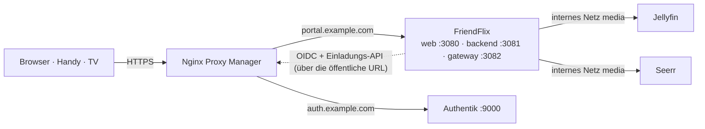

# Installationsanleitung

> **FriendFlix for Plex (Preview):** In FriendFlix for Plex ersetzt [plex.md](plex.md) die Jellyfin-Schritte (Jellyfin-API-Key, Webhook-Plugin, `JELLYFIN_*`-Variablen) durch `MEDIA_SERVER=plex`, `PLEX_URL`, `PLEX_TOKEN` und `compose.plex.yaml`. Alles andere (Authentik, Proxy, `.env`-Grundlagen) gilt unverändert.

[English](../setup.md) · **Deutsch**

Diese Anleitung führt vom leeren Server bis zu einem laufenden FriendFlix mit dem ersten eingeladenen Freund. Sie verwendet den Produktions-Stack ([`compose.prod.yaml`](../../compose.prod.yaml), fertige Images), Authentik für die Anmeldung und Nginx Proxy Manager (NPM) als einzigen öffentlichen Zugang.

Platzhalter in der ganzen Anleitung: `portal.example.com` (FriendFlix), `auth.example.com` (Authentik), `/opt/friendflix` (dein Klon). Durch eigene Werte ersetzen. Echte Secrets nie in Issues, Chats oder Commits einfügen.

## Inhalt

1. [Überblick und Reihenfolge](#1-überblick-und-reihenfolge)
2. [Voraussetzungen](#2-voraussetzungen)
3. [Authentik](#3-authentik)
4. [Jellyfin](#4-jellyfin)
5. [Seerr](#5-seerr)
6. [Die `.env`-Datei](#6-die-env-datei)
7. [Stack starten](#7-stack-starten)
8. [Nginx Proxy Manager: Proxy Host für das Portal](#8-nginx-proxy-manager-proxy-host-für-das-portal)
9. [Erste Anmeldung als Admin](#9-erste-anmeldung-als-admin)
10. [Freunde einladen](#10-freunde-einladen)
11. [Optionale Funktionen](#11-optionale-funktionen)
12. [Checkliste](#12-checkliste)
13. [Fehlersuche](#13-fehlersuche)

## 1. Überblick und Reihenfolge



Das Gesamtbild aus Containern, Netzen und Ports steht in [architecture.md](../architecture.md#containers-and-networks) (englisch).

Die Reihenfolge zählt, weil jeder Schritt einen Wert für den nächsten liefert:

| Schritt | Ergebnis |
|---|---|
| 2. DNS, Docker, NPM | Hostnamen mit TLS |
| 3. Authentik | `OIDC_ISSUER`, `OIDC_CLIENT_ID`, `OIDC_CLIENT_SECRET`, `ADMIN_GROUP`, optional `AUTHENTIK_URL`/`AUTHENTIK_API_TOKEN`/`AUTHENTIK_ENROLL_FLOW` |
| 4. Jellyfin | `JELLYFIN_URL`, `JELLYFIN_ADMIN_API_KEY` |
| 5. Seerr | `SEERR_URL`, `SEERR_API_KEY` |
| 6. `.env` | alle Secrets |
| 7.–8. Stack + NPM | das laufende Portal |
| 9.–10. erste Anmeldung, Einladungen | Admin-Konto, Freunde |

## 2. Voraussetzungen

**Server.** Ein Linux-Host oder eine NAS (z. B. TerraMaster, Synology, Unraid, Mini-PC) mit:

- Docker Engine und dem **Compose-v2**-Plugin (`docker compose version`).
- Etwa 2 GB RAM für FriendFlix (Postgres, Redis, Backend, Gateway, Web) plus 2 GB für Authentik, plus was Jellyfin fürs Transkodieren braucht.
- `git` und `openssl`.
- Zeit per NTP synchronisiert (`timedatectl` → *System clock synchronized: yes*). OIDC-Tokens werden abgelehnt, wenn die Uhren mehr als 30 s auseinanderliegen.

**Domains und DNS.** Zwei Hostnamen, die auf deine öffentliche IP zeigen (A/AAAA-Einträge oder ein DynDNS-Name mit CNAMEs):

- `portal.example.com` → FriendFlix
- `auth.example.com` → Authentik

Ports 80 und 443 vom Router an NPM weitergeleitet. Das FriendFlix-Backend ruft `https://auth.example.com/…` selbst auf; erreicht dein Router seine eigene öffentliche IP nicht von innen (kein NAT-Loopback), lokale DNS-Einträge anlegen (Router, Pi-hole, AdGuard), damit beide Namen auch im Heimnetz auf den NPM-Host zeigen.

**Nginx Proxy Manager** läuft ([Installation](https://nginxproxymanager.com/setup/)), ist auf 80/443 erreichbar und hat eine E-Mail-Adresse für Let's Encrypt. FriendFlix und Authentik veröffentlichen ihre Ports nur auf `127.0.0.1`, NPM muss daher auf demselben Host laufen:

- NPM mit Host-Netzwerk oder nativ installiert: an `127.0.0.1` weiterleiten.
- NPM in einem normalen Bridge-Container: `127.0.0.1` ist dort NPM selbst. `BIND_ADDR` (FriendFlix und Authentik) auf die Bridge-Adresse des Docker-Hosts setzen, z. B. `172.17.0.1`, und an diese Adresse weiterleiten. Nie `0.0.0.0` auf einem Host mit öffentlicher Schnittstelle.

**Repository klonen:**

```bash
sudo mkdir -p /opt/friendflix && sudo chown "$USER" /opt/friendflix
git clone https://github.com/LetsManu/friendflix.git /opt/friendflix
cd /opt/friendflix
```

## 3. Authentik

Siehe **[docs/de/authentik.md](authentik.md)**. Kurz:

1. Authentik installieren (`compose.authentik.yaml` oder die offizielle Compose-Datei), NPM-Proxy-Host `auth.example.com` anlegen, Admin-Konto einrichten, optional SMTP.
2. [`deploy/authentik/friendflix-blueprint.yaml`](../../deploy/authentik/friendflix-blueprint.yaml) importieren (Registrierungs-Flow + Service-Account + API-Token).
3. Die Gruppen `friendflix-admins` (dich selbst aufnehmen) und optional `friendflix-users` anlegen.
4. OAuth2/OpenID-Provider und Anwendung mit Slug `friendflix` anlegen, Redirect-URI `https://portal.example.com/auth/callback`.
5. MFA im Authentifizierungs-Flow zur Pflicht machen.
6. Client-ID, Client-Secret und API-Token für Schritt 6 notieren.

## 4. Jellyfin

FriendFlix spricht mit Jellyfin über das interne Docker-Netz `friendflix_media`; Jellyfin ist nie öffentlich erreichbar.

**A) Bestehendes Jellyfin** (eigener Container oder Stack): Den API-Key unten in der gewohnten Weboberfläche anlegen. Nachdem der FriendFlix-Stack einmal gestartet wurde ([Schritt 7](#7-stack-starten) legt das Netz `friendflix_media` an), den Container anhängen:

```bash
docker network connect friendflix_media <jellyfin-container>
docker compose -f compose.prod.yaml restart backend gateway
```

`JELLYFIN_URL=http://<jellyfin-containername>:8096`. Ein `docker network connect` überlebt das Neuerstellen des Jellyfin-Containers nicht; dauerhaft wird es, wenn du `friendflix_media` in Jellyfins eigener Compose-Datei als Netz mit `external: true` einträgst. Sobald FriendFlix läuft, Jellyfins öffentliches Port-Mapping und einen eventuellen öffentlichen Proxy Host entfernen (oder zumindest per Firewall sperren, siehe [operations.md](../operations.md#host-firewall-zusätzlich-zum-fehlenden-port-mapping)).
Läuft Jellyfin nativ auf dem Host (nicht in Docker), erreicht das Backend kein `localhost`; Jellyfin in einen Container packen oder über die Bridge-IP des Hosts anbinden *(von den mitgelieferten Compose-Dateien nicht abgedeckt)*.

**B) Mitgeliefertes Jellyfin** (`--profile bundled`): Die Container `jellyfin` und `seerr` starten im Stack, ganz ohne Ports. Compose prüft alle Pflichtvariablen, auch wenn nur einzelne Dienste starten; daher zuerst die `.env` anlegen ([Schritt 6](#6-die-env-datei)) und in `JELLYFIN_ADMIN_API_KEY` und `SEERR_API_KEY` einen Platzhalter wie `pending` eintragen. Für die einmaligen Einrichtungsassistenten beide Dienste vorübergehend auf Loopback veröffentlichen, mit einer lokalen Override-Datei (nicht committen):

```yaml
# compose.setup.yaml - VORÜBERGEHEND, nach den Assistenten wieder entfernen
services:
  jellyfin:
    ports: ["127.0.0.1:8096:8096"]
    networks: [media, egress, front]
  seerr:
    ports: ["127.0.0.1:5055:5055"]
    networks: [media, egress, front]
```

```bash
MEDIA_PATH=/mnt/data/media docker compose -f compose.prod.yaml -f compose.setup.yaml --profile bundled up -d jellyfin seerr
ssh -L 8096:127.0.0.1:8096 -L 5055:127.0.0.1:5055 du@server     # vom eigenen PC; dann http://localhost:8096 öffnen
```

(`MEDIA_PATH` kann auch in die `.env`; es wird in Jellyfin schreibgeschützt unter `/media` eingebunden.) Assistenten abschließen, dann ohne `compose.setup.yaml` neu starten, damit die Ports verschwinden. `JELLYFIN_URL=http://jellyfin:8096`.

**In Jellyfin:**

1. Einrichtungsassistent abschließen: Admin-Nutzer, Metadaten-Sprache, Bibliotheken (Filme, Serien …). Die Bibliotheksnamen sind nur wichtig, wenn du Rollen auf bestimmte Bibliotheken beschränkst (`ROLE_TEMPLATES`).
2. *Dashboard → API Keys* (in neueren Versionen unter *Dashboard → Advanced → API Keys*) → **+** → App-Name `FriendFlix` → Schlüssel kopieren → `JELLYFIN_ADMIN_API_KEY`. Der Schlüssel hat Admin-Rechte: FriendFlix legt damit pro Portal-Nutzer einen Jellyfin-Nutzer an (Zufallspasswort, mit `APP_ENC_KEY` verschlüsselt gespeichert) und setzt die Rollen-Policies.
3. Optional: das Webhook-Plugin für sofortige „läuft gerade“- und „neu in der Bibliothek“-Ereignisse, siehe [integrations.md](../integrations.md#jellyfin-webhook-plugin-optional-polling-sessions-every-10-s-is-the-fallback).
4. Hardware-Transkodierung wie für deine Hardware üblich (Intel QSV/VAAPI: Hinweis zu „VPP Tone mapping“ in der README beachten).

## 5. Seerr

1. Seerr öffnen (bestehende Instanz oder `http://localhost:5055` über den Tunnel oben) und den Assistenten mit **Jellyfin** als Medienserver abschließen: URL `http://jellyfin:8096` (mitgeliefert) bzw. dein Containername, dazu ein Jellyfin-Admin-Login. Bibliotheken synchronisieren, ggf. Radarr/Sonarr hinzufügen.
2. *Settings → General* → **API Key** kopieren → `SEERR_API_KEY`. `SEERR_URL=http://seerr:5055` (mitgeliefert) bzw. `http://<seerr-container>:5055` nach `docker network connect friendflix_media <seerr-container>`.
3. *Settings → Users*: den automatischen Jellyfin-Nutzerimport ausschalten (FriendFlix-Profile sind versteckte Jellyfin-Nutzer und tauchten sonst auf). Auto-Approve aus lassen, wenn du jeden Wunsch freigeben willst.
4. Webhook für „Wunsch freigegeben/verfügbar“: siehe [integrations.md](../integrations.md#seerr).

## 6. Die `.env`-Datei

```bash
cp .env.example .env
chmod 600 .env
```

Jedes Secret einzeln erzeugen, keinen Wert für zwei Variablen verwenden. Für die Datenbank- und Redis-Passwörter **hex** nehmen: Sie stehen in Verbindungs-URLs, wo `/`, `+` und `=` aus base64 stören würden.

| Variable | Pflicht | Wert / Erzeugung |
|---|---|---|
| `PUBLIC_URL` | ja | `https://portal.example.com`, ohne Pfad. Muss genau die URL sein, die alle benutzen (Cookies, Redirect-URI, Origin-Prüfung der WebSockets). |
| `BIND_ADDR` | – | `127.0.0.1` (Standard) oder die Docker-Bridge-IP, wenn NPM in einem Bridge-Container läuft |
| `WEB_PORT`, `BACKEND_PORT`, `GATEWAY_PORT` | – | `3080`, `3081`, `3082` (Standard); nur ändern, wenn belegt |
| `POSTGRES_PASSWORD` | ja | `openssl rand -hex 24` |
| `REDIS_PASSWORD` | ja | `openssl rand -hex 24` |
| `APP_ENC_KEY` | ja | `openssl rand -base64 32` (44 Zeichen). Verschlüsselt die gespeicherten Jellyfin-Zugangsdaten. **Im Passwort-Manager ablegen**; ohne ihn ist eine wiederhergestellte Datenbank wertlos. |
| `INTERNAL_SECRET` | ja | `openssl rand -hex 24` (mind. 16 Zeichen); Backend ↔ Gateway |
| `WEBHOOK_SECRET` | ja | `openssl rand -hex 24`; Jellyfin-/Seerr-Webhooks |
| `OIDC_ISSUER` | ja | `https://auth.example.com/application/o/friendflix/` **mit Schrägstrich am Ende** |
| `OIDC_CLIENT_ID`, `OIDC_CLIENT_SECRET` | ja | aus dem Authentik-Provider |
| `ADMIN_GROUP` | – | `friendflix-admins` (Standard); Name der Authentik-Gruppe, Groß-/Kleinschreibung zählt |
| `JELLYFIN_URL` | ja | `http://jellyfin:8096` (interner Name, nie die öffentliche URL) |
| `JELLYFIN_ADMIN_API_KEY` | ja | aus Schritt 4 |
| `SEERR_URL` | ja | `http://seerr:5055` |
| `SEERR_API_KEY` | ja | aus Schritt 5 |
| `AUTHENTIK_URL`, `AUTHENTIK_API_TOKEN`, `AUTHENTIK_ENROLL_FLOW` | empfohlen | `https://auth.example.com`, der Token-Schlüssel, `friendflix-enrollment`; alle drei oder keine ([authentik.md §9](authentik.md#9-werte-für-die-friendflix-env)) |
| `SESSION_TTL_SECONDS`, `SESSION_IDLE_SECONDS` | – | `28800` (8 h absolut), `7200` (2 h Leerlauf) |
| `TZ` | – | z. B. `Europe/Vienna`; Zeitpläne (Wochenrückblick, Wiedergabe-Check, Backups) |
| `METRICS_TOKEN` | – | `openssl rand -hex 24`, wenn `/metrics` abgefragt wird ([monitoring.md](../monitoring.md)) |
| `FF_REGISTRY`, `FF_TAG` | – | `ghcr.io/letsmanu`, `latest`; Version mit Commit-SHA oder `x.y.z` festlegen |

Alles andere (Downloads, Push, ntfy, Portainer, Backups) ist optional und in [Abschnitt 11](#11-optionale-funktionen) sowie in der [Konfigurationstabelle der README](../../README.de.md#konfiguration) beschrieben.

Schnell die Secrets füllen:

```bash
for v in POSTGRES_PASSWORD REDIS_PASSWORD INTERNAL_SECRET WEBHOOK_SECRET; do
  sed -i "s|^$v=.*|$v=$(openssl rand -hex 24)|" .env
done
sed -i "s|^APP_ENC_KEY=.*|APP_ENC_KEY=$(openssl rand -base64 32)|" .env
grep -E '^(POSTGRES_PASSWORD|REDIS_PASSWORD|APP_ENC_KEY|INTERNAL_SECRET|WEBHOOK_SECRET)=' .env | cut -c1-24   # Kontrolle, ohne ganze Secrets auszugeben
```

Danach die URLs und die Schlüssel aus Authentik, Jellyfin und Seerr von Hand eintragen.

**Docker-Secrets statt `.env`** (optional): [`compose.secrets.yaml`](../../compose.secrets.yaml) liest `APP_ENC_KEY`, `INTERNAL_SECRET`, `WEBHOOK_SECRET`, `OIDC_CLIENT_SECRET`, `JELLYFIN_ADMIN_API_KEY`, `SEERR_API_KEY` und `VAPID_PRIVATE_KEY` aus Dateien in `secrets/` (alle müssen existieren; ohne Push `touch secrets/vapid_private_key`). Start mit `docker compose -f compose.prod.yaml -f compose.secrets.yaml up -d`.

## 7. Stack starten

```bash
docker login ghcr.io -u <github-nutzer>                 # nur bei privaten Paketen (PAT mit read:packages)
docker compose -f compose.prod.yaml up -d               # mit --profile bundled für das mitgelieferte Jellyfin + Seerr
docker compose -f compose.prod.yaml ps                  # postgres/redis healthy, backend/gateway/web laufen
docker compose -f compose.prod.yaml logs -f backend     # Migrationen, dann "Server listening"
curl -s http://127.0.0.1:3081/health/ready              # Postgres, Redis und Jellyfin erreichbar
```

Startet das Backend in einer Schleife neu, den ersten Fehler im Log lesen: eine fehlende oder ungültige Variable (die Konfigurationsprüfung nennt sie) oder eine fehlgeschlagene OIDC-Discovery (siehe [Fehlersuche](#13-fehlersuche)).

## 8. Nginx Proxy Manager: Proxy Host für das Portal

*Hosts → Proxy Hosts → Add Proxy Host*:

| Reiter | Feld | Wert |
|---|---|---|
| Details | Domain Names | `portal.example.com` |
| | Scheme | `http` |
| | Forward Hostname / IP | `127.0.0.1` (bzw. dein `BIND_ADDR`) |
| | Forward Port | `3080` (`WEB_PORT`, die SvelteKit-Oberfläche) |
| | Cache Assets | aus |
| | Block Common Exploits | an |
| | Websockets Support | **an** |
| SSL | SSL Certificate | Request a new Let's Encrypt certificate |
| | Force SSL, HTTP/2 Support, HSTS Enabled | an |
| Advanced | Custom Nginx Configuration | der komplette Inhalt von [`deploy/npm/portal.advanced.conf`](../../deploy/npm/portal.advanced.conf) |

Die Advanced-Konfiguration leitet `/api/`, `/auth/` und `/ws/` ans Backend (`:3081`), `/media/` ans Gateway (`:3082`, ungepuffert, mit HTTP-Range), hält `/media/c/` (Chromecast-Tokens) aus den Logs heraus und beantwortet `/internal/`, `/metrics` und `/health/ready` mit 404. Wer `BIND_ADDR` oder die Ports geändert hat, passt `127.0.0.1:3081`/`:3082` im eingefügten Text an. Den `/media/c/`-Block auch ohne Chromecast stehen lassen.

Das Backend vertraut `X-Forwarded-*`-Headern (`trustProxy`), NPM muss daher der einzige Zugang sein: Die Ports bleiben auf `BIND_ADDR`.

## 9. Erste Anmeldung als Admin

1. `https://portal.example.com` öffnen und auf Anmelden klicken. Authentik fragt Benutzername und Passwort ab und verlangt beim ersten Mal die Einrichtung von TOTP oder einem Passkey.
2. Weil du in `friendflix-admins` (`ADMIN_GROUP`) bist, legt FriendFlix dein Konto ohne Einladung mit der Rolle **admin** an, dazu einen Jellyfin-Nutzer und dein Hauptprofil. Dein erstes Gerät ist automatisch freigegeben; weitere Geräte müssen unter *Geräte* freigegeben werden.
3. **Sprache der Instanz:** FriendFlix fragt den ersten Admin einmal, welche Sprache die ganze Instanz standardmäßig nutzt (Englisch, Deutsch, Französisch, Spanisch, Italienisch, Türkisch, Polnisch). Jedes Profil kann später seine eigene Sprache wählen; neue Profile werden bei der ersten Anmeldung gefragt, mit der Browsersprache als Vorschlag.
4. Im *Admin*-Bereich umsehen: die **Übersicht** (Zustand von Medienserver und Wunsch-Dienst, offene Entscheidungen, letzte Aktivität), Rollen und Limits, Wochenrückblick. Unter *Inhalte* lassen sich **Marken-Hubs** anlegen, Themenlisten auf der Startseite anheften und Bald-weg-Termine setzen; das Hauptprofil legt Kinderprofile unter *Profile* an.

## 10. Freunde einladen

*Admin → Einladungen*:

1. Rolle wählen (`friend`, `family` oder `guest`; die Limits sind unter *Admin* änderbar), Gültigkeit des Links (Standard 48 h, max. 14 Tage) und optional eine Notiz.
2. **hat schon ein Authentik-Konto** für neue Leute nicht ankreuzen. Erstellen.
3. Der Einmal-Link wird nur jetzt angezeigt. Darunter muss stehen: *Der Link führt durch die Konto-Erstellung (inkl. Zwei-Faktor) und schaltet den Zugang direkt frei.* Sonst ist die Authentik-Einladung nicht eingerichtet; siehe [authentik.md §15](authentik.md#15-fehlersuche).
4. Link verschicken. Der Freund öffnet ihn, klickt **Konto anlegen & loslegen**, registriert sich in Authentik (inklusive MFA) und landet eingeloggt im Portal.

Für jemanden mit bestehendem Authentik-Konto **hat schon ein Authentik-Konto** ankreuzen: Der Link bietet dann **Anmelden & freischalten** an. Unbenutzte Einladungen lassen sich in der Liste widerrufen; das löscht auch die Authentik-Einladung.

## 11. Optionale Funktionen

| Funktion | Was zu tun ist | Details |
|---|---|---|
| **Offline-Downloads** | Standardmäßig an (`DOWNLOADS_ENABLED=true`). Für eine eigene Platte: `mkdir -p /mnt/data/friendflix/downloads /mnt/data/friendflix/previews && chown 1000:1000 /mnt/data/friendflix/{downloads,previews}`, dann `DOWNLOADS_PATH=…`, `PREVIEWS_PATH=…`. Ordner **vor** dem Start anlegen und `chown` setzen, sonst legt Docker sie als root an und das Backend loggt `EACCES`. Downloads je Rolle unter *Admin* erlauben. | [downloads.md](../downloads.md) |
| **Web-Push** | `node scripts/gen-vapid.mjs` (oder `npx web-push generate-vapid-keys`) → `VAPID_PUBLIC_KEY`, `VAPID_PRIVATE_KEY`, optional `VAPID_SUBJECT=mailto:du@example.com`. Das Schlüsselpaar stabil halten. Braucht HTTPS; unter iOS muss die Seite zum Home-Bildschirm hinzugefügt werden. | [integrations.md](../integrations.md#web-push-browser-notifications) |
| **ntfy / Discord** | `NTFY_URL=https://ntfy.example.com/friendflix` und/oder `DISCORD_WEBHOOK_URL=…` für den gemeinsamen Kanal; `NTFY_BASE_URL` für persönliche Themen. | [integrations.md](../integrations.md#ntfy--discord) |
| **Chromecast** | Standardmäßig an (`CAST_ENABLED=true`). Braucht eine https-`PUBLIC_URL` mit öffentlich gültigem Zertifikat, die der Chromecast erreicht, und den `/media/c/`-Block aus `portal.advanced.conf`. | [cast.md](../cast.md) |
| **TV-Modus** | Nichts einzurichten: `https://portal.example.com/tv` am Fernseher öffnen und mit dem Handy koppeln. | [tv-mode.md](../tv-mode.md) |
| **Datenbank-Backups** | `mkdir -p backups && sudo chown 70 backups`, dann `docker compose -f compose.prod.yaml --profile backup up -d backup` (`BACKUP_HOUR`, `BACKUP_KEEP_DAYS`, `BACKUP_PATH`). Authentik separat sichern ([authentik.md §2.6](authentik.md#26-backups-und-updates)) und `APP_ENC_KEY` im Passwort-Manager ablegen. | [operations.md](../operations.md#backups--wiederherstellung) |
| **Updates per Klick** | *Admin → Update* deployt über **Portainer** neu: entweder `PORTAINER_WEBHOOK_URL` (Stack-Webhook) oder `PORTAINER_URL` + `PORTAINER_API_KEY` + `PORTAINER_STACK_ID` (+ `PORTAINER_ENDPOINT_ID`, Standard `1`). Einen Portainer-Nutzer verwenden, der nur dieses eine Stack neu deployen darf. FriendFlix bekommt bewusst nie den Docker-Socket: **`/var/run/docker.sock` in keinen FriendFlix-Container einbinden**, die Web-App darf Docker nicht steuern können. | [operations.md](../operations.md#updates-aus-dem-portal) |
| **Monitoring** | `METRICS_TOKEN`, Beispiele für Prometheus/Icinga; optionaler Prometheus-+-Grafana-Stack: `GRAFANA_ADMIN_PASSWORD` setzen (kein Standardpasswort) und `-f compose.monitoring.yaml` ergänzen. | [monitoring.md](../monitoring.md) |
| **Plan B** | NPM liefert `/media/` selbst aus (`auth_request`); dann `DOWNLOADS_ENABLED=false`, `CAST_ENABLED=false`. | [operations.md](../operations.md#plan-b-npm-liefert-media-direkt-auth_request) |

Nach Änderungen an der `.env`: `docker compose -f compose.prod.yaml up -d` (erstellt nur neu, was sich geändert hat).

## 12. Checkliste

- [ ] `docker compose -f compose.prod.yaml ps`: alle Dienste laufen, `postgres`/`redis` (und `backup`) healthy.
- [ ] `curl -s http://127.0.0.1:3081/health/ready` meldet Postgres, Redis und Jellyfin OK.
- [ ] `curl -sI https://portal.example.com` → `200`, gültiges Zertifikat, Header `strict-transport-security`.
- [ ] `curl -s -o /dev/null -w '%{http_code}\n' https://portal.example.com/internal/x` → `404`; ebenso `/metrics`.
- [ ] Von außerhalb deines Netzes: `nmap -p 3080-3082,8096,5055,9000 <öffentliche-IP>` → alle filtered/closed.
- [ ] `curl -s https://auth.example.com/application/o/friendflix/.well-known/openid-configuration | jq -r .issuer` entspricht `OIDC_ISSUER`.
- [ ] Admin-Anmeldung klappt, MFA wird abgefragt, *Admin* ist sichtbar.
- [ ] Eine Test-Einladung im privaten Fenster endet eingeloggt im Portal; der Nutzer erscheint unter *Admin → Nutzer* und in Jellyfin.
- [ ] Ein Film läuft (Direct Play und eine erzwungene niedrigere Qualität → Transkodierung), Untertitel und Spulen funktionieren.
- [ ] Optional: Test-Push, ein Download, Casten, eine Backup-Datei in `backups/`.

## 13. Fehlersuche

| Symptom | Ursache / Lösung |
|---|---|
| Authentik zeigt einen Redirect-URI-Fehler | Die Redirect-URI im Provider muss exakt `${PUBLIC_URL}/auth/callback` sein (Schema, Host, kein Schrägstrich am Ende). FriendFlix muss an der Wurzel seines Hostnamens laufen. |
| Backend startet in Schleife neu, `"issuer" property does not match the expected value` | `OIDC_ISSUER` braucht den Schrägstrich am Ende und genau den Slug der Anwendung. |
| Backend startet in Schleife neu, `fetch failed` / `ENOTFOUND` beim Start | Der Backend-Container erreicht `auth.example.com` nicht: DNS im Heimnetz, NAT-Loopback, Firewall. Testen mit `docker compose -f compose.prod.yaml run --rm --no-deps backend node -e "fetch('https://auth.example.com').then(r=>console.log(r.status))"`. Notlösung: ein lokales Override ergänzt beim `backend` `extra_hosts: ["auth.example.com:host-gateway"]`, wenn NPM auf Port 443 des Hosts lauscht. |
| Backend lehnt einen `http://`-Issuer ab | `openid-client` akzeptiert nur https. `OIDC_ALLOW_INSECURE=true` ist für die Entwicklung gegen ein lokales Authentik, nie für den Betrieb. |
| `{"error":"login_failed"}` nach Authentik | Falsches Client-Secret, Encryption Key am Provider gesetzt oder Uhrenabweichung > 30 s zwischen den Hosts (NTP aktivieren). Die Backend-Logzeile `oidc callback failed` nennt den Grund. |
| `{"error":"invalid_state"}` | Login auf einer anderen Adresse als `PUBLIC_URL` gestartet (LAN-IP, `http://`), Browser hat das Cookie blockiert oder der Login dauerte länger als 10 Minuten. Immer `PUBLIC_URL` verwenden. |
| Login springt zur Startseite zurück / nicht eingeloggt | `PUBLIC_URL` ist `https://…`, die Seite wurde aber über `http://` oder eine IP geöffnet: Das Sitzungs-Cookie ist `Secure` und gilt nur für diesen Host. In NPM *Force SSL* aktivieren. |
| `403 {"error":"csrf"}` bei Aktionen | Veraltete Seite nach neuer Anmeldung in einem anderen Tab: neu laden. Dauerhaft: NPM muss `/api/` unverändert ans Backend weitergeben (`portal.advanced.conf` verwenden), und kein Cache dazwischen darf Header entfernen. |
| Watch-Party / Fernbedienung verbindet nicht (WebSocket schließt mit 4401) | Der `Origin` des Browsers muss `PUBLIC_URL` entsprechen; *Websockets Support* an und der `/ws/`-Block in NPM vorhanden. |
| `{"error":"no_invite"}` | Erste Anmeldung ohne Einladung und nicht in `ADMIN_GROUP`. Siehe [authentik.md §15](authentik.md#15-fehlersuche). |
| 502 Bad Gateway von NPM für die ganze Seite | NPM erreicht `BIND_ADDR:3080/3081/3082` nicht: falsche Weiterleitungs-IP (Bridge-Container → IP des Docker-Hosts), Container laufen nicht oder `BIND_ADDR` weicht von der IP in Proxy Host/Advanced-Konfiguration ab. |
| 502/504 nur für `/media/…` oder „Jellyfin nicht erreichbar“ im Admin-Status | Gateway/Backend erreichen `JELLYFIN_URL` nicht: Jellyfin hängt nicht an `friendflix_media` (`docker network connect friendflix_media <jellyfin>`), falscher Containername oder Jellyfin läuft nicht. Prüfen mit `docker compose -f compose.prod.yaml exec gateway node -e "fetch(process.env.JELLYFIN_URL+'/System/Info/Public').then(r=>console.log(r.status))"`. |
| Downloads scheitern mit `EACCES` | `DOWNLOADS_PATH`/`PREVIEWS_PATH` gehört nicht uid 1000: `chown 1000:1000 <ordner>`. |
| Backup-Container `unhealthy` | `docker compose -f compose.prod.yaml logs backup`; meist ist `backups/` für uid 70 nicht beschreibbar. |

Mehr: [operations.md](../operations.md) (Backups, Firewall, Updates), [integrations.md](../integrations.md) (Webhooks, Push), [authentik.md](authentik.md#15-fehlersuche) (Anmeldung und Einladungen).
