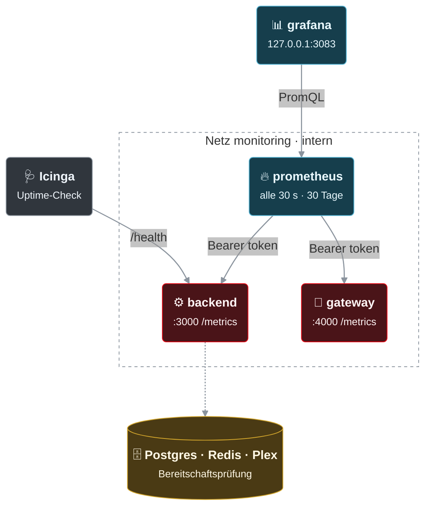

# Monitoring (Icinga / Prometheus / Grafana)

> **FriendFlix for Plex (Preview):** Wo hier „Jellyfin“ steht, ist bei Plex der Plex-Medienserver gemeint (`/health/ready` prüft ihn). Einrichtung: [de/plex.md](de/plex.md).

Endpunkte (nur lokal auf dem Docker-Host erreichbar: Ports sind an `127.0.0.1` gebunden; NPM antwortet für `/metrics` und `/health/ready` mit 404):
| URL | Zweck |
|---|---|
| `http://127.0.0.1:3081/health` | Liveness |
| `http://127.0.0.1:3081/health/ready` | Readiness: Redis, Postgres, Jellyfin (503 bei Problem) |
| `http://127.0.0.1:3081/metrics` | Prometheus (Bearer `METRICS_TOKEN`, falls gesetzt) |
| `http://127.0.0.1:3082/metrics` | Gateway-Durchsatz |

Wichtige Metriken: `friendflix_active_streams`, `friendflix_gateway_bytes_total` (Durchsatz = `rate()`), `friendflix_gateway_active_streams`, `friendflix_gateway_requests_total{code}`, `friendflix_dependency_up{dependency}`, `friendflix_users_total`, `friendflix_pending_devices`, `friendflix_pending_polls`, `friendflix_party_rooms`, `friendflix_client_errors_total{kind}` (Browser-Fehler, siehe unten).

Weitere Metriken: `friendflix_http_requests_total{method,status}` (Status als Klasse `2xx`…`5xx`), `friendflix_gateway_download_bytes_total`, `friendflix_gateway_cast_requests_total{code}`, `friendflix_download_jobs{status}`, `friendflix_download_disk_bytes`, `friendflix_authz_nginx_total{result}` (nur Plan B) sowie die Node.js-Standardmetriken des Backends mit Präfix `friendflix_` (`friendflix_process_cpu_seconds_total`, `friendflix_nodejs_eventloop_lag_p99_seconds`, …).

## Prometheus + Grafana (optional)
`compose.monitoring.yaml` ergänzt den Stack um Prometheus und Grafana mit fertigem Dashboard ([deploy/grafana/friendflix.json](../deploy/grafana/friendflix.json)):

So hängt es zusammen:



> 🟥 FriendFlix · 🟩 Medienserver · 🟦 weitere Dienste · 🟪 Reverse-Proxy · 🟨 Datenspeicher · ⬛ Zuschauer / extern · gestrichelter Rahmen = Netz bzw. Grenze · dicke Linie = Videostream · gepunktet = optional / über öffentliche URL

```bash
# .env: METRICS_TOKEN=<openssl rand -hex 32>   GRAFANA_ADMIN_PASSWORD=<langes Passwort>   (beides Pflicht, es gibt kein Standardpasswort)
docker compose -f compose.prod.yaml -f compose.monitoring.yaml up -d      # bzw. -f compose.yaml -f compose.monitoring.yaml
ssh -L 3083:127.0.0.1:3083 docker-host                                   # dann http://localhost:3083, Login GRAFANA_ADMIN_USER (admin)
```
- **Netz:** Prometheus hängt nur im internen Netz `monitoring` (kein Internet, kein Host-Port) und erreicht dort `backend:3000` und `gateway:4000`; beide Dienste treten diesem Netz durch das Overlay bei. Grafana ist zusätzlich im Netz `monitoring-ui` und nur auf `127.0.0.1:${GRAFANA_PORT:-3083}` veröffentlicht. Für Zugriff über NPM: eigener Proxy-Host mit Access-List auf `127.0.0.1:3083`, `GRAFANA_ROOT_URL=https://grafana.example.com/` und `GRAFANA_COOKIE_SECURE=true` setzen.
- **Token:** `METRICS_TOKEN` gelangt als Compose-Secret nach `/run/secrets/metrics_token` (aus der Umgebung, nicht in der Prometheus-Konfiguration). Deshalb läuft Prometheus nicht mit `read_only` (Compose schreibt das Secret beim Start in den Container), aber als `nobody` ohne Capabilities.
- **Grafana:** Datenquelle (`uid: prometheus`) und Dashboard werden aus `deploy/grafana/provisioning/` geladen; Änderungen im UI am Dashboard nicht speichern, sondern JSON exportieren und `deploy/grafana/friendflix.json` ersetzen. `GRAFANA_ADMIN_PASSWORD` gilt nur beim ersten Start (wenn Grafana seine Datenbank anlegt); später im UI ändern oder `docker compose exec grafana grafana cli admin reset-admin-password <neu>`. Selbstregistrierung, anonymer Zugriff, Telemetrie, Update-Checks und Plugin-Downloads sind abgeschaltet.
- **Aufbewahrung:** `PROMETHEUS_RETENTION` (Default `30d`), Daten in den Volumes `prometheus` und `grafana`. Scrape-Intervall 30 s (`deploy/prometheus/prometheus.yml`); jeder Backend-Scrape fragt Postgres, Redis und Jellyfin kurz ab.
- Die Dateien werden aus `./deploy` gemountet, der Host braucht also den Checkout des Repos (wie für `compose.prod.yaml`). Ein vorhandenes Prometheus/Grafana kann stattdessen den Scrape-Block unten nutzen und das Dashboard importieren (*Dashboards → New → Import*; Variablen `backend_job`/`gateway_job` auf die eigenen Job-Namen setzen).

**Dashboard „FriendFlix“:** Abhängigkeiten (Postgres/Redis/Jellyfin erreichbar), Scrape-Status, aktive Streams (Backend-Sicht und offene Gateway-Antworten), Gateway-Durchsatz (Streaming und Downloads), Nutzer, Watch-Party-Räume, wartende Geräte/Abstimmungen; Backend-Anfragen nach Statusklasse und Methode, 4xx/5xx-Anteil; Gateway- und Chromecast-Antworten nach Statuscode; abgelehnte Medienanfragen (401/403, Plan-B-Entscheidungen); Download-Jobs nach Status und belegter Platz; Browser-Fehler nach Art; CPU, Speicher und Event-Loop-Verzögerung des Backends.

**Was es (noch) nicht als Metrik gibt** – das Dashboard zeigt nur vorhandene Metriken: Latenz pro Route (dafür `Server-Timing` und das `slow request`-Log, siehe unten), Wiedergabe-Starts/-Fehler, Antwortzeiten des Medienservers (nur Erreichbarkeit über `friendflix_dependency_up{dependency="jellyfin"}`) und fehlgeschlagene Logins (Audit-Log). Abgelehnte Medienanfragen sind der nächstliegende Ersatz für Auth-Fehler.

## Icinga-Beispiele
```
# Zertifikat des öffentlichen Hosts (NPM / Let's Encrypt): Warnung < 21 Tage, kritisch < 7 Tage
object Service "friendflix-cert" { host_name = "docker-host"; check_command = "http"
  vars.http_address = "portal.example.com"; vars.http_ssl = true; vars.http_certificate = "21,7" }

# Öffentliche Erreichbarkeit der UI
object Service "friendflix-ui" { host_name = "docker-host"; check_command = "http"
  vars.http_address = "portal.example.com"; vars.http_ssl = true; vars.http_uri = "/"; vars.http_expect = "200" }

# Interne Readiness (vom Docker-Host aus; Container-IP oder `docker exec`)
object Service "friendflix-ready" { host_name = "docker-host"; check_command = "http"
  vars.http_address = "127.0.0.1"; vars.http_port = 3081; vars.http_uri = "/health/ready"; vars.http_expect = "200" }

# Aktive Streams / Gateway-Durchsatz: check_prometheus_query o. ä. (Prometheus) oder check_http mit -r auf /metrics
#   friendflix_active_streams > 8  -> WARNING (je nach Upstream-Bandbreite)
#   rate(friendflix_gateway_bytes_total[5m]) * 8 > 0.8 * <Upload in bit/s> -> WARNING
```
Prometheus-Scrape:
```yaml
- job_name: friendflix
  authorization: { credentials: "<METRICS_TOKEN>" }
  static_configs: [{ targets: ["127.0.0.1:3081", "127.0.0.1:3082"] }]
```

## Browser-Fehler
Die Web-App meldet unbehandelte Fehler an das Backend, damit kaputte Releases auffallen, ohne dass jemand die Browser-Konsole der Freunde lesen muss.

**Was gemeldet wird** (`web/src/lib/telemetry.ts`, registriert in `web/src/hooks.client.ts`): `window` `error` (`kind: error`), `unhandledrejection`, fehlgeschlagene `<script>`/`<link>`-Ladevorgänge (`kind: resource`) und Fehler, die SvelteKit in `handleError` abfängt. Pro Seitenaufruf höchstens 10 Meldungen, identische Meldungen (Art + Text) werden 60 Sekunden lang unterdrückt. Ignoriert werden Fehler aus Browser-Erweiterungen (`chrome-extension://`, `moz-extension://`, `safari-web-extension://` im Stack), die harmlosen `ResizeObserver loop …`-Warnungen und das nichtssagende `Script error.` ohne Stack. Versendet wird per `navigator.sendBeacon` (überlebt auch das Schließen des Tabs), Ersatz ist `fetch` mit `keepalive`.

**Backend** (`POST /api/client-errors`): ohne Login erreichbar (Fehler passieren auch auf Login- und Offline-Seite) und von der CSRF-Prüfung ausgenommen wie `/api/tv/code`, weil `sendBeacon` keinen `x-csrf-token`-Header setzen kann. Body: JSON als `text/plain` (kein CORS-Preflight) mit `message` (≤ 500), `stack` (≤ 4000, optional), `url` (≤ 500, nur Pfad), `userAgent` (≤ 300), `kind` (`error` | `unhandledrejection` | `resource`), `release` (≤ 40, optional). Antwort `204`; `400` bei ungültigem Body; `403` bei fremdem `Origin`; `429` über dem Limit (20 pro Minute und IP, 200 pro Stunde und angemeldetem Nutzer bzw. IP).

**Datenschutz:** Es wird nichts gespeichert. Das Backend schreibt pro Meldung eine Logzeile `level=warn`, `msg="client error"` mit dem Objekt `clientError` (`kind`, `message`, `stack`, `url`, `userAgent`, `release`). Vorher werden Query-Strings und Fragmente entfernt, ebenso `token=`/`code=`/`key=`-Werte, E-Mail-Adressen, Bearer-/JWT-Werte und lange zufällige Tokens (≥ 40 Zeichen). 32-stellige Jellyfin-IDs bleiben absichtlich erhalten, damit man den betroffenen Titel findet.

**Auswerten:**
```sh
# häufigste Browser-Fehler der letzten 24 h (Backend-Logs sind JSON; jq erforderlich)
docker compose logs backend --since 24h --no-log-prefix 2>&1 | grep '"client error"' | jq -r '.clientError | "\(.kind)\t\(.url)\t\(.message)"' | sort | uniq -c | sort -rn | head
```
Prometheus: `sum(increase(friendflix_client_errors_total[1h])) by (kind)`. Als Icinga-Warnung eignet sich z. B. `sum(increase(friendflix_client_errors_total[15m])) > 20` (nach einem Deployment: neue Fehlerart oder kaputtes Bundle, `kind="resource"` deutet auf ein nicht ausgeliefertes JS-/CSS-Asset hin). Die Zähler laufen nur bei akzeptierten Meldungen; das Rate-Limit begrenzt, wie viel ein einzelner Client beitragen kann.

## Ladezeiten messen

**Server-Timing im Browser.** Jede API-Antwort des Backends trägt einen `Server-Timing`-Header, z. B.
```
Server-Timing: jf;dur=212.4;desc="3 calls", db;dur=4.1;desc="5 calls", kv;dur=0.9;desc="2 calls", app;dur=231.7
```
| Eintrag | Bedeutung |
|---|---|
| `jf` | Zeit bis zu den Antwort-Headern aller Jellyfin-Aufrufe dieser Anfrage (Summe; parallele Aufrufe überlappen, die Summe kann daher größer als `app` sein) und deren Anzahl |
| `db` | Postgres-Abfragen (Summe, Anzahl; Transaktionen über `pool.connect()` zählen nicht mit) |
| `kv` | Redis-Aufrufe (Sitzung, Caches) |
| `app` | Gesamtzeit im Backend vom Eingang der Anfrage bis zum Absenden (ohne Komprimierung und Netzwerk) |

Einträge ohne Aufrufe fehlen. Das Gateway setzt auf Playlists, Segmente und Bildern `Server-Timing: authz;dur=…, upstream;dur=…`: `authz` ist die Sitzungsprüfung (gecacht ≈ 0 ms, sonst ein Aufruf von `/internal/authz`), `upstream` die Zeit bis zu den Antwort-Headern von Jellyfin (Transcoder-Start, Bild skalieren).

Ansehen: Chrome/Edge DevTools → **Network** → Anfrage anklicken → Reiter **Timing**, Abschnitt *Server Timing*; Firefox → **Netzwerkanalyse** → Anfrage → **Zeitmessung**. In der Spalte *Waiting for server response* (TTFB) steckt die Backend-Zeit plus eine Runde Netzwerk; ist `jf` fast so groß wie `app`, wartet das Portal auf Jellyfin, ist `app` klein, aber TTFB groß, liegt es an Netzwerk/Proxy. Schnell für alle Anfragen einer Seite in der Konsole:
```js
performance.getEntriesByType('resource').filter((e) => e.serverTiming?.length).map((e) => [new URL(e.name).pathname, Math.round(e.responseStart - e.requestStart), e.serverTiming.map((t) => `${t.name}=${Math.round(t.duration)}`).join(' ')])
```

**Langsame Anfragen im Log.** Dauert eine Anfrage im Backend 500 ms oder länger, schreibt es eine Zeile `level=30` (info), `msg="slow request"` mit `url` (Routenmuster, ohne IDs und Query), `method`, `status`, `totalMs` und `jf`/`db`/`kv` (`calls`, `ms`):
```sh
docker compose logs backend --since 1h --no-log-prefix 2>&1 | grep '"slow request"' | jq -r '"\(.totalMs)ms\t\(.method) \(.url)\tjf=\(.jf.calls)/\(.jf.ms)ms db=\(.db.calls)/\(.db.ms)ms kv=\(.kv.calls)/\(.kv.ms)ms"' | sort -rn | head -20
```

**Was das Portal selbst cacht** (zur Einordnung der Messwerte): Medien-Berechtigungen 5 s pro Sitzung (Gateway und Backend, gleichzeitige Anfragen teilen sich eine Prüfung); Jellyfin-Titeldetails 10 s pro Profil (jede Änderung über das Portal – gesehen, Favorit, Fortschritt – verwirft sie sofort); „Weil du … gesehen hast“ 10 min pro Profil (neue Daumen wirken sofort, Wiedergaben über das Portal oder den Jellyfin-Webhook ebenfalls). Bilder mit `tag`-Parameter speichert der Browser ein Jahr (`immutable`), ohne `tag` einen Tag. JSON-Antworten ab 1 KB werden mit Brotli bzw. gzip komprimiert; `API_COMPRESSION=false` schaltet das ab, falls Nginx Proxy Manager `/api` bereits komprimiert.

**Empfehlungen für Jellyfin** (Ratschläge, keine Einstellungen, die FriendFlix setzt oder prüft – Wirkung hängt von Hardware und Bibliothek ab):
- **Hardwarebeschleunigung** aktivieren (Dashboard → Wiedergabe → Transkodierung: Intel QSV/VA-API, NVIDIA NVENC) und dort auch **Tone-Mapping** (HDR → SDR) per Hardware; Software-Tone-Mapping ist der häufigste Grund für langsamen Start und Ruckeln bei HDR-Titeln.
- **Transkodierung drosseln** („Throttle transcodes“) einschalten: der Transcoder läuft nicht beliebig weit voraus und lässt CPU/GPU für parallele Starts frei.
- **HLS-Segmentlänge 3–4 s** statt der Voreinstellung (6 s): das erste Segment ist schneller fertig, Spulen reagiert schneller.
- **Trickplay-Bilder** (Vorschaubilder der Zeitleiste) als **geplante Aufgabe** nachts erzeugen lassen statt beim Hinzufügen bzw. Abspielen; dasselbe gilt für **Kapitelbilder** („Kapitelbilder extrahieren“ als geplante Aufgabe, nicht beim Bibliotheksscan).
- **Transkodier- und Cache-Verzeichnis** auf eine SSD oder ein `tmpfs` legen (z. B. `--mount type=tmpfs,destination=/cache` bzw. `/config/transcodes` mit genügend RAM): Segmente werden ständig geschrieben und gelesen; eine HDD oder ein Netzlaufwerk bremst Start und Spulen spürbar.
- Bilder: Jellyfin skaliert Poster beim ersten Abruf; ein voller Bild-Cache (`/cache/images`) auf der SSD hält spätere Abrufe schnell.
