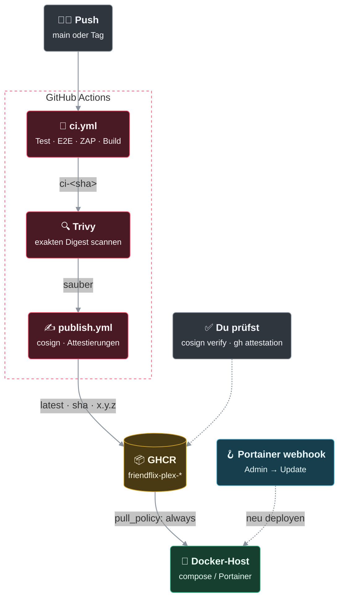

# Betrieb: Backup, Restore, Firewall, Updates, Image-Prüfung

Erstinstallation: [de/setup.md](de/setup.md) ([English](setup.md)). Authentik einrichten, sichern und aktualisieren: [de/authentik.md](de/authentik.md) ([English](authentik.md)).

> **FriendFlix for Plex (Preview):** Backups, Restore, Firewall und Updates gelten unverändert. Jellyfin-spezifische Teile (Jellyfin-Health-Check, „Plan B“) entfallen bzw. werden mit Plex **nicht unterstützt**; die Plex-Einrichtung steht in [de/plex.md](de/plex.md).

## Backups & Wiederherstellung
**Aktivieren** (opt-in, Compose-Profil `backup`; gilt für `compose.yaml` und `compose.prod.yaml`):
```bash
mkdir -p backups && chown 70 backups          # Container läuft als postgres-User (uid 70)
docker compose --profile backup up -d backup  # bzw. -f compose.yaml -f compose.prod.yaml --profile backup ...
docker compose logs -f backup                 # eine Zeile pro Lauf: "backup: OK <datei> (<bytes>), kept N dumps" oder "FAIL exit=<rc>"
```
- Der Sidecar nutzt `postgres:17-alpine` (gleiche Major-Version wie `postgres`; beim Upgrade beide gemeinsam anheben) und läuft täglich um `BACKUP_HOUR` (Default 3, Zeitzone aus `TZ`). Optional `BACKUP_RUN_ON_START=true` für einen Sofort-Dump beim Start.
- **Ablauf je Lauf:** `pg_dump -Fc` in eine `.tmp`-Datei, Prüfung mit `pg_restore --list`, erst dann Umbenennen nach `friendflix-YYYYmmdd-HHMM.dump`; danach werden Dumps älter als `BACKUP_KEEP_DAYS` (Default 14) gelöscht. Schlägt ein Schritt fehl, bleibt der letzte gute Dump unangetastet, die Logzeile zeigt `FAIL exit=<rc>` und der Container wird `unhealthy` (`docker compose ps`; für Alarme z. B. Portainer/Icinga auf den Health-Status).
- **Ablageort:** Host-Verzeichnis `BACKUP_PATH` (Default `./backups`) → `/backups` im Container. Das Passwort kommt aus `POSTGRES_PASSWORD` (wie beim `postgres`-Dienst) oder aus einer gemounteten Datei (`BACKUP_PGPASSWORD_FILE`), nie aus dem Image oder dem Dump-Verzeichnis.
- Alternativ per Cron auf dem Host: `0 3 * * * cd /opt/friendflix && ./scripts/backup.sh >> backups/backup.log 2>&1`
- **Off-site:** Dumps zusätzlich auf ein anderes Gerät kopieren, ein Backup auf derselben Platte schützt nicht vor Plattenausfall. Beispiel TerraMaster-NAS: `BACKUP_PATH` auf ein NAS-Share legen (NFS/SMB) und dort Snapshots aktivieren, oder per Cron `rsync -a --delete-after backups/ nas:/volume1/backups/friendflix/`. Den Schlüssel `APP_ENC_KEY` separat im Passwort-Manager sichern.

**Wiederherstellung** (App gestoppt, damit keine Verbindungen offen sind):
```bash
docker compose stop backend gateway
docker compose exec -T postgres pg_restore --clean --if-exists --no-owner -U friendflix -d friendflix < backups/friendflix-<ts>.dump
docker compose start backend gateway
```
Bei einer leeren/neuen Datenbank zuerst den Stack mit `postgres` starten (`docker compose up -d postgres`) und dann wie oben einspielen. Migrationen laufen beim Start des Backends ggf. nach.

**Restore-Test** (monatlich per Cron, Exit-Code ≠ 0 bei Fehler → Icinga/Cron-Mail): `./scripts/restore-test.sh`
Startet einen Wegwerf-Postgres ohne Port-Mapping, spielt den neuesten Dump ein und prüft Migrationen und Tabellen. Schnellprüfung einer einzelnen Datei: `docker compose exec -T postgres pg_restore --list < backups/<datei>.dump | head`.

- **APP_ENC_KEY sichern!** (Passwort-Manager, getrennt vom Dump). Ohne ihn sind die gespeicherten Jellyfin-Passwörter der Nutzer unlesbar.
- Nicht im Dump: Jellyfin-/Seerr-/Authentik-Daten (eigene Backups dieser Dienste; Authentik: [de/authentik.md §2.6](de/authentik.md#26-backups-und-updates)).

## TMDB-/OMDb-Schlüssel wechseln
Die optionalen Schlüssel für die Detailseite lassen sich ohne Neustart tauschen:
- **Über das Portal:** *Admin → Datenquellen*, neuen Schlüssel eintragen, *Testen*, *Speichern*. Die Sperre nach einem abgelehnten Schlüssel (401, 1 Stunde) und die zwischengespeicherten Fehlantworten fallen sofort weg.
- **Über die Secret-Datei** (`TMDB_API_KEY_FILE` / `OMDB_API_KEY_FILE`): Datei ändern und das Backend neu starten: `docker compose restart backend` (mit denselben `-f`-Dateien wie beim Start, z. B. `docker compose -f compose.prod.yaml -f compose.secrets.yaml restart backend`). `up -d` erstellt den Container nicht neu, wenn sich nur der Inhalt der Datei geändert hat. Beim Start erkennt das Backend den geänderten Schlüssel und hebt die Sperre und die zwischengespeicherten Fehlantworten sofort auf; ein erfolgreicher *Testen*-Klick tut das ebenfalls. Ein Schlüssel aus Datei oder Umgebung hat Vorrang vor einem im Portal gespeicherten; die Admin-Seite zeigt ihn dann nur an. Zum Wechsel auf die Portal-Eingabe die Variable entfernen.
- Der im Portal gespeicherte Schlüssel ist mit `APP_ENC_KEY` verschlüsselt. Geht `APP_ENC_KEY` verloren, meldet die Seite den Schlüssel als ungültig; dann einfach neu eintragen.

## Host-Firewall (zusätzlich zum fehlenden Port-Mapping)
Jellyfin/Seerr haben keine `ports:` und hängen nur im internen Netz. Falls sie auf dem Host zusätzlich laufen (nicht gebündelt):
```bash
# Docker umgeht ufw: Regeln gehören in DOCKER-USER
iptables -I DOCKER-USER -p tcp -m multiport --dports 8096,8920,5055 ! -s 127.0.0.1 -j DROP
ufw deny 8096,8920,5055/tcp
```
Prüfung von außen: `nmap -p 8096,8920,5055 <öffentliche-IP>` → alle `filtered/closed`.

## Updates
`git pull && docker compose build --pull && docker compose up -d`. Migrationen laufen beim Start (Advisory-Lock, transaktional).
Nach Jellyfin-Updates: `JELLYFIN_URL=… ./scripts/gen-jellyfin-client.sh` und Diff prüfen (Pfade ändern sich zwischen Versionen; der Client probiert alte/neue Pfade für Views/Resume/Item/Favoriten/Gesehen).

## Updates aus dem Portal
*Admin → Update* vergleicht die installierte Version (`GIT_SHA`, beim Image-Build eingebacken) mit dem letzten erfolgreichen CI-Lauf auf `main`, listet die Änderungen und kann das Portainer-Stack sofort neu ziehen. Portainer selbst zieht Images ohnehin alle 12 Stunden. Der Knopf bleibt deaktiviert, solange eine der beiden Varianten fehlt:

- **Webhook (einfach):** In Portainer → Stacks → *dein Stack* → *Stack-Webhook* aktivieren, URL kopieren und als `PORTAINER_WEBHOOK_URL` setzen. Die URL enthält ein Token und ist ein Secret (auch als `PORTAINER_WEBHOOK_URL_FILE` möglich).
- **API:** In Portainer → *My account* → *Access tokens* ein Token anlegen (`PORTAINER_API_KEY`), `PORTAINER_URL` (intern erreichbar vom Backend), `PORTAINER_STACK_ID` (steht in der URL des Stacks, `…/stacks/<id>`) und ggf. `PORTAINER_ENDPOINT_ID` (Default 1) setzen. Das Portal liest den Stack (Git- oder Datei-Stack), behält dessen Umgebungsvariablen unverändert und löst ein Redeploy mit Image-Pull aus.

Sicherheit: Webhook-URL und Token können den Stack neu deployen. Am besten einen eigenen Portainer-Benutzer nur mit Zugriff auf dieses eine Stack verwenden (kein Admin) und das Token ausschließlich in der `.env`/den Docker-Secrets ablegen. Beide Werte erscheinen weder in Antworten noch in Logs. Pro 2 Minuten ist ein Update möglich; jeder Auslöser steht als `system.update` im Audit-Log. Optional senkt `GITHUB_TOKEN` (ohne Rechte) das GitHub-Limit-Risiko; Ergebnisse werden 10 Minuten gecacht.

## Images prüfen: Signatur, SBOM, Provenienz
Jedes veröffentlichte Image (`ghcr.io/<owner>/friendflix-{backend,gateway,web}`, Tags `latest`, Kurz-SHA, `x.y.z`) ist
- mit **cosign keyless** signiert: kein Schlüssel, kein Secret. Der Publish-Job holt sich per GitHub-OIDC ein kurzlebiges Zertifikat von Sigstore (Fulcio), die Signatur steht im öffentlichen Transparenz-Log (Rekor). Die Identität im Zertifikat ist der Workflow, der signiert hat: `https://github.com/<Owner>/<Repo>/.github/workflows/publish.yml@refs/heads/main` bzw. `@refs/tags/vX.Y.Z`.
- mit **GitHub-Attestations** versehen: SLSA-Provenienz (welcher Commit, welcher Workflow-Lauf) und die SBOM (SPDX, von BuildKit beim Build erzeugt), beide auch in GHCR neben dem Image abgelegt.
- zusätzlich mit den BuildKit-Attestations (SBOM + Provenienz `mode=max`) direkt im Image-Index.

Signiert und attestiert wird nur der Digest, der vorher von Trivy geprüft wurde (siehe Kopf von `.github/workflows/ci.yml`), und nur bei Push auf `main` bzw. `v*`-Tags, nie in Pull Requests. Images von vor dieser Umstellung sind nicht signiert.

Vom Push bis zum laufenden Stack:



> 🟥 FriendFlix · 🟩 Medienserver · 🟦 weitere Dienste · 🟪 Reverse-Proxy · 🟨 Datenspeicher · ⬛ Zuschauer / extern · gestrichelter Rahmen = Netz bzw. Grenze · dicke Linie = Videostream · gepunktet = optional / über öffentliche URL

**Prüfen** (cosign ≥ 3, `gh` ≥ 2.60; Owner im Image-Namen klein geschrieben, in der Identität so wie auf GitHub – das Regex unterscheidet Groß-/Kleinschreibung):
```bash
IMG=ghcr.io/letsmanu/friendflix-backend:latest      # bzw. :<sha> oder :<x.y.z>, gateway / web genauso

# Signatur: muss aus einem Workflow dieses Repos stammen, ausgestellt für GitHub Actions
cosign verify "$IMG" \
  --certificate-identity-regexp '^https://github.com/LetsManu/friendflix/.github/workflows/' \
  --certificate-oidc-issuer https://token.actions.githubusercontent.com

# Provenienz (Standard-Prädikat SLSA) und SBOM (gh lädt die Attestations aus der GitHub-API, braucht `gh auth login`)
gh attestation verify "oci://$IMG" --repo LetsManu/friendflix
gh attestation verify "oci://$IMG" --repo LetsManu/friendflix --predicate-type https://spdx.dev/Document/v2.3
#   ohne GitHub-Login: --bundle-from-oci (liest die Attestations aus GHCR)

# SBOM / Provenienz ansehen
docker buildx imagetools inspect "$IMG" --format '{{ json .SBOM.SPDX }}' | jq '.packages | length'
docker buildx imagetools inspect "$IMG" --format '{{ json .Provenance.SLSA }}' | jq . | head -40
```
Strenger (nur `main` und Versions-Tags): `--certificate-identity-regexp '^https://github\.com/LetsManu/friendflix/\.github/workflows/publish\.yml@refs/(heads/main|tags/v.+)$'`.

**Forks** (z. B. die Plex-Variante) brauchen keine Anpassung an den Workflows: Image-Namen und Signatur-Identität leiten sich vom Repo ab, in dem der Workflow läuft. Beim Prüfen `letsmanu`/`LetsManu/friendflix` durch den eigenen Owner bzw. `<owner>/<repo>` ersetzen.

**Beim Deployment** am besten einen geprüften Digest pinnen statt `latest`: `docker buildx imagetools inspect "$IMG" --format '{{.Manifest.Digest}}'`, prüfen, dann in `compose.prod.yaml` per `FF_TAG` den Tag (oder direkt `image: …@sha256:…`) setzen.

## Weitere Prüfungen in der Pipeline
- **DAST:** Der CI-Job `dast` startet die gebaute Web-App und lässt einen **OWASP-ZAP-Baseline-Scan** darüber laufen (schlägt bei „High“ fehl, warnt bei „Medium/Low“; Regeln und bewusste Ausnahmen in `.zap/rules.tsv`, Bericht als Artefakt `zap-report`). `publish` wartet auf ihn.
- **Lieferkette:** Trivy (Image-Digest), gitleaks (Secrets), `npm audit` und der **OpenSSF Scorecard** ([scorecard.yml](../.github/workflows/scorecard.yml), wöchentlich und bei jedem Push auf `main`, Ergebnis im Code-Scanning und als Badge im README).
- Der Sprach- und der Bildqualitäts-Index werden von Hintergrundjobs gepflegt (`BACKGROUND_JOBS=true`, höchstens alle 12 h; beim ersten Start laufen sie sofort). Bis dahin sind die Filter „Ton / Untertitel“ und „Bildqualität“ unvollständig; ebenso laufen die Bald-weg-Erinnerungen nur mit diesem Schalter.

## Empfohlener Branch-Schutz
GitHub → *Settings* → *Rules* → *Rulesets* (oder *Branches* → *Branch protection rule*) für `main`:
- **Require a pull request before merging** (ohne Pflicht-Review reicht für ein Ein-Personen-Projekt), **Block force pushes**, **Restrict deletions**.
- **Require status checks to pass** mit genau diesen Checks aus `.github/workflows/ci.yml` (Namen wie in der Auswahl; sie erscheinen dort erst, nachdem sie einmal gelaufen sind):
  `test (22)`, `test (26)`, `e2e`, `dast`, `secrets`, `docker (backend)`, `docker (gateway)`, `docker (web)`
- **Require branches to be up to date before merging** (*Require status checks to pass* → *Require branches to be up to date before merging*): die Checks müssen gegen den aktuellen Stand von `main` gelaufen sein.
- Optional: den Check der CodeQL-Standardeinrichtung (Name erscheint nach dem ersten Lauf) bzw. unter Rulesets **Require code scanning results** für CodeQL.
- Nicht als Pflicht-Check eintragen: `publish / …` und `Scorecard analysis` (laufen nur bei Push bzw. zeitgesteuert, nie in einem PR – der PR würde ewig warten).

## Bitrate-Limit unterwegs (`HOME_NETWORKS`)
Jede Rolle hat zusätzlich zur normalen Bitrate-Grenze ein **Limit unterwegs** (Admin → Rollen, Feld „Limit unterwegs“; Standard 8 Mbit/s für Freund und Familie, 4 Mbit/s für Gast, 12 Mbit/s für Admin, nie höher als das Rollenlimit). Es gilt, wenn jemand **nicht** im Heimnetz schaut: Der Upload des Servers ist begrenzt, ein Stream über der Leitung ruckelt für alle. Backend (`POST /api/playback/info`) und Gateway (`MaxStreamingBitrate` der Medien-Anfragen) kappen die Bitrate, der Player kann sie nicht erhöhen. Chromecast-Sitzungen (`POST /api/cast/session`) folgen demselben Limit unterwegs: Das Token speichert die gekappte Bitrate, das Gateway kappt die Cast-Anfragen darauf. Plan B (`/internal/authz-nginx`) kennt die Client-Adresse nicht und wendet nur das normale Rollenlimit an.

**`HOME_NETWORKS`** (Env, kommagetrennte CIDRs) legt fest, was als Heimnetz gilt. Standard: `10.0.0.0/8,172.16.0.0/12,192.168.0.0/16,127.0.0.0/8,::1/128,fc00::/7,fe80::/10` (RFC1918, Loopback, IPv6 ULA/Link-Local; IPv4-mapped IPv6 wird erkannt). Unbekannte oder nicht auswertbare Adressen zählen als **unterwegs**.

**Client-Adresse:** zuerst `X-Real-IP`, sonst der **letzte** `X-Forwarded-For`-Eintrag (den hängt der eigene Proxy an), sonst der Socket-Peer. Der linkeste Eintrag wird bewusst ignoriert, weil ihn der Client selbst setzt. Ohne beide Header zählt im Backend nur Loopback als Heimnetz; ein Docker-Bridge-Peer gilt als unterwegs. Der Reverse Proxy (NPM) muss deshalb `X-Real-IP` bzw. `X-Forwarded-For` setzen, sonst werden alle Zuschauer gleich behandelt. **Wichtig:** `X-Real-IP` hat Vorrang, also muss der Proxy diesen Header **überschreiben** (`proxy_set_header X-Real-IP $remote_addr;`) oder entfernen. Ein Proxy, der nur `X-Forwarded-For` anhängt und ein mitgeschicktes `X-Real-IP` durchreicht, lässt Clients das Heimnetz vortäuschen (`X-Real-IP: 192.168.1.5`) und so das Limit unterwegs umgehen. Die mitgelieferte NPM-Konfiguration (`deploy/npm/portal.advanced.conf`) überschreibt beide Header bereits.

**Direct Play unterwegs:** Das Gateway kappt transkodierte Streams (HLS: fehlende `MaxStreamingBitrate`/`VideoBitrate` setzt es auf das Limit, höhere Werte senkt es). Den Originalstream (`/Videos/<id>/stream`) kann es nicht kappen, weil es die Bitrate der Datei nicht kennt: Rollen ohne Höhenbegrenzung dürfen ihn (mit dem Standard `DIRECT_PLAY_REQUIRES_DOWNLOAD=false`) auch unterwegs abrufen, etwa per Skript mit ihrem Cookie, und so mehr als das Limit unterwegs ziehen. Der Player selbst fordert unterwegs nur an, was das Backend-Limit erlaubt. Wer den Upload streng schützen muss, setzt `DIRECT_PLAY_REQUIRES_DOWNLOAD=true`: Dann bekommen nur Rollen mit Download-Recht den Originalstream (mehr Transcoding-Last, siehe [downloads.md](downloads.md)).

## Plan B: NPM liefert /media/ direkt (auth_request)
Standard ist das Node-Gateway. Wird es bei vielen parallelen Streams zum Engpass (CPU des `gateway`-Containers, `rate(friendflix_gateway_bytes_total)`), kann NPM/nginx `/media/` selbst ausliefern. Jede Anfrage wird vorher vom Backend freigegeben (`GET /internal/authz-nginx`).

**Ablauf je Request:** Browser → nginx → `auth_request` an Backend (Cookie + Original-URI + Shared Secret) → Backend prüft Session, Gerätefreigabe, Sperre und die Pfad-Allowlist, liefert nur Header zurück (`X-Jellyfin-Uri` = bereinigte URI mit Bitrate-Limit, `X-Jellyfin-Auth` = Jellyfin-Token des Nutzers) → nginx streamt von Jellyfin. Der Browser sieht nie ein Token.

**Einrichten**
1. Jellyfin muss vom NPM-Host erreichbar sein, ohne öffentlich zu sein: Stack mit `docker compose -f compose.yaml -f compose.planb.yaml --profile bundled up -d` starten. Das veröffentlicht Jellyfin **nur auf `127.0.0.1:8096`**. Port 8096 bleibt in der Host-Firewall gesperrt. (Läuft Jellyfin außerhalb des Stacks, muss es auf `127.0.0.1:8096` für NPM erreichbar und von außen gesperrt sein.)
2. In NPM → Proxy Host → Advanced: den `location /media/`-Block aus `portal.advanced.conf` **ersetzen** durch den Inhalt von `deploy/npm/plan-b-auth-request.conf`; `__INTERNAL_SECRET__` durch den Wert aus `.env` ersetzen.
3. Gateway-Container kann gestoppt werden (`docker compose stop gateway`).
4. Testen: `curl -I https://portal.example.com/media/Videos/<id>/master.m3u8` ohne Cookie → **401**; im Browser abspielen → läuft.

**Sicherheitsmerkmale (automatisiert geprüft mit `scripts/test-plan-b.sh` gegen echtes nginx):** 401 ohne/mit falscher Session, 403 außerhalb der Allowlist und bei Traversal, nur GET/HEAD, `/internal/` öffentlich 404, Client-`Authorization`/`X-Emby-*` erreichen Jellyfin nie, `api_key` wird entfernt, Bitrate wird auf das Rollenlimit gekappt, Token nur serverseitig, kein `Set-Cookie`/Token in Antworten, Range → 206.
Backend-Tests prüfen dieselben Pfad-Vektoren wie das Gateway (`test-vectors/media-paths.json`), damit beide Allowlists nicht auseinanderlaufen. Entscheidungen werden als `friendflix_authz_nginx_total{result}` gezählt.

**Grenzen:** Das Secret steht in der NPM-Konfiguration (es autorisiert nur den Auth-Endpunkt, der zusätzlich eine echte Session verlangt). Sperren/Abmelden wirken nach spätestens ~5 s (Memo im Backend). Durchsatz/Streams erscheinen nicht in den Gateway-Metriken, sondern in den NPM-/nginx-Logs. Bild-Caching setzt die Konfiguration selbst (`private, max-age=86400`).
