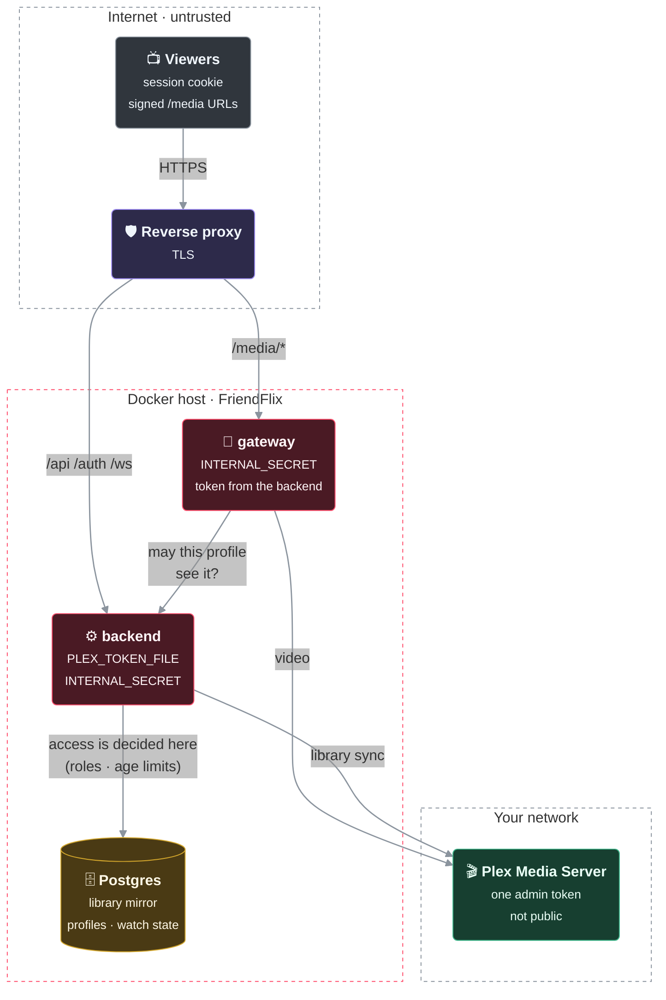
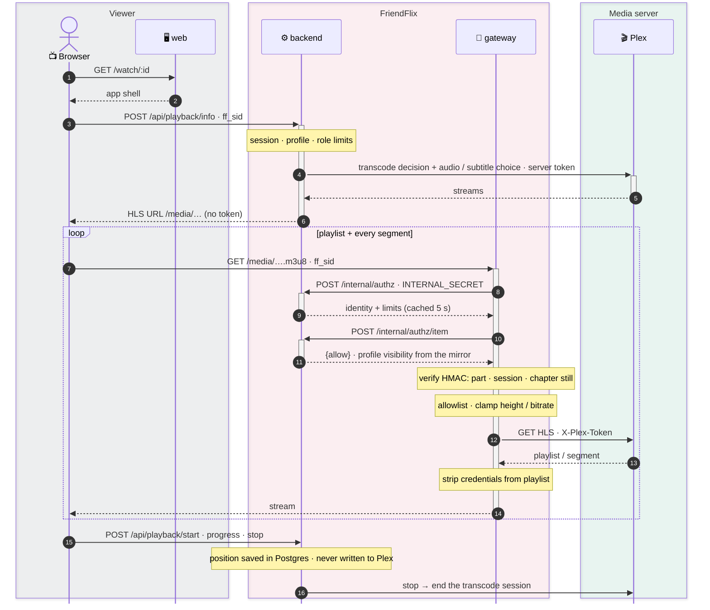

# FriendFlix for Plex – setup guide

> **Status: preview, not released.** The Plex backend, the gateway adapter and `compose.plex.yaml` are implemented on the development branch and tested against a fake Plex server built from real Plex Media Server 1.43 responses. There is **no release yet**: the `friendflix-plex-*` images are only published once the work is merged and released, and nobody has run it against many real servers. If you want to help, see [Test against a real Plex server](#test-against-a-real-plex-server).
>
> Using Jellyfin? Use the upstream project, [LetsManu/friendflix](https://github.com/LetsManu/friendflix). Deutsch: [de/plex.md](de/plex.md).

Back to the [README](../README.md).

## How it works in one minute

- **One Plex server per FriendFlix instance.**
- FriendFlix manages its users itself with **one Plex admin token**. Your friends do not need a plex.tv account, and it works without Plex Pass.
- Profiles, kids profiles, age limits, watch progress and favourites are stored **in FriendFlix**, not in Plex. FriendFlix never writes watch state to Plex.
- The token is only used by the gateway and the backend on the server. It is never sent to a browser; clients only see FriendFlix URLs.
- `compose.plex.yaml` only **connects to your existing Plex server**. It does not start a Plex container. You enter the Plex address and token in the setup wizard (or later under *Admin → Settings*); `.env` is only needed if you want to pin them (`PLEX_URL`, `PLEX_TOKEN` or `PLEX_TOKEN_FILE`).

The same in a picture – who holds what, and what crosses which boundary (all diagrams, with the container view and the "press play" walk-through: [architecture.md](architecture.md)):



> 🟥 FriendFlix · 🟩 media server · 🟦 other service · 🟪 reverse proxy · 🟨 data store · ⬛ viewers / outside · dashed frame = network or boundary · thick line = video stream · dotted = optional / via public URL

What happens when somebody presses play: FriendFlix decides (profile, role limits, age rules) and starts the Plex stream with its own token; every playlist and segment then passes the gateway, which asks the backend again and checks the signature of the path.



## 1. Claim the server

FriendFlix needs a **claimed** server and a token. An unclaimed Plex server only answers token-less requests from the machine it runs on, so it cannot be used from a container or another host.

1. Open the Plex web app (`http://<server>:32400/web`) and sign in with a Plex account. This claims the server.
2. For Docker installs of Plex you can claim at first start with a claim token from <https://plex.tv/claim> (`PLEX_CLAIM`); the token is valid for a few minutes only.

## 2. Get the admin token

Follow Plex's own support article **"Finding an authentication token / X-Plex-Token"** (search for that title on support.plex.tv). The token is sent as `X-Plex-Token`.

The article reads the token from a *View XML* link, which carries it in the address (`…?X-Plex-Token=…`). Copy only the token value into the **token** field and only `http://<server>:32400` into the **address** field: FriendFlix refuses an address with `?…`, `#…` or `user:password@` (`invalid_url`), because an address is stored and shown unencrypted. A pinned `PLEX_URL` in `.env` with such a part stops backend and gateway at start (the error names `PLEX_URL` and says it must be the server address only; the value is never printed).

Recommendations:

- **Which account.** FriendFlix uses the token of the Plex account you give it. The **server owner's token unlocks every feature** (for example *Live streams* of other Plex apps and some library care actions). A **dedicated account** keeps FriendFlix's audio-track changes away from the account you watch on; the check then shows the *not the owner's token* note and owner-only features are limited (see [Not the owner's token](#setup-wizard-on-plex)). Pick the owner's token for everything, a dedicated account for a quiet daily account.
- Use a **dedicated Plex account** (or at least a dedicated token) for FriendFlix, not your daily account. Plex stores the selected audio track per Plex account, and FriendFlix has to change it when someone picks a language (see [Audio tracks](#audio-tracks)). If other Plex apps use the same account, they would see those changes.
- The token is a password: keep it in `PLEX_TOKEN_FILE` (Docker secret, see the comment at the end of `compose.plex.yaml`) rather than in `.env` where you can, and do not paste it into issues or chats. If it leaks, revoke it (see [Rotating or revoking the token](#rotating-or-revoking-the-token)) and enter a new one.

Check it from the machine that runs FriendFlix:

```bash
curl -s -H "X-Plex-Token: $PLEX_TOKEN" -H "Accept: application/json" "$PLEX_URL/identity"
```

`"claimed": true` and a version number means the server is reachable; a `401` means the token is wrong or the server is not claimed.

## 3. Configure FriendFlix

`compose.plex.yaml` is an override for `compose.prod.yaml` (prebuilt images) or `compose.yaml` (local build). It sets `MEDIA_SERVER=plex` for backend and gateway, switches to the `friendflix-plex-*` images and removes the Jellyfin variables from the containers. **Nothing Plex-related is required in `.env`**: address and token go into the setup wizard.

```bash
# .env: only the general values (see .env.example); no Plex values needed
REQUESTS_URL=http://requests:5055      # also required by compose.prod.yaml (see "Wishes" in the parity table)

docker compose -f compose.prod.yaml -f compose.plex.yaml config --quiet   # validates the merged configuration
docker compose -f compose.prod.yaml -f compose.plex.yaml up -d
docker compose logs backend | grep "setup code"                           # the code the wizard asks for
```

Tip: `COMPOSE_FILE=compose.prod.yaml:compose.plex.yaml` in `.env` lets you use plain `docker compose up -d` / `ps` / `logs`.

### Setup wizard on Plex

Open your FriendFlix address; while setup is incomplete every page leads to `/setup` (general steps: [setup.md](setup.md)). In the **media step** you enter:

- the **address** of Plex as backend and gateway reach it, for example `http://plex.example.com:32400` (see [Network](#network)), and
- the **token** from [section 2](#2-get-the-admin-token).

Before saving, FriendFlix runs a check from the backend: `/identity` (is this a Plex server at all, without the token), `/library/sections` (does Plex accept the token) and `/status/sessions` (is it the server owner's token). The token is sent only as a header, redirects are not followed, and the answer is a short code, never the token or an error text. Then both values are saved in the database; the token is **encrypted** (`APP_ENC_KEY`), never shown again and never sent to a browser. Both can be changed later under *Admin → Settings* (media group); a field left empty keeps the saved token.

The first admin sees an empty library for a short while after the first sign-in, until the first library sync has run (every 5 minutes).

**Not the owner's token.** If the token works but is not the server owner's token (Plex refuses `/status/sessions`), the check ends with a note: *the token works, but it is not the Plex server owner's token, so some features may be limited.* The token is still saved. Library, playback and accounts work; what needs owner rights (for example *Live streams* of other Plex apps and some library care actions) may be limited. Use the owner account's token if you want everything.

**Why there is no "sign in with Plex" and no automatic token.** FriendFlix uses **one shared service token** for everybody, and your friends have no Plex accounts linked to FriendFlix. A password sign-in in the wizard would send your plex.tv password to a third host instead of the server you typed in, would not work well with two-factor accounts and would leave an account token that cannot be revoked cleanly. So the token is copied in by hand. A Plex PIN-link flow ("open this page and approve") may come later.

**Env pins win.** A value set in `.env` (or as a `_FILE` secret) wins over the database and shows as **locked** (*From environment*) in the wizard and in *Admin → Settings*. Pins are optional:

| Variable | Required | Purpose |
|---|---|---|
| `MEDIA_SERVER` | set to `plex` by `compose.plex.yaml` | selects the Plex implementation in backend and gateway |
| `PLEX_URL` | no (pin) | Plex base URL as seen from the containers (LAN IP, `http://host.docker.internal:32400` for Plex on the Docker host, or a container name on a shared network). The address only: no `?…` (never `?X-Plex-Token=…`), `#…` or `user:password@`, or backend and gateway refuse to start. `compose.plex.yaml` passes it to backend **and** gateway: set it for both or for neither, never remove it from only one of them |
| `PLEX_TOKEN` / `PLEX_TOKEN_FILE` | no (pin) | the Plex token FriendFlix uses for everybody. A pin is **backend-only**: the gateway has no `PLEX_TOKEN` in its environment |

**How the gateway gets the token.** The gateway has no database. It asks the backend for the Plex address and token over the internal network (`/internal/gateway-config`), protected by the shared secret from the bootstrap volume, and keeps them in memory only. A change in *Admin → Settings* reaches the gateway at the latest after 30 seconds (its refresh interval; sooner when a media request notices the new settings revision). The token is never logged and never sent to a browser.

**Token as a Docker secret.** `compose.secrets.yaml` has no `plex_token` entry. Create the secret file and add `plex_token` to the **backend** list yourself, as described at the end of `compose.plex.yaml`; set `PLEX_TOKEN_FILE=/run/secrets/plex_token` and leave `PLEX_TOKEN` empty. A `_FILE` value locks the field in the wizard.

**Admin → Settings on Plex** lists only the Plex media settings (`PLEX_URL`, `PLEX_TOKEN`); the Jellyfin fields are hidden. *Move* / *Move all* (import from the environment) never copies `JELLYFIN_*` values.

### Existing installs (settings in `.env`)

An install that already has `PLEX_URL` / `PLEX_TOKEN` in `.env` keeps working after the update: the environment wins over the database, and the wizard is not shown again once accounts exist. The fields show as locked. To move them into the database:

1. *Admin → Settings*, media group: **Move** per row or **Move all** (import env). The values are copied (token encrypted); the environment still wins until you remove it.
2. Remove `PLEX_URL`, `PLEX_TOKEN` and `PLEX_TOKEN_FILE` (and a `plex_token` secret entry) from `.env` / compose, then `docker compose up -d`. The fields become editable. If you keep `PLEX_URL` in `.env`, keep it for backend and gateway alike.

More on moving settings: [setup.md, section 14](setup.md#14-upgrading-to-settings-in-the-database).

### Changing the Plex server

If the address points to a **different Plex server** (another `machineIdentifier`), FriendFlix rebuilds its library mirror from scratch with one log warning. While it rebuilds, the library can look empty or only partly filled for a while. The same server under a new address keeps the mirror. Changing the address while a token is saved also needs a recent re-authentication, because the saved token would then go to the new address.

Limits:

- **Watch state is not cleared.** Played marks, resume positions and favourites (`plex_userdata`) are kept, and titles of the new server can have the same internal numbers as titles of the old one, so some marks can be wrong. There is no admin command that clears them. Viewers can correct single titles by marking them unwatched; deleting an account removes all its marks.
- The change is detected on a sync pass by comparing with the identifier stored at the previous pass. If you **upgrade FriendFlix and switch the server in the same restart**, there is no stored identifier yet and the switch is not detected. Upgrade first, let it run, then change the address.

### Rotating or revoking the token

If the token leaks or you want a new one: revoke it on the Plex side first (Plex account → *Authorized Devices*, or sign out of all devices; the exact name changes, see Plex's support pages), create a new token as in [section 2](#2-get-the-admin-token) and enter it under *Admin → Settings*. The gateway picks it up at the latest after 30 seconds. Saving a token needs a recent re-authentication (sign in again when asked). If the token is pinned in `.env` or as a `_FILE` secret, change it there and recreate the backend.

Until you enter the new token, FriendFlix keeps using the old one (which fails once revoked). **Clearing the token field does not remove it**: on a Plex instance the token is required, the save is refused ("required") and the last good token stays; an empty field means "unchanged".

### Network

- The **gateway and backend must be able to reach `PLEX_URL`**. Use the **local address** of the Plex server (LAN IP or a host name that resolves on the Docker host, port 32400). Do not use the public `plex.direct` / remote-access address: it adds latency, may go through Plex's relay and is not needed.
- Plex does not have to be reachable by browsers. Only the FriendFlix portal is public.
- If Plex runs on the same host: natively or with host networking, use `http://host.docker.internal:32400` (`compose.plex.yaml` maps that name to the host); in a container, put it on a shared Docker network or use the host's LAN IP.
- FriendFlix always sends the token, so it does not depend on Plex treating the connection as "local".

## 4. Library naming and role access

FriendFlix mirrors your Plex libraries (sections) and lets you decide **per role which libraries are visible** (for example: *Kids* role sees only `Kids Movies` and `Kids Shows`).

- Give libraries clear, stable names. The names are what you pick in the admin area.
- Prefer separate libraries for content that only some people should see (kids, adult, family videos) instead of relying on ratings alone.
- A library that is not allowed for a role is invisible to it, including search, recommendations, direct links and the media gateway.
- Access is bound to the library **name** (compared case-insensitively). **Renaming a library in Plex removes it from roles that list it by name** until you update the role settings.

## 5. Age ratings

Age limits and kids profiles rely on the Plex **content rating** (`contentRating`) of each title.

- FriendFlix maps common Plex ratings to a minimum age (for example `G`, `PG`, `PG-13`, `R`, `NC-17`, `TV-Y`, `TV-G`, `TV-PG`, `TV-14`, `TV-MA` and country-prefixed values such as `de/12`). The table lives in `backend/src/plex/access.ts` (`ratingAge`): US MPAA and TV ratings, `de/` (FSK), `gb/`, `ie/`, `au/`, `nz/`, `ca/`, `fr/`, `nl/`, `jp/` and plain numeric ages (`12`, `FSK 16`, `16+`).
- **Unknown or empty ratings are blocked for profiles with an age limit and for kids profiles** (fail closed). Profiles without a limit see everything allowed by their role.
- Episodes inherit the rating of their show unless they carry their own.

Fix a wrong or missing rating in Plex:

1. Open the title in Plex, **Edit** (pencil) → **Advanced** → **Content Rating**.
2. Enter a standard value and **lock** the field, so a metadata refresh does not overwrite it.
3. Plex does **not** update the item's modification date when metadata is edited, so FriendFlix cannot see it from timestamps alone. It polls every 5 minutes, listens to Plex's notification websocket and re-reads all details in a nightly sweep; a rating change can therefore take until the next sweep to appear.

Tip: in Plex, filter the library by *Content Rating* to spot titles without one. Matching a title to the correct entry ("Fix Match") often fills the rating in.

## 6. Preview thumbnails (scrubbing)

Hover and scrub previews need Plex's **video preview thumbnails** (BIF files). They work without Plex Pass but are off by default.

1. Plex → **Settings → Library → "Generate video preview thumbnails"**: set it to *as a scheduled task* or *as soon as possible*.
2. Per library: **Manage → Edit library → Advanced → Enable video preview thumbnails**.
3. Analyse existing titles (**…** → *Analyze*) or wait for the scheduled task.

Without them, FriendFlix shows no scrub thumbnails. With them it shows single frames (one every ~2 s), not a continuous sprite sheet.

**Chapter stills** in the player's "Scenes" panel come from Plex's chapter thumbnails: **Settings → Library → "Generate chapter thumbnails"** (*as a scheduled task* or *as soon as possible*), then analyse or wait. Chapter marks themselves (names, seek bar marks) need nothing: they are read from the files.

## 7. Plex Pass (optional)

You do **not** need Plex Pass for FriendFlix. Plex Pass only adds things FriendFlix can then use:

- **Skip intro / skip credits**: need intro and credits markers, which Plex only detects with Plex Pass. Without markers the skip button never appears. Recap and preview skipping are never available.
- **Hardware transcoding** is a Plex feature (according to Plex it requires Plex Pass). It is configured in Plex, not in FriendFlix.

## 8. Plex settings to leave alone

- Do **not** create Plex users, Home users or shares for FriendFlix's members; FriendFlix does not use them.
- Leave **remote access / relay** as you like; FriendFlix does not use it.
- Keep **transcoder settings** (temporary directory, quality) as they are, or tune them for your hardware; FriendFlix just asks the Plex transcoder for HLS streams.
- Do not delete and re-create libraries without need: titles may get new internal IDs, so FriendFlix could treat them as new items (watch progress, lists and favourites would not follow).

## Feature parity

What the preview implements (checked by the test suite against the fake Plex server; *Limited* = works with the restriction in the note):

| Feature | Plex | Note |
|---|---|---|
| Profiles, kids profiles, PIN, age limits | Works | Enforced by FriendFlix on every list, search, title and media request; needs correct `contentRating`, unknown ratings are blocked for capped profiles |
| Library access per role | Works | By library name, see section 4 |
| Library, search, detail pages, collections, genres, studios | Works | From FriendFlix's mirror of the Plex library |
| Images | Works | Posters, backdrops, logos (if Plex has one) through the Plex photo transcoder. Collections without their own poster show their title: Plex's composite poster is never used, because it can show members a profile may not see |
| Cast & info panel | Limited | Actors with character names, directors, writers, producers, studio and Plex labels; on episodes everyone credited on the episode but not on the series is a guest star; **no person images** |
| Chapters ("Scenes" panel, seek bar marks) | Works | Chapter marks of the file (Plex `includeChapters`); stills only when Plex generates chapter thumbnails (section 6); unnamed chapters ("Chapter 3") get the localized "Chapter 3" |
| Quality chips, 4K / HDR browse filter | Works | From Plex's stream details: resolution, Dolby Vision, HDR10 / HDR10+ / HLG, channels, Atmos (from the track title). Libraries mirrored before this version are re-read automatically on the next sync |
| Detail page ratings (community, critics) | Limited | From Plex's `audienceRating` (community, 0-10) and `rating` (critics, shown on a 0-100 scale only when Plex marks it as Rotten Tomatoes); with an IMDb / TMDB source or a legacy agent `rating` counts as the community score. IMDb, Rotten Tomatoes and Metacritic need the optional OMDb key, friends' ratings always work |
| Detail page facts (tagline, original title, release date, countries, studios, tags) | Works | From the Plex metadata; tags are Plex labels (genres stay in their own line). Libraries mirrored before this version are re-read once on the next sync |
| Collection row ("Part 2 of 3") | Works | Plex collections the film belongs to, in release order, with the viewer's library, age and kids limits; parts a profile may not see are left out, never shown as missing. With the optional TMDB key missing parts of the TMDB collection appear (not for kids profiles) |
| Outbound links (TMDB, IMDb, TVDB, Trakt) | Works | From Plex's `Guid` entries (`imdb://`, `tmdb://`, `tvdb://`) or a legacy agent guid (`com.plexapp.agents.imdb://…`, `themoviedb`, `thetvdb`); items matched by Plex's own agent without external ids get no links |
| Fresh labels (new, new season, new episode, season finale) | Limited | "Season finale" needs a series known to be ended; Plex has no series status, so FriendFlix treats a series as ended only when every episode has an air date and the newest is older than 60 days. Otherwise "new episode" is shown |
| Leaving soon, story so far, themed lists, calm mode, clear voices, phone shortcuts and badge | Works | FriendFlix features; "story so far" uses Plex's season and episode summaries (none without a metadata agent) |
| Admin pages (overview, people, content, live streams, previews, leaving soon, status, usage) | Works | "Live streams" also lists other Plex apps' sessions from Plex's `/status/sessions` (play method, codecs, hardware transcoding); "Stop" ends FriendFlix's Plex transcode session, a direct-play file cannot be interrupted. Plex reports no transcode reasons: a session of another app reads as "subtitles" (burnt in), "audio codec" (audio converted) or "other" |
| Library care (admin) | Works | Read from Plex's library listings (`includeGuids`); language and subtitle checks use the stream details of FriendFlix's mirror, so a title the mirror has not read in detail yet is checked on the next scan. Incremental scans use Plex's `updatedAt`, which metadata edits do not bump: the weekly full scan (or "Check now") catches those. "Refresh metadata" asks Plex to refresh the item |
| "More like this" | Limited | Computed by FriendFlix from shared genres and cast, not Plex's own recommendations |
| Continue watching, watchlist, favourites, ratings, history | Works | In FriendFlix; nothing is written to Plex |
| Direct play | Works | Browser-compatible files (MP4/WebM, H.264/VP9/AV1, AAC/MP3/Opus/FLAC) within the role's limits |
| Adaptive streaming (HLS) | Works | Plex universal transcoder (MPEG-TS segments), session-bound URLs through the gateway |
| Role limits | Works | Bitrate and height caps when the transcode starts; roles without transcoding get Direct Play only (otherwise `403 transcoding_not_allowed`); max. streams per account and per profile |
| Smooth streaming (Auto quality, remote limit, quality chip) | Works | Each quality change starts a new Plex transcode at the chosen rung (bitrate plus 1080p / 720p / 480p / 360p); the remote limit is applied when the transcode starts; the chip's reason comes from the source and Plex's per-stream decision (copy / transcode) |
| Subtitles | Limited | Text subtitles only (SRT, ASS/SSA, VTT, mov_text …); sidecar files converted, **embedded tracks extracted by FriendFlix** with ffmpeg; no PGS/VobSub; no subtitle search |
| Audio track selection | Limited | Plex keeps it per Plex account; FriendFlix serializes stream starts, see [Audio tracks](#audio-tracks) |
| Skip intro / credits | Limited | Only with Plex Pass markers; recap and preview skipping are never available |
| Scrub preview thumbnails | Limited | Single frames from Plex's BIF index, only if preview thumbnails are generated |
| Offline downloads | Works | Original file when it is already MP4/H.264/AAC, otherwise transcoded by Plex and remuxed by FriendFlix |
| Chromecast | Works | HLS; text subtitles through signed FriendFlix subtitle URLs |
| TV mode, watch parties, recommendations, notifications, hubs | Works | FriendFlix features |
| "Upcoming episodes" / calendar | Not available | Plex does not offer it |
| Account page (*My space → Account*) | Works | Main profile only. Shows the account and its devices; nothing on the page comes from Plex |
| Download my data | Works | One JSON file built from FriendFlix's own data, including the watch history read through the Plex implementation (up to 1000 rows, marked truncated or partial when Plex fails midway). It holds no Plex address, library path or token |
| Delete my account (7-day grace, restore) | Works | After the grace period the account's Plex identities, their limits and their watch state in FriendFlix are removed. Within the 7 days a restore re-enables every identity. Nothing exists in Plex itself, so nothing is deleted there |
| Admin → Users: approvals, lock, access until, per-user limits, bulk actions | Works | Approving a request creates the account's identity in FriendFlix; role and limit overrides apply to every profile of the account. The *Activity* tab lists the Plex history of every profile. An active account whose Plex identity is lost shows its link as **broken** until you use *Repair links* |
| Admin → Settings and setup wizard | Works | Plex address and token, see [Setup wizard on Plex](#setup-wizard-on-plex). The token is encrypted and write-only; env values show locked. No automatic token (see the note there) |
| Wishes (request service) | Works | Each FriendFlix account gets its own local request-service user (request permission only), created on the first wish |
| "Now playing" of other Plex apps | Not available | Viewers only see FriendFlix's own sessions (admins see all of them under "Live streams") |
| nginx "Plan B" media path | Not available | Unsupported with Plex: `/internal/authz-nginx` answers `501 plan_b_unsupported` |

### Audio tracks

Plex's transcoder ignores an audio track chosen in the request; it uses the track **selected for the Plex account** that owns the token, taken when the stream starts. To give each viewer their own language, FriendFlix sets the selection for the token and starts the stream **one at a time**, so concurrent viewers still get their own track. Consequences:

- Starting several streams at the same instant is slightly slower (they queue for a moment).
- The selection of your FriendFlix token changes constantly. **Do not use the account you watch Plex on** for FriendFlix, or its audio track will flip around. Use a dedicated Plex account or token.

### Role limits

Plex only knows one token, so FriendFlix enforces the role settings itself:

- **Bitrate / height caps** are sent with every transcode start; a capped role never gets Direct Play of a larger file.
- **Remote limit** (Block 20, `HOME_NETWORKS`): outside the home networks the role's remote limit is the cap of `POST /api/playback/info`, so it is part of the transcode start (`maxVideoBitrate` = cap − 192 kbit/s for audio, `videoResolution` = the rung's height: 1080p from 8 Mbit/s, 720p from 4, 480p from 1.5, else 360p; never above the role's height cap). The gateway cannot change a running Plex transcode and needs no bitrate rule for it: it never passes client parameters to Plex. A session started at home keeps its limit when the viewer leaves the home network until the next quality change or playback start.
- **Transcoding off** (role template or *Admin → Roles*): only Direct Play. Titles that would need the transcoder answer `403 transcoding_not_allowed`; no Plex transcode is started. Casting and transcoded downloads are refused the same way.
- **Max. streams**: counted per account (as upstream) and per profile identity, on the server: every Plex transcode FriendFlix started for the profile counts as long as Plex still runs it (`/transcode/sessions`; Plex ends transcodes nobody fetches), plus Direct Play sessions with a progress report in the last 60 s. A title beyond the limit answers `429 max_streams` before a transcode starts. Changing quality or audio on the same title never counts twice. A stop report ends the Plex transcode immediately.

## Troubleshooting

| Symptom | Likely cause and fix |
|---|---|
| Health check or login fails, log shows `401` from Plex | Wrong or revoked Plex token, or server not claimed. Run the `curl` check from section 2, then enter a new token under *Admin → Settings*. |
| The wizard says the token is not the owner's | A note, not an error: the token is saved and most things work. Use the owner account's token for full admin features. |
| Library empty or partial after switching the Plex address | Expected while FriendFlix rebuilds its mirror for the new server; watch marks of the old server are kept, see [Changing the Plex server](#changing-the-plex-server). |
| A user's account shows its media server link as *Broken* | The account's Plex identity is lost. *Admin → Users →* the person → *Repair links*. |
| `ECONNREFUSED` / timeouts to Plex | Gateway or backend cannot reach `PLEX_URL`. Test from the container; use the LAN address; check firewalls and Docker networks. |
| A library or title is missing | Role has no access to that library, or Plex has not finished scanning. Run a scan in Plex and wait for the next FriendFlix sync. |
| A library deleted in Plex is still listed | Expected for a while: FriendFlix only drops a library (or empties one) after it was missing in 3 consecutive syncs (about 15 minutes), so a Plex hiccup never wipes the mirror. If Plex lists no libraries at all, FriendFlix keeps everything. |
| Kids/age-limited profiles see nothing | Titles have no or unknown `contentRating`. See [Age ratings](#5-age-ratings). |
| A rating change in Plex does not show up | Plex does not bump timestamps for metadata edits; wait for the next sweep (a few minutes). |
| No skip-intro button | No markers (needs Plex Pass) or none detected yet. |
| No scrub thumbnails | Preview thumbnails not enabled/generated in Plex, see section 6. |
| "Scenes" panel without pictures | Chapter thumbnails not enabled/generated in Plex, see section 6. Files without chapters have no "Scenes" at all. |
| No 4K / HDR chips right after an update | The first sync after the update re-reads the stream details of every title; wait for it (minutes for large libraries). |
| Wrong audio language or it changes while others watch | Another app uses the same Plex account. Use a dedicated token, see [Audio tracks](#audio-tracks). |
| Stream does not start / stalls at the start | The Plex transcoder needs a few seconds for the first segment; check Plex's transcoder temp space and CPU load, and Plex's logs. |
| Subtitles missing | Only text subtitles are offered; image subtitles (PGS) are not. |
| FriendFlix playback does not show in Plex "Now Playing" | Expected: FriendFlix does not report playback to Plex. |
| `403 transcoding_not_allowed` | The role has transcoding switched off and the file cannot be played directly in the browser. |

## Test against a real Plex server

The preview is tested against a fake Plex server built from recorded answers of Plex Media Server 1.43. Reports from real servers help most. Please use a **test instance** (separate database, a dedicated Plex account/token) and note your Plex version, OS and whether you have Plex Pass. Never paste your token into an issue.

1. **Connection:** the `curl` check from section 2 works from the Docker host; `docker compose -f compose.prod.yaml -f compose.plex.yaml config --quiet` passes; backend and gateway become healthy; the backend log shows the first sync without errors.
2. **Libraries:** all Plex libraries appear under *Admin → Roles*; a role restricted to one library sees only that library (lists, search, direct link to a title of another library = not found).
3. **Ages:** a kids profile with cap 6 sees only titles rated up to 6; a title without rating is hidden; change a rating in Plex and check it updates (at the latest after the nightly sweep).
4. **Browse:** home rows, detail pages of a movie, a show, a season, an episode and a collection; posters, backdrops and logos load; search finds titles and people.
5. **Direct play:** an MP4/H.264/AAC file plays without the Plex dashboard showing a transcode.
6. **Transcode:** an MKV/HEVC file plays via HLS; seeking far ahead works; the Plex dashboard shows exactly one transcode session, and it disappears shortly after you close the player.
7. **Audio:** a title with two audio languages plays in the chosen language; start two different languages on two devices at the same time - each gets its own.
8. **Subtitles:** an SRT sidecar file and an embedded text subtitle (MKV) show up and are in sync; image subtitles (PGS) are not offered.
9. **Markers / thumbnails:** with Plex Pass and detected intros the skip button appears; with preview thumbnails generated, scrubbing shows frames.
10. **Progress:** watch 5 minutes, close, reopen: resume position and *Continue watching* are right; Plex's own watch state for the token's account is unchanged.
11. **Downloads and cast** (if you use them): a download finishes and plays offline; casting starts, and a text subtitle chosen before casting shows on the TV.
12. **Limits:** a role with transcoding off only plays direct-playable files; a role with 1 stream cannot start a second title on another device.
13. **Token hygiene:** in the browser's developer tools (Network tab), no request URL, response or playlist contains your Plex token or your Plex server address.

Report results (what worked, what did not, logs without the token) in an issue in [LetsManu/friendflix-plex](https://github.com/LetsManu/friendflix-plex/issues).

## Keeping in sync with upstream (maintainers)

Security notes for the Plex adapter: age caps fail closed (a re-rated title is hidden from capped profiles until its age is recomputed, even if a sync pass aborts); direct-stream, trickplay and chapter-still URLs are signed in separate domains (a chapter still binds the Plex media version to the item); the gateway memoises item visibility per session id for 5 s, exactly like its credential cache for Jellyfin - a profile switch issues a new session id, so the memo of the previous profile is never used for the new one.


This repository is a fork of [LetsManu/friendflix](https://github.com/LetsManu/friendflix). To keep merges small:

```bash
git remote add upstream https://github.com/LetsManu/friendflix.git   # once
git fetch upstream
git switch main && git merge upstream/main          # regularly, e.g. weekly or per upstream release
```

- Plex code lives in `backend/src/plex/` and in the gateway's upstream adapter; shared code only gets the minimum changes needed (the media-server interface). Prefer adding files over editing upstream files.
- Jellyfin-specific docs (`docs/integrations.md`, `docs/operations.md`, `docs/monitoring.md`, `docs/downloads.md`, `docs/discovery.md`, `docs/setup.md`, `docs/authentik.md` and their `docs/de/` twins) only carry a short note at the top pointing here, so upstream edits merge cleanly. Do not rewrite them in this fork.
- README, `docs/plex.md`, `docs/de/plex.md` and branding are fork-only and will conflict only in the README: resolve by taking the fork text and re-applying upstream's factual changes (new env vars, features).
- PWA manifest: upstream's localized route (`web/src/routes/manifest.webmanifest`) takes the name from `common.appName` (= `{brand}`, `web/src/lib/brand.ts`); the fork only changes one line in `web/src/lib/manifest.ts` (`short_name: BRAND_SHORT`) and the expectation in `manifest.test.ts`. There is no static `web/static/manifest.webmanifest` any more.
- After each merge run lint, typecheck and the test suites, including the Plex tests against the fake Plex server.
- Unrelated upstream features that depend on Jellyfin need a Plex equivalent or an entry in the parity table above.

## Trademark note

Plex is a trademark of Plex, Inc.; this project is not affiliated with or endorsed by Plex.
