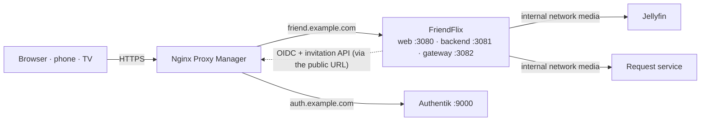

# Setup guide

> **FriendFlix for Plex (preview):** In FriendFlix for Plex, replace the Jellyfin steps (Jellyfin API key, webhook plugin, `JELLYFIN_*` variables) with [plex.md](plex.md) (`MEDIA_SERVER=plex`, `compose.plex.yaml`; Plex address and token go into the setup wizard, `PLEX_URL` / `PLEX_TOKEN` are optional pins). Everything else (Authentik, proxy, `.env` basics) applies unchanged.

**English** · [Deutsch](de/setup.md)

This guide takes you from an empty server to a running FriendFlix with your first invited friend. It uses the production stack ([`compose.prod.yaml`](../compose.prod.yaml), prebuilt images), Authentik for sign-in and Nginx Proxy Manager (NPM) as the only public entry point.

A new install needs **no `.env` file**: you start the stack, read a one-time setup code from the backend log and do the rest in the browser. The setup wizard sets the public address, connects Jellyfin and Authentik (automatically or by hand) and makes your first sign-in the admin. Configuring everything through `.env` still works ([section 15](#15-advanced-configure-by-environment)).

Placeholders used throughout: `friend.example.com` (FriendFlix), `auth.example.com` (Authentik), `/opt/friendflix` (your clone). Replace them with your own values. Never paste real secrets into issues, chats or commits.

## Contents

1. [Overview and order of steps](#1-overview-and-order-of-steps)
2. [Prerequisites](#2-prerequisites)
3. [Authentik](#3-authentik)
4. [Jellyfin](#4-jellyfin)
5. [Request service](#5-request-service)
6. [Nginx Proxy Manager: portal proxy host](#6-nginx-proxy-manager-portal-proxy-host)
7. [Start the stack](#7-start-the-stack)
8. [The setup wizard](#8-the-setup-wizard)
9. [First steps as admin](#9-first-steps-as-admin) (incl. [Harden Authentik](#harden-authentik))
10. [Invite friends](#10-invite-friends) (incl. [What a friend sees](#what-a-friend-sees))
11. [Optional features](#11-optional-features)
12. [Verification checklist](#12-verification-checklist)
13. [Troubleshooting](#13-troubleshooting)
14. [Upgrading to settings in the database](#14-upgrading-to-settings-in-the-database)
15. [Advanced: configure by environment](#15-advanced-configure-by-environment)

## 1. Overview and order of steps



For the full picture of containers, networks and ports see [architecture.md](architecture.md#containers-and-networks).

The path: **install** Authentik and Jellyfin (steps 3–4), **start** the stack ([step 7](#7-start-the-stack)), read the **setup code** from the backend log ([step 7](#7-start-the-stack), [the setup code](#the-setup-code)) and work through the **wizard** in the browser ([step 8](#8-the-setup-wizard)). The services the wizard connects must exist first:

| Step | What you do | What the wizard needs from it |
|---|---|---|
| 2. DNS, Docker, NPM | host names with TLS | – |
| 3. Authentik | install it and create its admin account | its address and a one-time superuser API token |
| 4. Jellyfin | finish Jellyfin's own setup wizard | its internal address and an administrator's username and password (used once) |
| 5. Request service (optional) | finish its setup wizard | its address and API key (wizard extras, or later) |
| 6.–7. NPM proxy host, stack | the running portal, no `.env` | – |
| 8. Setup wizard | setup code, public address, Jellyfin, Authentik, first admin | – |
| 9.–10. first steps, invites | harden Authentik, invite friends | – |

## 2. Prerequisites

**Server.** A Linux host or NAS (e.g. TerraMaster, Synology, Unraid, a mini PC) with:

- Docker Engine and the **Compose v2** plugin (`docker compose version`).
- About 2 GB RAM for FriendFlix (Postgres, Redis, backend, gateway, web) plus 2 GB for Authentik, plus whatever Jellyfin needs for transcoding.
- `git` and `openssl`.
- The time synchronised by NTP (`timedatectl` → *System clock synchronized: yes*). OIDC tokens are rejected when clocks differ by more than 30 s.

**Domains and DNS.** Two host names that point to your public IP (A/AAAA records or a DynDNS name with CNAMEs):

- `friend.example.com` → FriendFlix
- `auth.example.com` → Authentik

Ports 80 and 443 forwarded from the router to NPM. The FriendFlix backend fetches `https://auth.example.com/…` itself; if your router cannot reach its own public IP from inside (no NAT loopback), add local DNS entries (router, Pi-hole, AdGuard) so both names resolve to the NPM host inside the LAN too.

**Nginx Proxy Manager** running ([installation](https://nginxproxymanager.com/setup/)), reachable on 80/443, with an e-mail address set for Let's Encrypt. FriendFlix and Authentik publish their ports on `127.0.0.1` only, so NPM must run on the same host:

- NPM with host networking or installed natively: forward to `127.0.0.1`.
- NPM in a normal bridge container: `127.0.0.1` inside the container is NPM itself. Set `BIND_ADDR` (FriendFlix and Authentik) to the Docker host's bridge address, e.g. `172.17.0.1`, and forward to that address. Never use `0.0.0.0` on a host with a public interface. `BIND_ADDR` is one of the few values that are not settings: put it into a `.env` file next to the compose file (`echo BIND_ADDR=172.17.0.1 > .env`) or pass it on the command line.

**Clone the repository:**

```bash
sudo mkdir -p /opt/friendflix && sudo chown "$USER" /opt/friendflix
git clone https://github.com/LetsManu/friendflix-plex.git /opt/friendflix
cd /opt/friendflix
```

## 3. Authentik

Install Authentik and create its admin account: **[docs/authentik.md §2](authentik.md#2-install-authentik)** (`compose.authentik.yaml` or the official compose file, the NPM proxy host `auth.example.com`, the admin account `akadmin`, optionally SMTP).

That is all you need before the wizard. In the wizard's sign-in step FriendFlix sets up the rest **automatically** with a one-time superuser API token: the groups, the OAuth2/OpenID provider and the application, the service account for invitations, the enrollment and recovery flows. What it creates, how to get the token and how to revoke it afterwards: [authentik.md §3](authentik.md#3-automatic-setup-from-friendflix).

MFA and SMTP stay manual: see [Harden Authentik](#harden-authentik) after the wizard.

Prefer to click everything together yourself? Follow [authentik.md §4–§8](authentik.md#4-groups) and enter the values in the wizard's *By hand* mode.

**A freshly installed Authentik** imports its default flows in the background during the first 3 – 4 minutes. Start the wizard's sign-in step after that; if it stops with *Authentik refused the setup* (`blueprint_invalid`), wait a minute and press *Try again*.

## 4. Jellyfin

FriendFlix talks to Jellyfin over the internal Docker network `friendflix_media`; Jellyfin is never exposed publicly.

**A) Existing Jellyfin** (own container or stack): after the FriendFlix stack has been started once ([step 7](#7-start-the-stack) creates the network `friendflix_media`), attach the container:

```bash
docker network connect friendflix_media <jellyfin-container>
```

Its address for the wizard is `http://<jellyfin-container-name>:8096`. A `docker network connect` does not survive re-creating the Jellyfin container; to make it permanent, add `friendflix_media` as an `external: true` network in Jellyfin's own compose file. Remove Jellyfin's public port mapping and any public proxy host for it once FriendFlix works (or at least firewall it, see [operations.md](operations.md#host-firewall-zusätzlich-zum-fehlenden-port-mapping)).
If Jellyfin runs natively on the host (not in Docker), the backend cannot reach `localhost`; use a Docker container or attach Jellyfin via the host bridge IP *(not covered by the shipped compose files)*.

**B) Bundled Jellyfin** (`--profile bundled`): the containers `jellyfin` and `requests` (the request service) start inside the stack with no ports at all. For their one-time setup wizards publish both services temporarily on loopback with a local override file (do not commit it):

```yaml
# compose.setup.yaml - TEMPORARY, remove after the setup wizards
services:
  jellyfin:
    ports: ["127.0.0.1:8096:8096"]
    networks: [media, egress, front]
  requests:
    ports: ["127.0.0.1:5055:5055"]
    networks: [media, egress, front]
```

```bash
MEDIA_PATH=/mnt/data/media docker compose -f compose.prod.yaml -f compose.setup.yaml --profile bundled up -d jellyfin requests
ssh -L 8096:127.0.0.1:8096 -L 5055:127.0.0.1:5055 you@server     # from your PC; then open http://localhost:8096
```

(`MEDIA_PATH` is mounted read-only at `/media` in Jellyfin.) Finish the wizards, then start again without `compose.setup.yaml` so the ports disappear. Its address for the wizard is `http://jellyfin:8096`.

**In Jellyfin:**

1. **Finish Jellyfin's own setup wizard first**: admin user, metadata language, libraries (Movies, Shows …). Library names matter only if you restrict roles to certain libraries (`ROLE_TEMPLATES`). The FriendFlix wizard refuses the automatic API key until this is done (*The media server itself is not set up yet*).
2. The API key: the FriendFlix wizard creates it for you (*Create API key automatically*, [section 8](#8-the-setup-wizard)). By hand instead: *Dashboard → API Keys* (in newer versions under *Dashboard → Advanced → API Keys*) → **+** → app name `FriendFlix` → copy the key and choose *By hand* in the wizard. The key acts as admin: FriendFlix uses it to create one Jellyfin user per portal user (random password, stored encrypted with `APP_ENC_KEY`) and to apply the role policies.
3. Optional: the webhook plugin for instant "now playing" and "new in library" events, see [integrations.md](integrations.md#jellyfin-webhook-plugin-optional-polling-sessions-every-10-s-is-the-fallback).
4. Hardware transcoding as usual for your hardware (Intel QSV/VAAPI: see the note on "VPP Tone mapping" in the README).

## 5. Request service

Wishes go through a request service: the bundled `requests` container (upstream project: see its `image:` line in [`compose.prod.yaml`](../compose.prod.yaml)) or a compatible instance you already run.

The request service is **optional**. Without `REQUESTS_URL` and `REQUESTS_API_KEY`, FriendFlix hides wishes, the upcoming row and the admin request pages; *Requests* then only lists reminders. You connect it in the wizard's extras or later under *Admin → Settings → Requests*.

1. Open the request service (existing instance, or `http://localhost:5055` through the tunnel above) and finish the wizard with **Jellyfin** as media server: URL `http://jellyfin:8096` (bundled) or your container name, plus a Jellyfin admin login. Sync libraries, add Radarr/Sonarr if you use them.
2. *Settings → General* → copy the **API Key** (`REQUESTS_API_KEY`). The address is `http://requests:5055` (bundled) or `http://<container-name>:5055` after `docker network connect friendflix_media <container-name>`.
3. *Settings → Users*: turn off automatic Jellyfin user import (FriendFlix profiles are hidden Jellyfin users and would show up otherwise). Leave auto-approve off if you want to approve every request.
4. Webhook for "request approved/available": see [integrations.md](integrations.md#request-service).

## 6. Nginx Proxy Manager: portal proxy host

*Hosts → Proxy Hosts → Add Proxy Host*:

| Tab | Field | Value |
|---|---|---|
| Details | Domain Names | `friend.example.com` |
| | Scheme | `http` |
| | Forward Hostname / IP | `127.0.0.1` (or your `BIND_ADDR`) |
| | Forward Port | `3080` (`WEB_PORT`, the SvelteKit UI) |
| | Cache Assets | off |
| | Block Common Exploits | on |
| | Websockets Support | **on** |
| SSL | SSL Certificate | Request a new Let's Encrypt certificate |
| | Force SSL, HTTP/2 Support, HSTS Enabled | on |
| Advanced | Custom Nginx Configuration | the full content of [`deploy/npm/portal.advanced.conf`](../deploy/npm/portal.advanced.conf) |

The advanced config routes `/api/`, `/auth/` and `/ws/` to the backend (`:3081`), `/media/` to the gateway (`:3082`, unbuffered, with HTTP range), keeps `/media/c/` (Chromecast tokens) out of the logs, and answers `/internal/`, `/metrics` and `/health/ready` with 404. If you changed `BIND_ADDR` or the ports, replace `127.0.0.1:3081`/`:3082` in the pasted text accordingly. Keep the `/media/c/` block even if you do not use Chromecast.

The backend trusts `X-Forwarded-*` headers (`trustProxy`), so NPM must be the only way in: the ports stay on `BIND_ADDR`.

Until the setup wizard is finished, anybody who reaches the portal sees the wizard's first page (the code prompt). They cannot get past it without the code, but they can use up its attempts ([section 8](#the-setup-code)). Finish the wizard right after starting the stack, or keep the portal private until then, e.g. with an NPM *Access List* that only allows your own address, or by opening the wizard through an SSH tunnel to `127.0.0.1:3080`.

## 7. Start the stack

```bash
docker login ghcr.io -u <github-user>                   # only if the packages are private (PAT with read:packages)
docker compose -f compose.prod.yaml up -d               # add --profile bundled for the bundled Jellyfin + request service
docker compose -f compose.prod.yaml logs bootstrap      # file names and actions ("generated"), never values
docker compose -f compose.prod.yaml ps                  # postgres/redis healthy, backend/gateway/web running
docker compose -f compose.prod.yaml logs backend | grep "setup code"
```

No output yet? `up -d` returns before the backend has started: wait a few seconds and run the last command again; the line appears once the backend is up.

No `.env` is needed. The `bootstrap` service starts first, generates the database and Redis passwords, `APP_ENC_KEY` and `INTERNAL_SECRET` into the Docker volume `friendflix_bootstrap` and exits (`docker compose -f compose.prod.yaml ps -a` shows it as *Exited (0)*); every other service waits for it. If the backend restarts in a loop, read the first error in its log: an invalid variable (the config check names it) or a missing file of the bootstrap volume (see [troubleshooting](#13-troubleshooting)).

Until setup is complete the backend runs in **setup mode**: everything except the wizard answers `503 setup_required`, background jobs wait, `/health` stays OK, and the gateway answers `/media/…` with 503 until the media server is configured. The last command prints the line with the setup code:

```
FriendFlix setup: open the portal in your browser and enter the setup code K7QM-3XA9-PT2D (valid until 2026-10-15 14:03 UTC). Restart the backend for a new code.
```

**Back up the generated secrets now:** `./scripts/backup-bootstrap.sh` writes `backups/friendflix-bootstrap-<time>.tgz`. Keep it apart from the database dumps (password manager, another disk): without it a restored database cannot read its encrypted values. Details: [operations.md](operations.md#backups--wiederherstellung).

## 8. The setup wizard

Open `https://friend.example.com`. While setup is incomplete every page leads to `/setup`. Every step can be changed later under *Admin → Settings*; a step whose values come from the environment shows them locked (*From environment*) and can be skipped.

1. **Setup code.** Paste the code from the log. Case, spaces and dashes do not matter (`O` counts as `0`, `I` and `L` as `1`).
2. **Public address.** The address everybody uses, without a path: `https://friend.example.com`. The wizard suggests the one your browser used. FriendFlix then fetches a test page from that address; if that fails it only warns (common without NAT loopback), it does not block. `http://` works for tests but turns off secure cookies, Chromecast and passkeys.
3. **Media server.** *Automatic*: the Jellyfin address as the backend reaches it (`http://jellyfin:8096` or your container name, never the public URL) plus the username and password of a Jellyfin **administrator** → *Create API key automatically*. *By hand*: address and an API key from Jellyfin. Both are tested before they are saved.
4. **Sign-in.** *Automatic*: the Authentik address as the browser reaches it (`https://auth.example.com`; the backend must reach the same address) and a superuser API token → *Show plan* lists what will be created or adjusted, nothing changes yet → *Apply* (about 30 seconds). Leave *Add me to the admin group* ticked to put the token's owner into `friendflix-admins`. The result lists what is still to do by hand (SMTP, MFA, e-mail templates). Details: [authentik.md §3](authentik.md#3-automatic-setup-from-friendflix). *By hand*: issuer, client ID, client secret and admin group from your own provider, with a checklist of how the provider must be set up; optionally the Authentik API values for invitations.
5. **First admin.** *Sign in with Authentik*. Sign in with the account that should run FriendFlix (it needs MFA set up once MFA is mandatory). **This sign-in becomes the admin and completes the setup**, whatever groups the account has; FriendFlix creates its Jellyfin user and owner profile as for any first login. Exactly one account becomes admin this way, even with several backends.
6. **Extras** (signed in now; every card has *Skip*): request service, TMDB/OMDb keys, downloads, push keys (*Generate push keys*), ntfy/Discord, webhook secret (*Generate webhook secret*, shown once with the header lines to paste into Jellyfin and the request service), updates via Portainer. *Finish* opens the home page.

### The setup code

- The backend prints it **once**, at start, to its log (`docker compose -f compose.prod.yaml logs backend | grep "setup code"`). Only its hash is stored. It is valid for **24 hours**.
- **Every backend restart issues a new code** and the old one stops working: `docker compose -f compose.prod.yaml restart backend`. Do that when the code has expired or is locked.
- **Limits:** 5 tries per 15 minutes per client address; after **10 wrong codes in total** the code is locked (log: `Too many wrong setup codes; restart the backend for a new code`). The per-address limit is counted per backend instance and relies on the proxy reporting the client address (`trustProxy`); a client that can send its own `X-Forwarded-For` through your proxy gets around it, but not around the total of 10.
- **Anyone who reaches the portal before setup is done can lock the code** by guessing. They cannot guess it (60 random bits), but locking forces a restart. Finish the wizard promptly or restrict access until it is done ([section 6](#6-nginx-proxy-manager-portal-proxy-host)).
- Only a backend with `BACKGROUND_JOBS=true` (the default) issues a code. If none does, the wizard says *No code has been issued yet* (`no_code`).
- A valid code opens a **setup session** in this browser (2 hours, renewed while you work). The same code works on another device until setup completes. Completing setup invalidates the code and ends every setup session.

### What the wizard never keeps

The Authentik superuser token and the Jellyfin administrator's password are used for that one request and then forgotten: never stored, never logged, never shown in an error. What is saved is what an `.env` would hold: the Jellyfin API key `FriendFlix`, and the client ID and secret of the provider plus the token of the service account `friendflix-invites` (with only the permissions FriendFlix needs). **Revoke the superuser token in Authentik afterwards** ([Harden Authentik](#harden-authentik)).

## 9. First steps as admin

1. **Instance language:** FriendFlix asks the first admin once which language the whole instance should use by default (English, German, French, Spanish, Italian, Turkish, Polish). Every profile can pick its own language later; new profiles are asked on their first login, with the browser language suggested.
2. Your first device is approved automatically; further devices have to be approved under *Devices*. Further admins: put them into the Authentik group `friendflix-admins` (`ADMIN_GROUP`); on their first login FriendFlix makes them admin without an invite.
3. Harden Authentik, see below.
4. Look around *Admin*: the **overview** (health of the media server and the request service, what waits for your decision, recent activity), roles and limits, the weekly digest. Under *Content* you can add **brand hubs**, pin themed lists to the home page and set "leaving soon" dates; the owner profile can create kids profiles under *Profiles*.

### Harden Authentik

Right after the wizard, in Authentik:

1. **Revoke the one-time superuser token** (only if you used *Automatic*): *Directory → Tokens and App passwords*, tick the token, *Delete*. A bootstrap token (`authentik-bootstrap-token`) goes the same way, and `AUTHENTIK_BOOTSTRAP_TOKEN` leaves Authentik's environment. FriendFlix keeps only the token of the service account `friendflix-invites`. [authentik.md §3.2](authentik.md#32-the-one-time-superuser-token).
2. **Make MFA mandatory** in the authentication flow, so every friend sets up an authenticator app or security key at sign-up: [authentik.md §6](authentik.md#6-authentication-flow-with-mandatory-mfa). The wizard does not change how people sign in to Authentik.
3. **Set up SMTP** for invitation and password e-mails: [authentik.md §2.5](authentik.md#25-e-mail-smtp).
4. **Prepare the in-app sign-in.** FriendFlix shows its own sign-in screens as soon as Authentik is connected (`LOGIN_UI`, [authentik.md §10a](authentik.md#10a-in-app-sign-in)). Open *Admin → Status → Sign-in*: it checks the flows, implicit consent, the `authorization_code` grant type and whether passkeys can run on FriendFlix's own page, and names what to fix. Two things stay manual:
   - **The e-mail change flow** (the *E-mail address → Change* row of *Security* on the account page) needs its mail template mounted under `/templates` (with your FriendFlix address in its link) first; the wizard imports the flow only once Authentik lists that template, and *Repair Authentik setup* on *Admin → Status → Sign-in* does it later ([authentik.md §10a, step 7](authentik.md#10a-in-app-sign-in)). Until then the row shows the address without a *Change* button, and admins see a note.
   - **Optional:** let password-reset mails open in FriendFlix (`/reset`) with the recovery template ([authentik.md §10a, step 4](authentik.md#10a-in-app-sign-in)).

   Upgrading an install from before the in-app sign-in? Use *Repair Authentik setup* on *Admin → Status → Sign-in* with a one-time superuser token ([authentik.md §3.6](authentik.md#36-repair-or-upgrade-the-setup-of-an-existing-install)), or re-import `deploy/authentik/friendflix-service-account.yaml` (or `friendflix-blueprint.yaml`) by hand: the service account needs the new device-delete permissions for *Remove* on the account page, and read permissions for the validation stage and the OAuth2 provider (the last-factor rule and the status card's consent and grant-type checks) ([authentik.md §8.2](authentik.md#82-role-with-exactly-these-global-permissions)).
5. Check the result with [authentik.md §14](authentik.md#14-verification) and tick the checklist in [section 12](#12-verification-checklist).

### Settings in the database

*Admin → Settings* shows every setting with its source: **From environment** (`.env`, a `_FILE` secret or an older variable name; locked, the field cannot be edited), **Saved** (the database) or **Default**. The generated values of the *Server* group (`DATABASE_URL`, `REDIS_URL`, `APP_ENC_KEY`, `INTERNAL_SECRET`) show **From startup file**: the `bootstrap` service created them in its volume; they are read-only here. The environment wins over the database, the database over the default.

The in-app sign-in has its own settings under *Admin → Settings → Sign-in* (`LOGIN_UI`, the login and sign-out flow slugs, the slugs of the account page's flows for recovery codes, passkeys, password change and e-mail change, `PASSKEYS_IN_APP`) and *General* (`LOGIN_COVER_WALL`); no `.env` lines are needed. *Admin → Status* shows a Sign-in card that checks the Authentik side. See [authentik.md §10a](authentik.md#10a-in-app-sign-in).

- **Live:** most settings apply at once on every backend; a save bumps a revision, other instances and the gateway reload within seconds (at the latest after 30 s). `API_COMPRESSION` applies to the next response. Settings marked *Restart needed* (`DOWNLOAD_CREATE_PER_HOUR`) take effect after `docker compose -f compose.prod.yaml restart backend`; a banner lists them.
- **Secrets are write-only:** the page shows *Set* or *Not set* and the date of the last change (data-source keys also their last four characters), with *Replace* and *Remove*. No secret ever comes back from the server, and the audit log records key names only.
- **Checked before saving:** a save tests the affected service (media server, sign-in, Authentik, request service, data sources, Portainer, GitHub) with the new values. A refused key or login blocks the save; an unreachable service offers *Save anyway*.
- **Fresh sign-in:** saving a secret, `PUBLIC_URL`, `HOME_NETWORKS`, `ADMIN_GROUP`, `NTFY_URL` / `NTFY_BASE_URL`, any `OIDC_*` or `AUTHENTIK_*` value, or an address a saved key is sent to (`JELLYFIN_URL`, `REQUESTS_URL`, `PORTAINER_URL`) needs a sign-in that is at most 10 minutes old; so does replacing or removing a key in *Admin → Data sources*. FriendFlix sends you through the sign-in once more and then repeats the save (on *Data sources* you enter the key again).
- **Server:** a read-only group lists the values that stay per container in `.env` (`MEDIA_SERVER`, `BACKGROUND_JOBS`, `METRICS_TOKEN`, `DIGEST_DAY`/`DIGEST_HOUR`, `ROLE_TEMPLATES`, `UPDATE_REPO`, `GATEWAY_URL`, paths) and whether the generated secrets are set, never their values.
- **Move:** a row that comes from the environment has **Move** (and the page **Move all**): it copies the value into the database. Afterwards you can remove the variable from `.env` and run `docker compose -f compose.prod.yaml up -d`; until then the environment value keeps winning.

## 10. Invite friends

*Admin → Users → Invites*:

1. Choose the role (`friend`, `family` or `guest`; limits are editable under *Admin*), how long the link is valid (default 48 h, max. 14 days), an optional note, **Max. uses** (how many accounts the link can create, 1 – 50, default 1) and **Access (days)** (each new account's access ends after that many days; empty = unlimited).
2. Leave **already has an Authentik account** unticked for new people. Create.
3. The link is shown only now (also as a QR code). The text below it must read *The link guides through account creation (including two-factor) and grants access directly.* Otherwise the Authentik invitation is not configured; see [authentik.md §15](authentik.md#15-troubleshooting).
4. Send the link. The friend opens it, clicks **Create account & get started**, creates the account on FriendFlix's sign-in screens (Authentik runs its enrollment flow behind them, including MFA) and lands logged in on the portal. With `LOGIN_UI=authentik` the sign-up runs on Authentik's own pages instead.

For someone who already has an Authentik account, tick **already has an Authentik account**: the link then offers **Sign in & unlock**. Unused invites can be revoked in the list; that also deletes the Authentik invitation. The list shows the uses as "1/3" and, expanded, the accounts made from each invite.

**Without an invite:** someone who signs in through Authentik without an invite (and is not in `friendflix-admins`) is not refused. They see *Request sent* (`/pending`), you get a notification, and the request waits under *Admin → Users → Waiting for approval*. Approve it with a role and an optional access-until date, or reject it with an optional message; the page updates by itself, and after an approval the person signs in again. Details: [operations.md](operations.md#nutzerverwaltung-zugang-bis-freigaben-einladungen) (German).

### What a friend sees

1. **The invite page** (`/invite/…`): the account type (role) and the validity, plus a button **Create account & get started**. For someone with an Authentik account it reads **Sign in & unlock**. A used or expired link says *Invalid invitation*: send a new one.
2. **Sign-up** on FriendFlix's sign-in page, over the cover wall: username and password, then the authenticator app (QR code, or the key to type in, and the first 6-digit code) and recovery codes to copy or download. Authentik runs the enrollment flow behind these screens; a step FriendFlix cannot show continues on Authentik's page. Afterwards the friend is signed in on the portal and unlocked.
3. **First visit** (once per profile): a language picker (the browser language suggested), then **Welcome** in three steps: check the profile name and colour, pick 3 titles they like (these feed the recommendations; *Skip* is possible), *Let's go*. A kids profile gets a simpler version.
4. **Later:** the first device is trusted automatically; every further device waits under *Devices* until you approve it. With several profiles on an account, the profile picker appears once per browser session. Jellyfin and the request service stay invisible: friends only ever open `https://friend.example.com`.
5. **Signing in again** happens on the same page: name, password, then the 6-digit code (or a recovery code, or a passkey). *Forgot your password?* shows a "check your inbox" screen; the link in the mail opens Authentik's reset page, or FriendFlix's `/reset` page if you set the template. After too many wrong attempts the page links to Authentik's own sign-in.
6. **My space → Account → Security:** the friend changes the password, adds or removes an authenticator app or passkey, makes new recovery codes and changes the e-mail address. Each action asks for the password (and second factor) once more in a small dialog first; a new e-mail address only counts once the friend clicks the link sent to it.

Next: what you get to see and configure as admin is in [section 9](#9-first-steps-as-admin).

## 11. Optional features

| Feature | What to do | Details |
|---|---|---|
| **Offline downloads** | On by default (`DOWNLOADS_ENABLED=true`). For a dedicated disk: `mkdir -p /mnt/data/friendflix/downloads /mnt/data/friendflix/previews && chown 1000:1000 /mnt/data/friendflix/{downloads,previews}`, then `DOWNLOADS_PATH=…`, `PREVIEWS_PATH=…`. Create and `chown` the folders **before** starting, otherwise Docker creates them as root and the backend logs `EACCES`. Allow downloads per role under *Admin*. | [downloads.md](downloads.md) |
| **Web push** | *Admin → Settings → Push notifications → Generate key pair* (or `node scripts/gen-vapid.mjs` → `VAPID_PUBLIC_KEY`, `VAPID_PRIVATE_KEY` in `.env`), optional `VAPID_SUBJECT=mailto:you@example.com`. Keep the pair stable. Needs HTTPS; on iOS the site must be added to the home screen. | [integrations.md](integrations.md#web-push-browser-notifications) |
| **ntfy / Discord** | `NTFY_URL=https://ntfy.example.com/friendflix` and/or `DISCORD_WEBHOOK_URL=…` for the shared channel; `NTFY_BASE_URL` for personal topics. | [integrations.md](integrations.md#ntfy--discord) |
| **Chromecast** | On by default (`CAST_ENABLED=true`). Needs an https `PUBLIC_URL` with a publicly valid certificate that the Chromecast can reach, and the `/media/c/` block from `portal.advanced.conf`. | [cast.md](cast.md) |
| **TV mode** | Nothing to configure: open `https://friend.example.com/tv` on the TV and pair it with the phone. | [tv-mode.md](tv-mode.md) |
| **Database backups** | `mkdir -p backups && sudo chown 70 backups`, then `docker compose -f compose.prod.yaml --profile backup up -d backup` (`BACKUP_HOUR`, `BACKUP_KEEP_DAYS`, `BACKUP_PATH`). Back up the `bootstrap` volume once with `./scripts/backup-bootstrap.sh` and keep it apart from the dumps; back up Authentik separately ([authentik.md §2.6](authentik.md#26-backups-and-updates)). | [operations.md](operations.md#backups--wiederherstellung) |
| **One-click updates** | *Admin → Update* redeploys through **Portainer**: either `PORTAINER_WEBHOOK_URL` (stack webhook), or `PORTAINER_URL` + `PORTAINER_API_KEY` + `PORTAINER_STACK_ID` (+ `PORTAINER_ENDPOINT_ID`, default `1`). Use a Portainer user that can only redeploy this one stack. FriendFlix deliberately never gets the Docker socket: **do not mount `/var/run/docker.sock` into any FriendFlix container**, the web app must not be able to control Docker. | [operations.md](operations.md#updates-aus-dem-portal) |
| **Monitoring** | `METRICS_TOKEN`, Prometheus/Icinga examples; optional Prometheus + Grafana stack: set `GRAFANA_ADMIN_PASSWORD` (no default) and add `-f compose.monitoring.yaml`. | [monitoring.md](monitoring.md) |
| **Plan B** | NPM serves `/media/` itself (`auth_request`); then `DOWNLOADS_ENABLED=false`, `CAST_ENABLED=false`. | [operations.md](operations.md#plan-b-npm-liefert-media-direkt-auth_request) |

Values in the table can also be set in *Admin → Settings*. After changing `.env`: `docker compose -f compose.prod.yaml up -d` (recreates only what changed).

## 12. Verification checklist

- [ ] The setup wizard is closed: the backend log has `Setup completed; the setup code is no longer valid.` and `/setup` leads to the home page.
- [ ] The Authentik superuser token used by the wizard is deleted.
- [ ] `docker compose -f compose.prod.yaml ps`: all services up, `postgres`/`redis` (and `backup`) healthy.
- [ ] `curl -s http://127.0.0.1:3081/health/ready` reports Postgres, Redis and Jellyfin OK.
- [ ] `curl -sI https://friend.example.com` → `200`, valid certificate, `strict-transport-security` header.
- [ ] `curl -s -o /dev/null -w '%{http_code}\n' https://friend.example.com/internal/x` → `404`; same for `/metrics`.
- [ ] From outside your network: `nmap -p 3080-3082,8096,5055,9000 <public-ip>` → all filtered/closed.
- [ ] `curl -s https://auth.example.com/application/o/friendflix/.well-known/openid-configuration | jq -r .issuer` equals `OIDC_ISSUER`.
- [ ] Admin login works, MFA is requested, *Admin* is visible.
- [ ] A test invite in a private window ends logged in on the portal; the user appears in *Admin → Users* and in Jellyfin.
- [ ] *Admin → Status → Sign-in* shows no warning (the e-mail change flow shows *Missing* until you import it, without a warning; see [Harden Authentik](#harden-authentik)).
- [ ] A movie plays (direct play and a forced lower quality → transcoding), subtitles work, seeking works.
- [ ] Optional: push test notification, a download, casting, a backup file in `backups/`.

## 13. Troubleshooting

| Symptom | Cause / fix |
|---|---|
| No line with `setup code` in the backend log | The log was cut (the line is printed once per start) or setup is already complete. `docker compose -f compose.prod.yaml restart backend` prints a new code. The wizard says *No code has been issued yet* (`no_code`): no backend runs with `BACKGROUND_JOBS=true`; set it on one backend and restart it. |
| Wizard: *The code has expired* / *Too many wrong attempts* | The code is valid for 24 hours and locked after 10 wrong tries. `docker compose -f compose.prod.yaml restart backend` and use the new code from the log. If somebody else is guessing, restrict access to the portal until setup is done ([section 6](#6-nginx-proxy-manager-portal-proxy-host)). |
| Wizard: *Your setup session has expired* | More than 2 hours without activity, a restart of Redis, or another browser. Enter the code again: it stays valid for 24 hours, unless the backend restarted in between (then use the new code from the log). |
| Wizard, media server: *The media server itself is not set up yet* / *no admin rights* | Finish Jellyfin's own setup wizard first; the account must be a Jellyfin administrator. *Cannot be reached*: the address must be the one the backend container reaches (`http://jellyfin:8096`, Jellyfin attached to `friendflix_media`), not the public one. |
| Wizard, media server: *The API key comes from the environment (.env)* | `JELLYFIN_ADMIN_API_KEY` is set in `.env`, so the automatic step would create a key it cannot save, and the wizard cannot replace it. Switch to *By hand* and enter only the address (the key from `.env` is used), or remove the key from `.env` and restart the backend. |
| Wizard, sign-in: *Authentik refused the setup* (`blueprint_invalid`) | A freshly installed Authentik is still importing its default flows (3 – 4 minutes after the first start). Wait and press *Try again*; parts already created are reused. |
| Wizard, sign-in: *The token does not belong to a superuser* / *refuses the token* | Use an API token (intent *API Token*) of a superuser such as `akadmin`, not an app password ([authentik.md §3](authentik.md#3-automatic-setup-from-friendflix)). |
| Wizard, sign-in: Authentik *cannot be reached*, or the sign-in test fails with an `http://` address | The backend must reach Authentik at exactly the address you entered (the browser uses the same one). An `http://` Authentik needs `OIDC_ALLOW_INSECURE=true` in the environment (tests only). |
| *Sign in with Authentik* in the wizard comes back to the code step (*Your setup session has expired*) | The sign-in came back to another browser or address than the one that holds the setup session (cookies), or the session expired. Open the wizard at `PUBLIC_URL`, enter the code again and sign in from there. |
| Authentik shows a redirect URI error | The provider's redirect URI must be exactly `${PUBLIC_URL}/auth/callback` (scheme, host, no trailing slash). FriendFlix must run at the root of its host name. |
| Sign-in answers 503, backend log `oidc discovery failed`, `"issuer" property does not match the expected value` | `OIDC_ISSUER` needs the trailing slash and the exact application slug. |
| Sign-in answers 503, backend log `oidc discovery failed` with `fetch failed` / `ENOTFOUND` | The backend container cannot reach `auth.example.com`: DNS inside the LAN, NAT loopback, firewall. Test with `docker compose -f compose.prod.yaml run --rm --no-deps backend node -e "fetch('https://auth.example.com').then(r=>console.log(r.status))"`. As a workaround, a local override can add `extra_hosts: ["auth.example.com:host-gateway"]` to `backend` when NPM listens on the host's port 443. |
| Backend refuses an `http://` issuer | `openid-client` only accepts https. `OIDC_ALLOW_INSECURE=true` is for development against a local Authentik, never for production. |
| `{"error":"login_failed"}` after Authentik | Wrong client secret, an encryption key set on the provider, or clock skew > 30 s between the hosts (enable NTP). The backend log line `oidc callback failed` has the reason. |
| `{"error":"invalid_state"}` | The login was started on another address than `PUBLIC_URL` (LAN IP, `http://`), the browser blocked the cookie, or the login took longer than 10 minutes. Always use `PUBLIC_URL`. |
| Login loops back to the start page / not logged in | `PUBLIC_URL` is `https://…` but the site was opened via `http://` or an IP: the session cookie is `Secure` and only valid on that host. Enable *Force SSL* in NPM. |
| `403 {"error":"csrf"}` on actions | Stale page after a new login in another tab: reload. Persistent: NPM must forward `/api/` to the backend unchanged (use `portal.advanced.conf`), and no cache in between may strip headers. |
| Watch party / remote control does not connect (WebSocket closes with 4401) | The browser's `Origin` must equal `PUBLIC_URL`; *Websockets Support* on and the `/ws/` block present in NPM. |
| After sign-in someone sees *Request sent* (`/pending`) | First login without an invite and not in `ADMIN_GROUP`: approve them under *Admin → Users → Waiting for approval*. If it is you, the admin group is not recognised; see [authentik.md §15](authentik.md#15-troubleshooting). |
| 502 Bad Gateway from NPM for the whole site | NPM cannot reach `BIND_ADDR:3080/3081/3082`: wrong forward IP (bridge container → Docker host IP), containers not running, or `BIND_ADDR` differs from the IP in the proxy host/advanced config. |
| 502/504 for `/media/…` only, or "Jellyfin unreachable" in *Admin → Status* | The gateway/backend cannot reach `JELLYFIN_URL`: Jellyfin not attached to `friendflix_media` (`docker network connect friendflix_media <jellyfin>`), wrong container name, or Jellyfin down. The URL comes from `.env` or *Admin → Settings → Media server*; the gateway logs the one it uses (`gateway upstream: <origin>`). Check with that URL: `docker compose -f compose.prod.yaml exec gateway node -e "fetch('http://jellyfin:8096/System/Info/Public').then(r=>console.log(r.status))"`. |
| `/media/…` answers 503, gateway log `/media answers 503 until the media server is set up` | No `JELLYFIN_URL` yet, or the gateway cannot reach the backend: set it in `.env` or *Admin → Settings → Media server*; the gateway picks it up within 30 s. |
| Nothing starts, `docker compose logs bootstrap` shows `exists but is empty (damaged volume)` | The `bootstrap` volume lost `postgres_password` or `app_enc_key`. A new value would not match the database, so the service refuses. Set the value in `.env` (`POSTGRES_PASSWORD` / `APP_ENC_KEY`, from your password manager or old `.env`) or restore the volume backup, then `up -d` again. |
| Backend stops with `bootstrap file /run/friendflix/<name> missing` or `is not readable` | Started without the `bootstrap` service (`docker run`, `--no-deps`, an old override file) or without `group_add: ["10001"]`. Start with `docker compose -f compose.prod.yaml up -d`. |
| *Admin → Settings* shows *Stored value unreadable* | The value was saved with another `APP_ENC_KEY` (database restored without its `bootstrap` volume). Enter it again. |
| Log line `PUBLIC_URL has a path, query or credentials; using its origin` | FriendFlix runs at the root of its host name only. Remove the path from `PUBLIC_URL`. |
| Downloads fail with `EACCES` | `DOWNLOADS_PATH`/`PREVIEWS_PATH` not owned by uid 1000: `chown 1000:1000 <folder>`. |
| Backup container `unhealthy` | `docker compose -f compose.prod.yaml logs backup`; usually `backups/` not writable by uid 70. |

More: [operations.md](operations.md) (backups, firewall, updates), [integrations.md](integrations.md) (webhooks, push), [authentik.md](authentik.md#15-troubleshooting) (sign-in and invitations).

## 14. Upgrading to settings in the database

An existing install upgrades like any update (`docker compose -f compose.prod.yaml -f compose.plex.yaml pull && docker compose -f compose.prod.yaml -f compose.plex.yaml up -d`); its `.env` keeps working unchanged. What to know:

1. **The `bootstrap` service** starts first on every `up`, copies `POSTGRES_PASSWORD`, `REDIS_PASSWORD`, `APP_ENC_KEY` and `INTERNAL_SECRET` from `.env` into the volume `friendflix_bootstrap` and exits. Its log shows file names and actions only:

   ```bash
   docker compose -f compose.prod.yaml logs bootstrap
   # bootstrap: postgres_password: from environment
   # bootstrap: app_enc_key: from environment   ...
   ```

2. **Keep those four in `.env` until that log says `from environment` for each of them.** Removing one earlier makes the service generate a new value: a new database password does not match `pgdata` (Postgres keeps the password it was created with) and a new `APP_ENC_KEY` makes every encrypted value unreadable. Once the log line is there you may remove them, run `up -d` again and check that the log now says `kept`. Then back up the volume (`./scripts/backup-bootstrap.sh`). Leaving them in `.env` works too: `.env` then stays the source and the volume a copy.
3. **Settings show as locked.** Every setting from `.env` appears in *Admin → Settings* as *From environment* and cannot be edited there. **Move** (per row) or **Move all** copies the values into the database; the row then says which names (also `_FILE` and older names) you can remove from `.env`. The environment keeps winning until you remove them and run `up -d`. The values of the *Server* group stay in `.env`.
4. **`PUBLIC_URL` with a path or query** (e.g. `https://friend.example.com/ff`) starts with its origin (`https://friend.example.com`) and logs one warning: FriendFlix runs at the root of its host name only. A value saved in *Admin → Settings* must be an origin.
5. **The request service is optional now.** Without `REQUESTS_URL` and `REQUESTS_API_KEY` the request menus are hidden; reminders still work.
6. **Keys from *Admin → Data sources*** move into the settings unchanged (same encryption); the page keeps working.
7. **Docker secrets** (`compose.secrets.yaml`) keep winning; the generated copies in the volume stay unused.
8. **Own override files:** the `postgres` service now reads `POSTGRES_PASSWORD_FILE`; an override that also sets `POSTGRES_PASSWORD` there must drop it (the image refuses both). `DATABASE_URL` and `REDIS_URL` are no longer set by the compose files; a value from an override still wins.
9. **No setup wizard.** The upgrade marks setup as complete because accounts exist; the setup code and the wizard only appear on installs without any account.
10. **Plan B:** the NPM configuration keeps the `INTERNAL_SECRET` it has; after removing it from `.env`, the value lives in the volume ([operations.md](operations.md#plan-b-npm-liefert-media-direkt-auth_request)).

## 15. Advanced: configure by environment

Everything the wizard saves can also come from the environment: a `.env` file next to the compose file, `environment:` in a local override, or Docker secrets. A value from the environment **wins** over the database and shows locked in *Admin → Settings* and in the wizard (*From environment*, the step can be skipped). Use this to pin values, for automated installs, or if you prefer files over a web UI.

A fresh install with a complete `.env` still shows the wizard once: the setup code and the first admin's sign-in are always needed (the steps whose values come from `.env` are skipped). Installs that already have accounts never see the wizard ([section 14](#14-upgrading-to-settings-in-the-database)).

```bash
cp .env.example .env     # every line in it is commented out: uncomment only what you want to pin
chmod 600 .env
```

| Variable | Wizard step | Value |
|---|---|---|
| `PUBLIC_URL` | 2 | `https://friend.example.com`, no path. Must be exactly the URL people use (cookies, redirect URI, WebSocket origin check). |
| `JELLYFIN_URL`, `JELLYFIN_ADMIN_API_KEY` | 3 | `http://jellyfin:8096` (internal name, never the public URL) and an API key from *Dashboard → API Keys* |
| `OIDC_ISSUER` | 4 | `https://auth.example.com/application/o/friendflix/` **with trailing slash** |
| `OIDC_CLIENT_ID`, `OIDC_CLIENT_SECRET` | 4 | from the Authentik provider |
| `ADMIN_GROUP` | 4 | `friendflix-admins` (default); Authentik group name, case-sensitive |
| `AUTHENTIK_URL`, `AUTHENTIK_API_TOKEN`, `AUTHENTIK_ENROLL_FLOW` | 4 | invitations that create the Authentik account ([authentik.md §9](authentik.md#9-friendflix-env-values)) |
| `BIND_ADDR` | – | `127.0.0.1` (default) or the Docker bridge IP if NPM runs in a bridge container |
| `WEB_PORT`, `BACKEND_PORT`, `GATEWAY_PORT` | – | `3080`, `3081`, `3082` (defaults); change only if taken |
| `TZ` | – | e.g. `Europe/Vienna`; schedules (digest, playback check, backups) |
| `METRICS_TOKEN` | – | `openssl rand -hex 24` if you scrape `/metrics` ([monitoring.md](monitoring.md)) |
| `FF_REGISTRY`, `FF_TAG` | – | `ghcr.io/letsmanu`, `latest`; `FF_TAG` is the [release channel](#release-channels): `latest`, `nightly`, or `1` / `1.1` / `1.1.0` (or a commit SHA) to pin |
| `OIDC_ALLOW_INSECURE` | – | `false`; `true` only for tests against an `http://` Authentik, never in production |
| `POSTGRES_PASSWORD`, `REDIS_PASSWORD`, `APP_ENC_KEY`, `INTERNAL_SECRET` | – | **leave out** on a new install (generated). An existing install keeps them until the volume holds them ([section 14](#14-upgrading-to-settings-in-the-database)) |

Everything else (request service, sessions, downloads, push, ntfy, Portainer) is listed in the [README table](../README.md#advanced-configure-by-environment) and in [.env.example](../.env.example). The webhook secret is generated in *Admin → Settings → General → Webhook secret → Generate new* (or in the wizard's extras) and shown once. Until it is set, the webhooks of Jellyfin and the request service answer 403. After changing `.env`: `docker compose -f compose.prod.yaml up -d` (recreates only what changed).

### Release channels

`FF_TAG` alone decides which images the stack pulls (`compose.prod.yaml`: `…/friendflix-<service>:${FF_TAG:-latest}`):

| `FF_TAG` | Channel | Pulls |
|---|---|---|
| `latest` (default) | Stable | the highest published release `vX.Y.Z`; backports and pre-releases never move it |
| `nightly` | Nightly | every commit on `main` that passed CI (tests, scans, reproducible build); newer, less proven |
| `1` / `1.1` / `1.1.0` | pinned | a major line, a minor line or exactly one release (a short commit SHA pins one build) |

To switch, change `FF_TAG` in `.env`, then run `docker compose -f compose.prod.yaml -f compose.plex.yaml pull && docker compose -f compose.prod.yaml -f compose.plex.yaml up -d`. The switch only takes effect after that: FriendFlix never touches Docker itself (no Docker socket, no updater container). *Admin → Update* shows the channel the install actually runs (a build is a release when its commit is the commit of tag `v<version>`, else a nightly build, shown as `1.1.0-nightly · abc1234`), and its *Stable / Nightly* switch stores `UPDATE_CHANNEL` in the database: what the update check compares with (stable: newer releases with their notes; nightly: newer commits on `main`). When the selection differs from what runs, or an update exists, the page shows the `.env` line and the command to copy. Up to 1.1.0, `latest` also followed `main`: set `FF_TAG=nightly` to keep following it. Details (German): [operations.md, Release-Kanäle](operations.md#release-kanäle).

**Docker secrets instead of `.env`** (optional): [`compose.secrets.yaml`](../compose.secrets.yaml) reads `APP_ENC_KEY`, `INTERNAL_SECRET`, `WEBHOOK_SECRET`, `OIDC_CLIENT_SECRET`, `JELLYFIN_ADMIN_API_KEY`, `REQUESTS_API_KEY` (file `secrets/requests_api_key`) and `VAPID_PRIVATE_KEY` from files in `secrets/` (all must exist; `touch secrets/vapid_private_key` if you have no push). Start with `docker compose -f compose.prod.yaml -f compose.secrets.yaml up -d`. The files win like environment values (locked in *Admin → Settings*); the copies of `APP_ENC_KEY` and `INTERNAL_SECRET` that the `bootstrap` service generates then stay unused, so back up `secrets/` instead.
