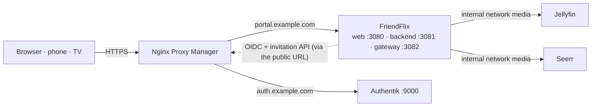

# Setup guide

> **FriendFlix for Plex (preview):** In FriendFlix for Plex, replace the Jellyfin steps (Jellyfin API key, webhook plugin, `JELLYFIN_*` variables) with [plex.md](plex.md) (`MEDIA_SERVER=plex`, `PLEX_URL`, `PLEX_TOKEN`, `compose.plex.yaml`). Everything else (Authentik, proxy, `.env` basics) applies unchanged.

**English** · [Deutsch](de/setup.md)

This guide takes you from an empty server to a running FriendFlix with your first invited friend. It uses the production stack ([`compose.prod.yaml`](../compose.prod.yaml), prebuilt images), Authentik for sign-in and Nginx Proxy Manager (NPM) as the only public entry point.

Placeholders used throughout: `portal.example.com` (FriendFlix), `auth.example.com` (Authentik), `/opt/friendflix` (your clone). Replace them with your own values. Never paste real secrets into issues, chats or commits.

## Contents

1. [Overview and order of steps](#1-overview-and-order-of-steps)
2. [Prerequisites](#2-prerequisites)
3. [Authentik](#3-authentik)
4. [Jellyfin](#4-jellyfin)
5. [Seerr](#5-seerr)
6. [The `.env` file](#6-the-env-file)
7. [Start the stack](#7-start-the-stack)
8. [Nginx Proxy Manager: portal proxy host](#8-nginx-proxy-manager-portal-proxy-host)
9. [First login as admin](#9-first-login-as-admin)
10. [Invite friends](#10-invite-friends)
11. [Optional features](#11-optional-features)
12. [Verification checklist](#12-verification-checklist)
13. [Troubleshooting](#13-troubleshooting)

## 1. Overview and order of steps



For the full picture of containers, networks and ports see [architecture.md](architecture.md#containers-and-networks).

Order matters because each step produces a value the next one needs:

| Step | Produces |
|---|---|
| 2. DNS, Docker, NPM | host names with TLS |
| 3. Authentik | `OIDC_ISSUER`, `OIDC_CLIENT_ID`, `OIDC_CLIENT_SECRET`, `ADMIN_GROUP`, optionally `AUTHENTIK_URL`/`AUTHENTIK_API_TOKEN`/`AUTHENTIK_ENROLL_FLOW` |
| 4. Jellyfin | `JELLYFIN_URL`, `JELLYFIN_ADMIN_API_KEY` |
| 5. Seerr | `SEERR_URL`, `SEERR_API_KEY` |
| 6. `.env` | all secrets |
| 7.–8. stack + NPM | the running portal |
| 9.–10. first login, invites | admin account, friends |

## 2. Prerequisites

**Server.** A Linux host or NAS (e.g. TerraMaster, Synology, Unraid, a mini PC) with:

- Docker Engine and the **Compose v2** plugin (`docker compose version`).
- About 2 GB RAM for FriendFlix (Postgres, Redis, backend, gateway, web) plus 2 GB for Authentik, plus whatever Jellyfin needs for transcoding.
- `git` and `openssl`.
- The time synchronised by NTP (`timedatectl` → *System clock synchronized: yes*). OIDC tokens are rejected when clocks differ by more than 30 s.

**Domains and DNS.** Two host names that point to your public IP (A/AAAA records or a DynDNS name with CNAMEs):

- `portal.example.com` → FriendFlix
- `auth.example.com` → Authentik

Ports 80 and 443 forwarded from the router to NPM. The FriendFlix backend fetches `https://auth.example.com/…` itself; if your router cannot reach its own public IP from inside (no NAT loopback), add local DNS entries (router, Pi-hole, AdGuard) so both names resolve to the NPM host inside the LAN too.

**Nginx Proxy Manager** running ([installation](https://nginxproxymanager.com/setup/)), reachable on 80/443, with an e-mail address set for Let's Encrypt. FriendFlix and Authentik publish their ports on `127.0.0.1` only, so NPM must run on the same host:

- NPM with host networking or installed natively: forward to `127.0.0.1`.
- NPM in a normal bridge container: `127.0.0.1` inside the container is NPM itself. Set `BIND_ADDR` (FriendFlix and Authentik) to the Docker host's bridge address, e.g. `172.17.0.1`, and forward to that address. Never use `0.0.0.0` on a host with a public interface.

**Clone the repository:**

```bash
sudo mkdir -p /opt/friendflix && sudo chown "$USER" /opt/friendflix
git clone https://github.com/LetsManu/friendflix.git /opt/friendflix
cd /opt/friendflix
```

## 3. Authentik

Follow **[docs/authentik.md](authentik.md)**. In short:

1. Install Authentik (`compose.authentik.yaml` or the official compose file), add the NPM proxy host `auth.example.com`, create the admin account, optionally SMTP.
2. Import [`deploy/authentik/friendflix-blueprint.yaml`](../deploy/authentik/friendflix-blueprint.yaml) (enrollment flow + service account + API token).
3. Create the groups `friendflix-admins` (put yourself in it) and optionally `friendflix-users`.
4. Create the OAuth2/OpenID provider and the application with slug `friendflix`, redirect URI `https://portal.example.com/auth/callback`.
5. Make MFA mandatory in the authentication flow.
6. Note the client ID, client secret and API token for step 6.

## 4. Jellyfin

FriendFlix talks to Jellyfin over the internal Docker network `friendflix_media`; Jellyfin is never exposed publicly.

**A) Existing Jellyfin** (own container or stack): create the API key below in its normal web UI. After the FriendFlix stack has been started once ([step 7](#7-start-the-stack) creates the network `friendflix_media`), attach the container:

```bash
docker network connect friendflix_media <jellyfin-container>
docker compose -f compose.prod.yaml restart backend gateway
```

`JELLYFIN_URL=http://<jellyfin-container-name>:8096`. A `docker network connect` does not survive re-creating the Jellyfin container; to make it permanent, add `friendflix_media` as an `external: true` network in Jellyfin's own compose file. Remove Jellyfin's public port mapping and any public proxy host for it once FriendFlix works (or at least firewall it, see [operations.md](operations.md#host-firewall-zusätzlich-zum-fehlenden-port-mapping)).
If Jellyfin runs natively on the host (not in Docker), the backend cannot reach `localhost`; use a Docker container or attach Jellyfin via the host bridge IP *(not covered by the shipped compose files)*.

**B) Bundled Jellyfin** (`--profile bundled`): the containers `jellyfin` and `seerr` start inside the stack with no ports at all. Compose checks all required variables even when you start single services, so create `.env` first ([step 6](#6-the-env-file)) and put a placeholder such as `pending` into `JELLYFIN_ADMIN_API_KEY` and `SEERR_API_KEY`. For the one-time setup wizards publish both services temporarily on loopback with a local override file (do not commit it):

```yaml
# compose.setup.yaml - TEMPORARY, remove after the setup wizards
services:
  jellyfin:
    ports: ["127.0.0.1:8096:8096"]
    networks: [media, egress, front]
  seerr:
    ports: ["127.0.0.1:5055:5055"]
    networks: [media, egress, front]
```

```bash
MEDIA_PATH=/mnt/data/media docker compose -f compose.prod.yaml -f compose.setup.yaml --profile bundled up -d jellyfin seerr
ssh -L 8096:127.0.0.1:8096 -L 5055:127.0.0.1:5055 you@server     # from your PC; then open http://localhost:8096
```

(`MEDIA_PATH` can also go into `.env`; it is mounted read-only at `/media` in Jellyfin.) Finish the wizards, then start again without `compose.setup.yaml` so the ports disappear. `JELLYFIN_URL=http://jellyfin:8096`.

**In Jellyfin:**

1. Finish the setup wizard: admin user, metadata language, libraries (Movies, Shows …). Library names matter only if you restrict roles to certain libraries (`ROLE_TEMPLATES`).
2. *Dashboard → API Keys* (in newer versions under *Dashboard → Advanced → API Keys*) → **+** → app name `FriendFlix` → copy the key → `JELLYFIN_ADMIN_API_KEY`. The key acts as admin: FriendFlix uses it to create one Jellyfin user per portal user (random password, stored encrypted with `APP_ENC_KEY`) and to apply the role policies.
3. Optional: the webhook plugin for instant "now playing" and "new in library" events, see [integrations.md](integrations.md#jellyfin-webhook-plugin-optional-polling-sessions-every-10-s-is-the-fallback).
4. Hardware transcoding as usual for your hardware (Intel QSV/VAAPI: see the note on "VPP Tone mapping" in the README).

## 5. Seerr

1. Open Seerr (existing instance, or `http://localhost:5055` through the tunnel above) and finish the wizard with **Jellyfin** as media server: URL `http://jellyfin:8096` (bundled) or your container name, plus a Jellyfin admin login. Sync libraries, add Radarr/Sonarr if you use them.
2. *Settings → General* → copy the **API Key** → `SEERR_API_KEY`. `SEERR_URL=http://seerr:5055` (bundled) or `http://<seerr-container>:5055` after `docker network connect friendflix_media <seerr-container>`.
3. *Settings → Users*: turn off automatic Jellyfin user import (FriendFlix profiles are hidden Jellyfin users and would show up otherwise). Leave auto-approve off if you want to approve every request.
4. Webhook for "request approved/available": see [integrations.md](integrations.md#seerr).

## 6. The `.env` file

```bash
cp .env.example .env
chmod 600 .env
```

Generate every secret separately; do not reuse a value for two variables. Use **hex** for the database and Redis passwords: they are embedded in connection URLs, where `/`, `+` and `=` from base64 would break.

| Variable | Required | Value / how to generate |
|---|---|---|
| `PUBLIC_URL` | yes | `https://portal.example.com`, no trailing path. Must be exactly the URL people use (cookies, redirect URI, WebSocket origin check). |
| `BIND_ADDR` | – | `127.0.0.1` (default) or the Docker bridge IP if NPM runs in a bridge container |
| `WEB_PORT`, `BACKEND_PORT`, `GATEWAY_PORT` | – | `3080`, `3081`, `3082` (defaults); change only if taken |
| `POSTGRES_PASSWORD` | yes | `openssl rand -hex 24` |
| `REDIS_PASSWORD` | yes | `openssl rand -hex 24` |
| `APP_ENC_KEY` | yes | `openssl rand -base64 32` (44 characters). Encrypts the stored Jellyfin credentials. **Store it in your password manager**; without it a restored database is useless. |
| `INTERNAL_SECRET` | yes | `openssl rand -hex 24` (min. 16 characters); backend ↔ gateway |
| `WEBHOOK_SECRET` | yes | `openssl rand -hex 24`; Jellyfin/Seerr webhooks |
| `OIDC_ISSUER` | yes | `https://auth.example.com/application/o/friendflix/` **with trailing slash** |
| `OIDC_CLIENT_ID`, `OIDC_CLIENT_SECRET` | yes | from the Authentik provider |
| `ADMIN_GROUP` | – | `friendflix-admins` (default); Authentik group name, case-sensitive |
| `JELLYFIN_URL` | yes | `http://jellyfin:8096` (internal name, never the public URL) |
| `JELLYFIN_ADMIN_API_KEY` | yes | from step 4 |
| `SEERR_URL` | yes | `http://seerr:5055` |
| `SEERR_API_KEY` | yes | from step 5 |
| `AUTHENTIK_URL`, `AUTHENTIK_API_TOKEN`, `AUTHENTIK_ENROLL_FLOW` | recommended | `https://auth.example.com`, the token key, `friendflix-enrollment`; all three or none ([authentik.md §9](authentik.md#9-friendflix-env-values)) |
| `SESSION_TTL_SECONDS`, `SESSION_IDLE_SECONDS` | – | `28800` (8 h absolute), `7200` (2 h idle) |
| `TZ` | – | e.g. `Europe/Vienna`; schedules (digest, playback check, backups) |
| `METRICS_TOKEN` | – | `openssl rand -hex 24` if you scrape `/metrics` ([monitoring.md](monitoring.md)) |
| `FF_REGISTRY`, `FF_TAG` | – | `ghcr.io/letsmanu`, `latest`; pin a version with a commit SHA or `x.y.z` |

Everything else (downloads, push, ntfy, Portainer, backups) is optional and described in [section 11](#11-optional-features) and in the [README configuration table](../README.md#configuration).

A quick way to fill the secrets:

```bash
for v in POSTGRES_PASSWORD REDIS_PASSWORD INTERNAL_SECRET WEBHOOK_SECRET; do
  sed -i "s|^$v=.*|$v=$(openssl rand -hex 24)|" .env
done
sed -i "s|^APP_ENC_KEY=.*|APP_ENC_KEY=$(openssl rand -base64 32)|" .env
grep -E '^(POSTGRES_PASSWORD|REDIS_PASSWORD|APP_ENC_KEY|INTERNAL_SECRET|WEBHOOK_SECRET)=' .env | cut -c1-24   # check, without printing whole secrets
```

Then fill in the URLs and the keys from Authentik, Jellyfin and Seerr by hand.

**Docker secrets instead of `.env`** (optional): [`compose.secrets.yaml`](../compose.secrets.yaml) reads `APP_ENC_KEY`, `INTERNAL_SECRET`, `WEBHOOK_SECRET`, `OIDC_CLIENT_SECRET`, `JELLYFIN_ADMIN_API_KEY`, `SEERR_API_KEY` and `VAPID_PRIVATE_KEY` from files in `secrets/` (all must exist; `touch secrets/vapid_private_key` if you have no push). Start with `docker compose -f compose.prod.yaml -f compose.secrets.yaml up -d`.

## 7. Start the stack

```bash
docker login ghcr.io -u <github-user>                   # only if the packages are private (PAT with read:packages)
docker compose -f compose.prod.yaml up -d               # add --profile bundled for the bundled Jellyfin + Seerr
docker compose -f compose.prod.yaml ps                  # postgres/redis healthy, backend/gateway/web running
docker compose -f compose.prod.yaml logs -f backend     # migrations, then "Server listening"
curl -s http://127.0.0.1:3081/health/ready              # Postgres, Redis and Jellyfin reachable
```

If the backend restarts in a loop, read the first error in its log: a missing or invalid variable (the config check names it), or OIDC discovery failing (see [troubleshooting](#13-troubleshooting)).

## 8. Nginx Proxy Manager: portal proxy host

*Hosts → Proxy Hosts → Add Proxy Host*:

| Tab | Field | Value |
|---|---|---|
| Details | Domain Names | `portal.example.com` |
| | Scheme | `http` |
| | Forward Hostname / IP | `127.0.0.1` (or your `BIND_ADDR`) |
| | Forward Port | `3080` (`WEB_PORT`, the SvelteKit UI) |
| | Cache Assets | off |
| | Block Common Exploits | on |
| | Websockets Support | **on** |
| SSL | SSL Certificate | Request a new Let's Encrypt certificate |
| | Force SSL, HTTP/2 Support, HSTS Enabled | on |
| Advanced | Custom Nginx Configuration | the full content of [`deploy/npm/portal.advanced.conf`](../deploy/npm/portal.advanced.conf) |

The advanced config routes `/api/`, `/auth/` and `/ws/` to the backend (`:3081`), `/media/` to the gateway (`:3082`, unbuffered, with HTTP range), keeps `/media/c/` (Chromecast tokens) out of the logs, and answers `/internal/`, `/metrics` and `/health/ready` with 404. If you changed `BIND_ADDR` or the ports, replace `127.0.0.1:3081`/`:3082` in the pasted text accordingly. Keep the `/media/c/` block even if you do not use Chromecast.

The backend trusts `X-Forwarded-*` headers (`trustProxy`), so NPM must be the only way in: the ports stay on `BIND_ADDR`.

## 9. First login as admin

1. Open `https://portal.example.com` and click sign in. Authentik asks for username, password and, the first time, makes you set up TOTP or a passkey.
2. Because you are in `friendflix-admins` (`ADMIN_GROUP`), FriendFlix creates your account with the role **admin** without an invite, plus a Jellyfin user and your owner profile. Your first device is approved automatically; further devices have to be approved under *Devices*.
3. **Instance language:** FriendFlix asks the first admin once which language the whole instance should use by default (English, German, French, Spanish, Italian, Turkish, Polish). Every profile can pick its own language later; new profiles are asked on their first login, with the browser language suggested.
4. Look around *Admin*: the **overview** (health of the media server and the request service, what waits for your decision, recent activity), roles and limits, the weekly digest. Under *Content* you can add **brand hubs**, pin themed lists to the home page and set "leaving soon" dates; the owner profile can create kids profiles under *Profiles*.

## 10. Invite friends

*Admin → Invitations*:

1. Choose the role (`friend`, `family` or `guest`; limits are editable under *Admin*), how long the link is valid (default 48 h, max. 14 days) and an optional note.
2. Leave **already has an Authentik account** unticked for new people. Create.
3. The one-time link is shown only now. The text below it must read *The link guides through account creation (including two-factor) and grants access directly.* Otherwise the Authentik invitation is not configured; see [authentik.md §15](authentik.md#15-troubleshooting).
4. Send the link. The friend opens it, clicks **Create account & get started**, signs up in Authentik (including MFA) and lands logged in on the portal.

For someone who already has an Authentik account, tick **already has an Authentik account**: the link then offers **Sign in & unlock**. Unused invites can be revoked in the list; that also deletes the Authentik invitation.

## 11. Optional features

| Feature | What to do | Details |
|---|---|---|
| **Offline downloads** | On by default (`DOWNLOADS_ENABLED=true`). For a dedicated disk: `mkdir -p /mnt/data/friendflix/downloads /mnt/data/friendflix/previews && chown 1000:1000 /mnt/data/friendflix/{downloads,previews}`, then `DOWNLOADS_PATH=…`, `PREVIEWS_PATH=…`. Create and `chown` the folders **before** starting, otherwise Docker creates them as root and the backend logs `EACCES`. Allow downloads per role under *Admin*. | [downloads.md](downloads.md) |
| **Web push** | `node scripts/gen-vapid.mjs` (or `npx web-push generate-vapid-keys`) → `VAPID_PUBLIC_KEY`, `VAPID_PRIVATE_KEY`, optional `VAPID_SUBJECT=mailto:you@example.com`. Keep the pair stable. Needs HTTPS; on iOS the site must be added to the home screen. | [integrations.md](integrations.md#web-push-browser-notifications) |
| **ntfy / Discord** | `NTFY_URL=https://ntfy.example.com/friendflix` and/or `DISCORD_WEBHOOK_URL=…` for the shared channel; `NTFY_BASE_URL` for personal topics. | [integrations.md](integrations.md#ntfy--discord) |
| **Chromecast** | On by default (`CAST_ENABLED=true`). Needs an https `PUBLIC_URL` with a publicly valid certificate that the Chromecast can reach, and the `/media/c/` block from `portal.advanced.conf`. | [cast.md](cast.md) |
| **TV mode** | Nothing to configure: open `https://portal.example.com/tv` on the TV and pair it with the phone. | [tv-mode.md](tv-mode.md) |
| **Database backups** | `mkdir -p backups && sudo chown 70 backups`, then `docker compose -f compose.prod.yaml --profile backup up -d backup` (`BACKUP_HOUR`, `BACKUP_KEEP_DAYS`, `BACKUP_PATH`). Back up Authentik separately ([authentik.md §2.6](authentik.md#26-backups-and-updates)) and keep `APP_ENC_KEY` in a password manager. | [operations.md](operations.md#backups--wiederherstellung) |
| **One-click updates** | *Admin → Update* redeploys through **Portainer**: either `PORTAINER_WEBHOOK_URL` (stack webhook), or `PORTAINER_URL` + `PORTAINER_API_KEY` + `PORTAINER_STACK_ID` (+ `PORTAINER_ENDPOINT_ID`, default `1`). Use a Portainer user that can only redeploy this one stack. FriendFlix deliberately never gets the Docker socket: **do not mount `/var/run/docker.sock` into any FriendFlix container**, the web app must not be able to control Docker. | [operations.md](operations.md#updates-aus-dem-portal) |
| **Monitoring** | `METRICS_TOKEN`, Prometheus/Icinga examples; optional Prometheus + Grafana stack: set `GRAFANA_ADMIN_PASSWORD` (no default) and add `-f compose.monitoring.yaml`. | [monitoring.md](monitoring.md) |
| **Plan B** | NPM serves `/media/` itself (`auth_request`); then `DOWNLOADS_ENABLED=false`, `CAST_ENABLED=false`. | [operations.md](operations.md#plan-b-npm-liefert-media-direkt-auth_request) |

After changing `.env`: `docker compose -f compose.prod.yaml up -d` (recreates only what changed).

## 12. Verification checklist

- [ ] `docker compose -f compose.prod.yaml ps`: all services up, `postgres`/`redis` (and `backup`) healthy.
- [ ] `curl -s http://127.0.0.1:3081/health/ready` reports Postgres, Redis and Jellyfin OK.
- [ ] `curl -sI https://portal.example.com` → `200`, valid certificate, `strict-transport-security` header.
- [ ] `curl -s -o /dev/null -w '%{http_code}\n' https://portal.example.com/internal/x` → `404`; same for `/metrics`.
- [ ] From outside your network: `nmap -p 3080-3082,8096,5055,9000 <public-ip>` → all filtered/closed.
- [ ] `curl -s https://auth.example.com/application/o/friendflix/.well-known/openid-configuration | jq -r .issuer` equals `OIDC_ISSUER`.
- [ ] Admin login works, MFA is requested, *Admin* is visible.
- [ ] A test invite in a private window ends logged in on the portal; the user appears in *Admin → Users* and in Jellyfin.
- [ ] A movie plays (direct play and a forced lower quality → transcoding), subtitles work, seeking works.
- [ ] Optional: push test notification, a download, casting, a backup file in `backups/`.

## 13. Troubleshooting

| Symptom | Cause / fix |
|---|---|
| Authentik shows a redirect URI error | The provider's redirect URI must be exactly `${PUBLIC_URL}/auth/callback` (scheme, host, no trailing slash). FriendFlix must run at the root of its host name. |
| Backend restart loop, `"issuer" property does not match the expected value` | `OIDC_ISSUER` needs the trailing slash and the exact application slug. |
| Backend restart loop, `fetch failed` / `ENOTFOUND` at start | The backend container cannot reach `auth.example.com`: DNS inside the LAN, NAT loopback, firewall. Test with `docker compose -f compose.prod.yaml run --rm --no-deps backend node -e "fetch('https://auth.example.com').then(r=>console.log(r.status))"`. As a workaround, a local override can add `extra_hosts: ["auth.example.com:host-gateway"]` to `backend` when NPM listens on the host's port 443. |
| Backend refuses an `http://` issuer | `openid-client` only accepts https. `OIDC_ALLOW_INSECURE=true` is for development against a local Authentik, never for production. |
| `{"error":"login_failed"}` after Authentik | Wrong client secret, an encryption key set on the provider, or clock skew > 30 s between the hosts (enable NTP). The backend log line `oidc callback failed` has the reason. |
| `{"error":"invalid_state"}` | The login was started on another address than `PUBLIC_URL` (LAN IP, `http://`), the browser blocked the cookie, or the login took longer than 10 minutes. Always use `PUBLIC_URL`. |
| Login loops back to the start page / not logged in | `PUBLIC_URL` is `https://…` but the site was opened via `http://` or an IP: the session cookie is `Secure` and only valid on that host. Enable *Force SSL* in NPM. |
| `403 {"error":"csrf"}` on actions | Stale page after a new login in another tab: reload. Persistent: NPM must forward `/api/` to the backend unchanged (use `portal.advanced.conf`), and no cache in between may strip headers. |
| Watch party / remote control does not connect (WebSocket closes with 4401) | The browser's `Origin` must equal `PUBLIC_URL`; *Websockets Support* on and the `/ws/` block present in NPM. |
| `{"error":"no_invite"}` | First login without an invite and not in `ADMIN_GROUP`. See [authentik.md §15](authentik.md#15-troubleshooting). |
| 502 Bad Gateway from NPM for the whole site | NPM cannot reach `BIND_ADDR:3080/3081/3082`: wrong forward IP (bridge container → Docker host IP), containers not running, or `BIND_ADDR` differs from the IP in the proxy host/advanced config. |
| 502/504 for `/media/…` only, or "Jellyfin unreachable" in *Admin → Status* | The gateway/backend cannot reach `JELLYFIN_URL`: Jellyfin not attached to `friendflix_media` (`docker network connect friendflix_media <jellyfin>`), wrong container name, or Jellyfin down. Check `docker compose -f compose.prod.yaml exec gateway node -e "fetch(process.env.JELLYFIN_URL+'/System/Info/Public').then(r=>console.log(r.status))"`. |
| Downloads fail with `EACCES` | `DOWNLOADS_PATH`/`PREVIEWS_PATH` not owned by uid 1000: `chown 1000:1000 <folder>`. |
| Backup container `unhealthy` | `docker compose -f compose.prod.yaml logs backup`; usually `backups/` not writable by uid 70. |

More: [operations.md](operations.md) (backups, firewall, updates), [integrations.md](integrations.md) (webhooks, push), [authentik.md](authentik.md#15-troubleshooting) (sign-in and invitations).
